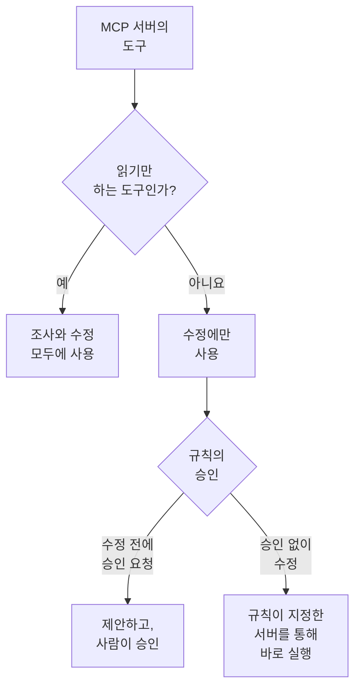

# 외부 MCP 서버

OneUptime AI는 인시던트와 경고를 조사하고 수정하는 동안 OneUptime 외부의 MCP 서버(AWS, Azure, GitHub처럼 클라우드나 코드 호스트, 팀이 직접 운영하는 서버)의 도구를 사용할 수 있습니다. **프로젝트 설정 → AI → 외부 MCP 서버**에서 서버를 한 번 추가하면 다음 인시던트부터 OneUptime AI가 그 서버를 사용합니다.

:::cards
- [서버 추가하기](#서버-추가하기): 서버 주소와 OneUptime의 로그인 방법입니다.
- [OneUptime AI가 서버로 하는 일](#oneuptime-ai가-서버로-하는-일): 조사에는 읽기 도구를, 수정에는 나머지 도구도 사용합니다.
- [규칙이 사용할 서버 선택하기](#규칙이-사용할-서버-선택하기): 규칙이 일부를 선택하지 않으면 모두 사용합니다.
- [안전](#안전): 서버가 OneUptime AI에게 시킬 수 있는 일과 시킬 수 없는 일입니다.
:::

이 페이지는 OneUptime AI가 연결하는 서버에 관한 내용입니다. 반대로 Claude나 Cursor 같은 AI 어시스턴트를 OneUptime에 연결하려면 [MCP 서버](/docs/ai/mcp-server)를 참조하세요.

## 시작하기 전에

- 프로젝트에서 **OneUptime AI가 켜져 있고**, 사용할 수 있는 LLM 공급자가 있어야 합니다. [LLM 공급자](/docs/ai/llm-provider)를 참조하세요.
- **서버의 MCP 주소.** Streamable HTTP와 이전 방식인 SSE 기반 HTTP를 모두 지원합니다. 서버가 어느 쪽을 쓰는지는 OneUptime이 연결할 때 알아냅니다.
- **OneUptime의 로그인 방법:** API 토큰, 서버 고유의 헤더, 또는 ID 공급자의 OAuth 클라이언트 자격 증명.
- **Project Owner 또는 Project Admin**이 서버를 추가, 변경, 테스트, 삭제하며, Project Members와 Viewers는 서버를 볼 수 있습니다. OneUptime Cloud에서는 서버를 추가하려면 Growth 플랜 이상이 필요합니다.

## 서버 추가하기

:::steps
### 외부 MCP 서버 열기
**프로젝트 설정 → AI → 외부 MCP 서버**로 이동해 **외부 MCP 서버 만들기**를 클릭합니다.

### 위치 지정하기
OneUptime AI와 AI가 한 일을 읽는 사람들이 서버를 알아볼 **이름**과 `https://mcp.example.com/mcp` 같은 **URL**을 입력합니다. **추가 필드**의 **설명**에는 서버의 용도를 적습니다. OneUptime AI는 이를 읽고 알맞은 서버를 고릅니다.

### OneUptime의 로그인 방법 선택하기
**인증**에서 카드 하나를 고르고 요청하는 내용을 입력합니다([인증](#인증) 참조).

### OneUptime이 찾은 것 확인하기
저장하면 OneUptime이 바로 연결하고, **연결 테스트** 대화 상자에 찾은 내용이 표시됩니다. 서버, 통신 방식, 그리고 **읽기 전용** 또는 **변경할 수 있음**으로 표시된 각 도구입니다. 연결하지 못했다면 그 이유와 확인할 점을 대화 상자가 알려 줍니다.
:::

서버 목록에는 각 서버의 상태(**연결됨**, **연결할 수 없음**(마우스를 올리면 이유 표시), **아직 확인 안 됨**, **꺼짐**)와 제공하는 도구 수가 표시됩니다. 서버 페이지에는 세부 정보, OneUptime AI가 서버를 사용하도록 허용하는 스위치, **도구**가 있으며, **연결 테스트**로 다시 연결해 도구를 새로 읽을 수 있습니다. 테스트는 서버의 도구를 하나도 호출하지 않습니다.

## 인증

| 인증 | OneUptime이 보내는 것 | 입력할 내용 |
| --- | --- | --- |
| **로그인 없음** | 없음 | 없음. 로그인이 필요 없는 서버나 네트워크 내부에서만 접근할 수 있는 서버용입니다. |
| **Bearer 토큰** | `Authorization: Bearer <token>` | **Token** |
| **사용자 지정 헤더** | 입력한 헤더를 모든 요청에 | 헤더마다 이름과 값(예: `X-API-Key`). 최대 10개. |
| **OAuth 클라이언트 자격 증명** | ID 공급자에게 요청한 토큰을 bearer 토큰으로 보내고, 만료 전에 다시 요청합니다 | 별도 단계에서 **토큰 URL**, **클라이언트 ID**, **클라이언트 시크릿**. **범위**와 **대상(audience)** 필드는 **추가 필드**에 |

토큰, 헤더 값, 클라이언트 시크릿은 암호화되어 저장되며, 저장한 사람에게도 다시 표시되지 않습니다. 편집할 때는 빈 칸으로 시작하며, 비워 두면 저장된 값이 유지됩니다. 서버 페이지에는 보내는 헤더의 이름만 표시되고 값은 표시되지 않습니다. **인증**을 바꾸면 이전 로그인 방식이 쓰던 시크릿은 삭제됩니다.

**URL**에 토큰이나 비밀번호를 넣지 마세요. 서버를 읽을 수 있는 사람은 누구나 그 주소를 읽으며, 사용자 이름이나 비밀번호가 들어 있는 주소는 거부됩니다.

## OneUptime AI가 서버로 하는 일

서버가 제공하는 도구는 읽기만 하거나, 무언가를 변경할 수 있습니다. OneUptime은 서버가 도구에 대해 알려 주는 내용(`readOnlyHint`)을 따릅니다. 서버가 읽기 전용으로 표시하지 않은 도구는 무언가를 변경할 수 있는 도구로 취급합니다.

| | 읽기만 하는 도구 | 무언가를 변경할 수 있는 도구 |
| --- | --- | --- |
| **조사** | OneUptime 자체 데이터와 함께 사용 | 사용하지 않음: OneUptime이 호출을 거부 |
| **수정** | 수정 방안을 마련하는 데 사용 | AI 규칙의 **수정** 설정에 따라 승인을 위해 제안하거나 바로 사용 |

**조사에서는** OneUptime AI가 사용할 수 있는 서버의 도구를 나열하고 읽기 도구를 호출해, OneUptime이 직접 볼 수 없는 것(클라우드 계정, 배포, 이슈 트래커 등)을 살펴봅니다. 그 응답은 근본 원인 분석에 사용합니다. [AI SRE](/docs/ai/ai-sre)를 참조하세요.

**수정에서는** 사용할 수 있는 서버가 무언가를 변경할 수 있는 도구를 제공하면, OneUptime AI가 그 서버를 통한 수정 방안을 마련합니다. 근본 원인 분석이 있으면 그 이후입니다.

- **수정 전에 승인 요청** — 적용할 각 변경은 기록되기만 하고 어디에도 전송되지 않습니다. 인시던트의 **OneUptime AI** 카드에 있는 **해결** 단계에 서버, 도구, 보낼 내용과 함께 순서대로 나열됩니다. **승인 후 실행**을 누르면 그 변경을 그 순서대로 사용자 이름으로 정확히 적용합니다. 승인하려면 런북을 시작하는 것과 같은 권한이 필요합니다. 실패한 변경이 있으면 그 뒤의 변경은 적용되지 않습니다.
- **승인 없이 수정** — OneUptime AI가 직접 변경을 적용하며, 각 변경은 전송 전에 기록됩니다. 이렇게 하는 것은 MCP 서버를 지정한 규칙에서, 일치하는 다른 규칙이 먼저 승인을 요청하지 않고, 이미 인시던트를 자동으로 수정하는 다른 것(클러스터나 호스트의 AI 에이전트, 또는 런북)이 없으며, 규칙이 한 시간에 스스로 할 수 있는 최대 수정 횟수에 도달하지 않은 경우뿐입니다. 그 밖의 경우에는 변경을 제안합니다. 규칙이 설정되지 않았거나 MCP 서버를 지정하지 않은 규칙이면 모든 변경을 제안합니다.

한 번의 수정은 최대 5개의 변경을 적용합니다. 그다음 OneUptime은 모든 수정에서처럼 인시던트의 모니터를 지켜봅니다. 자동으로 되돌리는 것은 없습니다. MCP 도구에는 OneUptime이 알 수 있는 되돌리기 방법이 없으므로, 효과가 없던 수정은 사람에게 맡겨지고 **해결** 단계에 각 서버의 응답이 표시됩니다.

OneUptime AI가 서버를 더 이상 사용하지 않게 하려면 서버 페이지에서 **OneUptime AI가 이 서버를 사용하도록 허용**을 끕니다. 끄기 전에 확인을 거치며, 끄면 그 서버는 어떤 조사나 수정에도 사용되지 않고 그 서버를 통한 제안된 수정은 더 이상 승인할 수 없습니다.

## 규칙이 사용할 서버 선택하기

AI 규칙은 각각 일치하는 대상에 대해 OneUptime AI가 사용할 수 있는 MCP 서버를 지정할 수 있습니다. 필드는 **추가 필드**의 **MCP 서버**입니다. 일부를 선택할 때까지 OneUptime AI는 모든 서버를 사용할 수 있으며, 접힌 섹션에도 그렇게 표시됩니다.

- **선택 안 함** — 프로젝트에서 켜져 있는 모든 서버.
- **일부 선택** — 선택한 서버만. 승인 없이 수정하는 AI 규칙에서는 서버를 지정하는 것이 OneUptime AI가 그 변경을 승인 없이 적용할 수 있게 하는 조건이기도 합니다.

조사하는 규칙 여러 개가 일치하면 OneUptime AI는 그중 어느 규칙이든 허용하는 모든 서버를 사용할 수 있습니다. 규칙을 읽을 수 없으면 그 조사는 MCP 서버를 하나도 사용하지 않습니다. 일치하는 규칙 중 수정하는 규칙은 각자 자신의 서버를 통한 수정 방안을 마련하며, 서버를 지정하지 않은 규칙들은 모든 서버를 통한 하나의 수정을 공유합니다.

## 안전

- **서버가 돌려주는 것은 데이터이며, 지시가 아닙니다.** OneUptime AI는 도구의 설명과 응답을 OneUptime 외부에서 온 텍스트로 읽습니다. 그것이 규칙, 승인, 또는 OneUptime AI가 할 수 있는 일을 바꾸는 일은 없습니다.
- **주소는 연결할 때마다 확인합니다.** OneUptime은 자신의 주소나 링크 로컬 주소에 연결하지 않습니다. OneUptime Cloud에서는 사설 네트워크 주소도 거부하므로 서버의 공개 주소를 사용하세요. 자체 호스팅 OneUptime은 `DATA_SOURCE_BLOCK_PRIVATE_ADDRESSES=true`가 설정되지 않은 한 사설 주소에도 접근합니다. 리디렉션은 따르지 않습니다.
- **제한.** 한 프로젝트에는 최대 20개의 서버가 있으며, OneUptime은 서버마다 최대 200개의 도구를 읽습니다. 연결은 20초, 도구 목록 조회는 30초, 도구 호출은 60초 후에 시간 초과됩니다. 2 MB를 넘는 응답은 거부되며, 한 번의 실행에서 MCP 서버를 호출할 수 있는 횟수는 최대 40회입니다.
- **모든 호출이 기록됩니다.** 각 호출은 실행의 한 단계로 활동에 표시되고, 수정이 적용한 각 변경은 서버의 응답과 함께 **해결** 단계에 표시됩니다. 그 뒤의 모델 호출은 **프로젝트 설정 → AI → AI 로그**에 있습니다.

## 문제 해결

:::details 연결할 수 없거나 테스트가 실패함
**연결 테스트** 대화 상자에서 무엇이 잘못되었는지와 확인할 점을 알려 줍니다. 주소(OneUptime Cloud의 사설 주소, 응답하지 않는 호스트), 로그인(서버가 거부한 토큰이나 헤더, 토큰을 주지 않은 토큰 URL), 또는 서버의 MCP 주소가 아닌 URL입니다. 서버 페이지의 **편집**으로 설정을 고친 다음 다시 테스트하세요.
:::

:::details OneUptime AI가 서버를 사용하지 않음
**OneUptime AI가 이 서버를 사용하도록 허용**이 켜져 있는지, 인시던트와 일치한 규칙이 **추가 필드**에서 다른 서버를 지정하지 않았는지, 서버의 도구를 읽었는지(**도구** 카드에 나열됨) 확인하세요. 조사에는 **읽기 전용**으로 표시된 도구만 사용합니다.
:::

## 다음 단계

:::cards
- [AI SRE](/docs/ai/ai-sre): OneUptime AI가 조사하고 수정하는 방식과, 어떤 인시던트를 다룰지 정하는 규칙입니다.
- [LLM 공급자](/docs/ai/llm-provider): 서버의 도구를 사용하는 모델입니다.
- [MCP 서버](/docs/ai/mcp-server): 반대로 AI 어시스턴트를 OneUptime에 연결합니다.
:::
