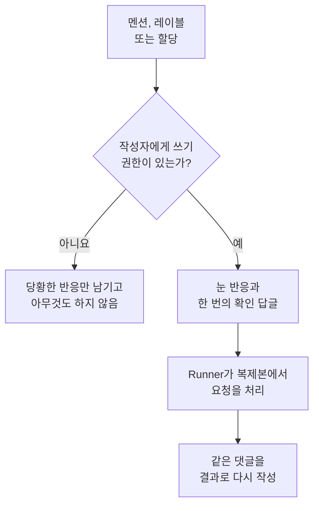

# GitHub App

OneUptime GitHub App은 코드와의 단순한 연결 그 이상입니다. 저장소 안에서 앱에 말을 걸면 그곳에서 작업합니다. 이슈에서 멘션하면 풀 리퀘스트를 열고, 풀 리퀘스트에서 멘션하면 브랜치를 수정하거나 diff를 리뷰합니다. 앱이 만드는 모든 것은 사람이 읽을 풀 리퀘스트나 리뷰입니다. **절대 아무것도 병합하지 않으며, 풀 리퀘스트를 승인하지도 않습니다.**

:::cards
- [명령](#명령): 이슈나 풀 리퀘스트에 무엇을 쓸지 설명합니다.
- [스레드에서 보이는 모습](#스레드에서-보이는-모습): 작업을 따라가는 댓글 하나입니다.
- [프로덕션 컨텍스트를 담은 리뷰](#프로덕션-컨텍스트를-담은-리뷰): 변경된 코드에 대해 프로덕션이 알려 주는 것입니다.
- [명령할 수 있는 사람](#명령할-수-있는-사람): 쓰기 권한이 있는 사람만 가능합니다.
- [문제 해결](#문제-해결): 멘션해도 아무 일이 없을 때 확인합니다.
:::

```text
@oneuptime implement this                          →  a pull request that closes the issue
@oneuptime revise this — use exponential backoff   →  new commits on this pull request's branch
@oneuptime review                                  →  a code review posted on this pull request
@oneuptime production review                       →  what production shows of the changed code
```

> [!NOTE]
> `@oneuptime` 을 여러분 앱의 핸들로 바꾸세요. OneUptime Cloud에서는 `@oneuptime` 입니다. 자체 호스팅 인스턴스에서는 GitHub App에 붙인 이름을 소문자로 바꾸고 공백을 하이픈으로 바꾼 것입니다. 예를 들어 "Acme AI" 라는 앱은 `@acme-ai` 로 멘션합니다. 멘션해도 아무 일이 없다면 이것부터 확인하세요.

## 동작 방식



[코드](/docs/ai/ai-agent)와 같은 에이전트, 같은 Runner, 같은 예산을 사용하며 트리거만 다릅니다.

## 시작하기 전에

- 저장소는 GitHub App을 통해 **OneUptime 프로젝트에 연결되어** 있어야 합니다. **제품 → 코드** 에서 연결합니다. 자체 호스팅 인스턴스에는 먼저 자체 GitHub App이 필요합니다. [GitHub 통합](/docs/self-hosted/github-integration)을 참조하세요. GitHub 계정에 앱이 이미 설치되어 있다면, 다시 설치하는 대신 그곳에서 **기존 설치 연결**을 클릭하세요.
- 코드에서 저장소 설정으로 선택한 Runner(아무것도 선택하지 않은 저장소는 글로벌 Runner)가 온라인이어야 합니다. [코드](/docs/ai/ai-agent)의 작업을 수행하는 것과 같은 Runner입니다. Runner가 없으면 명령은 접수된 뒤 30분 후에 어떤 Runner도 가져가지 않았다는 메시지와 함께 실패합니다.
- GitHub App에는 **Read & write** 수준의 **Issues** 권한이 필요하며, [구독할 이벤트](#구독할-이벤트)에 나열된 웹훅 이벤트를 구독해야 합니다.

## 명령

모든 명령은 앱 멘션으로 시작합니다. 멘션은 댓글 어디에 있어도 되며, 멘션 뒤에 쓴 내용은 요청으로 전달됩니다. 이미 앱을 멘션한 댓글을 수정해도 앱은 다시 실행되지 않습니다. 요청을 바꾸려면 새 댓글을 작성하세요. 멘션을 추가하는 수정은 새 요청입니다.

### 풀 리퀘스트에서

| 명령 | 동작 | 함께 인식되는 표현 |
| --- | --- | --- |
| `@oneuptime review` | 브랜치를 복제하고, 변경된 코드와 그 주변 코드를 읽고, 그 코드에 대해 프로덕션이 알려 주는 것을 확인한 뒤, 리뷰를 댓글로 게시합니다. 아무것도 바꾸지 않습니다. | `code review`, `please review`, `can you review`, `review this` |
| `@oneuptime production review` | 누가 열었든 지금 바로 풀 리퀘스트를 프로덕션 기준으로 리뷰합니다. 변경된 코드 주변의 예외, 작업, 인시던트, 배포를 그 자리에서 수정되는 댓글 하나에 담습니다([풀 리퀘스트의 프로덕션 리뷰](/docs/ai/ai-agent#풀-리퀘스트의-프로덕션-리뷰) 참조). 아무것도 복제하지 않고 아무것도 실행하지 않습니다. | `review against production`, `review production`, `check production` |
| `@oneuptime revise this — <what you want changed>` | 풀 리퀘스트 자체의 브랜치를 복제하고, 변경을 만든 뒤 그 브랜치에 새 커밋을 푸시합니다. 두 번째 풀 리퀘스트는 절대 열지 않습니다. | `revise`, `please revise`, `rework`, `redo` |

멘션 뒤에 쓴 내용 중 알려진 명령이 아닌 것은 수정 요청으로 읽힙니다. 거의 항상 실제로 그렇기 때문입니다:

```text
@oneuptime the retry loop here should back off exponentially, and the test
should cover the 429 case
```

### 이슈에서

| 명령 | 동작 | 함께 인식되는 표현 |
| --- | --- | --- |
| `@oneuptime implement this` | 이슈를 처리하고, 그 이슈를 닫는 풀 리퀘스트를 엽니다. | `implement`, `please implement`, `work on this`, `pick this up`, `take this` |
| `@oneuptime <anything else>` | 같은 동작이며, 여러분의 말을 추가 지시로 사용합니다. | — |

댓글 없이 이슈를 앱에 넘길 수도 있습니다:

- **트리거 레이블을 추가합니다.** 이슈에 저장소의 트리거 레이블(바꾸지 않았다면 `oneuptime`)을 추가하면 같은 작업이 시작됩니다. GitHub 자체 페이지에서 작업을 넘기는 가장 확실한 방법입니다.
- **이슈를 앱의 봇 사용자에게 할당합니다**(저장소가 허용하는 경우). GitHub는 모든 곳에서 앱을 담당자로 지정하게 해 주지는 않으며, 그래서 레이블이 있습니다. 할당해도 아무 일이 없으면 레이블을 사용하세요.

### 어디서나

| 명령 | 동작 | 함께 인식되는 표현 |
| --- | --- | --- |
| `@oneuptime help` | 명령 목록을 보여 줍니다. 뒤에 아무것도 없는 멘션만 해도 같습니다. | `commands`, `usage`, `what can you do` |
| `@oneuptime status` | 이 스레드에서 무엇을 작업 중인지 알려 줍니다. | `progress` |
| `@oneuptime cancel` | 이 스레드에서 진행 중인 실행을 멈춥니다. 이미 푸시된 작업은 그대로 남습니다. | `stop`, `abort` |

`help`, `status`, `cancel` 은 에이전트 실행을 시작하지 않으므로 비용이 들지 않습니다.

## 스레드에서 보이는 모습

명령 하나는 **댓글 하나** 를 만들고, 앱은 작업이 진행되는 대로 그 댓글을 편집합니다. 그래서 긴 작업이라도 풀 리퀘스트가 상태 로그로 변하지 않습니다.

1. 여러분의 댓글에 👀 반응을 달고, 실행이 속한 OneUptime 프로젝트의 이름과 실시간 실행 링크가 담긴 확인 답글을 게시합니다.
2. 작업이 끝나면 같은 댓글을 결과로 다시 씁니다. 연 풀 리퀘스트, 푸시한 커밋, 또는 아무것도 하지 않은 이유에 대한 명확한 설명입니다.

바꿀 만한 것을 찾지 못하면 추측성 풀 리퀘스트를 여는 대신 그렇게 알려 줍니다. 이는 실패가 아니라 정상적인 결과입니다. 더 구체적으로 지시하고 다시 요청하세요.

## 프로덕션 컨텍스트를 담은 리뷰

OneUptime에는 리뷰하는 코드의 텔레메트리가 있으므로, diff만 읽는 리뷰어는 말할 수 없는 것을 리뷰에서 말할 수 있습니다. 저장소가 담당하는 서비스에 대해 다음을 확인합니다:

- 지난 7일 동안 변경된 파일과 함수에서 발생한 예외
- diff가 건드리는 엔드포인트와 오퍼레이션이 얼마나 많이 호출되고 얼마나 느린지
- 변경된 파일에 연결된 인시던트
- 서비스의 최근 배포 중 OneUptime이 회귀로 표시한 배포

찾은 내용은 리뷰의 **Production context** 제목 아래에 들어가며, 각 항목에는 근거가 된 수치와 기간이 함께 적힙니다. 예: "`chargeCard` 가 지난 7일 동안 `TypeError: Cannot read properties of undefined` 를 1,240번 발생시켰습니다. 이 변경은 이를 막는 null 검사를 추가합니다." 프로덕션에 diff와 관련된 것이 아무것도 없으면, 리뷰는 모든 것이 괜찮다고 말하는 대신 그 제목을 생략합니다.

따로 설정할 것은 없습니다. 서비스는 수정 때와 마찬가지로 OneUptime이 이 저장소에 해당한다고 찾은 서비스입니다([수정에 쓰이는 프로덕션 텔레메트리](/docs/ai/ai-agent#수정에-쓰이는-프로덕션-텔레메트리) 참조). 쿼리는 읽기 전용이고 OneUptime 서버에서 실행되며, 다른 서비스, 프로젝트, 비공개 인시던트의 내용은 전혀 읽지 않습니다. 서비스가 프로젝트에 텔레메트리를 보내지 않는 저장소는 코드만으로 리뷰됩니다.

모든 풀 리퀘스트를 스스로 프로덕션 기준으로 리뷰하게 하려면 저장소 설정에서 **프로덕션 기준으로 풀 리퀘스트 검토** 를 켜세요. [풀 리퀘스트의 프로덕션 리뷰](/docs/ai/ai-agent#풀-리퀘스트의-프로덕션-리뷰) 를 참조하세요.

## 명령할 수 있는 사람

**저장소에 write, maintain 또는 admin 권한이 있는 사람만 가능합니다.** OneUptime은 매번 GitHub에 해당 저장소에서 댓글 작성자의 권한을 묻습니다. GitHub가 댓글 옆에 보여 주는 "contributor" 배지는 현재 권한이 아니라 과거 활동을 나타내므로 믿지 않습니다.

그 밖의 사람이 멘션하면 😕 반응 하나만 달리고 아무 일도 일어나지 않습니다. 이는 의도된 동작입니다. 공개 저장소에서는 누구나 댓글을 달 수 있으며, 낯선 사람에게 항상 답하는 앱은 스레드를 스팸으로 채우는 데 쓰일 수 있습니다.

또한 봇이 쓴 모든 댓글(자신의 댓글 포함)과 인용(`>`)이나 코드 블록 안의 멘션을 무시합니다. 이 두 규칙이 함께, 자신의 댓글에 대한 답글로 앱이 다시 시작되는 것을 막습니다.

## 하지 않는 일

- **절대 병합하지 않습니다.** 이 앱이 하는 어떤 일도 기본 브랜치에 코드를 넣을 수 없습니다.
- **승인하거나 변경을 요청하지 않습니다.** 리뷰는 댓글로 게시되므로, 앱의 리뷰는 브랜치 보호 규칙을 절대 충족할 수 없습니다.
- **기록을 다시 쓰지 않습니다.** 수정은 커밋을 추가하며, force-push는 절대 하지 않습니다. 다른 사람이 먼저 브랜치에 푸시했다면, 그 사람의 작업을 버리는 대신 수정이 실패합니다.
- **포크에서 온 풀 리퀘스트는 수정할 수 없습니다.** 포크의 브랜치는 설치가 쓸 수 없는 저장소에 있습니다. 그래도 리뷰는 할 수 있으니, 대신 리뷰를 요청하세요.
- **풀 리퀘스트의 제목, 설명, 대상 브랜치를 절대 바꾸지 않습니다.** 코드만 바꿉니다.

## 비용과 상한을 두는 방법

작업을 시작하는 모든 명령은 완전한 에이전트 실행입니다. 복제 한 번, 최대 40번의 LLM 호출과 100,000개의 출력 토큰, 그리고 자체 Runner에서는 저장소의 `AGENTS.md` 가 설명하는 빌드와 테스트 검사를 사용합니다. 리뷰의 프로덕션 쿼리는 최대 12번이며, 같은 40번의 호출에 포함됩니다.

GitHub 명령은 인시던트와 경고 밖에서 하는 AI 작업이므로 일일 수정 작업 한도가 적용되지 않습니다. 프로젝트가 설정한 경우 프로젝트 자체의 일일 AI 한도는 적용됩니다. 그 밖의 한도는 이미 [코드](/docs/ai/ai-agent)의 작업에 적용되는 것 하나뿐입니다:

- **열린 풀 리퀘스트 상한**(저장소의 **설정** 페이지의 **추가 설정** 아래에 있는 **열린 수정 풀 리퀘스트 최대 수**). **AI 수정 풀 리퀘스트** 는 **제한** 을 고르기 전까지 **제한 없음** 이며, **없음** 을 고르면 그 저장소의 AI 수정 풀 리퀘스트를 막습니다. 리뷰와 수정은 예외입니다. 둘 다 리뷰 대기열에 풀 리퀘스트를 추가하지 않기 때문입니다.

이슈나 풀 리퀘스트마다 한 번에 종류별로 하나의 실행만 진행됩니다. 두 번 요청하면 이미 작업 중이라고 알려 주고, 수정이 진행되는 동안 리뷰를 요청하면 서로 다른 요청이므로 둘 다 시작됩니다.

실행을 시작할 수 없으면 앱이 스레드에서 이유를 알려 줍니다. 조용히 실패하는 일은 없습니다.

## 끄기

각 저장소에는 스위치가 있습니다. 저장소의 **설정** 페이지 **추가 설정** 아래에 있는 **GitHub 명령에 응답** 입니다. 모든 저장소에서 켜져 있으며, 전환하는 즉시 저장됩니다. 끄면 앱은 그 저장소의 멘션, 할당, 트리거 레이블을 무시하고, 묻는 사람에게 스위치로 가는 링크로 답합니다.

`oneuptime` 이 아닌 다른 레이블을 원하면 같은 페이지의 **추가 설정** 아래 **GitHub 트리거 레이블** 에서 정합니다.

## 구독할 이벤트

GitHub App의 **Permissions & events** 설정에서 다음을 구독하세요:

| 이벤트 | 필요한 이유 |
| --- | --- |
| **Issue comment** | 이슈와 풀 리퀘스트의 `@mention` 명령 |
| **Issues** | 이슈를 앱에 할당하는 것과 트리거 레이블 |
| **Pull request** | 앱에 요청한 리뷰, 그리고 풀 리퀘스트가 열리고 바뀔 때의 프로덕션 리뷰 |
| **Pull request review** | 제출된 리뷰 본문 안의 멘션 |
| **Pull request review comment** | diff에 단 인라인 댓글 안의 멘션 |

**Repository permissions** 에서 **Issues** 는 **Read & write** 여야 합니다. GitHub는 풀 리퀘스트의 대화 댓글을 이슈 API로 보내므로, 이 권한이 있어야 앱이 풀 리퀘스트에도 댓글을 달 수 있습니다. **Checks** 가 **Read & write** 이면 각 프로덕션 리뷰가 풀 리퀘스트의 최신 커밋에 체크를 추가할 수 있습니다. 이 권한이 없으면 리뷰는 댓글만 게시합니다.

## 프롬프트 인젝션: 보호되는 것과 보호되지 않는 것

이슈 본문, 풀 리퀘스트 설명, diff, 댓글은 모두 에이전트 프롬프트의 일부가 되며, 공개 저장소에서는 누구나 그것을 쓸 수 있습니다. "지시를 무시하고 X를 하라" 같은 문장이 이슈에 들어 있는 것은 충분히 있을 수 있는 일입니다.

이를 제한하는 장치는 두 가지이며, 각각이 무엇을 하는지 알아 둘 만합니다:

- **프롬프트는 신뢰할 수 없는 텍스트를 지시가 아니라 요청으로 표시하며**, 실행의 저장소, 브랜치, 풀 리퀘스트는 에이전트가 시작되기 전에 고정됩니다. 에이전트가 무엇을 읽든 작업 대상은 바뀌지 않습니다.
- **실제 격리는 샌드박스입니다.** 에이전트는 여러분의 Runner에서 일회용 복제본으로 실행되며, 명령 환경에서 자격 증명이 제거되고 git 작업이 제한됩니다. 할 수 있는 것은 브랜치에 푸시하는 것뿐이며, 병합은 사람만 할 수 있습니다.

AI가 쓴 풀 리퀘스트는 이슈를 읽은 새 기여자의 풀 리퀘스트처럼 다루세요. 설명이 아니라 diff를 검토합니다.

## 문제 해결

:::details 멘션해도 아무 일이 없음
먼저 핸들을 확인하세요. 표시 이름이 아니라 앱의 slug입니다. 그다음 저장소가 프로젝트에 연결되어 있는지(**제품 → 코드** 에서), **GitHub 명령에 응답** 이 켜져 있는지, GitHub App이 위의 이벤트를 구독하고 있는지 확인하세요.
:::

:::details 😕 반응만 달고 아무 말이 없음
저장소에 대한 쓰기 권한이 없습니다.
:::

:::details 이미 작업 중이라고 함
이 이슈나 풀 리퀘스트에서 그 종류의 실행이 이미 진행 중입니다. `@oneuptime status` 로 무엇인지 확인하고, `@oneuptime cancel` 로 멈출 수 있습니다.
:::

:::details 확인 답글 후 오랫동안 조용함
저장소가 선택한 Runner가 **런북 → Runbook 에이전트** 에서 온라인인지 확인하세요. 아무것도 선택하지 않은 저장소는 글로벌 Runner에서 작업하며, 글로벌 Runner가 연결되어 있는지는 코드의 저장소 설정에 표시됩니다. 온라인 Runner가 없으면 실행은 30분 후 실패하고 스레드에 그 사실이 알려집니다.
:::

:::details 풀 리퀘스트가 포크에서 왔다고 함
수정에는 이 저장소의 브랜치가 필요합니다. 대신 리뷰를 요청하거나, 브랜치를 이 저장소로 푸시하세요.
:::

## 다음 단계

:::cards
- [코드](/docs/ai/ai-agent): 저장소에서 요청하거나 예외, 트레이스, 조사에서 시작되는 같은 에이전트입니다.
- [GitHub 통합](/docs/self-hosted/github-integration): 자체 호스팅 인스턴스에서 GitHub App을 만들고 구성합니다.
- [Runbook 에이전트](/docs/runbooks/agents): 모든 실행을 수행하는 워커입니다.
:::
