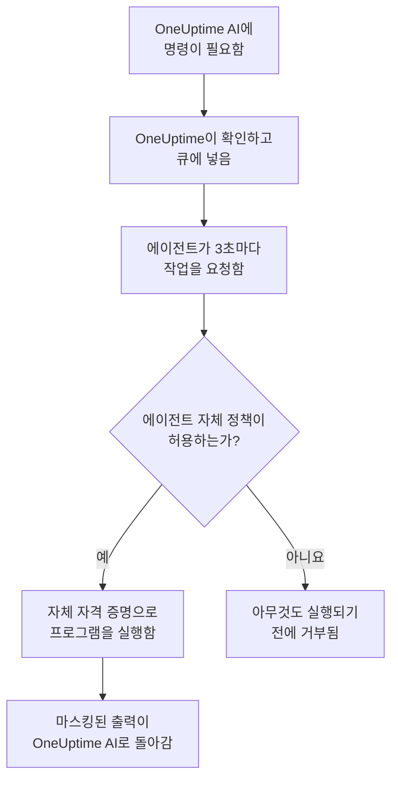

# 인프라 AI 에이전트

OneUptime AI는 인시던트나 경고를 조사하는 동안 텔레메트리 너머까지 살펴볼 수 있습니다. 리소스(Docker 또는 Podman 호스트, Docker Swarm 클러스터, Proxmox 클러스터, VMware vCenter, Ceph 클러스터, 데이터베이스 서버, Linux 호스트) 옆에 설치한 작은 에이전트가 `docker logs --tail 200 web`, `pvesh get /cluster/status`, `ceph health detail`, `db long-queries --min-seconds 30`, `journalctl -u nginx -n 200 --no-pager` 처럼 OneUptime AI가 요청하는 읽기 전용 명령을 실행하고 출력을 돌려보내므로, 근본 원인 분석은 리소스 자체가 알려 주는 내용을 인용합니다. 허용하면 같은 에이전트가 수정도 적용합니다(컨테이너 재시작, VM 시작, OSD를 다시 in으로 표시 등). 각 수정은 명령 정책에 따라 단계가 정해지며, 다르게 선택하지 않는 한 먼저 사람이 승인합니다. 리소스 페이지에서 연 AI에게 질문도 요청하면 같은 읽기 전용 명령을 실행합니다([AI에게 질문](/docs/ai/ask-ai) 참고).

AWS 계정, Azure 구독 또는 Google Cloud 프로젝트는 조사에 에이전트가 필요 없습니다. OneUptime이 연결할 때 사용한 읽기 전용 연결을 통해 실시간으로 읽기 때문입니다. 에이전트가 필요한 것은 수정뿐이며, 그 에이전트가 클라우드 AI 에이전트입니다. 클라우드 AI 에이전트는 계정 자체에서 실행되며 계정 페이지에서 명령 하나로 설정합니다([클라우드 계정에서](#클라우드-계정에서) 참조).

이 에이전트들이 **리소스 AI 에이전트** 입니다. 각 리소스의 대시보드 페이지에는 세 페이지로 된 **AI** 섹션이 있습니다:

- **인사이트** — 지난 30일 동안 OneUptime AI가 리소스에 대해 알아낸 것입니다. 계속 되풀이되는 문제와 그 이유(AI가 찾은 내용과 제안하는 단계 포함), 그중 대부분의 배후에 있는 리소스의 부분, 효과가 없었거나 승인을 기다리는 수정, AI가 스스로 수정한 것, 누군가 호출되기 전에 발견된 위험을 보여 주고, AI 자신이 그곳에서 한 일을 각주로 덧붙입니다. 클러스터의 페이지와 같은 방식으로 동작합니다. [AI가 클러스터에서 배운 것](/docs/ai/ai-sre#ai가-클러스터에서-배운-것) 을 참조하세요.
- **로그** — OneUptime AI가 리소스에서 한 모든 일을 최신순으로 보여 줍니다. 각 조사와 그 인시던트 또는 경고, 요약, 제안하거나 실행한 각 수정, 에이전트를 통해 보낸 각 명령입니다. (이 페이지는 이전에 인사이트라는 이름이었습니다.)
- **AI 에이전트** — 에이전트가 연결되어 있는지, AI가 리소스에서 무엇을 할 수 있는지(조사, 그리고 수정이 실행되는 방식), 주의가 필요한 모든 것과 그것을 해결하는 단계, 그리고 에이전트 상태 옆 **⋯** 메뉴의 **연결 테스트** 와 **에이전트 재설정** 입니다.

리소스의 **개요** 는 AI 에이전트 페이지를 요약하는 **AI 에이전트** 카드로 끝납니다. 에이전트가 연결되어 있는지, 조사가 켜져 있는지, 수정이 어떻게 실행되는지(**꺼짐**, **승인 요청**, **자동**, **승인 건너뛰기**), 주의가 필요한 것이 무엇인지 보여 주며, 이를 변경하는 AI 에이전트 페이지로 가는 링크가 있습니다.

:::cards
- [지원되는 리소스](#지원되는-리소스): 열한 종류의 리소스, 하나의 이미지.
- [AI 에이전트 설치](#ai-에이전트-설치): 이미 실행 중인 수집기 옆, Linux 호스트, 또는 명령 하나로 클라우드 계정에.
- [수정의 작동 방식](#수정의-작동-방식): 스스로 실행될 수 있는 것, 사람을 기다리는 것, 절대 실행되지 않는 것.
- [보안 모델](#보안-모델): 모든 명령에 대한 세 번의 검사, 그리고 OneUptime에서 오는 자격 증명은 없음.
:::

## 작동 방식

에이전트는 OneUptime의 연결을 기다리지 않습니다. 에이전트가 OneUptime에 연결해 작업을 요청하고, 자신이 가진 명령 정책 사본이 허용하는 것만 이미 가진 자격 증명으로 실행합니다.



## Kubernetes AI 에이전트와의 관계

Kubernetes 클러스터에는 자체 에이전트인 Kubernetes AI 에이전트가 있으며, Kubernetes 에이전트의 Helm 차트로 설치됩니다. [클러스터 액세스 — OneUptime AI가 kubectl을 실행하게 하기](/docs/ai/ai-sre#클러스터-액세스-oneuptime-ai가-kubectl을-실행하게-하기) 를 참조하세요. 이 페이지의 어떤 내용도 그것을 바꾸지 않습니다. 리소스 AI 에이전트는 같은 설계를 따릅니다:

- **같은 단계와 모드.** 모든 명령은 **Read**, **SafeWrite**, **RiskyWrite**, **Denied** 중 하나이며, 수정은 **꺼짐**, **승인 요청**, **자동**, **승인 건너뛰기** 중 하나로, 의미는 클러스터에서와 같습니다.
- **같은 세 번의 검사.** 같은 명령 정책을 OneUptime의 AI 도구가 적용하고, OneUptime이 명령을 큐에 넣을 때 다시 적용하며, 에이전트가 무엇이든 실행하기 전에 한 번 더 적용합니다.
- **자격 증명에 관한 같은 규칙.** 에이전트는 자신의 환경과 마운트가 주는 것만 사용합니다. OneUptime은 에이전트에 자격 증명을 절대 보내지 않습니다.
- **같은 기본값.** AI 조사는 기본적으로 켜져 있습니다. 리소스는 클러스터처럼 조사가 켜지고 수정이 꺼진 상태로 시작하므로, OneUptime AI는 에이전트가 연결되자마자 그 에이전트로 조사하고, 누군가 수정을 허용할 때까지 아무것도 바꾸지 않습니다([OneUptime에 연결](#oneuptime에-연결) 참조).

다른 점:

- **모든 리소스에 하나의 이미지.** `oneuptime/resource-ai-agent` 가 열한 종류의 리소스를 모두 담당하고, `ONEUPTIME_AI_AGENT_RESOURCE_TYPE` 이 에이전트가 담당하는 종류를 지정합니다. Helm 차트가 아니라 리소스의 수집기 옆에서 컨테이너 하나로 더 실행되거나, 담당하는 클라우드 계정 안에서 실행됩니다.
- **쓰기 액세스는 환경 변수입니다.** 에이전트에 `ONEUPTIME_AI_ALLOW_WRITES=true` 가 있어야만 수정을 적용할 수 있고, `ONEUPTIME_AI_WRITE_TARGETS` 는 수정이 건드릴 수 있는 컨테이너, 서비스, VM, OSD, 세션, 유닛을 제한합니다. 클러스터에서는 차트의 RBAC와 `aiAgent.remediation.namespaces` 가 이 역할을 합니다.

Kubernetes AI 에이전트와 마찬가지로 리소스 AI 에이전트는 Runner가 아닙니다. 런북 → Runbook 에이전트 아래에 나타나지 않으며, 런북의 Bash 또는 SSH 호스트로 사용되지도 않습니다.

## 지원되는 리소스

| 리소스 | `ONEUPTIME_AI_AGENT_RESOURCE_TYPE` | 에이전트 | 등록 이름(수집기의 변수) | 실행하는 것 | 리소스에 접근하는 방법 |
| -------------------- | ---------------------------------- | --------------------- | ----------------------------------------------------------------------------------------------- | -------------------------------------------------------------------------------------------------------------------------------------------------- | -------------------------------------------------------------------------- |
| Docker 호스트 | `docker` | Docker AI 에이전트 | `DOCKER_HOST_NAME` | `docker` | Docker 소켓, `/var/run/docker.sock` |
| Podman 호스트 | `podman` | Podman AI 에이전트 | `PODMAN_HOST_NAME` | Podman의 Docker 호환 API를 통한 `docker` | Podman 소켓, `/run/podman/podman.sock` |
| Docker Swarm 클러스터 | `docker-swarm`(또는 `swarm`) | Docker Swarm AI 에이전트 | `DOCKER_SWARM_CLUSTER_NAME` | `docker` | 매니저 노드의 Docker 소켓 |
| Proxmox 클러스터 | `proxmox` | Proxmox AI 에이전트 | `PROXMOX_CLUSTER_NAME` | Proxmox VE API로 보내는 `pvesh` 명령(에이전트에 `pvesh` 바이너리는 없음) | `https://PVE_HOST:8006/api2/json`, Proxmox API 토큰 사용 |
| VMware vCenter | `vmware`(또는 `vcenter`) | VMware AI 에이전트 | `VMWARE_VCENTER_NAME` | `govc` | vCenter의 API, vSphere 사용자 사용 |
| Ceph 클러스터 | `ceph` | Ceph AI 에이전트 | `CEPH_CLUSTER_NAME` | `ceph` | 모니터, `ceph.conf` 와 에이전트 전용 클라이언트의 키링 사용 |
| 데이터베이스 서버 | `database`(또는 `db`) | 데이터베이스 AI 에이전트 | `DATABASE_SERVER_ID`, 또는 `DATABASE_SYSTEM` + `DATABASE_SERVER_ADDRESS` + `DATABASE_SERVER_PORT` | `db` — 고정된 진단 카탈로그의 작업 하나, SQL은 절대 아님 | 데이터베이스 자체 드라이버, 데이터베이스 로그인 사용 |
| 호스트 | `host` | 호스트 AI 에이전트 | `HOST_NAME`(비어 있으면 호스트 자체의 호스트 이름) | `systemctl`, `journalctl`, `df`, `free`, `uptime`, `ps`, `ss`, `ip`, `dmesg`, `lsblk`, `cat`, `top`, `uname`, `hostnamectl`, `timedatectl`, `kill` | 특권 컨테이너에서 `nsenter` 로 호스트의 네임스페이스에 진입 |
| AWS 계정 | `aws` | 클라우드 AI 에이전트 | `AWS_ACCOUNT_ID`(비어 있으면 실행 중인 계정) | `cloud` — 고정된 카탈로그의 작업 하나, `aws` 명령은 절대 아님 | AWS API, 자체 IAM 역할 사용 |
| Azure 구독 | `azure` | 클라우드 AI 에이전트 | `AZURE_SUBSCRIPTION_ID`(설정 명령이 지정) | `cloud` — 고정된 카탈로그의 작업 하나, `az` 명령은 절대 아님 | Azure Resource Manager, Container App의 관리 ID로 |
| Google Cloud 프로젝트 | `gcp`(또는 `google-cloud`) | 클라우드 AI 에이전트 | `GOOGLE_CLOUD_PROJECT`(비어 있으면 실행 중인 프로젝트) | `cloud` — 고정된 카탈로그의 작업 하나, `gcloud` 명령은 절대 아님 | Google Cloud API, 자체 서비스 계정으로 |

데이터베이스 서버: 데이터베이스 AI 에이전트에는 PostgreSQL, MySQL(및 MariaDB와 Percona Server), Redis(및 Valkey, KeyDB, Dragonfly), MongoDB용 진단이 있습니다. 그 밖의 엔진에서는 아무것도 실행하지 않으며, 데이터베이스의 AI 에이전트 페이지에 그렇게 표시합니다.

AI 에이전트 페이지에서 에이전트 상태 옆 **⋯** 메뉴에 있는 **연결 테스트** 는 에이전트를 통해 다음 읽기 전용 명령을 실행하고 그 출력을 에이전트 카드에 표시합니다:

| 리소스 | 연결 테스트가 실행하는 것 |
| -------------------- | ---------------------------------------------------- |
| Docker 호스트 | `docker version`, `docker info` |
| Podman 호스트 | `docker version`, `docker info` |
| Docker Swarm 클러스터 | `docker version`, `docker node ls` |
| Proxmox 클러스터 | `pvesh get /version`, `pvesh get /cluster/status` |
| VMware vCenter | `govc about` |
| Ceph 클러스터 | `ceph health`, `ceph versions` |
| 데이터베이스 서버 | `db ping`, `db version` |
| 호스트 | `uptime`, `systemctl list-units --failed --no-pager` |
| AWS 계정 | `cloud whoami` |
| Azure 구독 | `cloud whoami` |
| Google Cloud 프로젝트 | `cloud whoami` |

Docker Swarm 워커에서는 `docker node ls` 가 실패합니다. Docker Swarm AI 에이전트는 매니저 노드에서 실행해야 합니다. 워커에서 시작한 에이전트는 그 노드가 매니저가 될 때까지 클러스터에 등록되지 않으며, Docker Swarm 설치 프로그램은 매니저가 아닌 노드에서는 에이전트를 제외합니다.

클라우드 계정에서 `cloud whoami` 는 클라우드 AI 에이전트가 작업하는 계정과 로그인한 ID, 무언가를 변경할 수 있는지, 할 수 있는 변경, 그리고 필요한 태그(있는 경우)를 보여 줍니다.

## AI 에이전트 설치

모든 리소스 AI 에이전트는 같은 이미지인 `oneuptime/resource-ai-agent:release` 입니다. 수집기 옆이나 호스트에서는 대시보드에서 설정할 것이 없습니다. 실행되면 OneUptime에 등록되고 1분 안에 리소스의 AI 에이전트 페이지에 나타납니다. 클라우드 계정의 에이전트는 계정 페이지가 작성해 주는 명령 하나로 계정 안에서 실행됩니다([클라우드 계정에서](#클라우드-계정에서) 참조).

### 수집기 옆에서

Docker, Podman, Docker Swarm, Proxmox, VMware, Ceph, 데이터베이스 서버의 경우 에이전트는 해당 리소스에 이미 사용 중인 수집기 옆에서 실행되며 그 `.env` 를 공유합니다. 에이전트에는 이미 `ONEUPTIME_URL`, 수집 키, 리소스 이름이 있습니다. 각 수집기의 `docker-compose.yml` 에는 에이전트가 서비스 하나로 더 포함되어 있고, 그 `install.sh` 가 에이전트를 시작합니다.

| 리소스 | 수집기 | AI 에이전트 서비스(및 컨테이너) | 설정 위치 |
| -------------------- | ----------------------------------------------------------- | --------------------------------- | ------------------------------------------------------------------------------------- |
| Docker 호스트 | [Docker 에이전트](/docs/telemetry/docker-host#ai-에이전트) | `oneuptime-docker-ai-agent` | `agents/DockerAgent/docker-compose.yml`. `install.sh` 가 두 번째 컨테이너로 시작 |
| Podman 호스트 | [Podman 에이전트](/docs/telemetry/podman-host#ai-에이전트) | `oneuptime-podman-ai-agent` | `agents/PodmanAgent/docker-compose.yml`. `install.sh` 가 두 번째 컨테이너로 시작 |
| Docker Swarm 클러스터 | [Docker Swarm 에이전트](/docs/telemetry/docker-swarm#ai-에이전트) | `oneuptime-docker-swarm-ai-agent` | `agents/DockerSwarmAgent/docker-compose.yml`, 매니저 노드에서 |
| Proxmox 클러스터 | [Proxmox 에이전트](/docs/telemetry/proxmox#ai-에이전트) | `oneuptime-proxmox-ai-agent` | `agents/ProxmoxAgent/docker-compose.yml` |
| VMware vCenter | [VMware 에이전트](/docs/telemetry/vmware#ai-에이전트) | `oneuptime-vmware-ai-agent` | `agents/VMwareAgent/docker-compose.yml` |
| Ceph 클러스터 | [Ceph 에이전트](/docs/telemetry/ceph#ai-에이전트) | `oneuptime-ceph-ai-agent` | `agents/CephAgent/docker-compose.yml`, 에이전트 전용 Ceph 클라이언트를 `./ceph` 에 둠 |
| 데이터베이스 서버 | [데이터베이스 에이전트](/docs/telemetry/databases#ai-에이전트) | `oneuptime-database-ai-agent` | `agents/DatabaseAgent/docker-compose.yml` |

AI 에이전트가 생기기 전에 설치한 수집기는 아직 에이전트를 실행하지 않습니다. 그 `install.sh` 를 다시 실행하면 이제 AI 에이전트도 시작합니다(Proxmox, VMware, Ceph, 데이터베이스, Docker Swarm 설치 프로그램은 AI 에이전트 서비스가 포함된 최신 `docker-compose.yml` 을 내려받습니다). 파일을 직접 관리한다면 수집기의 `docker-compose.yml` 에서 서비스를 가져와 자신의 파일에 추가하고 `docker compose up -d` 를 실행하세요. 리소스의 AI 에이전트 페이지에는 해당 리소스에 맞는 정확한 서비스가 이름이 이미 채워진 상태로 표시됩니다.

설치 프로그램 없이도 Docker AI 에이전트는 `docker run` 한 번으로 실행할 수 있습니다:

```bash
docker run -d \
  --name oneuptime-docker-ai-agent \
  --user 0:0 \
  --restart unless-stopped \
  --read-only --tmpfs /tmp \
  -v /var/run/docker.sock:/var/run/docker.sock:ro \
  -e ONEUPTIME_URL="https://oneuptime.com" \
  -e ONEUPTIME_SERVICE_TOKEN="YOUR_TELEMETRY_INGESTION_TOKEN" \
  -e ONEUPTIME_AI_AGENT_RESOURCE_TYPE=docker \
  -e DOCKER_HOST_NAME="my-docker-host" \
  oneuptime/resource-ai-agent:release
```

`DOCKER_HOST_NAME` 은 Docker 에이전트가 보고하는 이름이어야 합니다. Docker와 Podman 설치 프로그램은 AI 에이전트를 제외하는 `--no-ai-agent`(또는 `ONEUPTIME_INSTALL_AI_AGENT=false`)를 받으며, Docker Swarm 설치 프로그램도 마찬가지입니다. 나중에 에이전트 없이 수집기를 실행하려면 `docker-compose.yml` 에서 AI 에이전트 서비스를 삭제하거나 `docker rm -f` 로 그 컨테이너를 제거하세요.

### 호스트 AI 에이전트

[호스트 OpenTelemetry 수집기](/docs/telemetry/host-otel-collector)를 통해 보고하는 Linux 호스트에는 옆에 둘 OneUptime 컨테이너가 없으므로, 호스트 AI 에이전트는 자체 설치 프로그램(`agents/HostAIAgent`)과 함께 제공됩니다:

```bash
curl -fsSL https://raw.githubusercontent.com/OneUptime/oneuptime/master/agents/HostAIAgent/install.sh -o install.sh
sudo bash install.sh
```

설치 프로그램은 OneUptime URL, 프로젝트의 텔레메트리 수집 키, 호스트 이름을 묻고, `/opt/oneuptime-host-ai-agent/.env` 와 `docker-compose.yml` 을 쓰고, 컨테이너 `oneuptime-host-ai-agent` 를 시작합니다. 대신 systemd 유닛 `oneuptime-host-ai-agent` 아래에서 실행하려면 `--systemd` 를 추가하세요. Compose 플러그인이 있는 Docker(rootless Docker가 아닌 시스템 엔진)가 필요하며, rootful Podman으로도 같은 컨테이너를 실행할 수 있습니다.

호스트 AI 에이전트는 **호스트 자체의** 프로그램을 실행합니다. 모든 명령은 `nsenter --target 1 --mount --uts --ipc --net --pid -- PROGRAM ARGS` 로 실행되어 호스트 init의 네임스페이스에 들어갑니다. 이를 위해서는 `pid: host`, `privileged: true`, root가 필요합니다. [Docker 소켓과 호스트 AI 에이전트는 호스트의 root와 같다](#docker-소켓과-호스트-ai-에이전트는-호스트의-root와-같다) 를 참조하세요. 머신의 호스트 이름을 사용하려면 `HOST_NAME` 을 비워 두세요. 바꾸지 않았다면 이것이 수집기가 `host.name` 으로 보고하는 값입니다. 그렇지 않으면 **호스트** 아래에 표시되는 이름으로 설정하세요.

### 클라우드 계정에서

AWS 계정, Azure 구독 또는 Google Cloud 프로젝트에는 에이전트를 옆에 둘 수집기가 없으며, OneUptime은 에이전트 없이 이를 읽습니다([클라우드 계정](#클라우드-계정) 참조). 수정을 하는 클라우드 AI 에이전트는 계정 자체에서 실행되며, compose 파일도 `.env` 도 없이 계정 페이지에서 명령 하나로 설정합니다:

1. 클라우드 → 계정에서 계정을 열고, 그 **개요** 의 **AI 에이전트** 카드에서 **AI가 문제를 해결하도록 허용** 을 선택합니다.
2. 하나뿐인 질문 **AI에게 어디까지 맡기시겠습니까?** 에 답합니다. 기본값인 **먼저 물어보기** 는 **수정** 을 **승인 요청** 으로, **안전한 수정은 스스로 적용하기** 는 **자동** 으로 설정합니다. 나머지는 **추가 필드** 에 있습니다: AI가 할 수 있는 변경, AI가 절대 변경하면 안 되는 리소스, `oneuptime-ai=allow` 태그가 붙은 리소스만 변경하기, **승인 건너뛰기**, 계정의 로그 읽기, 에이전트를 다른 곳에서 실행하기 위한 변수입니다.
3. 표시된 명령을 그 계정에 로그인한 상태에서 클라우드 자체 셸에서 실행합니다. 명령은 켜진 변경으로 에이전트의 역할을 작성하고 에이전트를 시작하며, 에이전트는 몇 분 안에 스스로 연결됩니다. 다시 붙여 넣을 것은 없습니다. 연결되지 않으면 로그에 이유가 나옵니다([로그와 상태](#로그와-상태) 참조).

| 클라우드 | 실행할 곳 | 명령이 만드는 것 |
| -------------------- | ------------------ | ------------------------------------------------------------------------------------------------------------------------------------------------------------------------------------------------------------------ |
| AWS 계정 | AWS CloudShell | ECS Fargate 태스크 하나를 실행하는 CloudFormation 스택 `oneuptime-ai-agent`. 태스크 역할은 쓰기 역할 `OneUptimeAiAgentWrite` 만 맡을 수 있으며, 이 역할이 켜진 변경의 권한을 가집니다. |
| Azure 구독 | Azure Cloud Shell | 리소스 그룹 `oneuptime-ai-agent` 의 Container App `oneuptime-ai-agent`. 그 관리 ID는 구독에 대해 켜진 변경의 권한을 가진 사용자 지정 역할을 가집니다. |
| Google Cloud 프로젝트 | Google Cloud Shell | CPU가 항상 할당된 Cloud Run 서비스 `oneuptime-ai-agent`. 서비스 계정 `oneuptime-ai-agent` 로 실행되며, 이 서비스 계정은 프로젝트에 대해 켜진 변경의 권한을 가진 사용자 지정 역할을 가집니다. |

명령은 작성된 대상 계정에서만 작동합니다. AWS에서는 다른 계정에 로그인한 셸에서 아무것도 만들지 않으며, Azure와 Google Cloud 명령은 호출할 때마다 구독이나 프로젝트를 지정합니다. 명령은 `ONEUPTIME_AI_INVESTIGATION=true`, 답에 따른 `ONEUPTIME_AI_FIXES`, `ONEUPTIME_AI_ALLOW_WRITES=true`, 그리고 작성된 대상 계정을 가리키는 `ONEUPTIME_AI_CLOUD_ACCOUNT_ID` 를 설정합니다. 에이전트는 클라우드가 알려 주는 소속 계정으로 등록하며 OneUptime에 계정을 추가하는 일은 절대 없습니다. 명령과 다른 계정에서 시작하면 거부되며, 명령의 대상 계정 페이지에 그 이유가 표시됩니다. 프로젝트의 어떤 연결도 읽지 않는 계정에서 시작해도 거부되며, 로그에 그렇게 기록됩니다.

무언가를 변경하려면 명령을 다시 실행합니다. **AI가 문제를 해결하도록 허용** 을 다시 열거나 계정의 **AI 에이전트** 페이지에서 **변경** 을 선택하고, 작성된 명령을 실행합니다. 역할에는 항상 켜진 변경만 들어 있습니다. 클라우드 계정의 **AI** 섹션에는 **AI 에이전트** 와 **로그** 두 페이지가 있으며, 에이전트 비용은 [클라우드 계정 연결](/docs/telemetry/cloud-accounts#ai가-문제를-해결하도록-허용) 에 있습니다. **활동**의 계정 **피드**는 에이전트의 연결이나 재설정, 그리고 OneUptime AI가 그곳에서 할 수 있는 일에 대한 모든 변경을 변경한 사람과 함께 기록합니다.

### OneUptime에 연결

에이전트는 **수집기가 보고하는 것과 같은 식별자** (`DOCKER_HOST_NAME`, `PROXMOX_CLUSTER_NAME`, `CEPH_CLUSTER_NAME`, …. `ONEUPTIME_AI_AGENT_RESOURCE_NAME` 으로 재정의 가능)로 등록하므로, 수집기의 텔레메트리가 만든 바로 그 리소스를 담당합니다. OneUptime에 아직 그 이름의 리소스가 없으면 등록할 때 만들어지므로, 수집기와 다른 이름을 쓰면 오류 대신 비어 있는 두 번째 리소스가 생깁니다. 데이터베이스는 `DATABASE_SERVER_ID` 가 설정되어 있으면 그것으로, 아니면 엔진, 주소, 포트로 등록합니다. 이 프로젝트의 데이터베이스가 아닌 `DATABASE_SERVER_ID` 는 거부됩니다.

수집기가 여전히 기본 이름(`docker-host`, `podman-host`, `docker-swarm`, `proxmox-cluster`, `vmware-vcenter`, `ceph`)을 사용하면, 그 기본값으로 설치한 모든 리소스가 OneUptime의 같은 리소스로 보고하며, 그 리소스를 위한 명령이 그중 어느 것에든 도달할 수 있습니다. 에이전트는 로그에서 이를 경고합니다. 수집기와 에이전트 모두에서 각 리소스에 고유한 이름을 지정하세요.

에이전트는 프로젝트의 텔레메트리 수집 키(`ONEUPTIME_API_KEY`, `ONEUPTIME_TELEMETRY_INGESTION_KEY`, `ONEUPTIME_SERVICE_TOKEN` 중 처음으로 설정된 것. 수집기가 이미 설정합니다)로 인증하고 자신만의 키를 받습니다. 모든 호출은 `<ONEUPTIME_URL>/resource-ai-agent-ingest/…` 로 보내는 HTTPS `POST` 입니다. 시작할 때 한 번 등록하고, 30초마다 하트비트를 보내며(마지막 하트비트 후 5분 동안 온라인으로 간주됨), 3초마다 작업을 요청하고, 멈출 때 로그오프합니다. 같은 식별자를 가진 두 번째 에이전트는 첫 번째 에이전트가 온라인인 동안 거부됩니다. 정상적으로 멈춘 컨테이너는 로그오프하므로 대체 에이전트가 바로 허용되고, 충돌이나 kill 이후에는 첫 거부 후 이전 에이전트가 40초 동안 아무것도 보내지 않으면 대체 에이전트가 자리를 넘겨받습니다. 10분 후에도 계속 거부되면 실행 중인 다른 에이전트가 같은 식별자를 사용하는 것입니다. 에이전트는 그렇게 알리는 오류를 기록하고, 각 리소스에 고유한 이름을 지정하거나 다른 에이전트를 멈출 때까지 5분마다만 요청합니다. 프로젝트 하나에는 리소스 AI 에이전트를 최대 250개까지 둘 수 있으며, 시간당 새로 등록되는 것은 최대 30개입니다. 250개에 도달하면 7일 동안 소식이 없는 에이전트가 제거되어 새 에이전트를 위한 자리가 생깁니다(리소스는 AI 설정을 유지하며, 그런 에이전트가 돌아오면 그냥 다시 등록됩니다).

**조사** 는 모든 리소스에서 처음부터 켜져 있으므로, OneUptime AI는 에이전트가 연결되자마자 에이전트로 조사합니다. 그 밖에 AI가 리소스에서 할 수 있는 일은 에이전트 자체의 설정입니다([AI가 할 수 있는 일, 에이전트가 설정](#ai가-할-수-있는-일-에이전트가-설정) 참조). 두 설정 중 어느 것도 지정하지 않은 에이전트는 기본값을 사용합니다. 자신의 리소스에 대해 **조사** 를 켜고, 쓰기를 허용하면(`ONEUPTIME_AI_ALLOW_WRITES=true`) **수정** 을 **승인 요청** 으로, 아니면 **꺼짐** 으로 설정합니다. 이 기본값은 AI 에이전트 페이지에서 아무도 AI 설정을 선택하지 않은 리소스에만 적용됩니다. 누군가 그곳에 저장한 설정은 에이전트 구성에서 지정할 때까지 그대로 유지되므로, 누군가 **조사** 스위치를 끈 리소스는 계속 꺼져 있습니다. 이 설정들보다 오래된 에이전트는 둘 다 보고하지 않으며, 이전처럼 AI 에이전트 페이지에서 설정합니다.

AI 에이전트 페이지의 같은 **⋯** 메뉴에 있는 **에이전트 재설정** 은 확인하면 OneUptime이 에이전트의 키를 잊게 합니다. 그 키를 가지고 있던 모든 것은 차단되며, 실제 에이전트는 몇 분 안에 다시 등록합니다. 에이전트에는 이미지와 같거나 더 새로운 버전의 OneUptime 서버가 필요합니다.

### AI가 할 수 있는 일, 에이전트가 설정

조사와 수정은 에이전트가 실행되는 곳(수집기와 공유하는 `.env` 또는 컨테이너의 환경)에서 설정하며, OneUptime은 그 설정을 따릅니다:

| 변수 | 기본값 | 하는 일 |
| ---------------------------- | ------- | ----------------------------------------------------------------------------------------------------------------------------------------------------------------------------------------------------------------------------------------------------- |
| `ONEUPTIME_AI_INVESTIGATION` | 비어 있음 | `true` 는 AI가 조사하는 동안 아래의 읽기 전용 명령을 실행하게 합니다. `false` 는 OneUptime이 이미 가진 데이터로 제한합니다. 비어 있으면: 켜짐. |
| `ONEUPTIME_AI_FIXES` | 비어 있음 | AI가 수정을 적용하는 방식: `off`, `ask-for-approval`, `automatic`, `bypass-approval`([수정 모드](#수정-모드) 참조). `off` 이외의 모드에는 `ONEUPTIME_AI_ALLOW_WRITES=true` 도 필요하며, `off` 는 그것이 있어도 에이전트를 읽기 전용으로 유지합니다. 비어 있으면: 에이전트가 쓰기를 허용할 때는 `ask-for-approval`, 아니면 `off`. |

예를 들어 사람이 각 수정을 승인하는 방식으로 AI가 수정을 적용하게 하려면:

```bash
ONEUPTIME_AI_INVESTIGATION=true
ONEUPTIME_AI_FIXES=ask-for-approval
ONEUPTIME_AI_ALLOW_WRITES=true
```

그런 다음 에이전트를 다시 시작합니다(`docker compose up -d`, 또는 Docker나 Podman 호스트라면 이 값들을 설정해 수집기의 `install.sh` 를 다시 실행). 에이전트는 등록할 때와 하트비트마다 두 설정을 보고하며, OneUptime은 이를 즉시 리소스에 적용합니다. 그러면 리소스의 AI 에이전트 페이지는 이를 읽기 전용으로 표시합니다. **변경** 은 아무것도 저장하지 않고 선택한 옵션에 해당하는 이 줄들을 보여 주며, 에이전트가 설정하는 동안 OneUptime은 다른 곳(API, Terraform, 마스터 관리자)에서 한 변경을 거부합니다. 명령 허용 목록은 페이지에 남습니다. 에이전트가 읽을 수 없는 값은 해당 설정을 꺼진 상태로 두며, 에이전트는 어느 설정인지 기록합니다.

## 조사가 실행할 수 있는 것

조사는 언제나 **Read** 명령만 실행합니다. 이 명령은 리소스를 살펴볼 뿐 아무것도 바꾸지 않습니다. OneUptime AI는 인시던트나 경고에 (모니터와 텔레메트리를 통해, 신호당 최대 10개) 연결된 리소스 중 AI 에이전트가 연결되어 있고(클라우드 계정에는 필요 없음) **조사** 스위치가 켜진 리소스를 보고, 조사에 필요한 만큼 명령을 실행합니다(폭주하는 루프를 막기 위해 조사당 최대 200개). 각 명령은 다른 증거와 마찬가지로 인용됩니다. 모든 명령은 인수가 있는 프로그램 하나이며 셸을 거치지 않으므로, 파이프, 리디렉션, `;`, `&&`, `$(…)`, `sudo` 는 그렇게 알리는 메시지와 함께 거부됩니다. 명령에는 기본 30초, 최대 2분이 주어지며, 출력은 에이전트에서 1024 KB로 제한됩니다. 그 출력은 OneUptime AI에 전달되기 전에 잘리지 않습니다. 긴 출력은 한 페이지씩 표시됩니다(처음 40,000자, 이후 요청에 따라 나머지). 에이전트가 명령을 가져가지 않으면 OneUptime AI는 조사의 나머지 동안 그 리소스에 명령을 보내지 않습니다.

각 종류의 리소스가 읽을 수 있는 것은 아래와 같습니다. AI 자신에게 주어지는 목록과 같으며, 목록에 없는 것은 모두 거부됩니다.

### Docker 및 Podman 호스트

- 컨테이너: `docker ps -a`(`-q`, `-n`, `-l`, `-s`, `--no-trunc`, `--filter`, `--format json` 도 가능), `docker container inspect web`, `docker inspect --type container web`, `docker top web`, `docker port web`, `docker diff web`. inspect 출력의 환경 변수 값은 마스킹되어 반환됩니다.
- 로그와 활동: `docker logs --tail 200 web` 또는 `docker logs --since 30m web`. 최대 2000의 `--tail` 이나 `--since` 가 필수이며(`--tail` 이 없으면 `--since` 는 최대 24h의 기간이어야 함), `-f` 는 절대 허용되지 않습니다. `docker stats --no-stream`. `docker events --since 30m --until 0s`(두 경계 모두 필수이고 `--until` 은 기간으로 지정하므로 창은 항상 과거에서 닫힘).
- 엔진: `docker info`, `docker version`, `docker system df`(`-v` 는 표 형식으로만 가능. `-v --format json` 은 모든 빌드 단계의 명령줄을 출력함), `docker images`, `docker image inspect nginx:1.27`, `docker network ls`, `docker network inspect bridge`, `docker volume ls`, `docker volume inspect data`.
- `--format json`(목록에는 `table`)만 가능하며 Go 템플릿은 절대 쓰지 않고, docker의 전역 플래그(`-H`, `--context`, `--config`, …)도 쓰지 않습니다. 이 플래그들은 CLI가 다른 엔진을 가리키게 하기 때문입니다.

Podman 호스트는 Podman의 Docker 호환 API를 통해 같은 `docker` CLI와 같은 정책을 실행합니다.

### Docker Swarm 클러스터

- 노드: `docker node ls`, `docker node ps node-1`, `docker node inspect node-1 --pretty`.
- 서비스: `docker service ls`, `docker service ps web --no-trunc`, `docker service inspect web --pretty`(환경 변수 값은 마스킹되어 반환됨), `docker service logs --tail 200 web`(최대 2000의 `--tail` 이나 `--since` 가 필수이며, 단독일 때는 최대 24h의 기간. `-f` 는 절대 불가).
- 스택: `docker stack ls`, `docker stack ps shop`, `docker stack services shop`.
- 매니저 자체의 엔진: `docker ps -a`, `docker container inspect web`, `docker logs --tail 200 web`, `docker stats --no-stream`, `docker info`, `docker version`, `docker network ls`, 그리고 Docker 호스트의 나머지 읽기 명령.

### Proxmox 클러스터

에이전트에는 `pvesh` 가 없습니다. 명령은 `pvesh` 문법(`get` 또는 `ls` 와 API 경로, 옵션은 `--name value` 형식)으로 작성하며, 에이전트는 이를 자체 토큰으로 Proxmox VE API에 보내는 `GET` 하나로 정확히 변환합니다. `--output-format json|json-pretty|text` 로 출력을 고릅니다. 쿼리 문자열은 받지 않으며, 쓰기 작업은 노드를 지정해야 합니다(`localhost` 는 절대 불가).

- 클러스터: `pvesh get /version`, `pvesh get /cluster/status`, `pvesh get /cluster/resources --type vm`, `pvesh get /cluster/ha/status/current`, `pvesh get /cluster/log --max 50`, `pvesh get /cluster/tasks`, `pvesh get /nodes`, 그리고 복제, 백업, 풀, 스토리지 목록.
- 노드: `pvesh get /nodes/pve1/status`, `pvesh get /nodes/pve1/services`, `pvesh get /nodes/pve1/storage`, `pvesh get /nodes/pve1/disks/list`, `pvesh get /nodes/pve1/rrddata --timeframe hour`, 그리고 그 노드의 네트워크, 복제, APT 업데이트, Ceph 상태.
- 작업과 로그: `pvesh get /nodes/pve1/tasks --errors 1 --limit 20`, 작업의 상태와 로그, `pvesh get /nodes/pve1/syslog --limit 200`, `pvesh get /nodes/pve1/journal --lastentries 200`.
- 게스트(VM은 `qemu`, 컨테이너는 `lxc`): `pvesh get /nodes/pve1/qemu`, `pvesh get /nodes/pve1/lxc`, `pvesh get /nodes/pve1/qemu/101/status/current`, `pvesh get /nodes/pve1/qemu/101/config`(cloud-init 비밀번호 같은 비밀 값은 마스킹되어 반환됨), 보류 중인 변경, 스냅샷, `pvesh get /nodes/pve1/qemu/101/rrddata --timeframe hour`, 그리고 `pvesh get /nodes/pve1/qemu/101/agent/get-fsinfo` 같은 QEMU 게스트 에이전트 정보.
- 절대 불가: `/access` 아래의 모든 것(사용자, API 토큰, ACL), 콘솔(`vncproxy`, `termproxy`, `spiceproxy`), QEMU 모니터, 게스트 에이전트의 exec 및 파일 호출.

### VMware vCenter

명령을 먼저 쓰고, 그다음 플래그, 마지막으로 이름이나 인벤토리 경로를 씁니다(govc는 인수 뒤에 쓴 플래그를 무시함). `-dc DATACENTER` 로 데이터센터를 고릅니다.

- `govc about`, `govc datacenter.info`, `govc ls /DC/vm`, `govc find . -type m -runtime.powerState poweredOff` — vCenter의 버전과 인벤토리(`find` 는 이름, 유형, 상태, 런타임 속성으로만 필터링함. `ls -json` 은 나열하는 모든 개체의 모든 속성을 불러오므로 거부됨).
- `govc vm.info web-01`, `govc host.info esx-01`, `govc datastore.info datastore1`, `govc pool.info /DC/host/cluster1/Resources` — 전원 상태, 호스트, 게스트 OS, IP 주소, VMware Tools, 용량. `vm.info` 는 텍스트만 가능합니다. `-json` 과 `-e` 는 cloud-init 데이터와 비밀번호가 있는 VM의 `extraConfig` 를 출력하므로 거부됩니다.
- `govc events -n 50 /DC/vm/web-01`, `govc tasks -n 50` — 최근 이벤트와 작업(최대 500, `-f` 는 절대 불가).
- `govc metric.sample -n 12 /DC/vm/web-01 cpu.usage.average`, `govc metric.ls /DC/vm/web-01`, `govc object.collect -s /DC/vm/web-01 runtime.powerState`(런타임 및 상태 속성만), `govc host.service.ls -host esx-01`, `govc host.date.info -host esx-01`, `govc tags.ls`.
- 절대 불가: 연결, 자격 증명, TLS, 디버그 플래그(`-u`, `-k`, `-cert`, `-debug`, `-dump`, …), 게스트 작업(`guest.*`), 데이터스토어 파일 액세스, `esxcli`, `env`, 그리고 목록에 없는 모든 명령.

### Ceph 클러스터

- 클러스터: `ceph status`(또는 `ceph -s`), `ceph health detail`, `ceph df detail`, `ceph versions`, `ceph progress`, `ceph quorum_status`, `ceph log last 100`.
- OSD: `ceph osd tree`, `ceph osd df`, `ceph osd perf`, `ceph osd stat`, `ceph osd dump`, `ceph osd blocked-by`, `ceph osd find 3`, `ceph osd metadata 3`, `ceph osd ok-to-stop 3`, `ceph osd safe-to-destroy 3`.
- 풀과 배치 그룹: `ceph osd pool ls detail`, `ceph osd pool stats`, `ceph osd pool get rbd size`, `ceph pg stat`, `ceph pg dump_stuck`, `ceph pg 1.2f query`, `ceph pg ls-by-osd 3`.
- 데몬, 충돌, cephadm: `ceph mon stat`, `ceph mgr services`, `ceph mgr module ls`, `ceph fs status`, `ceph mds stat`, `ceph balancer status`, `ceph crash ls`, `ceph crash stat`, `ceph orch ps`, `ceph orch ls`, `ceph orch host ls`, `ceph orch device ls`.
- 구조화된 출력을 원하면 `--format json`(또는 `-f json`, `json-pretty`, `plain`)을 추가합니다. 다른 옵션은 받지 않으며(`-c`, `--keyring`, `--id`, `--admin-daemon`, `-i`, `-o`, `-w` 는 절대 불가), `auth`, `config-key`, `config`, `tell`, `daemon` 은 절대 실행되지 않습니다.

### 데이터베이스 서버

`db` 는 프로그램이 아닙니다. 고정된 진단 카탈로그의 작업 하나를 가리키는 이름으로, 에이전트는 이를 데이터베이스 자체 드라이버를 통해 읽기 전용 세션에서 실행하며 모든 문에 시간 제한을 둡니다. OneUptime AI는 SQL, Redis 명령, MongoDB 셸 코드를 절대 작성하지 않습니다. 플래그는 긴 형식만 있습니다(`--limit 20` 또는 `--limit=20`).

- `db ping`, `db version` — 서버의 응답 여부, 버전, 가동 시간.
- `db sessions --limit 20`(`--state active`, `--user`, `--database` 도 가능. `db current-ops` 도 같음) — 세션과 각 세션이 실행 중인 것.
- `db long-queries --min-seconds 30`, `db blocking`, `db locks` — 느린 문, 그리고 누가 잠금을 기다리고 누가 잠금을 쥐고 있는지.
- `db replication`, `db connections`, `db database-sizes`, `db table-sizes --limit 20`, `db top-statements --limit 10` — 복제 지연, 한도 대비 연결 수, 공간과 시간이 어디에 쓰이는지.
- `db settings work_mem`(또는 모든 설정) — `requirepass` 같은 자격 증명 설정은 절대 읽지 않음.
- 엔진 보고서: `db slowlog`, `db info memory`, `db innodb-status`, `db memory`, `db keyspace`.

출력의 쿼리 텍스트는 정규화되므로(모든 문자열과 숫자 리터럴이 `?` 로 바뀜), 문에 담긴 고객 데이터가 OneUptime에 도달하는 일은 없습니다.

### 호스트

- 서비스: `systemctl status nginx --no-pager -n 50`, `systemctl is-active nginx`, `systemctl list-units --failed --no-pager`, `systemctl list-timers --all`, `systemctl show nginx -p ActiveState,SubState,Result,NRestarts`(`-p` 는 필수이며 유닛 상태 속성만 허용됨. `Environment` 나 유닛 파일은 절대 불가).
- 로그: `journalctl -u nginx -n 200 --no-pager`. 모든 읽기에는 `-n`(최대 2000)이나 `--since` 가 필요하며 `-f` 는 절대 불가합니다. `-p err`, `-k`, `-b`, `--until`, `-g`, `-t`, `-o short-iso|json` 도 가능합니다. `journalctl --list-boots`, `journalctl --disk-usage`.
- 리소스: `uptime`, `free -m`, `df -h`, `df -i`, `lsblk -f`, `uname -a`, `hostnamectl`, `timedatectl`, `dmesg -T --level=err,warn`.
- 프로세스: `ps aux --sort=-%cpu`, `top -b -n 1 -o %MEM`. 명령줄의 비밀번호는 마스킹되어 반환됩니다.
- 네트워크: `ss -tulpn`, `ss -s`, `ip -br addr`, `ip route`, `ip route get 1.1.1.1`.
- 커널 카운터: `cat /proc/loadavg`, `cat /proc/meminfo`, `cat /proc/pressure/memory`, `cat /etc/os-release`. `cat` 은 `/proc` 의 짧은 파일 목록과 `/etc/os-release` 만 읽으며, 그 밖에는 아무것도 읽지 않습니다.
- 명령마다 프로그램 하나이며, 경로 없이 이름으로 지정합니다. 셸, `sudo`, 그 밖의 프로그램은 절대 쓰지 않습니다.

### 클라우드 계정

OneUptime은 AWS 계정, Azure 구독 또는 Google Cloud 프로젝트를 계정의 읽기 전용 연결을 통해 직접 실시간으로 읽습니다([클라우드 계정 연결](/docs/telemetry/cloud-accounts) 참조). 이 읽기는 OneUptime에서 실행되며 에이전트가 필요 없으므로, 조사는 클라우드 AI 에이전트가 실행되는지와 관계없이 연결된 계정을 읽습니다. 명령은 `cloud` 와 고정된 카탈로그의 작업 하나, 그리고 계정의 인벤토리가 나열하는 그대로의 리소스 ID 하나입니다. 예를 들어 ARN `arn:aws:ecs:us-east-1:123456789012:service/prod/web`, Azure 리소스 ID `/subscriptions/00000000-0000-0000-0000-000000000000/resourceGroups/prod/providers/Microsoft.Web/sites/web`, Google Cloud 전체 리소스 이름 `//run.googleapis.com/projects/my-project/locations/us-central1/services/web` 입니다. `aws`, `az`, `gcloud` 명령은 절대 없으며, 플래그는 긴 형식만 쓰고 각각 한 번만 지정합니다.

- `cloud describe RESOURCE` — 리소스의 현재 설정과 상태. AWS에서는 ECS 서비스, EC2 인스턴스, RDS 인스턴스, Aurora 클러스터, Auto Scaling 그룹, Lambda 함수, Lambda 별칭, SQS 큐, 대상 그룹, 로드 밸런서가 아닌 리소스는 OneUptime이 가진 계정의 마지막 읽기 사본에서 읽고 NOT LIVE로 표시합니다.
- `cloud recent-events RESOURCE [--hours N] [--limit N]` — 플랫폼이 최근 리소스에 한 일. 배포와 서비스 이벤트, RDS 이벤트, 스케일링 활동, 리소스 상태, 활동 로그 항목입니다(`--hours` 는 기본값 6, 최대 72).
- `cloud target-health RESOURCE` — AWS 전용. 대상 그룹이나 로드 밸런서가 정상으로 보는 백엔드와 나머지가 정상이 아닌 이유.
- `cloud quota-usage RESOURCE [--limit N]` — 리소스의 리전에서 리소스 서비스에 대한 계정의 한도 대비 사용량.
- `cloud read-logs RESOURCE [--filter TEXT] [--minutes N] [--limit N]` — 리소스의 로그 줄을 최신순으로, `--filter` 를 지정하면 그것을 포함한 줄만 보여 줍니다(`--minutes` 는 기본값 60, 최대 1440). 로그 줄에는 고객 데이터가 담길 수 있으므로, 누군가 **AI가 문제를 해결하도록 허용** 의 **추가 필드** 에서 **조사 중에 AI가 이 계정의 로그를 읽도록 허용** 을 켤 때까지 이 읽기는 꺼져 있습니다. 이 설정은 바로 저장되며 실행할 명령은 없습니다.
- `cloud whoami` — 클라우드 AI 에이전트에서 실행되는 읽기 중 하나. 에이전트가 작업하는 계정, 무언가를 변경할 수 있는지, 어떤 변경을 할 수 있는지를 보여 줍니다. 에이전트 상태 옆 **⋯** 메뉴의 **연결 테스트** 가 이를 실행합니다.
- `cloud dry-run CHANGE RESOURCE [--flag value]` — 클라우드 AI 에이전트에서 실행되는 또 하나의 읽기. 실행될 그대로 쓴 변경을 실제로 하지 않고 확인합니다. 에이전트는 변경 전에 확인하는 것과 같이 확인하고(쓰기 액세스, 할 수 있는 변경, 계정, 필수 태그, 리소스 상태, 스케일 범위), 변경이 대체할 값을 읽은 뒤 변경을 하는 호출 직전에 멈춥니다. 변경이 실행될지, 무엇을 대체할지, 어떻게 되돌릴지, 또는 거부될 이유를 답합니다.

`--limit` 는 기본값 50행, 최대 200행입니다. 읽기의 응답은 줄 단위로 64 KB에서 잘리며, 계정 하나가 받는 실시간 읽기는 분당 최대 30회입니다. 클라우드 리소스 페이지에서 연 AI에게 질문도 이 읽기를 리소스의 계정에서 실행합니다.

## 수정의 작동 방식

수정은 켜기 전까지 꺼져 있으며, 켜려면 에이전트에 두 가지 설정이 필요합니다. `ONEUPTIME_AI_FIXES` 를 `off` 가 아닌 모드로 설정하는 것([AI가 할 수 있는 일, 에이전트가 설정](#ai가-할-수-있는-일-에이전트가-설정) 참조)과 `ONEUPTIME_AI_ALLOW_WRITES=true`([에이전트의 쓰기 액세스](#에이전트의-쓰기-액세스) 참조)입니다. 둘 중 하나만으로는 아무것도 바뀌지 않습니다. `ONEUPTIME_AI_FIXES` 보다 오래된 에이전트는 대신 리소스의 AI 에이전트 페이지에서 **수정** 을 가져옵니다. 수정에는 프로젝트에서 AI가 활성화되어 있어야 하며(프로젝트 설정 → AI → AI Features 의 **AI 활성화**), 누군가 끄지 않는 한 활성화되어 있습니다. 끄면 OneUptime AI가 보내는 모든 명령이 즉시 멈추며, 승인된 계획의 다음 명령과 롤백도 마찬가지입니다. 에이전트 상태 옆 **⋯** 메뉴의 **연결 테스트** 만 계속 실행됩니다. 무엇이든 새로 수정되는지는 프로젝트 스위치 두 개가 정합니다. **새 인시던트 자동 수정** (**인시던트 → AI → 설정** 에 있음) 과 **새 경고 자동 수정** (**경고 → AI → 설정** 에 있음) 은 꺼진 상태로 시작하며, 둘 중 하나가 켜지기 전까지 그 종류의 새 항목은 수정되지 않습니다. **수정** 행은 **AI 에이전트** 페이지에서 두 스위치의 상태를 보여 주고, 꺼진 스위치마다 링크를 답니다.

### 수정 모드

수정에는 Kubernetes 클러스터와 같은 네 가지 모드가 있으며, `ONEUPTIME_AI_FIXES` 에서는 `off`, `ask-for-approval`, `automatic`, `bypass-approval` 로 씁니다:

- **꺼짐** — AI는 조사만 합니다.
- **승인 요청** — 근본 원인 분석 후 OneUptime AI는 읽기 명령으로 진단하고 원인을 해결하는 가장 작은 계획을 만듭니다. 예를 들면 `docker restart web` 입니다. 계획은 근거, 예상 효과, 롤백과 함께 인시던트나 경고에 표시되며, 사람이 한 번의 클릭으로 승인하면 OneUptime은 정확히 그 명령들을 실행합니다.
- **자동** — 안전한 변경(**SafeWrite**)은 자동으로 실행되고, 더 위험한 변경(**RiskyWrite**)은 리소스의 명령 허용 목록에 그 정확한 형태가 없는 한 승인을 위해 제안됩니다.
- **승인 건너뛰기** — 정책이 허용하는 모든 변경이 더 위험한 변경까지 포함해 자동으로 실행됩니다. 항상 사람이 필요한 것은 여전히 사람을 기다립니다.

수정이 실행된 후 OneUptime은 인시던트나 경고의 모니터를 지켜봅니다. 모니터가 회복되지 않으면 계획의 롤백이 실행되고, OneUptime AI는 실패한 시도를 앞에 두고 계획을 하나 더 만듭니다. 인시던트나 경고당 최대 두 라운드입니다. **자동** 모드에서는 그 두 번째 라운드가 승인을 요청하고, **승인 건너뛰기** 에서는 그것도 자동으로 실행됩니다. 무인 수정에는 리소스당 시간당 세 건의 서킷 브레이커가 있습니다. 이를 넘거나, OneUptime AI의 다른 무인 라운드가 같은 리소스를 아직 변경하거나 검증하는 동안에는 라운드가 계획을 실행하지 않고 승인을 위해 제안합니다.

인시던트나 경고 하나에는 AI 수정 레인이 하나만 주어집니다. 수정이 켜진 Kubernetes 클러스터에 연결되어 있으면 클러스터의 라운드가 실행되고 리소스 라운드는 실행되지 않습니다. 그렇지 않으면 수정이 켜져 있고 준비된 에이전트가 있는 첫 번째 연결 리소스가 다음 순서로 라운드를 받습니다: Docker 호스트, Podman 호스트, Docker Swarm 클러스터, Proxmox 클러스터, VMware vCenter, Ceph 클러스터, 데이터베이스 서버, 호스트, AWS 계정, Azure 구독, Google Cloud 프로젝트. 라운드는 그 리소스만 변경합니다.

### 안전함, 더 위험함, 절대 불가

| 단계 | 의미 | 실행 시점 |
| -------------- | ------------------------------------------------------------------------------------------------------------------------------------- | ------------------------------------------------------------------------------------------------------------ |
| **Read** | 리소스를 살펴볼 뿐 아무것도 바꾸지 않음 | 조사와 수정 라운드에서 항상 |
| **SafeWrite** | 이름이 지정된 개체 정확히 하나에 대한 되돌릴 수 있는 변경: 컨테이너 하나 재시작, VM 하나 시작, OSD 하나를 in으로 표시, 유닛 하나 재시작 | **자동** 과 **승인 건너뛰기** 에서는 자동으로, **승인 요청** 에서는 승인 후 |
| **RiskyWrite** | 무언가를 중단시키거나 실행되는 것을 바꿀 수 있는 변경: 중지, kill, 종료, 영으로 스케일, 새 이미지, 여러 개체를 한꺼번에 | **승인 건너뛰기** 에서는 자동으로, **자동** 에서는 허용 목록에 있으면 자동으로, 그 밖에는 승인 후 |
| **Denied** | 그 밖의 모든 것, 특히 코드를 실행하거나, 데이터를 삭제하거나, 자격 증명을 읽거나, 정책이 모르는 것 | 절대 실행되지 않음, 사람이 승인해도 마찬가지 |

일부 더 위험한 변경은 승인 건너뛰기를 포함한 모든 모드에서 **항상 사람이 필요** 하며, 허용 목록 항목으로도 이를 바꿀 수 없습니다. 아래 표에 그렇게 표시되어 있습니다.

### Docker 및 Podman 호스트의 수정

| | 명령 |
| ------------------- | ----------------------------------------------------------------------------------------------------------------------------------------------------------------------------------------------------------------------------------------------------------------------------------------------------- |
| **안전함** | `docker restart web`(`-t 30` 가능), `docker start web`, `docker unpause web` — 컨테이너 하나 |
| **더 위험함** | `docker stop web`, `docker kill -s TERM web`(TERM, INT, HUP, QUIT, USR1, USR2, KILL), `docker pause web`, `docker update --memory 1g web`(`--memory-swap`, `--memory-reservation`, `--cpus`, `--cpu-shares`, `--restart`, `--pids-limit` 도), `docker restart web api`(여러 컨테이너) |
| **항상 사람이 필요** | — |
| **절대 불가** | `docker exec web sh`, `docker run nginx`, `docker rm web`, `docker system prune`, `docker cp web:/etc/passwd .`, `docker compose up -d`, create, build, pull, push, login, commit, save, load, 네트워크와 볼륨 변경, swarm 명령, 그 밖의 모든 `update` 플래그 |

### Docker Swarm 클러스터의 수정

| | 명령 |
| ------------------- | --------------------------------------------------------------------------------------------------------------------------------------------------------------------------------------------------------------------------------------------------------------------------------------------------------------------------------------- |
| **안전함** | `docker service update --force web`(롤링 재시작), `docker service rollback web`, `docker service scale web=3`(1 이상) — 서비스 하나 |
| **더 위험함** | `docker service scale web=0`, `docker service update --image nginx:1.27 web`, `docker service update --replicas 5 web`, `docker service update --limit-memory 1g web`(CPU 제한, 예약, 업데이트 정책도), `docker node update --availability active node-1` |
| **항상 사람이 필요** | `docker node update --availability drain node-1`, `docker node update --availability pause node-1` |
| **절대 불가** | `docker service rm web`, `docker stack deploy -c stack.yml shop`, `docker secret ls`, `docker node rm node-1`, `docker service update --env-add A=b web`(환경, 마운트, 시크릿, 네트워크, 포트, 사용자), config, 노드 승격과 레이블, `docker restart web` — 매니저의 컨테이너 하나를 바꾸는 것은 Swarm 수정이 아님 |

변경이 실행되기 직전에 Docker, Podman, Docker Swarm AI 에이전트는 엔진에서 그 대상을 조회하고, 대상 때문에 변경이 단계가 말하는 것보다 커지는 경우 거부합니다. `--rm` 으로 시작한 컨테이너를 중지하거나 kill하는 것(docker가 그 컨테이너와 익명 볼륨을 삭제함), `docker compose run` 이 만든 중지된 일회성 컨테이너를 시작하는 것(그 작업이 다시 실행됨), Swarm 작업 서비스(`replicated-job` 또는 `global-job`. 각각 작업을 다시 실행함)를 업데이트, 스케일, 롤백하는 것입니다. 이런 변경은 누가 승인했든 사람에게 맡겨집니다.

### Proxmox 클러스터의 수정

수정은 `create` 와 API 경로로, Proxmox VE API에 보내는 `POST` 하나입니다. `{type}` 은 VM이면 `qemu`, 컨테이너면 `lxc` 입니다. 에이전트는 수정이 시작한 작업을 멈출 때까지 추적하므로, 시작에 실패한 게스트는 작업 로그와 함께 실패한 수정으로 보고됩니다.

| | 명령 |
| ------------------- | -------------------------------------------------------------------------------------------------------------------------------------------------------------------------------------------------------------------------------------------------------------------------------------------------------------------------------------------------------------------------------------------------------------------------------------------------------------------------------------------------------------------------- |
| **안전함** | `pvesh create /nodes/pve1/qemu/101/status/start`, `pvesh create /nodes/pve1/lxc/102/status/start`, `pvesh create /nodes/pve1/qemu/101/status/resume`, `pvesh create /nodes/pve1/qemu/101/status/reboot` — 게스트 하나 |
| **더 위험함** | `pvesh create /nodes/pve1/qemu/101/status/shutdown`, `pvesh create /nodes/pve1/qemu/101/status/stop`, `pvesh create /nodes/pve1/qemu/101/status/suspend`, `pvesh create /nodes/pve1/qemu/101/status/reset`, `pvesh create /nodes/pve1/services/pveproxy/restart`(pveproxy, pvedaemon, pvestatd, pve-ha-lrm, pve-ha-crm, spiceproxy, pvescheduler, pve-firewall, chrony, cron, postfix의 시작, 재시작, 다시 로드) |
| **항상 사람이 필요** | `pvesh create /nodes/pve1/qemu/101/migrate --target pve2`, `pvesh create /nodes/pve1/services/corosync/restart`(그리고 `pve-cluster` 의 시작, 재시작, 다시 로드) |
| **절대 불가** | `pvesh set /nodes/pve1/qemu/101/config --memory 4096`(모든 구성 변경), `pvesh delete /nodes/pve1/qemu/101`, `pvesh create /nodes/pve1/services/pveproxy/stop`(노드 서비스 중지), `pvesh create /nodes/pve1/status --command reboot`(노드 재부팅 또는 종료), `pvesh create /nodes/pve1/stopall`, `pvesh create /nodes/pve1/qemu/101/snapshot --snapname before`, `pvesh get /access/users`, `pvesh create /nodes/pve1/qemu/101/vncproxy`, `pvesh create /nodes/pve1/qemu/101/agent/exec --command ls` |

### VMware vCenter의 수정

모든 VM은 정확한 이름으로 지정합니다. govc는 단순한 이름을 어느 폴더에 있든 그 이름을 가진 모든 VM에 적용하므로, 전체 인벤토리 경로로 지정하는 것이 가장 좋습니다. 모든 ESXi 호스트는 이름만으로 지정합니다. 경로가 클러스터 전체를 가리킬 수 있기 때문입니다. 와일드카드와 관리 개체 참조(`vm-42`)는 쓸 수 없으며, 플래그는 이름 앞에 둡니다.

| | 명령 |
| ------------------- | -------------------------------------------------------------------------------------------------------------------------------------------------------------------------------------------------------------------------------------------------------------------------------------------------------------------------------------------------------------- |
| **안전함** | `govc vm.power -on /DC/vm/web-01`, `govc vm.power -r /DC/vm/web-01`(VMware Tools를 통한 게스트의 정상 재부팅) — 인벤토리 경로로 지정한 VM 하나 |
| **더 위험함** | `govc vm.power -s web-01`(게스트 종료), `govc vm.power -off web-01`, `govc vm.power -reset web-01`, `govc vm.power -suspend web-01`(`-force` 는 `-off` 나 `-reset` 과 함께만), `govc vm.power -on web-01 web-02`(여러 VM), `govc vm.power -on web-01`(단순한 이름: web-01이라는 이름의 모든 VM), `govc host.maintenance.exit esx-01` |
| **항상 사람이 필요** | `govc vm.migrate -host esx-02 web-01`, `govc host.maintenance.enter esx-01` |
| **절대 불가** | `govc vm.destroy web-01`(create, clone, change, register 도), `govc snapshot.create -vm web-01 before`, `govc guest.run -vm web-01 ls`, `govc vm.info -e web-01`, `govc env`, `govc host.esxcli -host esx-01 system version get`, 장치와 디스크, 데이터스토어 파일 액세스, 호스트 추가, 제거, 재부팅, 종료, 권한, 역할, 세션, 라이선스 |

### Ceph 클러스터의 수정

모든 수정은 OSD(`3` 또는 `osd.3`), PG(`1.2f`), 데몬(`ceph orch ps` 가 나열하는 형식), 서비스, 충돌 보고서 중 하나를 지정합니다.

| | 명령 |
| ------------------- | -------------------------------------------------------------------------------------------------------------------------------------------------------------------------------------------------------------------------------------------------------------------------------------------------------------------------------------------- |
| **안전함** | `ceph osd in 3`, `ceph osd unset noout`(norebalance, nobackfill, norecover, noscrub, nodeep-scrub, pause 도), `ceph orch daemon restart osd.3`, `ceph pg scrub 1.2f`, `ceph pg deep-scrub 1.2f`, 충돌 보고서 하나 보관 |
| **더 위험함** | `ceph osd out 3`, `ceph osd down 3`, `ceph osd set noout`, `ceph osd reweight 3 0.8`, `ceph pg repair 1.2f`, `ceph mgr fail`, `ceph orch daemon stop osd.3`, `ceph orch restart rgw.default`, `ceph crash archive-all`, `ceph balancer on` |
| **항상 사람이 필요** | `ceph osd set pause`(모든 클라이언트 I/O를 멈춤), `ceph osd pool set rbd size 3`(`min_size` 도) |
| **절대 불가** | `ceph osd purge 3`(destroy, rm, lost, CRUSH 변경도), `ceph osd pool delete rbd`(풀 생성, 이름 변경, 그 밖의 모든 풀 설정도), `ceph auth ls`, `ceph config-key ls`, `ceph tell osd.3 injectargs --debug-osd 20`, `ceph --id admin status`, `config`, `daemon`, fs 및 mon 변경, `mgr module enable`, `orch apply`, `crash rm` |

### 데이터베이스 서버의 수정

아래의 `12345` 는 `db sessions` 가 출력하는 세션 ID로, PostgreSQL의 pid, MySQL의 processlist ID, Redis의 클라이언트 ID, MongoDB의 opid입니다. 에이전트는 먼저 세션을 조회하며, 자신의 연결, 서버 또는 복제 스레드, 존재하지 않는 세션은 절대 건드리지 않습니다.

| | 명령 |
| ------------------- | ----------------------------------------------------------------------------------------------------------------------------------------------------------------------------------------------------- |
| **안전함** | `db cancel-query 12345` — 세션 하나가 실행 중인 문을 취소하며, 세션은 연결된 상태로 유지됨(PostgreSQL, MySQL/MariaDB, MongoDB) |
| **더 위험함** | `db terminate-session 12345` — 세션 하나의 연결을 끊고 열린 트랜잭션을 롤백함(PostgreSQL, MySQL/MariaDB, Redis) |
| **항상 사람이 필요** | — |
| **절대 불가** | `db query "SELECT 1"`, `db sql DROP TABLE users` — SQL, 설정 변경(`ALTER SYSTEM`, `SET GLOBAL`, `CONFIG SET`), `FLUSHALL`, `SHUTDOWN`, 스키마, 데이터, 사용자, 복제 변경은 일절 없음 |

### 호스트의 수정

유닛은 전체 이름으로 지정합니다. `systemctl restart nginx` 는 `nginx.service` 를 다시 시작합니다.

| | 명령 |
| ------------------- | -------------------------------------------------------------------------------------------------------------------------------------------------------------------------------------------------------------------------------------------------------------------------------------------------------------------------------------------------------------------- |
| **안전함** | `systemctl restart nginx`, `systemctl start nginx`, `systemctl reload nginx`, `systemctl reset-failed nginx`(`try-restart` 와 `reload-or-restart` 도) — service, socket, timer, path 유닛 하나 |
| **더 위험함** | `systemctl stop nginx`, `systemctl restart nginx php-fpm`(여러 유닛), `journalctl --vacuum-size=500M`(`--vacuum-time`, `--vacuum-files` 도), 유닛을 지정하지 않은 `systemctl reset-failed` |
| **항상 사람이 필요** | `systemctl restart sshd` 와 보호된 유닛(ssh, `systemd-*`, udev, dbus, polkit, NetworkManager, networking, getty와 autovt, docker, containerd, podman, kubelet, 방화벽, `user@`, 그리고 `apt-daily-upgrade` 와 `unattended-upgrades` 같은 패키지 업그레이드 유닛)에 대한 그 밖의 모든 변경, `systemctl restart docker`, `systemctl restart local-fs.target`(모든 `.target`, `.mount`, `.automount`, `.swap` 유닛), `kill -TERM 4242`(프로세스에 신호 보내기) |
| **절대 불가** | `systemctl enable nginx`(disable, mask, edit 도), `systemctl daemon-reload`, `systemctl reboot`(poweroff, halt, suspend, rescue와 `reboot.target`, `runlevel6.target` 같은 해당 유닛도), `systemctl start debug-shell`(비밀번호 없는 root 셸), `systemctl cat nginx`, `systemctl show nginx -p Environment`, `journalctl -f -u nginx`, `ip link set eth0 down`, `kill -9 1`, `cat /etc/shadow`, `bash -c uptime`, `sudo systemctl restart nginx`, `dmesg --clear`, `ss -K` |

### 클라우드 계정의 수정

변경은 읽기와 마찬가지로 ID로 리소스 하나를 지정하며, 계정의 인벤토리가 나열하는 리소스에서만 실행되므로, OneUptime AI는 OneUptime이 존재를 모르는 것을 절대 변경하지 않습니다. 변경하기 전에 에이전트는 변경이 대체할 값(예: 스케일 전의 개수나 롤백 전의 버전)을 읽고, OneUptime은 그 값으로 변경의 실행 취소를 작성하므로, 도움이 되지 않은 수정은 정확히 되돌려집니다. 태그를 보면 코드가 선언한 리소스(CloudFormation 스택, Terraform, Pulumi 등)는 다음 apply가 이전 값으로 되돌릴 것이므로 어떤 모드에서든 수정이 승인을 위한 제안으로만 올라가며, 계획에는 그 리소스를 소유한 코드가 표시됩니다. 변경의 단계는 변경하는 리소스의 종류에 따라 다릅니다:

| 변경 | AWS | Azure | Google Cloud |
| -------------------- | --------------------------------------------- | --------------------------------------------------------------------------- | -------------------------------------------------- |
| `restart-service` | 안전함: ECS 서비스 | 더 위험함: App Service 또는 Function App, Container App | — |
| `start-instance` | 안전함: EC2 인스턴스, RDS 인스턴스 | 안전함: 가상 머신 | 안전함: Compute Engine VM |
| `scale-out` | 안전함: ECS 서비스, Auto Scaling 그룹 | 안전함: App Service 플랜, VM 확장 집합 | 안전함: Cloud Run 서비스, 관리형 인스턴스 그룹 |
| `scale-in` | 더 위험함: ECS 서비스, Auto Scaling 그룹 | 더 위험함: App Service 플랜, VM 확장 집합 | 더 위험함: Cloud Run 서비스, 관리형 인스턴스 그룹 |
| `reboot-instance` | 더 위험함: EC2 인스턴스, RDS 인스턴스 | 더 위험함: 가상 머신, PostgreSQL 유연한 서버, MySQL 유연한 서버 | 더 위험함: Compute Engine VM, Cloud SQL 인스턴스 |
| `roll-back-service` | 더 위험함: ECS 서비스, Lambda 별칭 | 더 위험함: App Service 또는 Function App, Container App | 더 위험함: Cloud Run 서비스 |
| `set-concurrency` | 더 위험함: Lambda 함수 | — | 더 위험함: Cloud Run 서비스 |
| `fail-over-database` | 항상 사람이 필요: Aurora 클러스터, RDS 인스턴스 | 항상 사람이 필요: SQL 장애 조치 그룹 | 항상 사람이 필요: Cloud SQL 인스턴스 |
| `stop-instance` | 항상 사람이 필요: EC2 인스턴스 | 항상 사람이 필요: 가상 머신 | 항상 사람이 필요: Compute Engine VM |
| `redrive-queue` | 항상 사람이 필요: SQS 큐 | — | — |

`scale-out` 은 그룹의 최댓값 안에서만 늘리며, 플랫폼이 최댓값을 정하지 않은 곳에서는 개수를 최대 두 배까지 늘립니다. `scale-in` 은 최솟값 아래로 줄이거나 0으로 만들지 않습니다. `roll-back-service` 는 이전에 실행되던 버전이나 `--to` 로 지정한 버전으로 옮기며, App Service에서는 배포 슬롯(`--slot`)을 다시 교환합니다. 전체를 쓰면 변경은 `cloud scale-out arn:aws:ecs:us-east-1:123456789012:service/prod/web --count 4` 와 같습니다.

**절대 불가**(사람이 승인하더라도): 무엇이든 삭제하거나 종료하는 것, IAM, 보안 그룹과 방화벽 규칙, 시크릿과 키, 스토리지와 데이터베이스의 내용, 인스턴스 유형, 스냅샷과 복원, 큐 비우기, 그룹의 최솟값이나 최댓값, 그리고 표에 없는 모든 것.

클라우드 계정을 변경하는 수정을 사람이 승인하기 전에 OneUptime은 제안한 변경마다 시험 실행을 하고, 인시던트나 경고에 있는 수정 카드가 변경 아래에 답을 보여 줍니다. 실행된다(할 호출과 되돌리는 방법과 함께), 거부된다(그 이유와 함께), 또는 시험 실행을 완료하지 못했다 중 하나입니다. **시험 실행 다시 하기** 로 한 번 더 확인합니다. 시험 실행은 아무것도 바꾸지 않습니다. 에이전트는 변경을 할 호출 직전에 멈추며, AWS에서는 사용하는 쓰기 역할 세션이 읽기만 할 수 있습니다.

### 명령 허용 목록

**자동** 모드에서는 AI 에이전트 페이지에 있는 리소스의 **명령 허용 목록** 으로, 지정한 더 위험한 명령을 승인 없이 실행할 수 있습니다. 목록은 텍스트가 아니라 명령과 단어 단위로 대조됩니다:

- `*` 는 정확히 **단어 하나 전체** (이름, ID, 값)를 대신하며, 단어의 일부나 추가 단어, 플래그를 대신하지 않습니다. `docker update --memory * web` 은 `web` 의 모든 메모리 제한을 허용하고, `docker stop web-*` 는 아무것과도 일치하지 않습니다. `*` 는 단어의 일부를 대신하지 않기 때문입니다.
- 명령의 모든 단어가 플래그를 포함해 항목에 있어야 하며, 항목에는 프로그램 뒤에 단어가 적어도 두 개 있어야 합니다. `*` 로 동사를 대신할 수는 없으며, `docker *` 와 `docker * web` 은 저장할 때 거부됩니다.
- 변경을 사전 승인할 수 없는 항목은 거부됩니다. 읽기 전용 명령(읽기에는 승인이 필요 없음), 정책이 거부하는 명령, 다른 종류의 리소스용 명령입니다. 목록 하나에는 최대 500자 길이의 항목을 최대 50개까지 넣을 수 있습니다.
- 대상 자리에 `*` 가 있는 항목(`docker stop *` 은 **모든** 컨테이너의 중지를 사전 승인함)은 저장하기 전에 확인을 요청합니다.
- Proxmox 경로는 단어 하나이므로 `*` 를 넣을 수 없습니다. `pvesh create /nodes/pve1/qemu/100/status/shutdown` 처럼 게스트마다 항목을 하나씩 쓰세요.
- 허용 목록의 어떤 항목도 항상 사람이 필요한 변경이나 정책이 거부하는 명령을 무시하게 할 수 없습니다.

리소스별 유효한 항목 예시: `docker stop web`(Docker와 Podman), `docker service update --image nginx:1.27 web`(Docker Swarm), `pvesh create /nodes/pve1/qemu/100/status/shutdown`(Proxmox), `govc vm.power -off web-01`(VMware), `ceph osd out 3`(Ceph), `db terminate-session 12345`(데이터베이스), `systemctl stop nginx`(호스트), `cloud scale-in arn:aws:ecs:us-east-1:123456789012:service/prod/web --count 2`(AWS), `cloud restart-service /subscriptions/00000000-0000-0000-0000-000000000000/resourceGroups/prod/providers/Microsoft.Web/sites/web`(Azure), `cloud reboot-instance //compute.googleapis.com/projects/my-project/zones/us-central1-a/instances/web-1`(Google Cloud).

### 변경할 수 있는 사람

에이전트가 조사와 수정을 설정하는 동안에는 누구든 에이전트가 실행되는 곳에서 이를 변경하며, 아래 내용은 명령 허용 목록에만 해당합니다. 이 설정들보다 오래되어 설정을 AI 에이전트 페이지에 맡기는 에이전트의 경우, 수정을 켜는 것(**꺼짐** 에서 바꾸는 모든 변경으로 **승인 요청** 으로의 변경 포함)과 수정을 완화하는 것(**자동** 이나 **승인 건너뛰기** 로 전환, 허용 목록에 항목 추가)에는 Project Owner, Project Admin 또는 **Edit AI Rule** 권한이 필요합니다. 승인 없이 수정하는 AI 규칙을 만들 수 있는 사람과 같습니다. **에이전트 재설정** 에도 같은 사람이 필요합니다. 제한을 강화하는 것(**꺼짐**, 덜 자율적인 모드, 허용 목록 항목 제거)과 **조사** 스위치는 리소스를 편집할 수 있는 누구에게나 열려 있으며, **연결 테스트** 와 OneUptime AI가 그 리소스에 제안한 수정을 승인하는 것도 마찬가지입니다. 이 모든 것에는 바로 그 리소스를 편집할 권한이 필요합니다. 일부 라벨이나 본인 또는 본인 팀이 소유한 리소스로 제한된 권한은 그 리소스에만 미치며, 라벨이 있는 차단 항목은 그 라벨이 붙은 리소스를 제외합니다.

## 에이전트의 쓰기 액세스

AI 에이전트 페이지에 무엇이 표시되든, 에이전트 자체는 쓰기 액세스로 시작되지 않았다면 모든 변경을 거부합니다. 이는 에이전트의 환경이 결정합니다:

| 변수 | 기본값 | 하는 일 |
| -------------------------------- | ------- | -------------------------------------------------------------------------------------------------------------------------------------------------------------------------------------------------------------------------------------------------- |
| `ONEUPTIME_AI_ALLOW_WRITES` | `false` | `true` 여야만 에이전트가 변경을 실행할 수 있습니다. 그 밖의 값(설정 안 함, `false`, 오타, `yes`)은 모두 읽기 전용으로 유지하며, `true` 도 `false` 도 아닌 값에는 에이전트가 경고를 기록합니다. |
| `ONEUPTIME_AI_WRITE_TARGETS` | 비어 있음 | 변경이 건드릴 수 있는 대상의 쉼표로 구분된 glob. `*` 는 임의의 문자열과 일치하며 대소문자를 구분합니다. 비어 있으면 보호된 대상을 제외한 모든 대상을 뜻합니다. 설정되어 있으면 대상을 지정하지 않은 변경은 거부됩니다. |
| `ONEUPTIME_AI_PROTECTED_TARGETS` | 비어 있음 | 에이전트가 스스로 보호하는 대상에 더해, OneUptime AI가 절대 변경해서는 안 되는 대상의 쉼표로 구분된 glob. 대소문자를 구분하지 않고 비교합니다. |
| `ONEUPTIME_AI_CLOUD_OPERATIONS` | 비어 있음 | 클라우드 AI 에이전트 전용: 에이전트가 할 수 있는 변경을 쉼표로 구분한 목록(예: `restart-service,scale-out`). 비어 있으면 카탈로그의 모든 변경을 각각의 단계로 합니다. 에이전트가 모르는 이름은 제외되고 로그에 경고가 남습니다. |
| `ONEUPTIME_AI_CLOUD_REQUIRED_TAG` | 비어 있음 | 클라우드 AI 에이전트 전용: `key=value` 형식의 태그(예: `oneuptime-ai=allow`). 그러면 에이전트는 이 태그(Google Cloud에서는 레이블)가 붙은 리소스만 변경하며, AWS에서는 쓰기 역할도 그 리소스에 대한 변경만 허용합니다. `key=value` 형식이 아닌 값은 모든 변경을 거부합니다. |

이 변수들은 에이전트가 수집기와 공유하는 `.env`(또는 컨테이너의 환경)에 설정하고 `docker compose up -d` 로 에이전트를 다시 시작하세요. 항목이 64개를 넘는 목록이나 256자를 넘는 항목이 있는 목록은 고칠 때까지 에이전트를 읽기 전용으로 유지합니다. 클라우드 AI 에이전트의 설정은 설정 명령에서 오며, **AI가 문제를 해결하도록 허용** 의 **추가 필드** 에 있는 **AI가 할 수 있는 변경(각 변경의 위험 등급은 그대로 적용됨)** 과 **AI가 절대 변경하면 안 되는 리소스**, 그리고 태그가 이를 정합니다. 바꾸려면 명령을 다시 실행하세요.

에이전트는 하트비트마다 이 설정을 OneUptime에 보고하므로, OneUptime은 그 범위를 벗어난 수정을 OneUptime AI가 제안할 때 이미 거부하고 누군가 승인할 때 다시 거부합니다. 따라서 실패한 수정으로 에이전트에 도달하는 일은 없습니다. 에이전트도 무엇이든 실행하기 전에 이를 거부합니다.

### 리소스별 쓰기 대상

| 리소스 | `ONEUPTIME_AI_WRITE_TARGETS` 가 보는 변경의 대상 | 예시 |
| ----------------------- | ---------------------------------------------------------------------------------------------------------------------------------------------------------------------------------------------------- | ----------------------- |
| Docker 및 Podman 호스트 | 명령에 쓰인 그대로의 컨테이너 이름 또는 ID | `web-*,api-*` |
| Docker Swarm 클러스터 | 서비스 이름(`web=3` 이 아니라 `web`)과 노드 이름 | `web_*,api_*` |
| Proxmox 클러스터 | 게스트의 VMID(`101`). 노드 서비스는 `<node>/<service>` 형식(`pve1/pveproxy`) | `100,101,pve1/pveproxy` |
| VMware vCenter | 명령에 쓰인 그대로의 VM 이름과 호스트 이름 또는 인벤토리 경로. 경로를 쓴다면 두 형식을 모두 나열하세요 | `web-*,/DC/vm/web/*` |
| Ceph 클러스터 | `osd.3`(명령이 `3` 으로 썼든 `osd.3` 으로 썼든), 풀 이름, PG ID, 데몬 이름, 서비스 이름, `mgr.NAME`, `crash/ID`, 그리고 `ceph osd set noout` 같은 클러스터 전체 변경에는 `cluster` | `osd.*,cluster` |
| 데이터베이스 서버 | `session:<id>` | `session:*` |
| 호스트 | 전체 유닛 이름(`nginx.service`), 프로세스에는 `pid:<pid>`, 저널 정리에는 `journal` | `nginx.service,app-*` |
| 클라우드 계정 | 리소스의 ID: ARN, 소문자로 쓴 Azure 리소스 ID, 또는 Google Cloud 전체 리소스 이름 | `arn:aws:ecs:*:123456789012:service/prod/*` |

### 에이전트가 스스로 보호하는 것

`ONEUPTIME_AI_WRITE_TARGETS` 에 무엇이 있든, OneUptime AI는 에이전트 자체나 에이전트가 실행되는 환경을 절대 변경하지 않습니다:

- **Docker, Podman, Docker Swarm:** 에이전트 자신의 컨테이너(이름과 ID로 식별)와 그 Swarm 서비스, 그리고 OneUptime의 Docker, Podman, Docker Swarm 에이전트의 컨테이너(수집기, Swarm 인벤토리 폴러, 그 AI 에이전트). 에이전트가 자신의 컨테이너를 찾을 때까지는 모든 변경을 거부합니다.
- **VMware vCenter:** `VCENTER_ENDPOINT` 의 호스트 이름을 딴 VM(과 그 짧은 이름). 보통 vCenter 어플라이언스 자체이며, 명령이 어떤 인벤토리 경로로 지정하든 보호됩니다. 에이전트는 어플라이언스를 그 이름으로만 알아봅니다. `VCENTER_ENDPOINT` 가 IP 주소이거나(이때 에이전트는 시작 시 경고함) 어플라이언스의 VM 이름이 다르면, 그 VM을 `ONEUPTIME_AI_PROTECTED_TARGETS` 에 넣으세요.
- **데이터베이스 서버:** 에이전트 자신의 세션.
- **호스트:** 모든 OneUptime 유닛(호스트 AI 에이전트 자신의 유닛을 포함한 `oneuptime-*`), OpenTelemetry 수집기(`otelcol-contrib.service`, `otelcol.service`), 에이전트가 실행되는 Docker 엔진(`docker.service`, `docker.socket`, `containerd.service`), 그리고 에이전트 자신의 프로세스와 그 위의 프로세스.
- **Proxmox:** 에이전트는 자신이 어느 게스트에서 실행되는지 알 수 없습니다. 같은 클러스터의 VM이나 컨테이너에서 실행된다면 그 VMID를 `ONEUPTIME_AI_PROTECTED_TARGETS` 에 넣으세요. VMware의 에이전트 VM도 마찬가지입니다.
- **클라우드 계정:** 설정 명령이 만든 모든 것. AWS에서는 `oneuptime-ai-agent` 스택, 그 ECS 클러스터와 서비스, `OneUptimeAiAgentTask` 와 `OneUptimeAiAgentWrite` 역할, Azure에서는 `oneuptime-ai-agent` 리소스 그룹, Google Cloud에서는 `oneuptime-ai-agent` Cloud Run 서비스와 서비스 계정.

## 자격 증명과 최소 권한

에이전트는 자신의 환경과 마운트에 있는 자격 증명만 사용하며, 대부분은 같은 `.env` 에 있는 수집기의 자격 증명입니다. 자격 증명을 담은 작업은 거부됩니다. OneUptime은 자격 증명을 절대 보내지 않습니다. 명령 정책이 무엇을 허용하든 리소스 자체는 그 자격 증명이 허락하는 일만 에이전트에게 허용하므로, 자격 증명이 넘을 수 없는 한계입니다. 조사에는 읽기 전용 ID를, 수정에는 꼭 필요한 권한만 가진 별도의 ID를 주세요.

| 리소스 | 에이전트가 사용하는 것 | 조사용 | 수정용 |
| ---------------------------- | --------------------------------------------------------------------------------------------------------------------------------------------------------------------------------------------------------------------------------------- | --------------------------------------------------------------------- | ---------------------------------------------------------------------------------------------------------------------------------------------------------------------------------------------------------------------------- |
| Docker, Podman, Docker Swarm | 컨테이너에 마운트된 엔진 소켓(`DOCKER_HOST` 로 위치 재정의) | 읽기 전용 소켓은 없으므로 `ONEUPTIME_AI_ALLOW_WRITES` 는 설정하지 않음 | `ONEUPTIME_AI_WRITE_TARGETS` 에 AI가 변경할 수 있는 컨테이너나 서비스를 지정 |
| Proxmox 클러스터 | `PVE_API_TOKEN_ID` / `PVE_API_TOKEN_SECRET`(수집기의 토큰) 또는 설정된 경우 `ONEUPTIME_AI_PVE_API_TOKEN_ID` / `ONEUPTIME_AI_PVE_API_TOKEN_SECRET`. `PVE_HOST`, `PVE_PORT`, `PVE_VERIFY_SSL`, `PVE_CA_FILE` | 수집기의 `PVEAuditor` 토큰 | `/vms`(가능하면 풀이나 개별 VMID)에 `VM.PowerMgmt`(예: `PVEVMUser` 역할)가 있는 에이전트 전용 토큰. 노드의 `Sys.Modify` 는 AI가 노드 서비스를 다시 시작할 수 있게 하려는 경우에만 |
| VMware vCenter | `VCENTER_USERNAME` / `VCENTER_PASSWORD`(수집기의 사용자) 또는 설정된 경우 `ONEUPTIME_AI_VCENTER_USERNAME` / `ONEUPTIME_AI_VCENTER_PASSWORD`. `VCENTER_ENDPOINT`, `VCENTER_INSECURE_SKIP_VERIFY`, `VCENTER_CA_FILE`, `GOVC_DATACENTER` | 수집기의 **Read-Only** 사용자 | `VirtualMachine.Interact.PowerOn`, `PowerOff`, `Reset`, `Suspend` 를 AI가 수정할 수 있는 폴더에만 부여한 에이전트 전용 사용자. `Host.Config.Maintenance` 와 마이그레이션 권한은 그런 수정을 원하는 경우에만 |
| Ceph 클러스터 | 에이전트 전용 클라이언트 `client.oneuptime-ai` 의 키링과 최소한의 `ceph.conf` 를 `/etc/ceph` 에 마운트(`CEPH_CLIENT_ID`, `CEPH_CONF`, `CEPH_KEYRING`) | `mon 'allow r' mgr 'allow r' osd 'allow r'` — 관리자 키링은 절대 사용하지 않음 | 읽기 caps에 더해 필요한 수정만을 위한 `allow command` 항목(Ceph 에이전트의 README에 목록이 있음) |
| 데이터베이스 서버 | `DATABASE_USERNAME` / `DATABASE_PASSWORD`(수집기의 로그인) 또는 설정된 경우 `ONEUPTIME_AI_DATABASE_USERNAME` / `ONEUPTIME_AI_DATABASE_PASSWORD`. `DATABASE_ENDPOINT` 와 TLS 설정 | 수집기의 모니터링 로그인(PostgreSQL에서는 `pg_monitor`) | 다른 세션에 신호를 보낼 수 있는 에이전트 전용 로그인: `pg_signal_backend`(PostgreSQL), `CONNECTION_ADMIN`(MySQL 8), `+client\|kill`(Redis ACL), `killop` 작업(MongoDB) |
| 호스트 | 없음. 호스트의 네임스페이스에서 root로 특권 실행됨 | `ONEUPTIME_AI_ALLOW_WRITES` 는 설정하지 않음 | `ONEUPTIME_AI_WRITE_TARGETS` 에 AI가 변경할 수 있는 유닛을 지정 |
| 클라우드 계정 | 실행되는 곳의 ID. AWS에서는 ECS 태스크의 역할이며, `ONEUPTIME_AI_AWS_WRITE_ROLE_ARN` 의 쓰기 역할만 맡을 수 있음. Azure에서는 Container App의 관리 ID, Google Cloud에서는 Cloud Run 서비스의 서비스 계정 | 없음. OneUptime이 읽기 전용 연결을 통해 계정을 읽음 | 설정 명령이 작성하는 역할: 켜진 변경의 권한과 그 변경에 필요한 읽기만, 그 밖에는 없음. AWS에서는 변경마다 그 리소스 하나에 대한 그 변경 하나만 허용하는 세션 정책과 함께 `OneUptimeAiAgentWrite` 를 맡음 |

수집기의 README에는 정확한 명령이 있습니다. Proxmox 수정용 토큰을 위한 `pveum` 명령([ProxmoxAgent](https://github.com/OneUptime/oneuptime/tree/master/agents/ProxmoxAgent)), vSphere 수정용 역할([VMwareAgent](https://github.com/OneUptime/oneuptime/tree/master/agents/VMwareAgent)), Ceph의 읽기용과 수정용 caps([CephAgent](https://github.com/OneUptime/oneuptime/tree/master/agents/CephAgent)), 엔진별 데이터베이스 권한([DatabaseAgent](https://github.com/OneUptime/oneuptime/tree/master/agents/DatabaseAgent))입니다. 클라우드 AI 에이전트의 역할은 설정 명령이 작성합니다. 변경을 끄고 명령을 다시 실행하면 그 권한이 역할에서 빠집니다.

## 보안 모델

### 세 가지 적용 지점

모든 명령은 셸 줄이 아닌 인수 목록이며, 같은 명령 정책(OneUptime에 하나, 에이전트에 바이트 단위로 동일한 사본 하나)이 세 지점에서 그 단계를 결정합니다:

1. **OneUptime AI의 도구.** 조사 도구는 Read가 아닌 것을 모두 거부합니다. 수정 도구는 Denied 명령을 거부하고, 모드, 허용 목록, 에이전트가 보고한 쓰기 액세스를 적용하며, 사람이 필요한 변경은 승인을 위해 보냅니다.
2. **OneUptime이 큐에 넣을 때.** 모든 명령이 다시 검사됩니다. **AI 활성화** 가 여전히 켜져 있어야 하고(에이전트가 명령을 가져갈 때 한 번 더 읽습니다), Denied 명령은 거부되고, 조사는 Read만 큐에 넣을 수 있으며, 리소스는 이 프로젝트의 것이어야 하고 그 에이전트는 온라인이어야 하며, 조사 또는 수정 스위치가 켜져 있어야 하고, 작업에는 자격 증명이 담겨서는 안 되며, 변경은 에이전트가 보고한 쓰기 액세스 범위 안에 있어야 합니다. 프로젝트 하나가 큐에 넣을 수 있는 것은 시간당 조사 명령 최대 240개, 수정 명령 최대 30개, 클라우드 시험 실행 최대 60회입니다.
3. **에이전트에서, 무엇이든 실행하기 전에.** 에이전트는 자신의 리소스(등록할 때 쓴 식별자와 OneUptime ID)를 위한 AI 명령이 아닌 작업, 자신의 리소스가 실행하지 않는 프로그램, 자신의 정책이 거부하거나 OneUptime이 보낸 단계보다 높게 판정하는 명령, 조사에서 Read가 아닌 모든 것, 그리고 `ONEUPTIME_AI_ALLOW_WRITES` 가 `true` 가 아니거나 쓰기 대상을 벗어난 변경을 거부합니다.

### 명령이 실행되는 방식

- 프로그램 하나를 인수 목록으로 실행하며 셸을 거치지 않습니다. 파이프, 리디렉션, `;`, `&&`, `$(…)` 는 무엇이든 실행되기 전에 거부되며, `sudo` 도 마찬가지입니다.
- 그 명령 하나를 위해 만든 환경. 에이전트 자신의 것(수집 키도, 프록시 설정도)은 프로그램에 전달되지 않으며, `docker`, `govc`, `ceph` 는 그 명령 하나를 위해 `/tmp` 아래에 비어 있는 개인 홈 디렉터리를 받습니다. `docker` CLI는 비어 있는 개인 `DOCKER_CONFIG` 를 받으므로 컨텍스트나 자격 증명 도우미가 CLI의 대상을 바꿀 수 없습니다. `govc` 는 자격 증명을 명령줄이 아니라 환경으로 받습니다. `ceph` 는 에이전트 자신의 `--conf`, `--keyring`, `--id` 를 받으며, 명령이 다른 것을 고를 수 없습니다.
- 시간 제한(최대 2분)이 있으며, 지나면 프로그램이 종료됩니다. 출력은 50 KB로 제한됩니다.
- 출력에 있는 비밀 값(`docker inspect` 의 환경 변수 값, Proxmox cloud-init 비밀번호, 로그와 명령줄의 키, 토큰, 비밀번호)은 출력이 에이전트를 떠나기 전에 에이전트에서 마스킹되며, 저장되거나 모델에 표시되기 전에 OneUptime에서 다시 마스킹됩니다.
- 컨테이너는 읽기 전용 루트 파일 시스템으로 실행됩니다. Proxmox, VMware, Ceph, 데이터베이스 AI 에이전트는 capability 없이 UID 1000으로 실행됩니다.
- 클라우드 AI 에이전트는 프로그램을 전혀 시작하지 않습니다. `cloud` 는 카탈로그의 작업 하나를 가리키며, 에이전트는 이를 대응하는 API 호출 하나로, 실행되는 곳의 자격 증명으로 수행합니다. 읽기는 계정의 읽기 전용 연결을 통해 OneUptime에서 실행됩니다.

### Docker 소켓과 호스트 AI 에이전트는 호스트의 root와 같다

이 에이전트 중 두 개가 무엇을 쥐고 있는지 분명히 알아 두세요:

- **Docker와 Podman 소켓은 호스트의 root와 같습니다.** 소켓과 통신할 수 있는 사람은 누구나 호스트의 파일 시스템을 마운트하는 특권 컨테이너를 시작할 수 있습니다. 읽기 전용(`:ro`)으로 마운트해도 이는 바뀌지 않습니다. 프로세스는 읽기 전용 마운트에 있는 소켓에도 연결할 수 있고, 모든 API 호출이 통과합니다. Docker Swarm 매니저에서는 소켓이 swarm 전체를 제어합니다. Docker, Podman, Docker Swarm AI 에이전트는 소켓의 소유자가 root이므로 root로 실행됩니다.
- **호스트 AI 에이전트는 호스트의 root와 같습니다.** 호스트의 pid 네임스페이스에서 root로 특권 실행되며, 명령마다 호스트의 네임스페이스에 들어갑니다.

둘 다 이보다 세분화된 자격 증명이 없으므로, 이 네 에이전트에서는 계정이 아니라 명령 정책, `ONEUPTIME_AI_ALLOW_WRITES`, `ONEUPTIME_AI_WRITE_TARGETS` 가 한계입니다. 정책은 `exec`, `run`, `rm`, `prune`, 셸, 목록 밖의 프로그램을 절대 실행하지 않으며, 에이전트는 자신이나 자신의 수집기를 절대 변경하지 않습니다. 이보다 더 신뢰하고 싶지 않다면 `ONEUPTIME_AI_ALLOW_WRITES` 를 설정하지 않거나(조사는 계속 동작함) 그 호스트에서 에이전트를 실행하지 마세요.

### OneUptime이 절대 보내지 않는 것

OneUptime이 에이전트에 보내는 것은 명령(프로그램, 인수, 단계)뿐입니다. 비밀번호, 토큰, 키, 연결 설정은 절대 보내지 않으며, 그런 것을 담은 작업은 큐에 넣을 때, 에이전트가 가져갈 때, 그리고 에이전트 자체에서 거부됩니다. 에이전트 자신의 키는 등록할 때 발급되며 그 해시만 저장됩니다. OneUptime의 API는 에이전트를 그 리소스를 읽을 수 있는 사람에게만 보여 줍니다.

## 문제 해결

### 로그와 상태

먼저 에이전트의 로그를 보고, 그다음 상태를 확인하세요. 각 에이전트는 포트 `3877` 에서 응답하며(Kubernetes AI 에이전트는 3876을 쓰므로 둘을 한 머신에서 함께 실행할 수 있음), 자신의 네트워크의 `127.0.0.1` 에서만 수신합니다(`ONEUPTIME_AI_AGENT_HEALTH_HOST=0.0.0.0` 으로 설정하면 포트를 게시할 수 있도록 모든 인터페이스에서 제공함). `/status/live`, `/status/ready`(둘 다 OneUptime을 기다리지 않음), `/status` 가 있으며, 마지막 것은 등록 여부, 담당하는 리소스, 마지막 하트비트와 오류, 리소스에 도달할 수 있는지와 그 이유, OneUptime이 에이전트에 비해 너무 오래되었는지를 보여 줍니다:

```bash
docker logs --tail 100 oneuptime-docker-ai-agent
docker exec oneuptime-docker-ai-agent wget -qO- http://127.0.0.1:3877/status
```

리소스의 컨테이너 이름을 사용하세요: `oneuptime-docker-ai-agent`, `oneuptime-podman-ai-agent`(`docker` 대신 `podman` 사용), `oneuptime-docker-swarm-ai-agent`, `oneuptime-proxmox-ai-agent`, `oneuptime-vmware-ai-agent`, `oneuptime-ceph-ai-agent`, `oneuptime-host-ai-agent`. 데이터베이스 에이전트의 서비스에는 고정된 컨테이너 이름이 없으므로 `/opt/oneuptime-database-agent` 에서 `docker compose logs --tail=100 oneuptime-database-ai-agent` 와 `docker compose exec oneuptime-database-ai-agent wget -qO- http://127.0.0.1:3877/status` 를 사용하세요. 호스트 AI 에이전트는 호스트의 네트워크를 쓰므로 `curl -s http://127.0.0.1:3877/status` 가 호스트에서 바로 동작합니다.

클라우드 AI 에이전트는 클라우드에서 실행되므로 `exec` 할 컨테이너가 없습니다. 로그는 클라우드 셸에서 `aws logs tail /oneuptime/oneuptime-ai-agent --since 30m`, `az containerapp logs show --name oneuptime-ai-agent --resource-group oneuptime-ai-agent --tail 100` 또는 `gcloud run services logs read oneuptime-ai-agent --region "$(gcloud run services list --filter "metadata.name=oneuptime-ai-agent" --format "value(region)" | head -1)" --limit 100` 명령으로 읽고, 상태는 계정의 **AI 에이전트** 페이지에서 확인합니다. 이 페이지에도 같은 명령이 표시됩니다.

설정이 빠져 있어도 에이전트는 충돌하지 않습니다. 정상 상태로 계속 실행되면서 무엇이 빠졌는지 로그와 `/status` 에 알리고 그 밖에는 아무것도 하지 않으므로, 컨테이너가 반복해서 다시 시작되는 일은 없습니다.

### 자주 발생하는 오류

| 표시되는 내용 | 해결 방법 |
| ------------------------------------------------------------------------------------- | --------------------------------------------------------------------------------------------------------------------------------------------------------------------------- |
| `ONEUPTIME_AI_AGENT_RESOURCE_TYPE is not set`(또는 다른 필수 설정) | 에이전트가 수집기와 공유하는 `.env` 에 설정한 다음 `docker compose up -d` 를 실행합니다. |
| `This OneUptime server does not have the resource AI agent API` | OneUptime을 업그레이드하거나 서버에 맞는 버전의 에이전트 이미지를 실행합니다. 에이전트는 5분마다 다시 확인합니다. |
| `OneUptime refused the agent's API key` | 고정되지 않은 프로젝트의 텔레메트리 수집 키를 사용합니다. |
| `OneUptime refused the registration: …` | 줄의 나머지를 읽으세요. 알 수 없는 리소스 유형, 비어 있거나 너무 긴 식별자, 다른 프로젝트의 `DATABASE_SERVER_ID`, 프로젝트의 에이전트 한도 중 하나입니다. 클라우드 AI 에이전트는 프로젝트의 어떤 연결도 읽지 않는 계정이나 명령과 다른 계정에서도 거부됩니다. |
| `Waiting for this …'s previous AI agent to go offline` | 이전 컨테이너가 로그오프하지 않았으므로(충돌 또는 kill) 이전 에이전트가 40초 동안 아무것도 보내지 않으면 새 에이전트가 자리를 넘겨받습니다. 그보다 길어지면 다른 에이전트가 이 식별자를 사용하는 것입니다. |
| 이름이 수집기의 기본값이라는 경고 | 수집기와 에이전트에서 리소스에 고유한 이름을 지정합니다. |
| `The agent cannot reach this … right now` | 메시지가 가리키는 소켓 마운트, 주소, 자격 증명, 키링을 확인합니다. AI 에이전트 페이지에도 같은 이유가 표시됩니다. |
| `Refused by the …: … this agent is read-only` | `ONEUPTIME_AI_ALLOW_WRITES=true` 를 설정하고 `ONEUPTIME_AI_FIXES` 를 `off` 가 아닌 모드로 설정한 다음 에이전트를 다시 시작합니다. |
| `ONEUPTIME_AI_FIXES="…" is not one of …, so AI fixes stay off` | `off`, `ask-for-approval`, `automatic`, `bypass-approval` 중 하나(`ONEUPTIME_AI_INVESTIGATION` 에는 `true` 나 `false`)를 사용합니다. 그때까지 그 설정은 꺼진 상태로 유지됩니다. |
| `ONEUPTIME_AI_FIXES=…, but … is not "true": the agent stays read-only` | `ONEUPTIME_AI_ALLOW_WRITES=true` 도 설정하거나 `ONEUPTIME_AI_FIXES=off` 로 설정합니다. |
| OneUptime AI가 할 수 있는 일을 에이전트가 설정하므로 저장이 거부됨 | 조사와 수정은 에이전트가 설정합니다. 에이전트가 실행되는 곳에서 변경하세요. AI 에이전트 페이지의 **변경** 이 각 옵션에 해당하는 줄을 보여 줍니다. |
| 수정이 `outside the targets` 로, 또는 에이전트가 대상을 보호해서(`protects`) 거부됨 | `ONEUPTIME_AI_WRITE_TARGETS` 나 `ONEUPTIME_AI_PROTECTED_TARGETS` 를 조정하거나 그 변경을 사람에게 맡깁니다. |
| `OneUptime sent … as …, but this agent's policy reads it as …` | 에이전트와 OneUptime의 버전이 다릅니다. 서버에 맞는 버전의 에이전트 이미지를 실행합니다. |
| `pipes and redirects are not supported; run one command` | 예상된 동작입니다. 명령은 셸을 거쳐 실행되지 않습니다. 이 거부는 OneUptime AI에게 명령을 하나씩 실행하라고 알립니다. |
| `Killed (timeout …)` | 리소스가 제때 응답하지 않았습니다. 출력이 전혀 없다면 에이전트가 리소스에 도달하지 못하는 것이니 둘 사이의 네트워크를 확인합니다. |
| 권한, 역할, cap이 없다는 Proxmox, vCenter, Ceph, 데이터베이스 오류 | 자격 증명이 넘을 수 없는 한계입니다. 메시지가 가리키는 것을 부여하거나([자격 증명과 최소 권한](#자격-증명과-최소-권한) 참조) 그 변경을 사람에게 맡깁니다. |
| `The Cloud AI agent could not check its cloud: …` | 역할, 관리 ID 또는 서비스 계정이 없어졌거나 권한이 부족하거나, 클라우드의 API에 연결할 수 없습니다. 계정 페이지에서 설정 명령을 다시 실행하세요. |
| `cloud … is not one of the changes this agent may make` | **AI가 문제를 해결하도록 허용** 의 **추가 필드** 에서 그 변경을 켜고 명령을 다시 실행하세요. 그러면 에이전트의 역할에도 그 변경의 권한이 부여됩니다. |
| `the agent only changes resources that carry the …` | 리소스에 `oneuptime-ai=allow` 태그(Google Cloud에서는 레이블)를 붙이거나, 태그 없이 에이전트를 다시 설정하세요. |

[Proxmox](https://github.com/OneUptime/oneuptime/tree/master/agents/ProxmoxAgent), [VMware](https://github.com/OneUptime/oneuptime/tree/master/agents/VMwareAgent), [Ceph](https://github.com/OneUptime/oneuptime/tree/master/agents/CephAgent), [데이터베이스](https://github.com/OneUptime/oneuptime/tree/master/agents/DatabaseAgent) 에이전트의 README와 [호스트 AI 에이전트](https://github.com/OneUptime/oneuptime/tree/master/agents/HostAIAgent)의 README에는 각자의 연결 오류에 대한 문제 해결 표가 있습니다.

## 다루지 않는 것

Kubernetes 클러스터는 Kubernetes AI 에이전트를 사용합니다. 클라우드 AI 에이전트 하나는 AWS 계정, Azure 구독 또는 Google Cloud 프로젝트 하나를 담당하며, AWS Organization 전체를 위한 에이전트는 없습니다. 조직이나 테넌트를 읽는 연결에는 AI가 수정할 계정, 구독, 프로젝트마다 에이전트가 필요합니다. 코드로 선언된 리소스에 대한 수정은 제안으로 남으며, OneUptime AI는 그 코드에 대해 풀 리퀘스트를 열지 않습니다. IoT 장치군과 네트워크 장치에는 AI 에이전트가 없습니다. 이들에 대해 작업하려면 장치의 자격 증명이 필요하며, OneUptime AI는 사용자가 실행하는 Runner를 통해서만 그 자격 증명을 사용합니다.

## 다음 단계

:::cards
- [AI SRE](/docs/ai/ai-sre): OneUptime AI가 인시던트로 무엇을 하는지, 그리고 수정이 어떻게 결정되는지.
- [Docker 에이전트](/docs/telemetry/docker-host): Docker AI 에이전트가 옆에서 실행되는 수집기를 설치합니다.
- [호스트 OpenTelemetry 수집기](/docs/telemetry/host-otel-collector): Linux 호스트를 보고하게 한 다음 호스트 AI 에이전트를 추가합니다.
- [클라우드 계정 연결](/docs/telemetry/cloud-accounts): 클라우드 AI 에이전트가 담당하는 계정을 연결한 다음, 그 계정에서 AI가 문제를 해결하게 하세요.
:::
