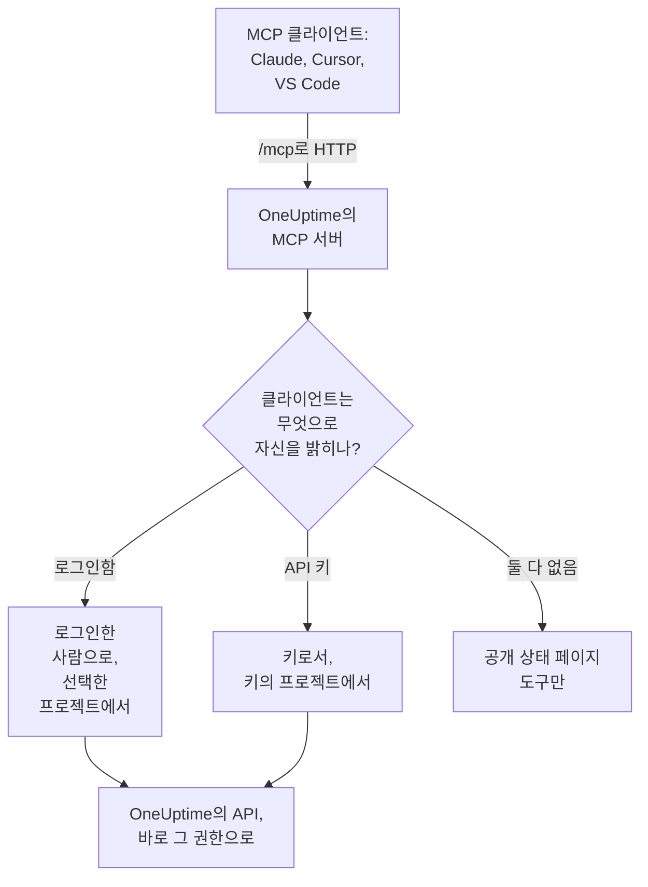

# MCP 서버

OneUptime MCP 서버를 사용하면 AI 어시스턴트가 OneUptime 프로젝트에서 직접 작업할 수 있습니다. Claude, Cursor, GitHub Copilot이 있는 VS Code 또는 Model Context Protocol(MCP)의 다른 클라이언트를 연결한 뒤, 인시던트를 살펴보고, 로그와 트레이스를 조회하고, 알림을 확인하고, 모니터를 설정해 달라고 요청하세요. 클라이언트는 사용자의 권한 또는 API 키의 권한으로 OneUptime의 도구를 호출합니다.

:::cards
- [클라이언트 연결하기](#클라이언트-연결하기): 클라이언트에 서버 주소를 알려 주고 로그인합니다.
- [OneUptime으로 로그인하기](#oneuptime으로-로그인하기): 연결된 클라이언트가 할 수 있는 일과 연결을 끊는 방법입니다.
- [API 키 받기](#api-키-받기): 사람 없이 실행되는 에이전트를 위한 방법입니다.
- [문제 해결](#문제-해결): 로그인, 권한, 연결 문제입니다.
:::

## 작동 방식

MCP 서버는 모든 OneUptime 인스턴스에 포함되어 있으며, 대시보드와 같은 주소의 `/mcp` 에 있고 streamable HTTP 전송을 사용합니다. 설치할 것은 없습니다.

- **OneUptime Cloud**: `https://oneuptime.com/mcp`
- **셀프 호스팅**: `https://your-oneuptime-domain.com/mcp`



서버는 상태를 저장하지 않습니다. 세션 ID를 발급하지 않고 모든 요청이 독립적이므로, 로드 밸런서 뒤에서도, 여러 복제본에서도 동작합니다.

## 도구로 할 수 있는 일

- **모니터**: 모니터를 만들고 구성하며, 상태를 확인하고 기록을 검토합니다.
- **인시던트 대응**: 인시던트를 만들고, 확인하고, 해결하며, 내부 메모나 공개 메모를 추가하고 해결될 때까지 따라갑니다.
- **알림**: 알림을 확인하고 해결하며, 메모를 추가하고, 알림 상태와 심각도를 관리합니다.
- **팀과 온콜**: 팀과 온콜 정책을 관리합니다.
- **상태 페이지**: 상태 페이지를 관리하고 공지를 게시합니다.
- **예정된 유지 관리**: 유지 관리 이벤트를 만들고 관리합니다.
- **텔레메트리**: 로그, 메트릭, 트레이스, 예외, 모니터 로그, 보안 이벤트 등을 조회합니다(읽기 전용).

30가지 레코드에 대한 생성, 조회, 목록, 업데이트, 삭제, 개수 도구와 9가지 텔레메트리에 대한 목록과 개수 도구, 그리고 인시던트 대응을 위한 도구가 있습니다. 읽기 전용 도구에는 `readOnlyHint` 가, 무언가를 바꾸는 모든 도구에는 `destructiveHint` 가, 공개 상태 페이지 도구에만 `openWorldHint` 가 붙어 있어 클라이언트는 읽기 전용 호출은 스스로 실행하고 무언가를 바꾸기 전에는 사용자에게 물어볼 수 있습니다. 실패한 도구 호출은 MCP 프로토콜 오류가 아니라 `statusCode`, 세부 정보, 제안이 담긴 도구 결과(`isError: true`)로 돌아오므로, 에이전트는 실패 내용을 읽고 스스로 바로잡을 수 있습니다.

## 시작하기 전에

- OneUptime 인스턴스: OneUptime Cloud 또는 셀프 호스팅.
- Claude Code, Claude, GitHub Copilot이 있는 VS Code, Cursor 같은 MCP 클라이언트.
- 로그인에 사용할 OneUptime 계정, 또는 사람 없이 실행되는 에이전트를 위한 OneUptime API 키. 공개 상태 페이지 도구에는 둘 다 필요하지 않습니다.
- OneUptime Cloud에서는 Growth 플랜 이상: MCP 클라이언트 연결은 API 키와 같은 플랜에서 사용할 수 있습니다.

## 클라이언트 연결하기

클라이언트에는 서버 주소만 알려 주세요. 처음 데이터가 필요할 때 클라이언트가 로그인할 수 있도록 브라우저에서 OneUptime을 엽니다([OneUptime으로 로그인하기](#oneuptime으로-로그인하기) 참고). 셀프 호스팅 인스턴스에서는 `https://oneuptime.com/mcp` 대신 `https://your-oneuptime-domain.com/mcp` 를 사용합니다.

:::tabs
@tab Claude Code
```bash
claude mcp add --transport http oneuptime https://oneuptime.com/mcp
```
그런 다음 Claude Code 안에서 `/mcp` 를 실행하고 **oneuptime** 을 선택해 로그인합니다.
@tab Claude
Claude에서 **Customize → Connectors** 를 열고 **Add custom connector** 를 선택한 다음 `https://oneuptime.com/mcp` 를 입력합니다. Claude는 처음 데이터가 필요할 때 OneUptime에 로그인하라고 요청합니다.
@tab VS Code
이것을 MCP 구성에 추가합니다(구성 위치는 [GitHub Copilot이 있는 VS Code](#github-copilot이-있는-vs-code) 참고). 서버를 시작하면 VS Code가 로그인할 수 있도록 OneUptime을 엽니다:
```json
{
  "servers": {
    "oneuptime": {
      "type": "http",
      "url": "https://oneuptime.com/mcp"
    }
  }
}
```
@tab Cursor
```json
{
  "mcpServers": {
    "oneuptime": {
      "url": "https://oneuptime.com/mcp"
    }
  }
}
```
:::

MCP 인증을 지원하는 다른 클라이언트도 똑같이 동작합니다. 주소만 알려 주면 나머지는 클라이언트가 모두 알아냅니다. 프로토콜은 [로그인(OAuth 2.1)](#로그인oauth-21) 을 참고하세요.

대시보드에도 인스턴스 주소가 채워진 이 단계가 있습니다: **프로젝트 설정 → AI → MCP 서버**. 또한 어떤 리소스(모니터, 인시던트, 상태 페이지 등)에서든 사이드 메뉴의 **개발자** 를 펼치고 **AI 어시스턴트** 를 선택하세요. 이 페이지는 리소스와 그 ID를 담은 프롬프트도 제안하므로 어시스턴트가 리소스를 바로 찾습니다. 워크플로처럼 MCP 서버에 아직 도구가 없는 리소스의 경우, 명령을 실행할 수 있는 어시스턴트가 대신 REST API로 작업하는 방법을 페이지가 보여 줍니다.

## OneUptime으로 로그인하기

가장 간단한 연결 방법은 MCP 클라이언트에 서버 주소만 알려 주는 것입니다. 클라이언트가 처음 데이터를 필요로 하면 브라우저에서 OneUptime 페이지가 열립니다:

:::steps
1. 아직 로그인하지 않았다면 OneUptime에 로그인합니다.
2. 클라이언트가 작업할 프로젝트를 선택합니다.
3. **읽기 및 쓰기** 또는 **읽기 전용** 을 선택합니다.
4. **승인** 을 클릭합니다.
:::

그러면 클라이언트는 그 프로젝트에서 사용자 본인으로 동작합니다. 만들거나 복사하거나 교체할 API 키가 없고, 구성 파일에 비밀 정보가 저장되지도 않습니다.

연결된 클라이언트가 할 수 있는 일:

- **사용자의 권한을 가지며, 그보다 많이 갖지 않습니다.** 팀이 프로젝트에서 사용자에게 허용한 일이 곧 클라이언트가 할 수 있는 일입니다. 역할이 바뀌거나 프로젝트를 떠나면 클라이언트의 바로 다음 요청부터 적용됩니다. 프로젝트를 떠나면 클라이언트 연결도 끊깁니다. 클라이언트의 승인이 삭제되며, 프로젝트에 다시 참여하면 클라이언트를 다시 연결하면 됩니다.
- **읽기 전용은 말 그대로 읽기 전용입니다.** 읽기 전용으로 승인된 클라이언트는 `get_`, `list_`, `count_` 도구를 사용할 수 있습니다. 생성, 업데이트, 삭제, 확인, 해결을 하는 도구는 MCP 서버와 그 뒤의 OneUptime API 양쪽에서 거부됩니다. 클라이언트가 요청한 것보다 많은 접근 권한을 줄 수는 없습니다.
- **하나의 프로젝트용입니다.** 다른 프로젝트를 사용하려면 클라이언트를 다시 연결하고 그 프로젝트를 선택합니다.
- **MCP 서버를 통해서만 동작합니다.** 클라이언트의 액세스 토큰은 MCP 엔드포인트에서만 받아들여지고 다른 곳에서는 받아들여지지 않습니다. OneUptime REST API를 직접 호출하는 데 사용할 수 없습니다.
- **인스턴스 관리자도 특별 대우를 받지 않습니다.** 마스터 관리자가 연결한 클라이언트는 그 사람의 팀이 프로젝트에서 부여한 권한만 가지며, 인스턴스 전체에 대한 접근 권한은 없습니다.

### 연결된 클라이언트 관리하기

로그인으로 연결된 모든 클라이언트는 **프로젝트 설정 → AI → MCP 서버** 의 **연결된 MCP 클라이언트** 아래에, 연결한 사람, 할 수 있는 일, 마지막 사용 시각과 함께 표시됩니다. 자신이 연결한 클라이언트가 보이며, 프로젝트 소유자와 관리자에게는 모든 사람의 클라이언트가 보입니다.

클라이언트를 로그아웃시키려면 **연결 해제** 를 클릭합니다. 클라이언트는 즉시 동작을 멈춥니다.

클라이언트는 사용되는 동안 계속 연결되어 있습니다. 30일 동안 사용되지 않은 클라이언트는 다시 로그인해야 합니다.

### 클라이언트를 연결할 수 있는 사람 제어하기

기본적으로 모든 프로젝트 멤버가 MCP 클라이언트를 연결할 수 있습니다. 어떤 팀의 멤버가 그렇게 하지 못하게 하려면 팀의 **권한** 페이지를 열고, 아래쪽의 **추가 설정** 을 연 다음, **권한 차단** 에 **Authorize MCP Client** 권한을 추가합니다. 그 멤버들이 이미 연결한 클라이언트는 즉시 동작을 멈춥니다.

프로젝트에서 싱글 사인온이 필수라면, 클라이언트를 승인하기 전에 브라우저에서 SSO로 프로젝트에 로그인하세요. 클라이언트의 연결은 그 SSO 로그인이 유지되는 동안만 지속됩니다. 로그인이 만료되거나, 로그인에 사용한 SSO 공급자가 꺼지거나 삭제되면 클라이언트를 다시 연결하세요.

OneUptime Cloud에서 MCP 클라이언트 연결은 API 키와 같은 플랜(Growth 이상)에서 사용할 수 있습니다.

Enterprise Edition에서는 연결된 클라이언트가 만든 모든 변경 사항이 연결한 사람의 이름과 클라이언트 이름으로 감사 로그에 기록됩니다. API 키로 만든 변경 사항에는 키의 이름이 표시됩니다.

## API 키 받기

예약된 작업이나 CI 파이프라인처럼 로그인할 사람이 없는, 사람 없이 실행되는 에이전트에는 API 키를 사용합니다.

:::steps
### 키 만들기

**프로젝트 설정 → 고급 → API 키** 로 이동해 **API 키 만들기** 를 클릭합니다. "MCP Server" 같은 이름을 붙입니다.

### 할 수 있는 일 고르기

**접근** 에서 읽기만 하는 에이전트에는 **뷰어** 를, 생성, 업데이트, 삭제도 하는 에이전트에는 **프로젝트 관리자** 를 고릅니다([API 키 권한](#api-키-권한) 참고).

### 키 복사하기

**API 키 만들기** 를 클릭하면 키 페이지가 열립니다. 거기서 키를 복사합니다.
:::

API 키는 하나의 프로젝트에 속합니다. MCP 서버는 키에서 프로젝트를 알아내므로 생성 도구에는 `projectId` 인수가 필요하지 않습니다.

> [!WARNING]
> AI 에이전트에게 마스터 키를 절대 주지 마세요. OneUptime 마스터 API 키도 이 헤더에서 받아들여지며, 인스턴스 전체에 대한 관리자 접근 권한을 줍니다. 항상 에이전트에 필요한 최소한의 권한을 가진 프로젝트 API 키를 사용하세요. 모든 `get_`, `list_`, `count_` 도구에는 읽기 전용 키로 충분합니다.

## API 키로 연결하기

키는 `x-api-key` 헤더로 보냅니다. API 키를 담은 요청은 로그인을 요청받지 않습니다. 셀프 호스팅 인스턴스에서는 `oneuptime.com` 대신 자신의 도메인을 사용합니다.

:::tabs
@tab Claude Code
```bash
claude mcp add --transport http oneuptime https://oneuptime.com/mcp --header "x-api-key: your-api-key-here"
```
@tab Claude Desktop
이것을 `claude_desktop_config.json` 에 추가합니다. 이 파일은 macOS에서는 `~/Library/Application Support/Claude/`, Windows에서는 `%APPDATA%\Claude\`, Linux에서는 `~/.config/Claude/` 에 있습니다:
```json
{
  "mcpServers": {
    "oneuptime": {
      "transport": "streamable-http",
      "url": "https://oneuptime.com/mcp",
      "headers": {
        "x-api-key": "your-api-key-here"
      }
    }
  }
}
```
@tab VS Code
`"password": true` 가 있는 입력 변수는 키를 평문으로 보관하는 대신 서버가 시작될 때 키를 묻습니다:
```json
{
  "servers": {
    "oneuptime": {
      "type": "http",
      "url": "https://oneuptime.com/mcp",
      "headers": {
        "x-api-key": "${input:oneuptime-api-key}"
      }
    }
  },
  "inputs": [
    {
      "type": "promptString",
      "id": "oneuptime-api-key",
      "description": "OneUptime API Key",
      "password": true
    }
  ]
}
```
@tab Cursor
```json
{
  "mcpServers": {
    "oneuptime": {
      "url": "https://oneuptime.com/mcp",
      "headers": {
        "x-api-key": "your-api-key-here"
      }
    }
  }
}
```
:::

## GitHub Copilot이 있는 VS Code

VS Code 1.99 이상은 GitHub Copilot Chat에서 MCP 서버를 기본으로 지원합니다.

:::steps
### 필요한 것 확인하기

VS Code 1.99 이상, GitHub Copilot 확장 프로그램 설치 및 로그인, GitHub Copilot Chat 활성화가 필요합니다.

### MCP 구성 열기

`Ctrl+Shift+P`(macOS에서는 `Cmd+Shift+P`)를 누르고 "MCP: Open User Configuration" 을 입력한 다음 Enter를 누릅니다. `mcp.json` 파일이 열리거나 만들어집니다. 하나의 작업 영역에서만 쓰려면 대신 그 안에 `.vscode/mcp.json` 을 만드세요.

### OneUptime 추가하기

위의 VS Code 구성을 붙여 넣습니다. 로그인용인 키 없는 구성이나 API 키가 있는 구성 중 하나입니다.

### 서버 시작하기

`Ctrl+Shift+P`(macOS에서는 `Cmd+Shift+P`)를 누르고 "MCP: List Servers" 를 입력한 다음 **oneuptime** 을 선택해 시작합니다. VS Code는 처음에 서버를 신뢰할지 묻고, 그다음 로그인하거나 API 키를 입력하라고 요청합니다.

### Copilot에게 질문하기

에이전트 모드에서 GitHub Copilot Chat을 열고, 예를 들어 "OneUptime에 어떤 모니터가 있어?", "최근 인시던트를 보여 줘", "https://example.com 에 대한 새 모니터를 만들어 줘" 처럼 질문합니다.
:::

## 인증

MCP 서버를 사용하는 방법은 세 가지입니다.

### 공개 도구(인증 불필요)

API 키나 로그인 없이도 클라이언트는 공개 도구를 사용할 수 있습니다:

- **`oneuptime_help`**: OneUptime MCP 도구에 대한 도움말과 안내
- **`oneuptime_list_resources`**: 리소스와 각 리소스로 할 수 있는 일
- **`get_public_status_page_overview`**: 공개 상태 페이지의 개요
- **`get_public_status_page_incidents`**: 공개 상태 페이지의 인시던트
- **`get_public_status_page_scheduled_maintenance`**: 그 페이지의 예정된 유지 관리 이벤트
- **`get_public_status_page_announcements`**: 그 페이지의 공지

공개 상태 페이지 도구는 상태 페이지의 ID(UUID)나 도메인 이름을 받습니다. 이 도구만 사용하려면 자격 증명 없이 주소만으로 연결합니다:

```json
{
  "mcpServers": {
    "oneuptime": {
      "transport": "streamable-http",
      "url": "https://oneuptime.com/mcp"
    }
  }
}
```

상태 페이지의 소유자는 그 페이지의 MCP 접근을 끌 수 있습니다. 상태 페이지 사이드 메뉴의 **AI** 섹션에서 **MCP** 를 열고 **MCP 서버 활성화** 를 끕니다. 스위치는 전환하는 즉시 저장됩니다. MCP 접근은 기본적으로 켜져 있습니다. 꺼져 있는 동안 네 가지 `get_public_status_page_*` 도구는 그 상태 페이지에 대해 오류를 반환합니다. 상태 페이지 웹사이트, RSS 피드, 공개 JSON API는 영향을 받지 않으며, 로그인이 필요한 상태 페이지 도구(`get_status_page`, `list_status_pages` 등)는 그 페이지가 속한 프로젝트에서 계속 동작합니다.

### 로그인(OAuth 2.1)

그 밖의 모든 도구는 누가 호출하는지 알아야 합니다. 자격 증명 없이 그런 도구를 호출한 클라이언트는 서버의 보호된 리소스 메타데이터를 가리키는 `WWW-Authenticate` 헤더와 함께 `401 Unauthorized` 를 받습니다. 이것이 MCP 클라이언트가 사용자를 로그인시키는 신호입니다. `initialize`, `tools/list`, 공개 도구는 로그인을 요구하지 않습니다.

서버는 [MCP 인증 사양](https://modelcontextprotocol.io/specification/latest/basic/authorization) 을 구현합니다:

- **흐름**: PKCE(`S256` 만)를 사용하는 OAuth 2.1 인증 코드. 액세스 토큰은 `Authorization: Bearer` 로 전송됩니다.
- **검색**: 보호된 리소스 메타데이터(RFC 9728)와 인증 서버 메타데이터(RFC 8414). 발급자와 리소스는 모두 `https://<host>/mcp` 입니다.
- **클라이언트 식별**: Client ID Metadata Document(클라이언트 ID는 서버가 가져오는 `https` URL), 또는 동적 클라이언트 등록(RFC 7591). 관리자가 클라이언트를 등록할 필요가 없습니다.
- **범위**: `get_`, `list_`, `count_` 도구에는 `mcp:read`. `mcp:write` 는 무언가를 바꾸는 모든 도구를 더하며 `mcp:read` 를 포함합니다. 읽기 전용 토큰으로 쓰기 도구를 호출하면 `error="insufficient_scope"` 와 함께 `403` 을 받습니다.
- **토큰 수명**: 액세스 토큰은 한 시간 동안 유효합니다. 갱신 토큰은 30일 동안 유효하며 사용할 때마다 교체됩니다. 이미 교체된 갱신 토큰을 사용하면 연결이 끝납니다.
- **리소스 표시자**(RFC 8707): 토큰은 `https://<host>/mcp` 에 대해 발급되며 다른 곳에서는 받아들여지지 않습니다.
- **폐기**(RFC 7009): 어느 토큰이든 폐기하면 연결이 끝납니다.

### API 키

사람 없이 실행되는 에이전트는 다음 헤더 중 하나로 OneUptime API 키를 보냅니다:

- `x-api-key`: OneUptime API 키
- `Authorization`: API 키를 담은 bearer 토큰(예: `Bearer your-api-key-here`)

`Bearer` 스킴은 대소문자를 구분하지 않습니다. API 키를 담은 요청은 로그인을 요청받지 않습니다.

OneUptime Cloud에서 API 키는 프로젝트가 **Growth** 이상 플랜에 있는 동안만 동작합니다. 그보다 낮은 플랜에서는 키가 필요한 모든 도구가 플랜을 알려 주는 메시지와 함께 `402` 를 반환하며, 에이전트에게 다시 시도하지 말라고 알립니다. 삭제되는 것은 없습니다. 프로젝트가 다시 Growth가 되면 아무것도 다시 연결하지 않아도 키가 그대로 다시 동작합니다. 로그인으로 연결된 클라이언트는 사람으로 동작하므로 계속 동작합니다([플랜 미만의 API 키와 SCIM](/docs/api-reference/api-reference#플랜-미만의-api-키와-scim)).

## 사용 가능한 엔드포인트

| 엔드포인트 | 메서드 | 설명 |
| --- | --- | --- |
| `/mcp` | POST | 도구 호출 등의 작업을 위한 JSON-RPC 요청 |
| `/mcp` | GET | SSE `Accept` 헤더가 없으면 서버에 대한 짧은 JSON 설명. 있으면 `405`. 상태를 저장하지 않는 서버는 독립된 SSE 스트림을 제공하지 않기 때문입니다(사양을 따르는 클라이언트는 그것 없이 계속 진행합니다) |
| `/mcp` | DELETE | 아무것도 하지 않습니다. 서버가 상태를 저장하지 않으므로 끝낼 세션이 없습니다 |
| `/mcp/health` | GET | 상태 확인 |
| `/mcp/tools` | GET | 일반 REST로 제공되는 도구 목록 |

로그인하는 MCP 클라이언트는 아래의 OAuth 엔드포인트도 사용합니다. 클라이언트가 직접 찾으므로, 여기서는 클라이언트를 작성하거나 프록시를 설정하는 사람을 위해 나열합니다.

| 엔드포인트 | 메서드 | 설명 |
| --- | --- | --- |
| `/mcp/.well-known/oauth-protected-resource` | GET | 보호된 리소스 메타데이터(RFC 9728). `/.well-known/oauth-protected-resource/mcp` 에도 있습니다 |
| `/.well-known/oauth-authorization-server/mcp` | GET | 인증 서버 메타데이터(RFC 8414). `/mcp/.well-known/oauth-authorization-server` 에도 있습니다 |
| `/mcp/oauth/authorize` | GET | 인증 엔드포인트: 클라이언트가 로그인을 위해 브라우저를 보내는 곳 |
| `/mcp/oauth/token` | POST | 토큰 엔드포인트: 인증 코드나 갱신 토큰을 교환합니다 |
| `/mcp/oauth/register` | POST | 동적 클라이언트 등록(RFC 7591) |
| `/mcp/oauth/revoke` | POST | 토큰 폐기(RFC 7009) |

서버가 실행 중인지 확인하고 도구 목록을 보려면:

```bash
curl https://oneuptime.com/mcp/health
curl https://oneuptime.com/mcp/tools
```

## 인시던트 대응을 위한 도구

레코드 종류별 도구 외에도, 서버에는 인시던트와 알림에 대응하기 위해 만든 도구가 있습니다:

- **`acknowledge_incident`** / **`resolve_incident`**: 대시보드의 버튼과 마찬가지로 인시던트를 프로젝트의 Acknowledged 또는 Resolved 상태로 옮깁니다
- **`acknowledge_alert`** / **`resolve_alert`**: 알림에 대해 같은 일을 합니다
- **`add_incident_note`**: `visibility: "internal"`(팀만, 기본값) 또는 `visibility: "public"`(상태 페이지에 게시)로 인시던트에 메모를 추가합니다. Markdown을 지원합니다
- **`add_alert_note`**: 알림에 내부 메모를 추가합니다

일반적인 흐름: `list_incidents` → `acknowledge_incident` → `list_logs` 로 조사 → `add_incident_note`(공개) → `resolve_incident`.

**`oneuptime_whoami`** 도구는 자격 증명이 속한 프로젝트(ID와 이름)를 반환합니다. 로그인한 클라이언트라면 누구로 로그인했는지, 변경할 수 있는지도 알려 줍니다. 에이전트가 상황을 파악하기에 좋은 첫 호출이며, 생성 도구는 자격 증명에서 `projectId` 를 가져오므로 에이전트가 프로젝트 ID를 넘길 필요가 없습니다.

## 텔레메트리 조회하기

로그, 메트릭, 트레이스(스팬), 예외, 모니터 로그 등의 텔레메트리는 읽기 전용 `list_` 및 `count_` 도구로 제공됩니다(`list_logs`, `list_metrics`, `list_spans`, `list_exception_instances`, `list_monitor_logs` 와 각각의 `count_` 짝). 텔레메트리는 OpenTelemetry로 들어오므로 생성 도구는 없습니다.

텔레메트리는 항상 시간 범위를 정해 조회하세요. 쿼리 필드에는 값이나 연산자 객체를 넣습니다:

```json
{
  "query": {
    "time": { "_type": "GreaterThan", "value": "2026-07-04T00:00:00.000Z" }
  },
  "sort": { "time": "DESC" },
  "limit": 50
}
```

연산자는 `EqualTo`, `NotEqual`, `IsNull`, `NotNull`, `EqualToOrNull`, `GreaterThan`, `LessThan`, `GreaterThanOrEqual`, `LessThanOrEqual`, `InBetween`, `Search`, `Includes` 입니다. 정렬 값은 `"ASC"` 또는 `"DESC"` 입니다.

## 필드 선택과 페이지 나누기

`get_` 및 `list_` 도구는 필드 이름 배열인 `select` 를 선택적으로 받습니다. 기본적으로 무거운 필드(JSON, 매우 긴 텍스트, HTML 열)를 제외한 모든 읽을 수 있는 필드가 반환되며, 무거운 필드는 `select` 에서 요청해야 합니다.

목록 도구는 `limit`(기본 10, 최대 100)와 `skip` 으로 페이지를 나누며, 각 목록 응답은 무엇을 반환했는지 정확히 알려 줍니다:

```json
{
  "returnedCount": 10,
  "totalCount": 42,
  "skip": 0,
  "limit": 10,
  "hasMore": true,
  "data": ["..."]
}
```

## 사용 예시

### 일상적인 질문

```text
"What's the current status of all my monitors?"
"Show me incidents from the last 24 hours"
"List the teams in this project"
"Show me our on-call policies"
```

### 모니터와 인시던트

```text
"Create a new website monitor for https://example.com that checks every 5 minutes"
"Set up an API monitor for https://api.example.com/health with a 30-second timeout"
"Disable the monitor for staging.example.com while we're doing maintenance"
"Create a high-priority incident for the database outage affecting user authentication"
"Add a note to incident #123 saying 'Database connection restored, monitoring for stability'"
"Mark incident #456 as resolved"
```

### 상태 페이지

```text
"Update our status page to show 'Investigating Payment Issues' for the payment service"
"Create a status page announcement about scheduled maintenance this weekend"
```

### 공개 상태 페이지 질의(API 키 불필요)

이 예시는 자격 증명 없이 공개 상태 페이지 도구만으로 동작합니다:

```text
"What's the current status of status.example.com?"
"Show me recent incidents from the OneUptime status page"
"Are there any scheduled maintenance events on status.acme.com?"
"Get the latest announcements from my public status page with ID abc123-..."
```

### 여러 단계를 한 번에

```text
"Create a scheduled maintenance window for Saturday 2-4 AM, disable all monitors for api.example.com during that time, and update the status page"
"Show me all monitors that have been down in the last hour, create incidents for any that don't already have one"
```

## API 키 권한

| 에이전트가 하는 일 | **접근** 에서 고를 것 |
| --- | --- |
| 읽기만 함 | **뷰어**, 또는 키 페이지에서 읽기 권한 추가 |
| 생성, 업데이트, 삭제도 함 | **프로젝트 관리자**, 또는 키 페이지에서 Project Admin 역할 추가 |

각 키에는 필요한 최소한의 권한만 주고, 키를 정기적으로 교체하고, 환경마다 별도의 키를 두고, 각 키가 하는 일을 OneUptime에서 지켜보세요.

## 셀프 호스팅 구성

셀프 호스팅 인스턴스에서는 로그인이 별도 설정 없이 동작합니다. 이를 바꾸는 설정은 두 가지입니다:

| 환경 변수 | Helm 값 | 하는 일 |
| --- | --- | --- |
| `DISABLE_MCP_OAUTH` | `mcpOAuth.disabled` | `true` 로 설정하면 로그인을 끕니다. OAuth 엔드포인트가 더 이상 제공되지 않고 MCP 서버는 API 키만 받아들입니다. 삭제되는 것은 없으며, 다시 켜면 연결된 클라이언트가 다시 동작합니다. |
| `DISABLE_MCP_OAUTH_CLIENT_ID_METADATA_DOCUMENTS` | `mcpOAuth.disableClientIdMetadataDocuments` | 인터넷에 연결할 수 없는 인스턴스에서 `true` 로 설정합니다. 클라이언트는 OneUptime이 가져오는 URL로 자신을 식별할 수 있는데, 이 설정을 켜면 클라이언트가 대신 인스턴스에 직접 등록하므로 외부로 나가는 요청이 필요 없습니다. |

OneUptime 앞에 자체 리버스 프록시를 두고 있다면, `/mcp` 와 함께 `/.well-known/oauth-protected-resource` 와 `/.well-known/oauth-authorization-server`(및 그 아래의 모든 경로)를 OneUptime으로 전달하세요. 함께 제공되는 ingress는 이미 그렇게 합니다.

서버는 모든 OAuth URL을 `HOST` 와 `HTTP_PROTOCOL` 설정으로 만들므로, 이 값은 사람들이 인스턴스에 접속하는 주소와 일치해야 합니다.

## 문제 해결

### 로그인 문제

- **클라이언트가 로그인을 요청하지 않음**: 클라이언트가 MCP 인증을 지원하지 않거나, 우선 적용되는 API 키 헤더가 구성되어 있을 수 있습니다. 대신 로그인하려면 그 헤더를 제거하세요.
- **인증 페이지에서 프로젝트가 회색으로 표시됨**: 프로젝트 이름 옆에 이유가 표시됩니다. 프로젝트 플랜에 MCP 클라이언트 연결이 포함되어 있지 않거나, 프로젝트에 SSO가 필수인데 이 브라우저에서 SSO로 로그인하지 않았거나, 팀이 클라이언트 연결을 차단당한 경우입니다.
- **도구가 "read-only" 로 거부됨**: 클라이언트가 읽기 전용으로 승인되었습니다. 다시 연결하고 **읽기 및 쓰기** 를 선택하세요.
- **클라이언트가 동작을 멈춤**: 연결이 끊겼거나, 30일 동안 사용되지 않았거나, 프로젝트에서 제거되었거나, 프로젝트의 SSO 로그인이 만료되었거나 그 공급자가 꺼진 경우입니다. 다시 연결하세요.
- **셀프 호스팅 - 클라이언트가 인증 서버를 찾을 수 없다고 함**: `HOST` 와 `HTTP_PROTOCOL` 이 공개 주소와 일치하는지, 프록시가 `/.well-known/oauth-*` 경로를 전달하는지 확인하세요.

### 권한 오류

API 키, 또는 로그인한 클라이언트라면 사용자 본인의 계정에 올바른 권한이 있어야 합니다. 레코드 목록에는 읽기 권한, 생성과 업데이트에는 쓰기 권한, 삭제에는 삭제 권한이 필요합니다.

### 연결 문제

OneUptime 주소가 올바르고 접근 가능한지, API 키가 유효한지, 상태 확인 엔드포인트가 응답하는지 확인하세요([사용 가능한 엔드포인트](#사용-가능한-엔드포인트) 참고).

### 잘못된 API 키

- OneUptime 설정에서 API 키를 확인하세요. 여분의 공백이나 문자가 없어야 합니다
- 키가 만료되지 않았는지 확인하세요
- OneUptime Cloud에서 API 키에 Growth 플랜이 필요하다는 `402` 가 반환되면 프로젝트가 그 플랜보다 낮다는 뜻입니다. **프로젝트 설정 → 결제 및 청구서 → 결제** 에서 프로젝트를 업그레이드하면 같은 키가 다시 동작합니다

### 세션 오류

MCP 서버는 상태를 저장하지 않습니다. 세션 ID를 발급하지도 추적하지도 않으므로 모든 요청이 어느 복제본에서든 동작합니다. 이전 서버 버전에서 받은 `mcp-session-id` 헤더를 보내는 클라이언트는 그 헤더를 빼도 됩니다. 무시됩니다. 서버가 세션 ID를 반환한다고 기대하는 이전 클라이언트 구성은 업데이트하세요.

## 사용 가능한 리소스

| 분야 | 생성, 조회, 목록, 업데이트, 삭제, 개수 도구가 있는 레코드 |
| --- | --- |
| 모니터링 | Monitor, Monitor Status, Monitor Status Event |
| 인시던트 | Incident, Incident State, Incident Severity, Incident State Timeline, Incident Public Note, Incident Internal Note, Incident Alert, Postmortem Status |
| 알림 | Alert, Alert State, Alert Severity, Alert State Timeline, Alert Internal Note |
| 상태 페이지 | Status Page, Status Page Announcement |
| 예정된 유지 관리 | Scheduled Maintenance Event, Scheduled Maintenance State, Scheduled Maintenance State Timeline |
| 팀과 온콜 | Team, On-Call Policy |
| 레이블 | Label |
| 보안 | Security Case, Security Case Note, Security Case Priority, Security Case Status, Security Detection, Security Playbook |

| 분야 | 목록과 개수 도구만 있는 텔레메트리 |
| --- | --- |
| 옵저버빌리티 | Log, Metric, Span, Exception Instance, Monitor Log |
| 보안 | Security Event, Threat Intel Indicator |
| 변경과 비용 | Change Event, Kubernetes Cost Allocation |

도구 이름은 스네이크 케이스입니다: `create_incident`, `get_incident`, `list_incidents`, `update_incident`, `delete_incident`, `count_incidents`, 텔레메트리라면 `list_logs` 와 `count_spans` 입니다.

## 다음 단계

:::cards
- [AI에게 질문](/docs/ai/ask-ai): 대신 OneUptime 안에서 프로젝트에 대해 질문합니다.
- [OneUptime API 레퍼런스](/docs/api-reference/api-reference): 모든 도구 뒤에 있는 REST API입니다.
- [권한](/docs/permissions/index): 역할, 팀, API 키가 할 수 있는 일입니다.
:::
