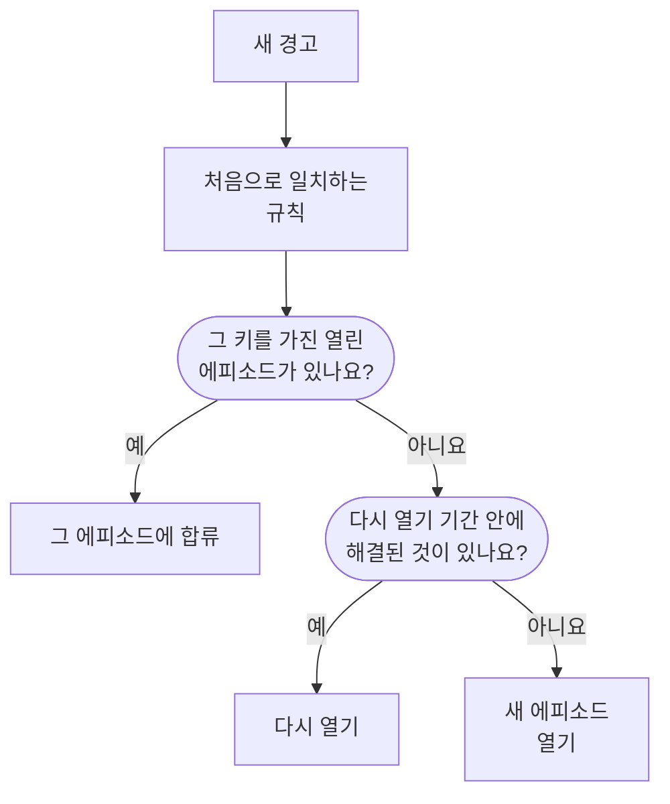
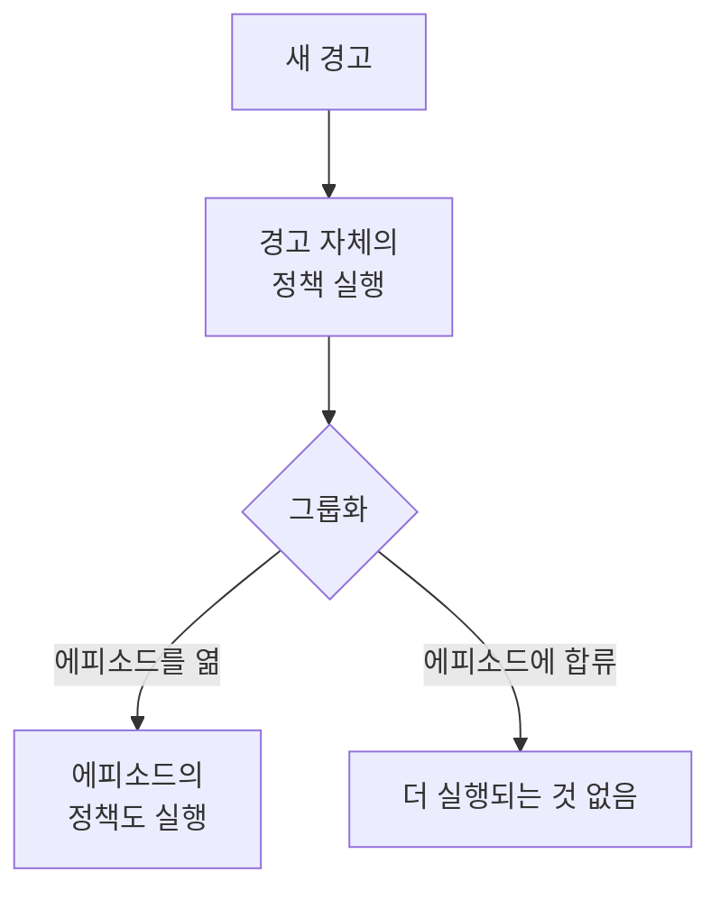

# 경고 에피소드 및 그룹화 규칙

데이터베이스가 다운되면 모니터 스무 개가 몇 분 안에 경고 스무 개를 발생시킬 수 있습니다. 에피소드는 이 경고들을 팀이 한꺼번에 인지하고 해결하는 하나의 레코드로 묶고, 그룹화 규칙이 어떤 경고가 들어갈지 정합니다. 이 페이지에서는 그룹화의 작동 방식, 규칙 설정 방법, 열린 에피소드의 동작을 설명합니다.

:::cards
- [그룹화 작동 방식](#그룹화-작동-방식): 규칙, 그룹화 키, 시간 창.
- [그룹화 규칙 만들기](#그룹화-규칙-만들기): 템플릿에서 클릭 한 번으로, 또는 직접.
- [에피소드의 동작](#에피소드의-동작): 심각도, 상태, 해결 시점.
- [에피소드가 호출하는 사람](#에피소드가-호출하는-사람): 규칙의 온콜 정책과 경고 자체의 정책.
:::

## 그룹화 작동 방식

그룹화는 새 경고마다 한 번, 그 경고의 온콜 정책이 실행된 직후에 실행됩니다. 경고는 활성화된 그룹화 규칙과 목록 위에서부터 차례로 대조되며, 처음으로 일치하는 규칙이 에피소드를 정합니다. 어떤 규칙과도 일치하지 않는 경고는 따로 남습니다.

- **규칙의 조건**은 규칙이 어떤 경고에 적용되는지 정합니다. 조건이 없는 규칙은 모든 새 경고에 적용됩니다.
- **그룹화 키**는 어떤 경고가 에피소드를 함께 쓰는지 정합니다. 같은 모니터, 같은 심각도, 같은 제목, 또는 규칙이 그룹화에 쓰는 조합이 같은 경고들입니다. 그룹화 기준이 없는 규칙은 일치하는 모든 경고를 하나의 에피소드에 넣습니다.
- **시간 창**은 에피소드가 얼마나 오래 경고를 받는지 정합니다. 켜져 있으면 에피소드의 마지막 경고 이후 시간 창 안에 들어온 경고만 합류합니다. 꺼져 있으면 에피소드가 해결될 때까지 일치하는 경고가 계속 합류합니다.

그룹화는 경고가 생성될 때 일어납니다. 오늘 추가한 규칙은 그 이후에 생성된 경고를 그룹화하며, 이미 있는 경고를 다시 그룹화하지는 않습니다.

> [!NOTE]
> 이미 인지된 상태로 생성된 경고는 열린 에피소드에 합류할 수 있지만 에피소드를 열지는 않으며, 해결된 상태로 생성된 경고는 전혀 그룹화되지 않습니다. [이미 인지되었거나 해결된 상태로 생성](/docs/alerts/index#이미-인지되었거나-해결된-상태로-생성)을 참고하세요.

## 그룹화 규칙 만들기

**경고 → 규칙 → 그룹화 규칙**으로 이동하세요. 사이드 메뉴의 **규칙** 섹션은 접힌 상태로 시작하므로 먼저 펼치세요.

### 템플릿에서 시작하기

그룹화 규칙이 없는 프로젝트에는 빈 목록 대신 미리 만든 규칙 네 개가 표시됩니다. 규칙이 있으면 카드의 **템플릿에서 생성**으로 엽니다. **규칙 추가**는 클릭 한 번으로 규칙을 저장하며, 활성화된 상태로 목록 끝에 놓이고 모든 새 경고에 적용됩니다. 이후에는 다른 규칙처럼 편집하세요.

| 템플릿                                 | 그룹화 방식                                               | 시간 창     |
| -------------------------------------- | --------------------------------------------------------- | ----------- |
| **같은 모니터의 경고 그룹화**          | 모니터마다 에피소드 하나                                  | 30분        |
| **함께 발생한 경고 그룹화**            | 모니터와 관계없이 공유하는 에피소드 하나                  | 10분        |
| **심각도별 경고 그룹화**               | 심각도마다 에피소드 하나                                  | 30분        |
| **같은 경고의 반복 그룹화**            | 경고 제목마다 에피소드 하나 (숫자와 대소문자 무시)        | 1시간       |

### 직접 만들기

:::steps
#### 그룹화 방식 답하기

템플릿 아래의 **사용자 지정 규칙 만들기**를, 또는 규칙이 있으면 카드의 **경고 그룹화 규칙 만들기**를 클릭하세요. **그룹화** 단계에서 **경고 그룹화 기준**이 하나의 질문을 합니다. **모니터**, **모두 함께**, **심각도**, **제목**, **사용자 지정** 중 하나입니다. **이름**은 직접 입력하기 전까지 답에 맞춰 바뀝니다.

#### 시간 창 설정하기

**가까운 시간에 들어온 경고만 그룹화**가 켜져 있고, 시간 창은 30분입니다. 분을 바꾸거나, 꺼서 해결될 때까지 에피소드 하나를 열어 두세요.

#### 사용자 지정용 필드 조합하기

**사용자 지정**은 스위치 다섯 개가 있는 **그룹화 기준** 단계를 추가합니다. **모니터별 그룹화**, **경고 심각도별 그룹화**, **경고 제목별 그룹화**, **경고 레이블별 그룹화**, **모니터 레이블별 그룹화**입니다. 레이블은 정확한 조합으로 그룹화됩니다.

#### 범위 좁히기

**대상 경고**에서 새 규칙이 처음 고르는 **모든 알림**은 모든 새 경고를 그룹화합니다. 범위를 좁히려면 **조건과 일치하는 알림만**을 고르고 모니터, 심각도, 레이블, 제목, 설명에 대한 조건을 추가하세요. 그런 다음 **경고 그룹화 규칙 만들기**를 클릭하세요.
:::

규칙이 할 수 있는 나머지 일은 **그룹화** 단계 끝의 **추가 필드** 아래에 세 그룹으로 접혀 있습니다. 접힌 상태에서도 머리글이 담긴 내용을 알려 주고 규칙이 쓰는 각 설정을 그 값과 함께 보여 주므로, 규칙을 편집할 때 규칙이 하는 일이 가려지지 않습니다.

| 그룹                      | 설정                                                                                                       |
| ------------------------- | ---------------------------------------------------------------------------------------------------------- |
| **온콜 및 소유권**        | 규칙이 에피소드를 열 때 실행할 **온콜 정책**과 **에피소드 소유자**.                                       |
| **에피소드 생명주기**     | **최근 해결된 에피소드 다시 열기**, **에피소드 해결 전 대기**, **조용한 에피소드 해결**. 각각 분 단위 값을 가진 스위치입니다. |
| **세부 정보**             | 규칙의 **설명**, **에피소드 제목 템플릿**, **에피소드 설명 템플릿**, **에피소드 레이블**.                  |

규칙은 목록 위에서부터 확인되며 첫 번째 일치가 우선합니다. 위치를 바꾸려면 규칙을 끌어 옮기세요. 구체적인 규칙을 넓은 규칙보다 위에 두세요. 목록의 **그룹화** 열은 각 규칙이 하는 일을 "모니터마다 에피소드 하나"처럼 한 문장으로 보여 줍니다.

## 에피소드 제목

템플릿이 없으면 에피소드는 첫 경고의 모니터 이름을 따르고, 모니터가 없으면 경고 제목의 앞 50자를 씁니다. **에피소드 제목 템플릿**이나 **에피소드 설명 템플릿**에서는 다음 변수가 채워집니다. 두 필드 중 어느 쪽에서든 `{{`를 입력하면 고를 수 있습니다.

| 변수                   | 채워지는 값                                                                                    |
| ---------------------- | ---------------------------------------------------------------------------------------------- |
| `{{alertTitle}}`       | 첫 경고의 제목.                                                                                |
| `{{alertDescription}}` | 첫 경고의 설명.                                                                                |
| `{{alertSeverity}}`    | 첫 경고의 심각도.                                                                              |
| `{{monitorName}}`      | 첫 경고의 모니터 이름.                                                                         |
| `{{alertCount}}`       | 에피소드에 있는 경고 수로, 경고가 합류하거나 빠질 때마다 다시 쓰입니다.                         |

첫 경고에 값이 없는 변수나 이 목록에 없는 변수는 생략됩니다. 첫 경고가 비공개이면 에피소드는 비공개가 아니므로 `{{alertTitle}}`과 `{{alertDescription}}`은 "Private alert"가 됩니다.

## 에피소드의 동작

에피소드는 경고와 같은 경고 상태 목록을 따라 이동하며, 자체 소유자, 메모, 근본 원인, 해결 노트를 가집니다.

- **심각도는 경고에 따라 올라갑니다.** 첫 경고의 심각도로 시작하고, 더 심각한 경고가 합류하면 그 심각도를 따릅니다. "더 심각하다"는 **경고 → 설정 → 알림 심각도**에서 더 위에 있다는 뜻입니다.
- **상태가 경고를 옮깁니다.** 에피소드를 인지하거나 해결하거나 직접 만든 상태로 옮기면, 그 안의 모든 경고도 함께 옮겨집니다. 단, 이미 그 상태 이후에 있는 경고는 제외됩니다.
- **저절로 해결됩니다**. 안의 모든 경고가 해결되었을 때입니다. **에피소드 해결 전 대기**는 경고가 다시 돌아올 경우에 대비해 그 분만큼 먼저 에피소드를 열어 둡니다.
- **다시 열릴 수 있습니다.** **최근 해결된 에피소드 다시 열기**가 켜져 있으면, 에피소드가 해결된 뒤 그 분 안에 들어온 일치하는 경고가 다른 에피소드를 여는 대신 그 에피소드를 다시 엽니다. 이는 상태 목록을 위로 되돌아가는 유일한 이동이며, 에피소드의 경고는 다시 열지 않습니다.

> [!WARNING]
> **조용한 에피소드 해결**은 설정한 분 동안 새 경고가 합류하지 않은 에피소드를 해결하고, 그 안에서 아직 열려 있는 모든 경고도 해결합니다. 대응이 필요 없다고 확신하는 잡음에만 쓰세요.

## 에피소드가 호출하는 사람

경고 자체의 온콜 정책은 에피소드에 합류하든 하지 않든, 경고가 생성될 때 그룹화보다 먼저 실행됩니다. 에피소드는 여기에 자체 정책을 더합니다.

- **새 에피소드**는 규칙의 **온콜 정책**에 더해, **경고 → 규칙 → 온콜 규칙**의 **Episode Rules** 탭에서 일치하는 규칙의 정책을 실행합니다.
- **열린 에피소드에 합류하는 경고**는 자체 정책만 실행합니다. 에피소드의 정책은 다시 실행되지 않습니다.
- **에피소드의 호출에 응답하면** 에피소드가 인지되고, 그와 함께 안의 모든 경고도 인지됩니다.

> [!TIP]
> 경고마다가 아니라 문제마다 한 번 호출하려면, 온콜 정책을 그룹화 규칙에 두고 경고에서는 빼세요. 모니터 조건, 생성 양식, 경고 온콜 규칙에서 빼면 됩니다.

에피소드 소유자도 알림을 받습니다. **경고 에피소드 생성됨**, **경고 에피소드 상태 변경됨**, **경고가 경고 에피소드에 추가됨**은 **사용자 설정 → 알림 설정**의 **알림** 탭에서 기본으로 이메일이 켜져 있습니다. 규칙의 **에피소드 소유자**는 규칙이 여는 모든 에피소드의 소유자가 되며, 다른 소유자처럼 알림을 받습니다.

## 직접 에피소드 만들기

:::steps
### 양식 열기

**경고 → 모든 에피소드**로 이동해 **에피소드 만들기**를 클릭하세요. **새 경고 에피소드 생성** 양식이 열립니다.

### 에피소드 설명하기

**에피소드 세부 정보**에서 **제목**을 입력하고, 원하면 **알림 심각도**와 **설명**도 입력하세요. **초기 상태**와 **레이블**은 **추가 필드** 아래에 있습니다.

### 호출 대상과 소유자 고르기

**온콜 및 소유자**에서 에피소드가 생성될 때 실행할 **온콜 정책**과 **소유자**를 고르세요. 그런 다음 **에피소드 만들기**를 클릭하세요.

본인이 속한 각 팀은 **소유자** 아래에서 클릭 한 번으로 추가할 수 있고, 요약에는 소유자를 더 추가할 소유자 규칙이 나옵니다.

### 경고 추가하기

에피소드의 **구성원 알림** 페이지를 열고 **알림 추가**를 클릭한 다음, 에피소드에 속하는 경고를 필요한 만큼 한 번에 선택합니다. 경고에서 시작하려면 **알림** 목록에서 경고를 선택하고 **일괄 작업**에서 **새 에피소드에 추가**를 고르세요([에피소드](/docs/incidents/episodes) 참고).
:::

직접 만든 에피소드에는 그룹화 규칙이 없으므로 목록에서 **그룹화 규칙**이 **수동**으로 표시되며, 생명주기 설정도 적용되지 않습니다. 그래도 안의 모든 경고가 해결되면 저절로 해결됩니다.

## 에피소드의 각 페이지

| 사이드 메뉴 섹션  | 페이지                                                                      |
| ----------------- | --------------------------------------------------------------------------- |
| **개요** | **개요**, **상태 타임라인** |
| **조사** | **설명**, **근본 원인**, **해결 노트** |
| **팀** | **소유자** |
| **알림** | **구성원 알림** |
| **노트** | **비공개 노트** |
| **개발자** | **Terraform**, **API**, **AI 어시스턴트** |
| **고급** | **감사 로그**, **에피소드 삭제** |

**개발자**와 **고급**은 접힌 상태로 시작합니다. **개요**의 헤더에는 에피소드의 **소유자**(팀이 먼저)가 표시되고, 첫 번째 타일 **생성됨**은 에피소드가 생성된 시각을 보여 줍니다. 그룹화 규칙이 연 에피소드라면 **자동**으로 표시됩니다. 페이지 맨 위에는 에피소드의 설명과 **근본 원인**을 보여 주는 **발생 내용** 카드가 있고, 이어서 **Alerts in this episode**와 **에피소드 피드**가 **에피소드 세부 정보** 카드 옆에 있습니다. 카드에는 번호, 상태, 심각도, 경고 수, 그룹화 규칙, 온콜 정책이 표시됩니다. 헤더에는 **인지**와 **해결**이 있고, **⋯** 메뉴에 **에피소드 이동**가 있습니다.

**경고 → 활성 에피소드**에는 아직 해결되지 않은 에피소드가 나열되며, 옆의 배지가 그 수를 셉니다.

## 문제 해결

:::details 새 경고가 예상한 에피소드에 합류하지 않았습니다
다음 순서로 확인하세요. 규칙이 활성화되어 있는지, 그 위의 규칙이 먼저 경고와 일치하지 않았는지, 경고가 규칙의 조건에 맞는지, 같은 모니터처럼 에피소드의 경고와 같은 그룹화 키를 가졌는지, 그리고 시간 창이 켜져 있다면 에피소드의 마지막 경고 이후 시간 창 안에 들어왔는지입니다. 이미 인지된 상태로 생성된 경고는 에피소드를 열지 않고, 해결된 상태로 생성된 경고는 그룹화되지 않습니다.
:::

:::details 문제 하나로 두 번 호출되었습니다
경고 자체의 온콜 정책이 실행되었고, 새 에피소드의 정책도 실행되었습니다. 정책은 그룹화 규칙에 두고, 경고의 조건, 양식, 온콜 규칙에서는 빼세요.
:::

:::details 에피소드가 저절로 해결되었습니다
안의 모든 경고가 해결되었으므로, 대기가 끝나자 에피소드가 해결되었습니다. **조용한 에피소드 해결**이 켜져 있으면, 그 시간 동안 새 경고를 받지 않은 에피소드도 해결합니다.
:::

## 다음 단계

:::cards
- [경고 규칙 및 설정](/docs/alerts/settings): 새 경고와 에피소드에 작용하는 다른 규칙.
- [경고 상태 및 심각도](/docs/alerts/states-and-severities): 에피소드가 거치는 상태.
- [에스컬레이션 규칙](/docs/on-call/escalation-rules): 에피소드가 실행하는 정책이 사람을 호출하는 방식.
- [인시던트 설정 및 자동화](/docs/incidents/settings): 인시던트의 그룹화 규칙.
:::
