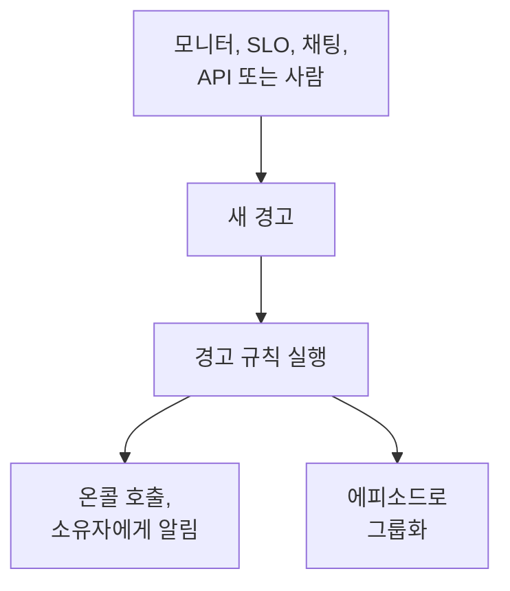

# 경고 개요

경고는 사용자가 알아차리기 전에 살펴봐야 할 문제를 팀에 알려 줍니다. 가득 차 가는 디스크, 곧 만료될 인증서, 서서히 오르는 오류율 같은 것입니다. 경고는 온콜 담당자를 호출하고 소유자에게 알릴 수 있지만, 상태 페이지에 표시되거나 구독자에게 알리는 일은 없습니다. 이 페이지에서는 경고가 어디에서 오는지, 대시보드의 어디에 있는지, 팀이 경고를 어떻게 처리하는지 설명합니다.

:::cards
- [경고와 인시던트](#경고와-인시던트): 문제를 어느 쪽으로 다뤄야 하는지, 그리고 둘의 관계.
- [경고가 생기는 곳](#경고가-생기는-곳): 모니터, SLO, 채팅, API, 또는 직접.
- [직접 경고 만들기](#직접-경고-만들기): 대시보드에서 두 단계.
- [경고에 대응하기](#경고에-대응하기): 인지하거나, 해결하거나, 인시던트를 선언합니다.
:::

## 작동 방식

대부분의 경고는 조건이 일치한 모니터가 발생시킵니다. 오류 예산을 소진하는 SLO, 보안 규칙, Slack 이나 Microsoft Teams 에서 보낸 호출, 또는 사람에게서 오는 경고도 있습니다. 어떤 경로로 오든 경고는 같은 레코드이며, 같은 규칙이 실행됩니다.

- **규칙이 경고를 다듬습니다.** 개인정보 보호, 소유자, 레이블, 온콜 규칙은 경고가 생성되는 즉시 실행되고, Runbook 규칙은 일치하는 절차를 시작합니다. [경고 규칙 및 설정](/docs/alerts/settings)을 참고하세요.
- **온콜 정책이 사람을 호출합니다.** 경고가 지정한 정책과 온콜 규칙이 추가한 정책이, 누군가 경고를 인지할 때까지 담당자를 호출합니다.
- **에피소드가 잡음을 묶습니다.** 그룹화 규칙은 관련 경고를 하나의 에피소드로 묶어, 장애 하나에서 나온 경고 스무 개가 하나의 작업이 되게 합니다. [경고 에피소드 및 그룹화 규칙](/docs/alerts/episodes)을 참고하세요.

## 경고와 인시던트

둘 다 문제를 기록하고, 둘 다 온콜 담당자를 호출할 수 있습니다. 다른 점은 문제가 누구에게 영향을 주는가입니다.

|                              | 경고                                                   | 인시던트                                          |
| ---------------------------- | ------------------------------------------------------ | ------------------------------------------------- |
| **무엇인가**                 | 사용자가 영향을 받기 전에 팀이 살펴봐야 할 문제        | 장애처럼 사용자에게 영향을 주는 문제              |
| **상태 페이지**              | 표시되지 않음                                          | 표시될 수 있고 구독자에게 알림                    |
| **노트**                     | 비공개 노트, 팀 전용                                   | 고객용 공개 노트와 비공개 노트                    |
| **초기 상태**                | **식별됨**, **인지됨**, **해결됨**                 | **식별됨**, **인지됨**, **해결됨**            |
| **초기 심각도**              | **높음**, **낮음**                                      | Critical Incident, Major Incident, Minor Incident |
| **새 프로젝트의 번호**       | `ALT-42`, 에피소드는 `AE-42`                           | `INC-42`, 에피소드는 `IE-42`                      |

외부의 누군가가 알아차리기 전에 팀이 살펴봐야 할 때는 경고를 발생시키고, 사용자가 영향을 받을 때는 인시던트를 선언하세요. 경고가 장애의 일부로 밝혀지면 그 경고에서 인시던트를 선언하거나, 원인을 설명하는 인시던트에 연결하세요. [연결된 알림](/docs/incidents/linked-alerts)을 참고하세요.

## 경고가 생기는 곳

- **모니터의 조건.** 조건의 **작업**에서 **필터가 일치하면 경고를 생성합니다.** 옵션을 켜고, 생성될 경고를 채우세요. **경고 제목**과 **심각도**, 그다음 각각 접혀 있는 **설명**, **소유권 및 레이블**, **온콜**, **추가 필드**이며, 마지막 항목에는 **경고 자동 해결**, **비공개 경고**, **해결 노트**가 있습니다. 조건 하나는 한 번에 하나의 열린 경고만 유지하며, 필드로 그룹화하는 모니터에서는 시리즈마다 하나이고, **경고 자동 해결**은 조건이 더 이상 일치하지 않으면 경고를 해결합니다. [모니터 만들기](/docs/monitor/create-monitor)와 [인시던트 및 알림 템플릿](/docs/monitor/incident-alert-templating)을 참고하세요.
- **직접.** 경고 목록에서, 또는 모니터, 호스트, 기타 리소스의 **알림** 탭에서 **알림 생성**을 클릭하세요. 후자의 경우 해당 리소스가 자동으로 선택됩니다. [직접 경고 만들기](#직접-경고-만들기)를 참고하세요.
- **SLO 의 소진율.** 소진율 규칙은 SLO 가 오류 예산을 너무 빨리 쓸 때 경고를 생성할 수 있습니다. [소진율 경고 및 인시던트](/docs/slo/burn-rate-alerts)를 참고하세요.
- **네트워크 사이트와 보안 이벤트.** 비정상일 때 경고하도록 설정한 네트워크 사이트는 상태 요약이 정상 운영이 아니게 되면 경고를 엽니다. 보안 이벤트 탐지 규칙도 경고를 엽니다. [네트워크 사이트(상태 요약 및 가동 시간)](/docs/monitor/network-sites)와 [보안 이벤트(SIEM)](/docs/telemetry/security-events)를 참고하세요.
- **호출.** Slack 또는 Microsoft Teams 의 `/oneuptime page`는 메시지를 제목으로 한 경고를 열고, 지정한 사람을 호출합니다. 워크플로우의 호출 블록도 전달한 제목과 메시지로 같은 일을 합니다. [Slack 에서 누군가 호출하기](/docs/workspace-connections/slack#slack-에서-누군가-호출하기)와 [Paging](/docs/workflows/components#paging)을 참고하세요.
- **API, Terraform, 워크플로우.** 경고는 일반 리소스입니다. `/api/alert`, Terraform 리소스 `oneuptime_alert`, 그리고 워크플로우의 **Create One Alert** 단계가 있습니다.

## 대시보드에서 경고의 위치

상단 바의 **제품** 메뉴에서 **경고**를 여세요. 경고 목록은 `/dashboard/{projectId}/alerts`에 있으며, 사이드 메뉴에 경고와 관련된 모든 것이 있습니다.

| 섹션             | 하는 일                                                                                                                   |
| ---------------- | ------------------------------------------------------------------------------------------------------------------------- |
| **알림**         | **모든 알림**과 **활성 알림**. 빨간 배지는 아직 해결되지 않은 경고 수를 셉니다.                                           |
| **에피소드** | **모든 에피소드**와 **활성 에피소드**: 관련된 경고를 하나의 문제로 묶은 것입니다. |
| **AI**           | **인사이트**, **로그**, **설정**: OneUptime AI 가 경고에서 배운 것, 수행한 모든 일, 허용된 작업.                           |
| **워크스페이스** | 프로젝트가 연결한 **Slack** 과 **Microsoft Teams**, 둘 다 없으면 **Slack 또는 Teams 연결**.                               |
| **규칙**         | **그룹화 규칙**, **온콜 규칙**, **소유자 규칙**, **Runbook 규칙**, **개인정보 보호 규칙**, **레이블 규칙**, **Reminder Rules**. |
| **설정**         | **알림 상태**, **알림 심각도**, **노트 템플릿**, **사용자 정의 필드**, **측정**, **에피소드 소속**, **번호 매기기**.                         |

**알림**과 **에피소드**는 열려 있고, **AI**, **워크스페이스**, **규칙**, **설정**, **개발자**는 접힌 상태로 시작하며, 해당 섹션의 페이지에 있으면 섹션이 저절로 열립니다. 경고 설정은 **프로젝트 설정**이 아니라 여기에 있습니다.

목록에는 **경고 번호**, **제목**, **상태**, **심각도**, **영향받는 리소스** (경고의 모니터가 맨 앞), **생성됨**, **기간**, **레이블**, **소유자**가 표시됩니다. 경고를 선택하면 여러 개를 한 번에 처리할 수 있습니다. **인지**, **해결**, **상태 변경**, **심각도 변경**, **나에게 할당**, **소유자 추가**, **소유자 제거**, **레이블 추가**, **레이블 제거**, **인시던트에 연결**, **인시던트 선언**, 또는 삭제입니다.

각 경고 행 끝의 **⋯** 메뉴에서는 그 경고 하나에 같은 작업을 할 수 있습니다. 경고가 그 단계로 넘어갈 수 있는 동안 **인지** 및 **해결**, 그리고 **상태 변경**, **심각도 변경**, 아직 소유자가 아니면 **나에게 할당**, 다른 사람에게 맡기려면 **소유자 추가** 입니다.

## 직접 경고 만들기

:::steps
### 양식 열기

**경고 → 모든 알림**으로 이동해 **알림 생성**을 클릭하세요. **새 경고 생성** 양식이 첫 단계인 **경고 세부 정보**에서 열립니다.

### 경고 설명하기

**제목**을 입력하고 **알림 심각도**를 고르세요. 둘 다 필수입니다. 도움이 되면 **설명**을 추가하세요. 접혀 있는 **추가 필드**에서는 **초기 상태**를 고르거나, **레이블**을 추가하거나, **비공개 경고**를 켤 수 있습니다. **소유자**도 여기에 있습니다. 만든 알림의 소유자에는 어차피 본인이 되며, 본인이 속한 각 팀은 선택기 아래에서 클릭 한 번으로 추가할 수 있습니다.

### 영향 범위와 호출 대상 고르기

**다음**을 클릭해 **리소스 및 온콜**로 이동하세요. 해당 **모니터**와, 호스트, Kubernetes 클러스터, 서비스 같은 **기타 영향받는 리소스**를 고르세요. **온콜 정책**에서는 경고가 생성될 때 실행할 정책을 고르세요.

### 만들기

**다음**을 클릭해 요약을 확인한 다음 **알림 생성**을 클릭하세요. 경고 자체의 페이지가 열리고 규칙이 실행되기 시작합니다. 요약의 **소유자** 행에는 누군가를 추가할 각 소유자 규칙과 누구를 추가하는지가 나옵니다. [누가 소유자가 되는지](/docs/incidents/declaring-incidents#누가-소유자가-되는지)를 참고하세요.
:::

**초기 상태**를 비워 두면 경고는 모든 새 경고와 같은 곳에서 시작합니다. 생성 상태이며, 새 프로젝트에서는 **식별됨**입니다. 나중 상태를 고르면 누군가 이미 처리 중이거나 이미 끝난 경고로 기록됩니다. [이미 인지되었거나 해결된 상태로 생성](#이미-인지되었거나-해결된-상태로-생성)을 참고하세요.

## 경고가 생성되면 일어나는 일

경고가 생성되는 순간 OneUptime 은 다음 단계를 이 순서대로 진행합니다.

1. **번호와 상태가 붙습니다.** 경고 번호는 프로젝트별 카운터에서 나오며 접두사와 함께 표시됩니다(`ALT-42`). 양식, API, 워크플로우가 다른 상태를 고르지 않았다면 경고는 생성 상태에서 시작합니다.
2. **개인정보 보호 규칙이 먼저 실행되어**, 그 뒤의 모든 처리가 경고의 비공개 여부를 알 수 있습니다.
3. **피드와 채팅 도구가 알게 됩니다.** **경고 생성됨** 항목이 **경고 피드**에 기록되고, Slack 과 Microsoft Teams 규칙이 지정한 채널에 알립니다. 규칙에 따라 경고용 채널을 만들 수도 있습니다.
4. **소유자와 레이블이 추가됩니다**: 모니터의 조건이나 요청이 지정한 것, 그다음 일치하는 소유자 규칙과 레이블 규칙의 것.
5. **온콜 규칙이 정책을 추가하고**, 이어서 Runbook 규칙이 일치하는 런북을 시작합니다.
6. **온콜 정책이 실행됩니다.** 경고의 각 정책이 담당자를 동시에 호출합니다. 하나가 실패해도 나머지는 멈추지 않습니다.
7. **그룹화 규칙이 경고를 에피소드에 넣습니다**. 일치하는 규칙이 있을 때입니다. [경고 에피소드 및 그룹화 규칙](/docs/alerts/episodes)을 참고하세요.
8. **리마인더가 예약됩니다**. 리마인더 규칙이 일치할 때입니다. 또한 **OneUptime AI** 는 **경고 → AI → 설정**에서 **새 경고 조사**가 켜져 있으면 경고를 조사하고, **새 경고 자동 수정**이 켜져 있으면 수정합니다. [AI SRE](/docs/ai/ai-sre)를 참고하세요.

백그라운드 작업이 1분 안에 경고 소유자에게 알리고, 워크플로우 트리거 **On Create Alert**가 이를 사용하는 모든 워크플로우를 시작합니다.

### 이미 인지되었거나 해결된 상태로 생성

나중 상태에서 시작하는 경고는 누군가 이미 대응 중인 문제의 기록이므로, 새로운 긴급 상황으로 다루지 않습니다.

- **인지됨 상태 이후에서는** 온콜 정책이 실행되지 않습니다. 경고는 정책을 유지하고, 아무도 호출되지 않은 이유가 피드에 한 줄로 기록됩니다. 열린 에피소드에 합류할 수는 있지만 에피소드를 열지는 않습니다. 열면 에피소드의 정책으로 호출하게 되기 때문입니다.
- **해결됨 상태 이후에서는** 경고가 끝난 것입니다. 에피소드로 그룹화되지 않고, 런북이나 자동 수정도 작동하지 않으며, OneUptime AI 도 조사하지 않고, Slack 이나 Microsoft Teams 채널도 만들어지지 않습니다.

규칙, 소유자, 피드, 첫 상태는 두 경우 모두 그대로 적용됩니다. 인시던트도 같은 규칙을 따릅니다. [이미 인지되었거나 해결된 상태로 선언된 인시던트](/docs/incidents/declaring-incidents#이미-인지되었거나-해결된-상태로-선언된-인시던트)를 참고하세요.

## 경고에 대응하기

경고를 여세요. 헤더에는 상태, 심각도, 지속 시간, 소유자, 속한 모니터와 에피소드가 표시되고, 다음 단계에 필요한 버튼이 있습니다.

- **인지**는 누군가 처리 중임을 알립니다. 경고의 온콜 정책이 다음 단계를 호출하지 않게 합니다.
- **해결**은 경고를 닫습니다. 경고는 **활성 알림**에서 빠지고, 리마인더도 멈춥니다.
- 옆의 **⋯** 메뉴에 있는 **상태 변경**는 경고를 "조사 중" 같은 직접 만든 상태로 옮깁니다.
- **인시던트 선언**은 문제가 사용자에게 영향을 주는 것으로 밝혀졌을 때, 경고에서 미리 채운 새 인시던트를 엽니다. [연결된 알림](/docs/incidents/linked-alerts)을 참고하세요.

다른 상태로 옮길 때는 확인을 요청하며, **비공개 메모 추가** 아래에 접힌 선택 사항인 비공개 메모를 함께 남길 수 있습니다. 각 상태가 하는 일은 [경고 상태 및 심각도](/docs/alerts/states-and-severities)에 있습니다.

처리하는 동안 알게 된 내용을 **비공개 노트**로 남기고, **근본 원인**과 **해결** 페이지를 채우고, **소유자**를 추가하세요. **경고 피드**의 **작업** 메뉴에서는 **Execute Runbook**으로 런북을 실행하거나 **온콜 정책 실행**으로 더 많은 사람을 호출할 수도 있습니다.

## 경고의 각 페이지

| 사이드 메뉴 섹션  | 페이지                                                                                                         |
| ----------------- | -------------------------------------------------------------------------------------------------------------- |
| **개요** | **개요**와 **상태 타임라인** |
| **조사** | **설명**, **근본 원인**, **해결**, **런북**, **연결된 인시던트** |
| **팀** | **온콜 실행**과 **소유자**: 경고로 누가 호출되었는지와 경고의 소유자 |
| **알림**          | **알림 로그**와 **AI 로그**: 경고에 관해 보낸 모든 메시지와 AI 가 경고를 위해 한 모든 일                       |
| **노트**     | **비공개 노트**                                                                                                |
| **개발자**        | **Terraform**, **API**, **AI 어시스턴트**: 코드로 관리하는 경고                                                |
| **고급** | **사용자 정의 필드**, **설정**, **감사 로그**, **알림 삭제** |

**개요**, **조사**, **팀**, **노트**는 열려 있고, 다른 섹션은 클릭할 때까지 접혀 있습니다.

- **개요** — 헤더에는 경고의 모니터와 에피소드 옆에 경고의 **소유자**(팀이 먼저)가 표시됩니다. 타일 세 개 가운데 **생성됨**은 경고가 언제 무엇에 의해 생성되었는지를, 나머지 두 개는 인지와 해결에 걸린 시간을 보여 주며, 지속 시간은 헤더의 첫 번째 항목입니다. 페이지 맨 위에는 경고의 설명과 **근본 원인**을 보여 주는 **발생 내용** 카드가 있고, 그다음에 **AI Investigation** 카드가 있으며 그 아래쪽에 **Ask OneUptime AI**가 있습니다. **경고 피드**는 경고에 일어난 모든 일을 기록합니다. 그 옆에는 **영향받는 리소스** 카드, **경고 세부 정보** 카드, 경고의 측정값이 있습니다.
- **상태 타임라인** — 경고가 거친 모든 상태와 그 시점, 기간. [상태 타임라인](/docs/alerts/states-and-severities#상태-타임라인)을 참고하세요.
- **연결된 인시던트** — 이 경고가 속한 인시던트로, **인시던트 연결**과 **인시던트 선언**이 있습니다.
- **설정** — **비공개 경고** 스위치가 있는 **이 경고를 볼 수 있는 사람**과, **리마인더 보내기**가 있는 **리마인더**. 각 스위치는 전환하는 즉시 저장됩니다.

## 비공개 경고

비공개 경고는 소유자, 즉 소유자 사용자와 소유자 팀의 구성원, 그리고 프로젝트의 관리자와 소유자만 볼 수 있습니다. 프로젝트의 다른 사람은 열 수 없습니다.

생성 양식이나 모니터 조건의 **추가 필드**에 있는 **비공개 경고**, **경고 → 규칙 → 개인정보 보호 규칙**, 또는 나중에 경고의 **설정** 페이지에서 경고를 비공개로 만드세요. 설정 페이지는 경고를 숨기기 전에 **이 경고를 비공개로 설정하시겠습니까?** 라고 묻습니다. 그 사람들 중 누구에도 해당하지 않으면 본인도 접근 권한을 잃습니다.

비공개 경고가 연 에피소드는 비공개가 아니므로 경고의 제목이나 설명을 절대 보여 주지 않습니다. 제목이나 설명에 그것이 들어갈 자리에는 "Private alert"가 표시됩니다.

## 경고를 알게 되는 사람

- **온콜.** 경고의 온콜 정책이 담당자를 호출합니다. 각 담당자는 **사용자 설정 → 온콜 규칙**의 **알림** 탭에서 설정한 방식으로 연락을 받습니다. 호출에 응답하면 경고가 인지되고 호출이 멈춥니다.
- **소유자.** **사용자 설정 → 알림 설정**의 **알림** 탭에서 다른 채널을 고르지 않았다면 이메일로 받습니다. **경고 생성됨**, **경고 상태 변경됨**, **Alert reminder**는 기본으로 켜져 있고, **경고 노트 게시됨**과 **경고 소유자로 추가됨**은 누군가 켤 때까지 꺼져 있습니다. 소유자가 없는 경고는 대신 프로젝트 소유자에게 알립니다.
- **채팅 도구.** **경고 → 워크스페이스**에는 경고와 에피소드를 채널에 게시하는 Slack 과 Microsoft Teams 규칙이 있습니다. [Slack](/docs/workspace-connections/slack)과 [Microsoft Teams](/docs/workspace-connections/microsoft-teams)를 참고하세요.

## 문제 해결

:::details 새 경고에 아무도 호출되지 않았습니다
경고의 **온콜 실행** 페이지를 여세요. 비어 있다면 경고에 온콜 정책이 없었던 것입니다. 양식에서도 모니터 조건에서도 고르지 않았고, 일치하는 온콜 규칙도 없었습니다. 경고가 이미 인지되었거나 해결된 상태로 생성되었다면, 아무도 호출되지 않았다는 사실과 그 이유가 피드에 있습니다.
:::

:::details 모니터는 계속 실패하는데 새 경고가 나타나지 않습니다
조건 하나는 한 번에 하나의 열린 경고만 유지합니다. 그 경고가 해결될 때까지 모니터는 같은 조건에 대해 새로 추가하지 않습니다. 경고를 해결하거나, **경고 자동 해결**을 켜서 조건이 더 이상 일치하지 않을 때 모니터가 해결하게 하세요.
:::

:::details 동료는 열 수 있는 경고를 나는 찾을 수 없습니다
그 경고는 아마 비공개일 것입니다. 프로젝트 관리자에게 나를 소유자로 추가하거나, 경고의 **설정** 페이지에서 **비공개 경고**를 꺼 달라고 요청하세요.
:::

## 다음 단계

:::cards
- [경고 상태 및 심각도](/docs/alerts/states-and-severities): 인지와 해결이 하는 일, 그리고 직접 상태를 추가하는 방법.
- [경고 에피소드 및 그룹화 규칙](/docs/alerts/episodes): 쏟아지는 경고를 하나의 작업으로 만듭니다.
- [경고 규칙 및 설정](/docs/alerts/settings): 호출, 소유자, 레이블, 리마인더를 자동화합니다.
- [연결된 알림](/docs/incidents/linked-alerts): 경고를 그 원인을 설명하는 인시던트에 연결합니다.
:::
