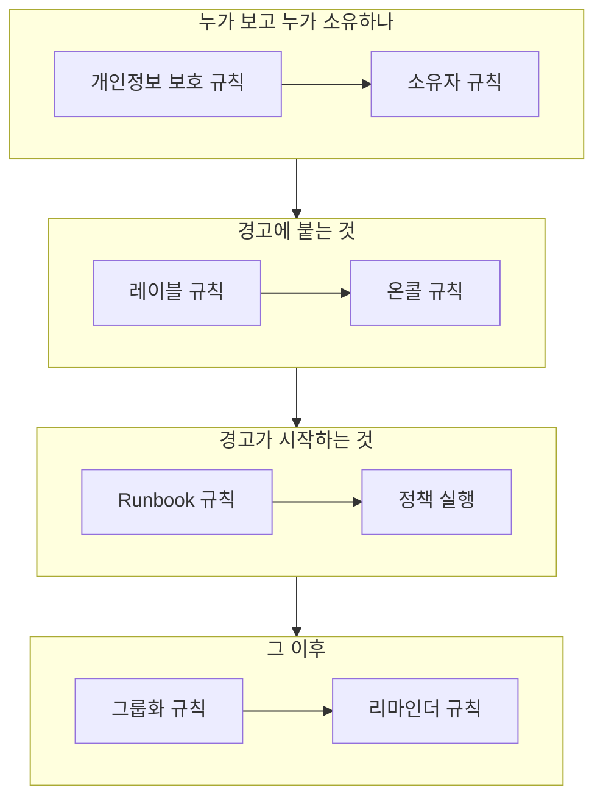

# 경고 규칙 및 설정

경고 설정은 **프로젝트 설정**이 아니라 **경고** 안에 있습니다. 모든 새 경고에 작용하는 규칙과, 프로젝트의 모든 경고를 형성하는 설정입니다. 이 페이지는 각각에 대한 참고 자료이며, 경고가 생성될 때 저절로 실행되는 것도 다룹니다.

:::cards
- [새 경고가 거치는 규칙](#새-경고가-거치는-규칙): 순서와 각 규칙의 역할.
- [온콜 규칙](#온콜-규칙): 매번 정책을 고르지 않고도 알맞은 사람을 호출합니다.
- [리마인더 규칙](#리마인더-규칙): 경고가 열려 있는 동안 소유자에게 상기시킵니다.
- [설정](#설정): 노트 템플릿, 사용자 정의 필드, 측정, 에피소드 소속, 번호 매기기.
:::

## 경고 설정의 위치

상단 바의 **제품** 메뉴에서 **경고**를 여세요. 사이드 메뉴의 **규칙**과 **설정** 섹션은 접힌 상태로 시작하므로 먼저 펼치세요. 여기의 모든 페이지는 프로젝트 전체에 적용되며, 주소는 `/dashboard/{projectId}/alerts/settings/`로 시작합니다.

| 규칙 페이지              | 하는 일                                                                                        |
| ------------------------ | ---------------------------------------------------------------------------------------------- |
| **그룹화 규칙**          | 관련 경고를 에피소드로 묶습니다. [경고 에피소드 및 그룹화 규칙](/docs/alerts/episodes)을 참고하세요. |
| **온콜 규칙**            | 일치하는 경고와 에피소드에 대해 온콜 정책을 실행합니다.                                        |
| **소유자 규칙**          | 일치하는 경고와 에피소드에 소유자를 추가합니다.                                                |
| **Runbook 규칙**         | 일치하는 경고에 대해 런북을 시작합니다.                                                        |
| **개인정보 보호 규칙**   | 일치하는 경고와 에피소드를 비공개로 만듭니다.                                                  |
| **레이블 규칙**          | 일치하는 경고와 에피소드에 레이블을 추가합니다.                                                |
| **Reminder Rules**       | 경고가 열려 있는 동안 정해진 간격으로 소유자에게 상기시킵니다.                                 |

**설정** 섹션에는 [경고 상태 및 심각도](/docs/alerts/states-and-severities)에서 다루는 **알림 상태**와 **알림 심각도**, 그리고 아래에서 다루는 **노트 템플릿**, **사용자 정의 필드**, **측정**, **에피소드 소속**, **번호 매기기**가 있습니다.

경고에 작용하는 섹션이 두 개 더 있습니다. **경고 → AI → 설정**은 OneUptime AI 가 스스로 하는 일을 정합니다. 새 프로젝트에서 켜져 있는 **새 경고 조사**와, 직접 켤 때까지 꺼져 있는 **새 경고 자동 수정**입니다. [AI SRE](/docs/ai/ai-sre)를 참고하세요. **경고 → 워크스페이스**에는 경고와 에피소드를 채널에 게시하는 Slack 과 Microsoft Teams 규칙과 **요약** 탭이 있습니다. [Slack](/docs/workspace-connections/slack)을 참고하세요.

## 새 경고가 거치는 규칙

여러 규칙이 일치할 때의 처리는 규칙마다 다릅니다.

- **그룹화 규칙**과 **Reminder Rules**는 목록 위에서부터 확인되며 첫 번째 일치가 우선합니다. 위치를 바꾸려면 규칙을 끌어 옮기세요. 새 규칙은 끝에 추가됩니다.
- **온콜 규칙**, **소유자 규칙**, **레이블 규칙**, **개인정보 보호 규칙**, **Runbook 규칙**은 일치하면 모두 작용합니다. 여러 규칙이 추가하는 온콜 정책, 소유자, 레이블은 한 번만 추가됩니다.

**온콜 규칙**, **소유자 규칙**, **레이블 규칙**, **개인정보 보호 규칙**에는 탭이 두 개 있습니다. 경고용 **Alert Rules**와, 새 경고 에피소드에 같은 방식으로 작용하는 **Episode Rules**입니다. 새 규칙은 활성화된 상태로 시작합니다. 일시 중지하려면 편집 양식에서 **활성화됨**을 끄세요. 목록에는 규칙마다 초록색 **활성화됨** 또는 빨간색 **비활성화**가 표시됩니다.

대부분의 규칙은 저장한 뒤에 생성된 경고와 에피소드에 작용합니다. 소유자, 레이블, 개인정보 보호 규칙을 이미 있는 항목에 적용하려면 **지금 실행**을 사용하세요. [기존 리소스에 규칙 실행](/docs/configuration/run-rules-now)을 참고하세요. 리마인더 규칙은 예외로, 하나를 저장하면 열려 있는 모든 경고가 다시 대조됩니다.

### 조건

규칙의 조건은 규칙이 어떤 경고에 작용할지 정하며, 문장처럼 읽힙니다. "**경고 제목**이 `database`를 포함하면", "그리고 **모니터 레이블**이 *Production* 중 하나를 포함하면" 같은 식입니다. 조건이 없는 규칙은 모든 경고와 일치합니다.

| 조건                                                          | 비교 방식                                                                                                      |
| ------------------------------------------------------------- | -------------------------------------------------------------------------------------------------------------- |
| **모니터**, **경고 심각도**, **경고 레이블**, **모니터 레이블** | 고른 값에 대해 **다음 중 하나 포함**, **모두 포함**, **모두 포함하지 않음**.                                  |
| **경고 제목**, **경고 설명**, **모니터 이름**, **모니터 설명** | 대소문자를 구분하지 않고 **포함**, **포함하지 않음**, **같음**, **같지 않음**, **다음으로 시작**, **다음으로 끝남**, 또는 정규식이나 `*` 와일드카드용 **패턴과 일치**와 **패턴과 일치하지 않음**. |

조건이 두 개 이상이면 모든 조건이 맞아야 하는 **모두 일치**나, 하나만 맞으면 되는 **하나라도 일치**를 고르세요. 에피소드 규칙은 대신 에피소드의 심각도, 레이블, 제목, 설명과 일치시킵니다.

## 온콜 규칙

**경고 → 규칙 → 온콜 규칙**은 호출을 자동화합니다. 일치하는 각 규칙이 새 경고에 정책을 추가하고, 경고는 이미 가진 정책과 함께 각 정책을 한 번씩 실행합니다.

:::steps
### 경고 고르기

**Alert On-Call Rule 만들기**를 클릭하세요. **일치**에서 새 규칙이 처음 고르는 **모든 알림**은 모든 새 경고와 일치합니다. 범위를 좁히려면 **조건과 일치하는 알림만**을 고르고 경고가 만족해야 할 조건을 추가하세요.

### 정책 고르기

**온콜 정책**에서 규칙이 호출할 **온콜 정책**을 고르세요. **이름**은 직접 입력할 때까지 "Platform on-call 호출"처럼 정책에 따라 바뀌며, **설명**은 **추가 필드**에 있습니다. 그런 다음 규칙을 만드세요.
:::

심각도만으로는 아무도 호출되지 않습니다. "모든 High 경고에 데이터베이스 팀 호출"을 설정하는 방법은 **경고 심각도**와 일치하는 온콜 규칙입니다. 한 경고에 대해 무엇이 실행되었는지 보려면 그 경고의 **온콜 실행** 페이지를 여세요. 이후 각 사람에게는 **사용자 설정 → 온콜 규칙**의 **알림** 탭에서 설정한 방식으로 연락이 갑니다. [에스컬레이션 규칙](/docs/on-call/escalation-rules)을 참고하세요.

규칙은 경고가 일치하는 즉시 호출합니다. 대신 근무 시간까지 기다리게 하려면 **추가 필드**의 **이 규칙은 언제 호출해야 하나요?** 항목에서 **근무 시간에만**을 고르세요. **근무 시간**은 처음에 내 시간대 기준 월요일부터 금요일, 09:00부터 17:00까지입니다. 다른 요일이나 다른 **시작 시간**, **종료 시간**, 다른 **시간대**를 고르면 선택지 아래 문장이 어떻게 되는지 알려 줍니다. 목록에서는 규칙 이름 아래에 근무 시간이 표시됩니다. 근무 시간 밖에 일치한 경고에는 기다리면서 아무도 호출하지 않는 실행이 만들어지고, 근무 시간이 시작되면 정책이 첫 번째 에스컬레이션 규칙을 호출하고 평소처럼 에스컬레이션합니다. 그 전에 경고가 인지되거나 해결되면 아무도 호출되지 않습니다. 기다리는 동안 경고가 바뀌어, 예를 들어 심각도가 올라가 바로 호출하는 규칙과 일치하게 되면, 실행은 그 즉시 호출을 시작하고 경고의 피드에 그 이유가 남습니다. 같은 정책을 호출하는 두 규칙은 둘 중 하나가 허용하는 즉시 그 정책을 호출하므로, 가장 높은 심각도를 바로 호출하는 규칙과 나머지를 위해 근무 시간을 기다리는 규칙을 함께 두면 밤을 조용히 지킬 수 있습니다.

## 소유자 및 레이블 규칙

**소유자 규칙**은 일치하는 새 경고에 소유자 사용자와 팀을 추가하고, **레이블 규칙**은 레이블을 추가합니다. 만드는 데는 두 단계가 있습니다. 조건인 **일치**, 그다음 규칙이 추가하는 **소유자** 또는 **레이블**입니다. 규칙의 **이름**은 직접 입력하기 전까지 고른 내용에 맞춰 바뀝니다.

- **규칙은 상속할 수 있습니다.** **소유자 상속** 또는 **레이블 상속** 아래에 접힌 스위치 여섯 개가 경고의 모니터, 호스트, Kubernetes 클러스터, Docker 호스트, Podman 호스트, 서비스의 소유자나 레이블을 물려받습니다. 에피소드 규칙에는 이런 스위치가 없습니다. 소유자 규칙의 **소유자 상속** 마지막에는 **생성자의 팀**이 있습니다. 거기에 나열된 팀 중 경고를 생성한 사람이 속한 팀도 소유자가 됩니다.
- **새 규칙은 무언가를 추가해야 합니다**. 소유자나 레이블을 하나 이상 고르거나 스위치를 켜세요. 인시던트 또는 경고 소유자 규칙에서는 **생성자의 팀**의 팀 하나만으로도 충분합니다.
- 소유자 규칙의 **추가 필드** 아래에 있는 **소유자에게 알림**이 추가된 사람에게 알릴지 정합니다.

[레이블 및 소유자 규칙](/docs/configuration/label-and-owner-rules)에서 모든 종류의 리소스에 대해 양식을 단계별로 설명합니다.

## 개인정보 보호 및 Runbook 규칙

**개인정보 보호 규칙**은 다른 어떤 것보다 먼저, 일치하는 새 경고를 비공개로 만듭니다. 그 소유자와 프로젝트의 관리자와 소유자만 볼 수 있습니다. 규칙에는 두 단계가 있습니다. 비공개로 만들 경고를 고르는 **일치**, 그리고 "경고를 비공개로 설정"이 미리 입력된 **이름**입니다. [비공개 경고](/docs/alerts/index#비공개-경고)를 참고하세요.

**Runbook 규칙**은 새 경고가 일치하면 런북을 시작합니다. 단, 경고가 해결된 상태로 생성된 경우는 제외됩니다. [Runbook 규칙](/docs/runbooks/rules)을 참고하세요.

## 리마인더 규칙

**경고 → 규칙 → Reminder Rules**는 경고가 열려 있는 동안 경고 소유자에게 상기시킵니다. 각 새 경고에는 목록 위에서부터 처음으로 일치하는 규칙이 적용됩니다.

:::steps
### 상기시킬 경고 고르기

**Alert Reminder Rule 만들기**를 클릭하세요. 모든 경고에 대해 상기시키려면 **일치**에서 **모든 알림**을 선택된 그대로 두세요. **조건과 일치하는 알림만**을 고르면 규칙을 적용할 **경고 심각도**와 **레이블**을 고를 수 있습니다.

### 간격 설정하기

**리마인더**에서 소유자에게 얼마나 자주 상기시킬지 정하는 **리마인더 간격(분)** 값과 **리마인더 중지 시점** 값을 설정하세요. 기본값인 **해결됨** 또는 **인지됨**입니다. **이름**은 직접 입력할 때까지 "해결될 때까지 30분마다 리마인더 보내기"처럼 두 값에 따라 바뀝니다. 그런 다음 규칙을 만드세요.
:::

소유자는 각 리마인더를 **Alert reminder**로 받으며, 이는 기본으로 이메일이 켜져 있습니다. 경고의 심각도나 레이블이 바뀌면 그 경고의 규칙이 다시 대조됩니다. 한 경고의 리마인더를 멈추려면 그 경고의 **설정** 페이지에서 **리마인더 보내기**를 끄세요. 전환하는 즉시 저장됩니다.

## 설정

### 노트 템플릿

**경고 → 설정 → 노트 템플릿**에는 비공개 노트용으로 미리 작성한 텍스트가 있습니다. **경고용 비공개 메모 템플릿** 카드에 목록이 있고, **경고 노트 템플릿 만들기**는 **템플릿 이름**, **템플릿 설명**, **노트**를 묻습니다. 템플릿은 누군가 경고나 에피소드에 비공개 노트를 쓸 때, 그리고 인지하거나 해결할 때 제시되며, 게시하기 전에 텍스트를 편집할 수 있습니다. 경고 노트 템플릿은 일반 텍스트이며, 인시던트 노트 템플릿과 달리 변수를 채우지 않습니다.

### 사용자 정의 필드

**경고 → 설정 → 사용자 정의 필드**는 고객 등급이나 티켓 참조 같은 자체 필드를 모든 경고에 추가합니다. 경고의 **사용자 정의 필드** 페이지에서 채우거나, API 에서 `customFields`로 지정하세요. 필드는 입력하는 대신 모니터의 사용자 정의 필드에서 값을 복사할 수도 있습니다. [모니터에서 복사하는 필드](/docs/incidents/settings#모니터에서-복사하는-필드)를 참고하세요. 경고에서도 같은 방식으로 동작합니다.

### 측정

**경고 → 설정 → 측정**은 모든 경고에서 일에 걸리는 시간을 잽니다. **인지까지 걸린 시간**이나 **해결까지 걸린 시간**, 또는 **알림이 생성될 때**와 고른 상태에 들어갈 때 같은 두 시점을 직접 고르세요. 각 측정값은 경고 페이지에 표시되며 `oneuptime.alert.measurement.<key>`로 차트에 그려집니다. [측정](/docs/incidents/settings#측정)을 참고하세요. 경고에서도 같은 방식으로 동작합니다.

**호출 후 인지까지 걸린 시간**은 경고가 생성된 때가 아니라 **누군가 처음 호출될 때**, 즉 온콜 정책이나 직접 호출이 경고에 대해 처음으로 누군가에게 알린 때부터 셉니다. 밤에 발생해 아침에 호출된 경고에는 밤 시간이 계산되지 않습니다. 아무도 호출되지 않은 경고에는 값이 없습니다. [호출 후 인지까지 걸린 시간](/docs/incidents/settings#호출-후-인지까지-걸린-시간)을 참고하세요.

### 에피소드 소속

**경고 → 설정 → 에피소드 소속**에서는 경고가 둘 이상의 에피소드에 있을 수 있는지 정합니다. **경고는 하나의 에피소드에만 있을 수 있음**을 켜면, 에피소드에 있는 경고를 그 에피소드에서 빼기 전까지 대시보드, API, 워크플로, 그룹화 규칙 어디에서도 다른 에피소드에 추가할 수 없습니다. 스위치는 켜기 전까지 꺼져 있고, 바꿀 수 있는 것은 Project Owners와 Project Admins뿐입니다. 켜도 에피소드에서 빠지는 경고는 없습니다. [인시던트당 에피소드 하나](/docs/incidents/episodes#인시던트당-에피소드-하나)를 참고하세요. 경고에서도 같은 방식으로 동작합니다.

### 번호 매기기

**경고 → 설정 → 번호 매기기**는 경고 번호와 에피소드 번호 앞의 텍스트를 정합니다. 새 프로젝트에서는 `ALT-`와 `AE-`이고, 없으면 `#`입니다. **업데이트**를 누르면 **경고 번호 접두사**와 **경고 에피소드 번호 접두사**가 열리고, 입력하는 동안 미리 보기가 표시됩니다. 새 접두사는 이후에 생성된 경고와 에피소드에만 붙습니다. 접두사 규칙은 [번호 접두사](/docs/incidents/settings#번호-접두사)에 있습니다.

그 아래의 **다음 번호** 카드는 다른 도구의 번호를 이어 가도록 다음 경고와 다음 에피소드가 받을 번호를 정합니다. **업데이트**를 누르면 **다음 경고 번호**와 **다음 경고 에피소드 번호**가 열리며, 각각 지금까지 가장 높은 번호보다 커야 합니다. [다음 번호](/docs/incidents/settings#다음-번호)를 참고하세요.

> [!NOTE]
> OneUptime Cloud 에서 노트 템플릿과 사용자 정의 필드에는 **Growth** 플랜 이상이 필요합니다.

## 워크플로우

모든 경고 모델에는 그 이름을 딴 워크플로우 트리거와 작업이 있습니다. **On Create Alert**, **On Update Alert**, **On Create or Update Alert**, **On Delete Alert**, 그리고 **경고 에피소드**, **경고 상태 타임라인** 등에도 같은 것이 있으며, **Create One Alert**, **Update One Alert** 같은 작업도 있습니다. 유일한 예외는 경고 사용자 정의 필드 정의로, 워크플로우 트리거가 없습니다. [워크플로우 개요](/docs/workflows/index)를 참고하세요.

## 변경할 수 있는 사람

규칙, 사용자 정의 필드, 측정에는 Project Owner 또는 Project Admin, 또는 해당 규칙의 권한을 가진 사용자 지정 역할이 필요합니다. **경고 구성원**은 경고와 에피소드, 그 노트, 소유자, 상태 타임라인, 그리고 노트 템플릿을 다룰 수 있고, **경고 관리자**는 여기에 더해 경고 상태와 심각도를 관리합니다. [사용자, 팀 및 권한](/docs/permissions/index)을 참고하세요.

## 다음 단계

:::cards
- [경고 에피소드 및 그룹화 규칙](/docs/alerts/episodes): 그룹화 규칙 자세히 보기.
- [에스컬레이션 규칙](/docs/on-call/escalation-rules): 온콜 규칙이 정책을 실행한 뒤 일어나는 일.
- [레이블 및 소유자 규칙](/docs/configuration/label-and-owner-rules): 규칙 양식을 단계별로.
- [AI SRE](/docs/ai/ai-sre): 새 경고를 저절로 조사하고 수정합니다.
:::
