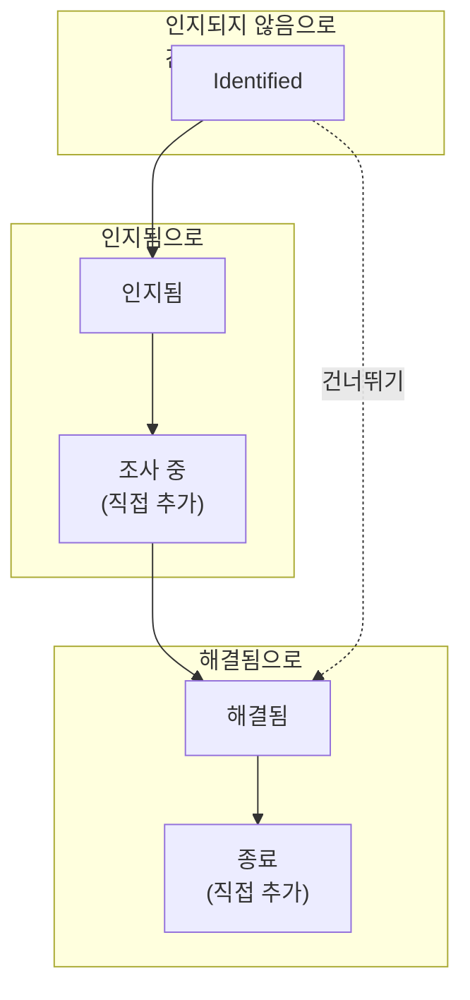

# 경고 상태 및 심각도

모든 경고에는 팀이 그 경고를 어디까지 처리했는지 나타내는 **상태**와, 얼마나 중요한지 나타내는 **심각도**가 있습니다. 상태는 OneUptime 이 하는 일을 결정합니다. 누가 아직 호출되는지, 무엇이 활성으로 간주되는지, 에피소드가 언제 해결되는지입니다. 심각도는 경고의 순위를 매기며, 규칙이 심각도로 일치시킬 수 있습니다. 이 페이지는 이를 설정하는 사람, 또는 경고가 왜 호출했는지 혹은 하지 않았는지 궁금한 사람을 위한 것입니다.

:::cards
- [기본 상태](#기본-상태): Identified, 인지됨, 해결됨과 각각의 역할.
- [직접 상태 추가하기](#직접-상태-추가하기): "조사 중" 같은 나만의 단계.
- [경고의 상태 옮기기](#경고의-상태-옮기기): 상태가 바뀌는 모든 방법.
- [심각도](#기본-심각도): High 와 Low, 그리고 직접 추가하기.
:::

## 작동 방식

프로젝트의 경고 상태는 하나의 순서 있는 목록이며, 경고는 그 목록을 아래로만 이동합니다. 상태의 위치에 따라 그 상태에 있는 경고가 무엇으로 간주되는지가 정해집니다. 아직 인지되지 않음, 인지됨, 해결됨 중 하나입니다. 경고 에피소드도 같은 목록을 따라 이동합니다.

`AlertState` 모델에는 `name`, `description`, `color`, `order`와 세 개의 플래그 `isCreatedState`, `isAcknowledgedState`, `isResolvedState`가 있습니다. OneUptime 은 이름이 아니라 플래그와 순서를 읽으므로, **해결됨**의 이름을 "종료"로 바꿔도 아무것도 깨지지 않습니다. `AlertSeverity` 모델에는 `name`, `description`, `color`, `order`가 있고 플래그는 없습니다.

> [!TIP]
> 두 목록 모두 **경고 → 설정** 아래에 있으며, 사이드 메뉴에서 접힌 상태로 시작합니다. **설정**을 펼치면 **알림 상태**와 **알림 심각도**가 보입니다.

## 기본 상태

모든 새 프로젝트는 다음 순서로 세 가지 경고 상태를 가지고 시작합니다.

| 상태             | `order` | 플래그                | 색상      | 의미                                              |
| ---------------- | ------- | --------------------- | --------- | ------------------------------------------------- |
| **식별됨**   | `1`     | `isCreatedState`      | `#fd625e` | 새 경고가 시작되는 상태.                          |
| **인지됨**       | `2`     | `isAcknowledgedState` | `#ffbf53` | 누군가 처리 중이며 호출이 멈춥니다.               |
| **해결됨**       | `3`     | `isResolvedState`     | `#2ab57d` | 경고가 끝났고 더 이상 활성으로 간주되지 않습니다. |

플래그가 있는 세 상태에는 설정 페이지에서 **기본 제공** 태그가 붙습니다. 이름과 색상을 바꾸고 끌어 옮길 수는 있지만, 생성, 인지, 해결이라는 순서는 유지되며 삭제할 수 없습니다. **삭제**는 잠긴 상태로 남고 그 이유를 알려 줍니다.

## 각 플래그의 역할

| 플래그                | OneUptime 이 하는 일                                                                                                                                                              |
| --------------------- | --------------------------------------------------------------------------------------------------------------------------------------------------------------------------------- |
| `isCreatedState`      | 아무도 다른 상태를 고르지 않으면 새 경고가 여기서 시작합니다. 모니터가 발생시키는 모든 경고와, **초기 상태**를 비워 두고 만든 모든 경고입니다.                                    |
| `isAcknowledgedState` | **인지**는 경고를 여기로 옮깁니다. 이 상태나 그 이후의 상태에서 경고는 인지된 것으로 간주됩니다. 온콜 정책이 호출을 멈추고 **인지**는 더 이상 표시되지 않습니다.                  |
| `isResolvedState`     | **해결**은 경고를 여기로 옮깁니다. 이 상태나 그 이후의 상태에서 경고는 해결된 것으로 간주됩니다. **활성 알림**에서 빠지고, 리마인더가 멈추며, 에피소드가 해결될 수 있습니다.     |

## 직접 상태 추가하기

직접 추가하는 상태는 팀이 거치는 단계 중 기본 상태 세 개가 이름 붙이지 않은 것입니다. "조사 중", "완화됨", "종료" 같은 것입니다.

:::steps
### 상태 목록 열기

**경고 → 설정 → 알림 상태**로 이동하세요. **경고 상태** 카드에 상태가 순서대로 나열됩니다. 각 행에는 색상과 이름, 그 상태의 경고가 무엇으로 **간주**되는지, 그리고 설명이 표시됩니다.

### 상태 만들기

**알림 상태 만들기**를 클릭하고 **이름**, **설명**, **색상**을 입력하세요. 색상은 이미 골라져 있습니다. 아직 다른 상태가 쓰지 않는 색입니다. 새 상태는 해결됨 상태 바로 위에 추가되므로 경고를 활성으로 유지합니다.

### 제자리로 끌어 놓기

행의 손잡이를 끌어 옮기세요. 놓는 즉시 새 순서가 저장됩니다. **간주** 열도 따라 바뀝니다. 인지됨 상태보다 위에서는 경고가 **인지되지 않음**, 그 상태부터 아래는 **인지됨**, 해결됨 상태부터 아래는 **해결됨**입니다.
:::

직접 추가한 상태에는 플래그가 없으므로, 위치가 곧 의미입니다. 완화 단계는 **인지됨**과 **해결됨** 사이에, 분류 단계는 **인지됨** 위에 두세요. **해결됨** 아래에 둔 상태는 어디서나 해결된 것으로 간주됩니다.

경고를 직접 만든 상태로 옮기려면 경고 헤더의 **⋯** 메뉴에서 **상태 변경**를 사용하세요. 현재 상태 이후의 모든 상태가 나열됩니다. 확인 창의 제목은 상태 이름이 들어간 **경고를 {{state}}(으)로 표시**입니다.

> [!NOTE]
> OneUptime Cloud 에서 경고 상태와 심각도를 추가하거나 변경하려면 **Growth** 플랜 이상이 필요합니다. 모든 플랜에서 이를 읽고 사용하고, 직접 추가한 상태를 삭제할 수 있습니다.

## 순서는 강제됩니다

경고의 모든 상태 변경은 누가 하든 목록과 대조됩니다. 대시보드, Slack, Microsoft Teams, API, Terraform, 워크플로우, 또는 OneUptime 자체 모두 마찬가지입니다.

- **뒤로 이동하면 거부됩니다**. 두 상태를 모두 밝히는 메시지가 표시됩니다: "Alert cannot transition to Acknowledged state from Resolved state because Acknowledged is before Resolved in the order of alert states."
- **이미 있는 상태로 이동하면 거부됩니다**: "Alert state cannot be same as previous state."
- **선택 목록에는 현재 상태 이후의 상태만 표시되므로**, 거부될 이동이 제시되는 일은 없습니다.

경고 에피소드도 같은 목록을 따르며, 자체 메시지("Episode cannot transition to …")를 표시합니다. 목록을 위로 되돌아가는 유일한 이동은 OneUptime 자체가 하는 것으로, 최근 해결된 에피소드를 다시 여는 그룹화 규칙입니다. 실수로 설정한 상태를 바로잡으려면 경고의 **상태 타임라인** 페이지에서 해당 행을 삭제하세요. 경고는 남은 행 중 가장 최근 행의 상태로 돌아갑니다.

## 기본 심각도

모든 새 프로젝트는 가장 심각한 것부터 두 가지 경고 심각도를 가지고 시작합니다.

| 심각도   | `order` | 색상      | 기본 설명                                                                         |
| -------- | ------- | --------- | --------------------------------------------------------------------------------- |
| **높음** | `1`     | `#b70400` | Issues causing very high impact to customers. Immediate attention is required.    |
| **낮음**  | `2`     | `#ffbf53` | Issues causing low impact to customers.                                           |

인시던트는 세 가지 심각도로, 경고는 두 가지로 시작합니다. 모니터 추천의 템플릿이 **심각** 또는 **Warning**이라고 하면, OneUptime 은 이를 첫 번째와 두 번째 경고 심각도에 대응시킵니다. 새 프로젝트에서는 **높음**과 **낮음**입니다.

## 심각도 편집하기

**경고 → 설정 → 알림 심각도**로 이동하세요. **경고 심각도** 카드에 가장 심각한 것부터 나열됩니다. 행을 끌어 순위를 바꾸세요. **알림 심각도 만들기**는 상태와 같은 **이름**, **설명**, **색상**을 가진 심각도를 목록 끝에, 가장 덜 심각한 것으로 추가합니다.

OneUptime 이 심각도를 비교하는 곳에서는 순위가 어느 쪽이 우선하는지 정합니다. 에피소드의 심각도는 합류한 경고 중 가장 심각한 것까지 올라갑니다. 심각도에는 플래그도 삭제 잠금도 없어서, 기본 심각도 두 개를 포함해 어떤 심각도든 삭제할 수 있습니다.

심각도만으로는 아무도 호출되지 않습니다. 심각도에 따라 호출하려면 **경고 심각도**가 일치하는 온콜 규칙을 추가하세요. [경고 규칙 및 설정](/docs/alerts/settings)을 참고하세요. 경고의 심각도를 바꾸면 피드에 항목이 기록되고 리마인더 규칙이 다시 대조됩니다.

## 상태 또는 심각도 보관

팀에서 더 이상 사용하지 않을 상태나 심각도는 삭제하는 대신 보관하세요. 보관해도 알림은 바뀌지 않습니다. 상태를 삭제하면 모든 알림 기록에서 해당 행이 제거되고, 심각도는 알림이 사용하는 동안 삭제할 수 없습니다.

- **보관**는 행의 **⋯** 메뉴에 있습니다. 먼저 확인을 요청하고, 이 값을 사용하도록 설정된 규칙, 측정, 모니터 조건, 워크플로를 보여 줍니다. 이들은 변경하기 전까지 계속 이 값을 사용합니다.
- **각자의 온콜 규칙은 그대로 유지됩니다.** 심각도의 경우 대화 상자에는 해당 심각도의 온콜 규칙을 가진 사람 수도 표시됩니다. 이 규칙은 그대로 유지되므로 이 심각도의 경고는 계속 그 사람들을 호출합니다. 각 사람의 **온콜 규칙** 페이지에서 보관된 심각도는 **보관됨**으로 표시되어 마지막에 나옵니다. 해당 규칙은 변경하거나 제거할 수 있지만 새로 추가할 수는 없습니다.
- **아무도 다시 선택할 수 없습니다.** **상태 변경**, 알림 헤더, Slack, Microsoft Teams, 규칙, 모니터 조건에서 제외됩니다. API, Terraform, MCP는 값의 이름과 보관을 취소할 수 있는 위치를 알려 주며 거부합니다.
- **알림은 값을 유지합니다.** 이 값을 가진 알림은 이후 편집에서도 계속 유지하며, 상태 타임라인에도 표시되고, 계속 필터로 사용할 수 있습니다.
- **보관된 값은 따로 표시됩니다.** 표 아래의 접힌 섹션 **보관된 알림 상태** 또는 **보관된 알림 심각도**에 누가 언제 보관했는지와 함께 표시됩니다. **보관 취소**로 원래대로 되돌릴 수 있습니다.
- **보관할 수 없는 값도 있습니다.** 생성, 확인, 해결 상태와 프로젝트에서 보관되지 않은 마지막 심각도입니다. 이들의 **보관**는 이유와 함께 잠겨 있습니다.

**삭제**는 먼저 무엇이 바뀌는지 알려 줍니다. 알림이나 에피소드가 이 값을 가지고 있는 동안에는 삭제가 거부되고 대화 상자에 해당 항목이 표시됩니다. 그렇지 않으면 삭제로 바뀌는 내용을 보여 주고 **대신 보관**를 제안합니다. 여러 개를 한 번에 삭제하려면 선택한 뒤 **일괄 작업**에서 **삭제**를 선택하세요. 대화 상자는 먼저 모두에 대해 같은 내용을 알려 주며, 삭제할 수 없는 값은 그대로 남고 나머지는 삭제됩니다.

## 경고의 상태 옮기기

| 방법                 | 위치                                                                                      | 묻는 내용                                                                                                                            |
| -------------------- | ----------------------------------------------------------------------------------------- | ------------------------------------------------------------------------------------------------------------------------------------ |
| **헤더 버튼**        | 경고의 헤더: **인지**, **해결**, 그리고 **⋯** 메뉴의 **상태 변경**                  | **경고 인지**, **경고 해결**, **경고를 {{state}}(으)로 표시** 같은 짧은 확인 창과, **비공개 메모 추가** 아래의 선택 사항인 메모.     |
| **State timeline**   | 경고 사이드 메뉴의 **상태 타임라인**                                                      | **경고 상태**와 **시작**을 지정해 직접 추가하는 행.                                                                                  |
| **목록 행** | 경고 목록에서 경고 행의 **⋯** 메뉴: **인지**, **해결**, **상태 변경** | 헤더와 같은 확인 창으로, 경고의 이름이 표시됩니다. 그사이 다른 변경으로 이미 넘어간 경고는 그대로 두고, 창에 그 이유가 표시됩니다. |
| **일괄 변경**        | 경고 목록에서 선택한 경고에 대한 **인지**, **해결** 또는 **상태 변경**                                            | 상태와, 모든 경고에 추가되는 비공개 메모. 이미 그 상태 이후에 있는 경고는 건너뜁니다.                                                |
| **자동**             | 모니터, 에피소드, 연결된 인시던트, 또는 직접 작성한 코드                                  | 모니터 조건의 **경고 자동 해결**, 에피소드의 상태 변경, [연결된 알림](/docs/incidents/linked-alerts)의 인시던트 스위치, 또는 `/api/alert-state-timeline`에서 만든 행. |

헤더에는 경고가 아직 인지되지 않은 동안 **인지**와 **해결**이, 인지된 뒤에는 **해결**만 표시됩니다. 해결된 경고에는 둘 다 표시되지 않습니다. 역할상 경고의 상태를 바꿀 수 없는 사람에게는 버튼이 잠긴 채 표시되고 다른 상태의 메뉴는 없습니다. 버튼을 가리키면 이를 허용하는 권한이 표시됩니다.

## 인지하면 일어나는 일

경고는 인지됨 상태 또는 해결됨을 포함한 그 이후의 상태로 옮겨지는 순간부터 인지된 것입니다. 그러면 다음과 같이 됩니다.

- **온콜이 그 경고에 대한 호출을 멈춥니다.** 온콜 정책이 다음 단계를 호출하지 않습니다.
- **인지가 더 이상 표시되지 않습니다**. 헤더에서도, Slack 과 Microsoft Teams 에서도 마찬가지이며, 다시 인지하려 하면 "Alert is already acknowledged." 또는 "Alert is already resolved."와 함께 거부됩니다. 그 뒤에 자신의 호출에 응답한 사람은 호출이 인지된 것으로 처리되고, 경고는 그대로입니다.
- **인지까지의 시간이 확정됩니다**. 이러한 첫 이동 시점을 기준으로 하며, **개요**의 첫 번째 타일과 **알림이 인지될 때** 끝나는 측정값에 쓰입니다.

## 해결하면 일어나는 일

경고는 해결됨 상태 또는 그 이후의 상태로 옮겨지면 해결된 것입니다. 그러면 다음과 같이 됩니다.

- **활성 알림에서 빠지며**, 사이드 메뉴의 개수에서도 빠집니다.
- **리마인더가 멈춥니다**. 리마인더 규칙이 무엇이든 마찬가지입니다.
- **에피소드가 해결될 수 있습니다.** 에피소드는 안의 모든 경고가 해결되면 저절로 해결됩니다. [경고 에피소드 및 그룹화 규칙](/docs/alerts/episodes)을 참고하세요.
- **모니터가 새 경고를 발생시킬 수 있습니다.** 조건 하나는 한 번에 하나의 열린 경고만 유지합니다. 그 경고가 해결되면 다음 일치가 새 경고를 엽니다.

**해결됨**에서 그 이후의 상태(예: "종료")로 넘어가도 이 중 아무것도 바뀌지 않습니다. 경고는 이미 해결되었기 때문입니다.

## 상태 타임라인

경고의 **상태 타임라인** 페이지는 경고가 거친 모든 상태의 기록입니다. 그 카드는 이를 타임라인으로 그립니다. 각 상태가 지속된 길이만큼의 띠와, 그 아래에 가장 최근 것부터 나열된 각 변경입니다. 카드 머리글의 **테이블**은 대신 이를 행으로 나열하며, **경고 상태**, **시작**, **종료**, **기간**을 표시합니다.

- **원인 보기**는 그 변경과 함께 기록된 근본 원인을 보여 줍니다.
- **로그 보기**는 경고가 바뀔 때 OneUptime 이 기록한 내용, 예를 들어 변경을 일으킨 모니터 검사를 보여 줍니다.

행은 추가하고 삭제할 수 있지만 편집할 수는 없으며, 경고에는 항상 최소 한 행이 남습니다. 가장 최근 행을 삭제하면 경고는 그 이전 행의 상태로 돌아갑니다.

> [!WARNING]
> 행을 삭제하면 경고의 기록과, 그 기록에서 계산된 모든 측정값이 다시 쓰입니다. 실수를 바로잡을 때만 쓰고, 정리용으로는 쓰지 마세요.

## 활성 알림 목록

**경고 → 활성 알림**에는 상태가 해결됨 상태보다 위에 있는 모든 경고가 들어 있으며, 다른 어떤 것도 이를 결정하지 않습니다. 심각도도, 경과 시간도, 누군가 인지했는지도 상관없습니다. 사이드 메뉴에서 그 옆의 빨간 배지는 같은 경고 수를 셉니다.

따라서 **해결됨** 위에 둔 직접 만든 상태는 경고를 목록에 남기고, 그 아래에 둔 상태는 해결과 마찬가지로 목록에서 뺍니다. **활성 에피소드**도 에피소드에 대해 같은 방식으로 동작합니다.

## 다음 단계

:::cards
- [경고 개요](/docs/alerts/index): 경고가 생기는 곳과 팀이 경고를 처리하는 방법.
- [경고 에피소드 및 그룹화 규칙](/docs/alerts/episodes): 에피소드의 상태가 경고를 어떻게 옮기는지.
- [경고 규칙 및 설정](/docs/alerts/settings): 심각도에 따른 호출과 리마인더.
- [인시던트 상태 및 심각도](/docs/incidents/states-and-severities): 인시던트의 같은 생명 주기.
:::
