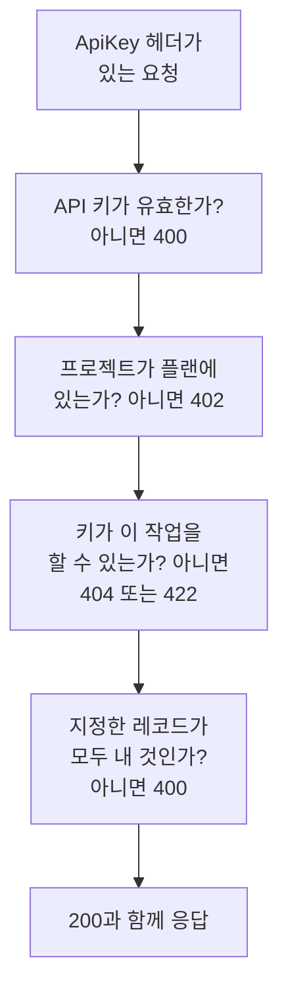

# OneUptime API 참조

OneUptime 대시보드에서 할 수 있는 모든 일은 REST API로도 할 수 있습니다. 반복 작업을 자동화하고, OneUptime을 다른 도구와 연결하고, 자체 통합을 만들 수 있습니다. 이 페이지는 첫 요청을 보내는 방법과 모든 요청이 따르는 규칙을 설명합니다. 모든 엔드포인트와 필드는 [전체 API 참조](/reference)에 나와 있습니다.

:::cards
- [첫 요청 보내기](#첫-요청-보내기): API 키 하나, 헤더 하나, curl 명령 하나.
- [요청과 응답](#요청과-응답): 모든 리소스에 있는 여섯 가지 요청과 각 상태 코드의 의미.
- [플랜과 API](#플랜과-api): 플랜이 제공하는 것과 플랜 미만에서도 계속 작동하는 것.
- [레코드 지정과 쓰기](#레코드-지정과-쓰기): ID, 참조, 스위치, OneUptime이 설정하는 필드.
- [상태와 에피소드](#상태와-에피소드): 레코드가 시작하는 상태와 거쳐 가는 상태.
- [요청이 닿는 범위](#요청이-닿는-범위): 읽기, 변경, 삭제는 한 번에 한 프로젝트씩.
:::

## 요청에 응답하는 방식

API는 REST를 중심으로 구성되어 있습니다. 표준 HTTP 메서드와 상태 코드를 쓰고, JSON을 받아 JSON을 돌려줍니다. 각 요청은 API 키를 담고 몇 가지 검사를 거칩니다. 요청이 처음으로 통과하지 못한 검사가 상태 코드와 `{ "message": "..." }`로 응답하므로, 무엇이 요청을 멈췄는지 메시지가 알려 줍니다.



## 첫 요청 보내기

모든 API 요청은 API 키로 인증됩니다. 키는 한 프로젝트에 속하며, 권한이 허용하는 일을 합니다.

:::steps
### API 키 만들기

**프로젝트 설정 → 고급 → API 키**를 열고 **API 키 만들기**를 클릭합니다. **이름**을 정하고, **접근**에서 키가 할 수 있는 일을 고릅니다. **프로젝트 관리자**, **프로젝트 구성원**, **뷰어**, 또는 키의 페이지에서 개별 권한을 추가하는 **나중에 권한 선택** 중 하나입니다. **고급**에서 다른 날짜를 고르지 않으면 키는 오늘부터 일 년 뒤에 만료됩니다.

### 키 복사

키의 페이지가 열립니다. **API 키 세부 정보** 카드에서 **API 키**를 복사하고, 코드에는 넣지 마세요.

```bash
export ONEUPTIME_API_KEY="your-api-key"
```

### 요청 보내기

처음 열 개의 모니터를 나열합니다. 키는 자신의 프로젝트를 읽으므로 요청에서 프로젝트를 지정하지 않습니다.

```bash
curl -X POST 'https://oneuptime.com/api/monitor/get-list?skip=0&limit=10' \
  -H "ApiKey: $ONEUPTIME_API_KEY" \
  -H 'Content-Type: application/json' \
  -d '{ "select": { "name": true } }'
```

응답은 `{ "data": [...], "count": ... }`입니다. 모니터와 모니터의 전체 수입니다. 자체 호스팅 설치에서는 `https://oneuptime.com` 대신 자신의 OneUptime 주소를 사용하세요.
:::

### 리소스별 예시

OneUptime 대시보드의 모든 리소스에는 사이드 메뉴에 **개발자** 섹션이 있으며, 열기 전까지는 접혀 있습니다. 그 **API** 페이지에는 해당 리소스에 대해 바로 실행할 수 있는 `curl` 명령이 있으며, 내 OneUptime을 대상으로 하고 내 프로젝트의 값으로 채워져 있습니다. 리소스 자체의 페이지에서는 읽기, 변경, 삭제를, 목록 페이지(예: **모니터**)에서는 나열, 개수 세기, 만들기를 할 수 있습니다. 명령은 API 키를 환경 변수 `ONEUPTIME_API_KEY`에서 읽습니다.

예시는 리소스에 맞게 작성되어 있습니다. 예를 들어 **인시던트** 목록에서는 목록 요청이 첫 번째 인시던트로 응답을 보여 주고, 필터는 해결되지 않은 인시던트, 특정 심각도의 인시던트, 특정 모니터에 관한 인시던트, 지난 7일 동안의 인시던트를 내 상태, 심각도, 모니터를 사용해 찾습니다. 만들기 요청은 내 심각도 중 하나로 인시던트를 선언하며, 각 필드의 용도를 한 줄로 설명합니다. 인시던트 자체의 페이지는 실제 응답으로 인시던트를 읽고, 다른 심각도로 옮기고, 자주 쓰는 작업을 제공합니다. 인시던트를 인지하고 해결하는 작업(프로젝트 고유의 상태 사용)과 내부 또는 공개 노트를 추가하는 작업입니다. 모든 API 페이지는 리소스의 엔드포인트로 끝납니다.

## 요청과 응답

모든 리소스에는 같은 요청이 있으며, `https://oneuptime.com/api` 뒤에 `/monitor`나 `/incident` 같은 리소스 경로를 붙여 호출합니다.

| 요청 | 메서드와 경로 | 본문에 담는 것 |
| --- | --- | --- |
| 나열 | `POST /api/<resource>/get-list` | `query`, `select`, `sort` |
| 개수 | `POST /api/<resource>/count` | `query` |
| 하나 읽기 | `POST /api/<resource>/<id>/get-item` | `select` |
| 만들기 | `POST /api/<resource>` | `{ "data": { ... } }` |
| 하나 변경 | `PUT /api/<resource>/<id>` | `{ "data": { ... } }`, 변경할 필드 |
| 하나 삭제 | `DELETE /api/<resource>/<id>` | 없음 |

`POST /api/<resource>/<id>/update-item`과 `POST /api/<resource>/<id>/delete-item`도 레코드 하나를 변경하고 삭제합니다. `POST`만 보낼 수 있는 클라이언트를 위한 것입니다.

### 필터링, 정렬, 페이지 넘기기

목록과 개수는 `query`를 받습니다. 값이 있는 필드는 그 값과 일치하고, `_type`이 있는 오브젝트는 비교를 합니다.

| `_type` | 일치하는 것 |
| --- | --- |
| `Search` | `value`를 포함하는 텍스트 |
| `NotEqual` | `value`를 제외한 모든 것 |
| `GreaterThan`, `LessThan` | 더 늦은 날짜나 더 큰 숫자, 또는 더 이른 날짜나 더 작은 숫자 |
| `InBetween` | `startValue`와 `endValue` 사이의 날짜나 숫자 |
| `Includes` | `value`에 있는 값 중 하나 |
| `IsNull`, `NotNull` | 값이 없음, 또는 어떤 값이든 있음 |

리소스가 지정하는 레코드의 필드는 그 관계 아래에서 필터링합니다. `"user": { "name": { "_type": "Search", "value": "ada" } }`는 사용자 이름에 "ada"가 들어간 팀 구성원을 찾습니다. 필드로 필터링하려면 그 필드를 읽을 권한이 필요하며, 관계를 거쳐도 리소스 자체에서와 같습니다. 읽을 수 없는 필드에 대한 필터는 그 필드를 알려 주는 `422`로 거부됩니다.

`select`는 돌려받을 필드를 지정하며, `_id`는 항상 돌아옵니다. `sort`는 `ASC` 또는 `DESC`로 정렬하며, 지정하지 않으면 최신 레코드가 먼저 옵니다. 목록은 `limit`을 설정하지 않으면 레코드 10개를 돌려주며 최대 10,000개까지 받을 수 있고, `skip`은 먼저 그만큼을 건너뜁니다. `count`만큼 받을 때까지 `skip`을 `limit`만큼 늘려 가세요. 목록 요청에 `?output-type=csv`를 붙이면 JSON 대신 CSV를 받습니다.

예를 들어 이름에 "checkout"이 들어가고 2026년 초부터 만들어진 모니터를 최신순으로 가져오려면 다음과 같이 합니다.

```bash
curl -X POST 'https://oneuptime.com/api/monitor/get-list' \
  -H "ApiKey: $ONEUPTIME_API_KEY" \
  -H 'Content-Type: application/json' \
  -d '{
    "query": {
      "name": { "_type": "Search", "value": "checkout" },
      "createdAt": { "_type": "GreaterThan", "value": "2026-01-01T00:00:00.000Z" }
    },
    "select": { "name": true, "createdAt": true },
    "sort": { "createdAt": "DESC" },
    "limit": 100
  }'
```

날짜와 `_id`가 아닌 ID는 `{ "_type": "DateTime", "value": "..." }`, `{ "_type": "ObjectID", "value": "..." }`처럼 감싸진 채 돌아오므로 `value`에서 읽으세요.

요청이 필터에 쓰거나 기록하는 모든 ID(`_id`, `monitorId` 같은 필드, `"labels": [{ "_id": "..." }]`처럼 관계가 나열하는 각 레코드)는 UUID이며, 텍스트로 보내거나 돌아올 때와 같은 방식으로 감싸서 보냅니다. UUID가 아닌 텍스트나 ID 대신 넣은 객체 같은 다른 값은 필드를 알려 주고 그것이 `query`와 `data` 중 어디에 있었는지 말해 주는 `400`으로 거부되며, 아무것도 읽거나 쓰지 않습니다.

```text
Invalid ID for "currentIncidentStateId" in the query: "resolved". An ID is a UUID, such as "550e8400-e29b-41d4-a716-446655440000".
```

### 상태 코드

| 코드 | 의미 | 더 읽기 |
| --- | --- | --- |
| `200` | 처리되었습니다. 목록과 개수는 읽을 수 있는 레코드로 응답하며, 없으면 아무것도 돌려주지 않습니다. | [ID로 레코드 하나 읽기](#id로-레코드-하나-읽기) |
| `400` | 요청이 잘못되었습니다. API 키가 유효하지 않거나, 값이 허용되지 않거나, 필드에 쓸 수 없거나, 지정한 레코드가 내 것이 아니거나, 여러 프로젝트를 한꺼번에 변경합니다. 메시지가 무엇이 잘못되었는지 알려 줍니다. | [요청이 지정하는 레코드](#요청이-지정하는-레코드) |
| `402` | 프로젝트의 플랜에 요청이 쓰는 기능이 포함되어 있지 않습니다. 메시지가 플랜을 알려 줍니다. | [내 플랜에 포함되지 않은 기능](#내-플랜에-포함되지-않은-기능) |
| `404` | 레코드가 없거나, 다른 프로젝트에 있거나, 읽을 수 없는 레코드입니다. 어느 경우든 같은 응답입니다. | [읽을 수 없는 레코드의 변경과 삭제](#읽을-수-없는-레코드의-변경과-삭제) |
| `422` | 이 작업은 허용되지 않습니다. API 키에 이 종류의 레코드에 대한 권한이 없거나, 레코드를 읽을 수는 있지만 변경할 수 없거나, 권한의 레이블이 레코드를 제외합니다. 메시지가 이유를 알려 줍니다. | [읽을 수 없는 레코드의 변경과 삭제](#읽을-수-없는-레코드의-변경과-삭제) |
| `500` | 서버에서 무언가 실패했습니다. 새 레코드의 소유자를 쓸 수 없으면 레코드가 다시 제거되므로 만들기를 다시 시도할 수 있습니다. | [요청이 지정하는 레코드](#요청이-지정하는-레코드) |

## 플랜과 API

### 내 플랜에 포함되지 않은 기능

OneUptime Cloud에서 일부 리소스는 플랜으로 제공됩니다. 싱글 사인온 공급자와 SCIM 연결은 **Scale**에서, API 키, 온콜 일정, Slack과 Microsoft Teams의 알림 규칙과 요약 등은 **Growth**에서 제공됩니다. 이런 리소스를 만들거나 변경하거나 켜려면 그 플랜이 필요합니다. 그보다 낮은 플랜에서는 요청이 `402 Payment Required`로 거부되고, 메시지가 플랜을 알려 줍니다.

리소스의 일부 설정도 같은 방식으로 플랜으로 제공됩니다. 예를 들면 비공개 상태 페이지, 목록 중 하나를 숨기는 상태 페이지, 사용자 지정 HTML, CSS, JavaScript, 이메일 보고서, SMS·Slack·Microsoft Teams·웹훅 구독자, IP 허용 목록이 있는 상태 페이지, 공개로 공유한 대시보드와 그 IP 허용 목록, 양식의 IP 허용 목록, 프로젝트의 감사 로그입니다. 각각의 가이드와 설정 옆의 대시보드 표시가 필요한 플랜을 알려 줍니다. 이런 설정은 쓸 때마다 플랜이 필요합니다. 리소스를 그 설정과 함께 만들 때도, 나중에 바꿀 때도 마찬가지입니다. 그래서 플랜 미만에서 설정을 켜는 만들기도 `402`로 거부됩니다. 기본값 그대로이거나 기본값으로 되돌린 설정은 모든 플랜에서 작동합니다. 이 설정들을 건드리지 않는 만들기는 통과하며, 이 설정들을 지정하지 않는 Terraform 구성도 마찬가지입니다.

프로젝트가 이미 가진 것은 플랜과 관계없이 계속 관리할 수 있습니다. 예를 들어 평가판이 끝났거나 플랜을 낮춘 뒤에도 그렇습니다.

- 그 레코드들을 삭제할 수 있습니다.
- `isEnabled` 필드가 있는 리소스는 `"isEnabled": false`만 보내서 끌 수 있습니다.
- 플랜을 낮춘 뒤 프로젝트가 찾아야 하는 것을 나열하고 읽을 수 있습니다. 끄기 위해서, 또는 무엇이 멈췄는지 보기 위해서입니다. 대상은 싱글 사인온 공급자, SCIM 연결, API 키와 그 권한, 온콜 일정, Slack과 Microsoft Teams의 알림 규칙과 요약입니다.

누가 무엇을 할 수 있는지는 플랜에 있을 때와 똑같이 일반 권한이 정합니다. 템플릿, 사용자 정의 필드, 모니터 그룹, 온콜 로그, 양식 제출처럼 플랜이 제공하는 다른 리소스를 읽으려면 여전히 플랜이 필요합니다. 그것을 읽는 것이 곧 기능을 쓰는 것이기 때문입니다. **Growth** 미만에서는 API 키의 권한을 하나씩 삭제하지 않습니다. 차단 권한을 삭제하면 키의 접근이 넓어지기 때문입니다. 대신 키를 삭제하세요.

### 플랜 미만의 API 키와 SCIM

OneUptime Cloud에서 프로젝트의 API 키는 프로젝트가 **Growth** 이상에 있는 동안에만 작동하고, SCIM 연결(프로젝트 자체의 것과 상태 페이지의 것)은 **Scale** 이상에 있는 동안에만 완전히 작동합니다. 프로젝트가 그 플랜 아래로 내려가면 다음과 같습니다.

- 프로젝트의 API 키로 보낸 모든 요청은 무엇을 요청하든 `402 Payment Required`로 거부됩니다. REST API, 그리고 API 키로 API를 호출하는 모든 것, 즉 Terraform, `oneuptime` CLI, API 키로 연결한 MCP 클라이언트, 요청 헤더로 키를 보내는 워크플로, 직접 만든 스크립트가 해당합니다. 메시지가 플랜을 알려 줍니다: `API keys need the Growth plan. This project's plan does not include them, so its API keys stopped working. The keys are kept: upgrade the project to Growth in Project Settings > Billing and Invoices > Billing and they work again.`
- SCIM 연결은 사람을 제거하기만 합니다. 사람을 비활성화하고 삭제하고 그룹에서 빼는 작업은 계속 작동하므로, 떠나는 사람은 여전히 접근을 잃습니다. 사람이나 그룹을 추가하거나 변경하는 SCIM 요청은 ID 공급자가 이유를 보여 줄 수 있도록 SCIM 오류 형식의 `402`로 거부됩니다([Scale 플랜 미만](/docs/identity/scim#scale-플랜-미만)).

아무것도 삭제되거나 꺼지지 않습니다. 키와 연결은 보존되며, 프로젝트가 플랜으로 돌아오는 즉시 그대로 다시 완전히 작동합니다. 새 키를 만들 필요도, ID 공급자에서 다시 설정할 필요도 없습니다. 플랜 변경은 1분 안에 적용됩니다.

**Growth** 미만에서는 **프로젝트 설정** > **고급** > **API 키**에 프로젝트에 남아 있는 키가 나열되고 멈췄다고 표시되므로, 어느 플랜에서나 키를 삭제(취소)할 수 있습니다. 키를 만들거나 변경하려면 **Growth**가 필요합니다. **프로젝트 설정** > **결제 및 청구서** > **결제**는 고를 수 있는 각 플랜에 대해, 낮은 플랜이 멈추는 API 키 수와 제한하는 SCIM 연결 수, 그리고 프로젝트의 플랜이 멈춘 것을 보여 줍니다. 플랜 변경으로 이것들이 멈추면 프로젝트 소유자에게 이메일이 갑니다. 이 동작이 시작될 때 이미 이 플랜들 아래에 있던 프로젝트의 소유자는 무엇이 멈췄고 어떻게 다시 켜는지 알려 주는 이메일을 한 통 받습니다.

영향을 받는 것은 프로젝트의 API 키와 SCIM 연결뿐입니다. 사람은 영향을 받지 않습니다. 대시보드 로그인과 로그인으로 연결한 MCP 클라이언트는 이전처럼 작동합니다. 텔레메트리 수집 키, 프로브 키, 에이전트 키는 API 키가 아니므로 계속 작동합니다. 자체 호스팅 설치에는 플랜이 없으므로 아무것도 바뀌지 않습니다.

## 레코드 지정과 쓰기

### 리소스의 ID 찾기

리소스 하나를 읽거나 변경하거나 삭제하는 요청은 ID(UUID)로 리소스를 지정합니다. 리소스 자체의 페이지에서 세부 정보 카드의 끝에는 ID의 앞부분을 보여 주는 작은 **ID** 줄이 있습니다. ID나 그 옆의 복사 버튼을 클릭하면 ID 전체가 복사됩니다. 이를 지원하는 목록에서는 행의 **⋯** 메뉴에 **ID 표시**가 있으며, ID는 페이지 주소의 마지막 부분이기도 합니다. 프로젝트의 ID는 **프로젝트 설정 → 프로젝트**의 **프로젝트 세부 정보** 카드 맨 처음에 있습니다.

### 요청이 지정하는 레코드

많은 리소스가 다른 레코드를 지정합니다. 모니터는 레이블과 프로브를, 상태 페이지 구독자는 상태 페이지를, 네트워크 장치는 사이트를, 인시던트 구성원은 인시던트와 역할을 지정합니다. 아래 규칙은 API, Terraform, 워크플로에 똑같이 적용됩니다.

| 요청이 | 지켜야 할 조건 | 지키지 않으면 |
| --- | --- | --- |
| ID로 레코드를 지정할 때 | 내 프로젝트의 레코드를 지정 | `400` |
| 노트처럼 다른 레코드를 통해 읽는 레코드를 만들 때 | 읽을 수 있는 레코드 아래에 만들기 | `400`, 또는 그 종류의 레코드를 읽을 권한이 없으면 `422` |
| 레코드를 다른 레코드 아래로 옮길 때 | 읽을 수 있는 레코드 아래로 옮기기 | `400` |
| 레코드를 나열하거나, 전용 필드에서 하나를 지정할 때 | 읽기 권한이 닿는 레코드를 지정 | `400` |
| 자격 증명을 담은 설정을 지정할 때 | 그 종류의 설정을 읽을 수 있는 사람이 보내기 | `400` |
| 레이블로 제한된 권한으로 레코드를 만들거나 레이블을 바꿀 때 | 그 레이블 중 하나를 레코드에 지정 | `422` |
| 레코드 하나를 두 가지 방식으로 지정할 때 | 두 번 모두 같은 레코드를 지정 | `400` |

#### 모든 ID는 내 프로젝트의 것이어야 함

리소스가 지정하는 레코드로 보내는 모든 ID는 내 프로젝트의 레코드여야 합니다. 대시보드의 선택기도 다른 것은 제시하지 않으며, Terraform과 워크플로의 요청에도 같은 규칙이 적용됩니다. 다른 프로젝트 레코드의 ID와 존재하지 않는 ID는 똑같이, 필드와 ID를 알려 주는 `400`으로 거부됩니다.

```text
This network device references records that are not in this project: Network Site "…". Please pick values from this project and try again.
```

사람은 구성원 자격으로 확인합니다. 프로젝트의 구성원이 아닌 사람도 같은 방식으로 거부됩니다. 모든 프로젝트가 쓸 수 있는 전역 프로브는 내 프로젝트의 것으로 간주됩니다. 리소스를 변경할 때는 변경이 추가하는 ID만 확인하므로, 이후 사라진 무언가를 지정하는 리소스도 계속 저장할 수 있습니다.

#### 다른 레코드를 통해 읽는 레코드

다른 레코드를 통해 읽는 레코드(인시던트나 알림의 노트와 상태 타임라인, 상태 페이지의 공지, 도메인, 그룹)도 그 레코드를 읽을 때의 규칙에 따라, 읽을 수 있는 레코드를 지정해야 합니다. 인시던트를 읽을 권한이 닿는 레이블이나 소유자 밖의 인시던트, 인시던트 읽기 차단이 빼는 레이블이 있는 인시던트, 또는 직접이든 팀을 통해서든 내가 소유자에 포함되지 않은 비공개 인시던트(프로젝트 소유자와 관리자는 모든 비공개 인시던트, 알림, 에피소드를 봅니다)는 같은 `400`으로 거부되며, 아무것도 쓰이지 않습니다. 공지가 지정하는 각 상태 페이지는 읽을 수 있는 것이어야 하며, 상태 페이지를 읽을 권한이 일부에만 닿는 키는 적어도 하나를 지정해야 합니다. 이런 레코드를 만드는 권한에는 그 레코드가 만들어지는 상위 레코드를 읽는 권한이 필요합니다. 그 권한이 없으면 만들기는 통과시켜 줄 권한을 알려 주는 `422`로 거부됩니다.

```text
You do not have permissions to create Incident Internal Note. It is read through its Incident, and you need one of these permissions to read Incidents: …
```

이런 레코드를 옮기는 변경도 같은 규칙을 따릅니다. 변경이 상위로 추가하는 각 레코드(공지의 다른 상태 페이지, 서비스를 통해 읽는 레코드의 다른 서비스)는 읽을 수 있는 것이어야 하며, 그렇지 않으면 변경은 같은 `400`으로 거부되고 아무것도 쓰이지 않습니다. 레코드가 이미 가진 상위 레코드는 다시 확인하지 않으며, 레코드를 어느 상위 아래에도 두지 않는 변경에는, 아무것도 지정하지 않는 만들기와 마찬가지로 그 종류의 레코드를 모두 읽을 수 있는 권한이 필요합니다.

#### 소유자

리소스의 소유자(모니터, 온콜 정책, 대시보드, 그 밖에 소유자가 있는 모든 리소스의 사용자 소유자와 팀 소유자 레코드)도 같은 방식으로 소유하는 리소스를 통해 읽습니다. 소유자를 나열하고, 읽고, 추가하고, 제거하려면 그 리소스의 레이블과 소유자에 따라 그 리소스를 읽는 권한이 필요하며, 읽을 수 없는 리소스의 소유자 레코드는 존재하지 않는 것처럼 응답합니다. 소유자를 추가하고 제거하는 것도 그것을 허용하는 권한의 범위를 따릅니다. `Owned` 범위의 권한은 본인이나 본인이 속한 팀 중 하나가 소유한 리소스의 소유자에만 닿으며, 그 밖의 리소스에 소유자를 추가하면 그렇다고 알려 주는 `422`로 거부됩니다.

#### 쓰기가 나열하거나 지정하는 레코드

만들기나 변경이 나열하는 레코드(인시던트의 모니터와 온콜 정책, 알림의 서비스, 예정된 유지 관리 이벤트의 상태 페이지, 규칙의 Runbook)는 그 종류의 레코드를 읽는 권한이 있으면 그 권한을, 어떤 경우든 그 읽기에 대한 레이블이 있는 차단을 따릅니다. 그 밖의 레코드는 같은 `400`으로 거부됩니다. 변경은 목록에 추가하는 레코드만 확인하므로, 목록에 이미 있는 레코드는 그대로 남습니다.

만들기나 변경이 전용 필드에서 지정하는 레코드 하나(알림의 모니터, 상태 페이지 리소스가 보여 주는 모니터, 비용 예산의 서비스, Runbook 실행이 연결되는 인시던트)도 어느 이름으로 보내든 같은 규칙을 따릅니다. 그 종류의 레코드를 읽는 권한 밖의 레코드나, 그 읽기 차단이 빼는 레이블이 있는 레코드는 같은 `400`으로 거부됩니다. 변경은 필드가 이미 가진 것과 다른 레코드를 지정할 때만 확인합니다. 모든 프로젝트가 쓸 수 있는 OneUptime의 전역 프로브와 AI 에이전트는 계속 모든 프로젝트에 열려 있습니다. 템플릿이 대신 채우는 레코드도 채워지는 즉시, 무엇이든 저장되기 전에 같은 방식으로 확인합니다. 인시던트 템플릿이 그 템플릿으로 선언한 인시던트에 추가하는 모니터, 상태 페이지, 온콜 정책은 직접 고른 것처럼 읽을 수 있는 것이어야 합니다.

#### 자격 증명을 담은 설정

자격 증명을 담은 설정(SMTP 서버, 통화와 SMS 공급자, SNMP 자격 증명, 화상 통화 연결, API 키, 외부 MCP 서버)은 그 종류의 설정을 읽을 수 있는 호출자만 지정할 수 있습니다. 대상은 상태 페이지의 `smtpConfig`와 `callSmsConfig`, 수신 통화 정책의 `projectCallSMSConfig`, 네트워크 장치나 사이트의 `snmpCredentialProfile`, 인시던트나 알림의 화상 통화 `videoCallConnection`, API 키 권한의 `apiKey`, 그리고 AI 규칙의 `externalMcpServers`입니다. 그 종류의 설정을 읽는 권한 없이, 또는 레이블 없는 차단이 빼는 권한으로 이런 설정을 지정하면, 어느 이름으로든 같은 `400`으로 거부됩니다. 레코드가 이미 지정한 설정을 유지하는 변경은 확인하지 않습니다. 수신 통화 정책의 번호 검색과 보유 번호 목록에도 지정하는 통화와 SMS 구성을 같은 방식으로 읽을 수 있어야 합니다.

#### 만들 때의 레이블과 소유자

레이블로 제한된 만들기 권한은 그 레이블 중 하나가 있는 레코드(자체 레이블이 없는 레코드라면, 레이블이 있는 레코드 아래의 레코드)만 만듭니다. 단, 그 종류의 레코드를 만드는 다른 권한이 프로젝트 전체에 닿으면 예외입니다. 또한 만들기 권한에 붙은 레이블이 있는 차단은 그 레이블 중 하나가 있는 레코드를 거부합니다. 그 밖의 만들기는 레이블을 알려 주는 `422`로 거부됩니다.

```text
Your access lets you create Status Pages only with one of these labels: Production. Add one of them and try again.
```

범위가 **Owned**인 만들기 권한은 모니터, 상태 페이지, 그 밖에 자체 소유자가 있는 레코드를 소유자 중 한 명이 되는 사람을 위해서만 만들고, 노트처럼 속한 레코드에서 소유자를 물려받는 레코드는 나나 내 팀 중 하나가 소유한 레코드 아래에만 만듭니다.

만든 사람은 레코드가 저장된 직후, 다른 어떤 일이 일어나기 전에 소유자가 됩니다. 소유자 행을 쓸 수 없으면 레코드는 다시 제거되고 만들기는 `500`으로 거부되므로, 만든 사람이 닿을 수 없는 레코드가 남지 않습니다.

#### 레이블 변경

레코드가 가진 레이블(자체 레이블, 또는 자체 레이블이 없는 레코드라면 그 레코드가 지정하는 레코드)의 변경도 같은 방식으로 그 종류의 레코드를 변경하는 권한을 따릅니다. 레이블로 제한된 권한이라면 레코드에 그 레이블 중 적어도 하나가 남아야 합니다. 단, 레코드를 변경하는 다른 권한이 프로젝트 전체에 닿으면 예외입니다. 또한 변경 권한에 붙은 레이블이 있는 차단은 그 레이블 중 하나를 붙이는 것을 거부합니다. 이런 변경은 레이블을 알려 주는 `422`로 거부됩니다.

```text
Your access lets you change Monitors only with one of these labels: Production. Keep one of them and try again.
```

#### 두 가지 방식으로 레코드 지정

레코드는 두 가지 방식으로 지정할 수 있습니다. ID 필드(`monitorId`)로 지정하거나, 대시보드의 양식이 보내는 관계(`"monitor": { "_id": "…" }`)로 지정합니다. 둘 중 하나를 보내세요. 요청이 둘 다 보내면 같은 레코드를 지정해야 합니다. 둘이 서로 다른 요청(서로 다른 두 ID, 또는 ID와 빈 값)은 두 필드를 모두 알려 주는 `400`으로 거부됩니다.

```text
Conflicting Monitor references were provided. monitorId and monitor are names for the same field and must hold the same value: send only one of them, or the same id in each.
```

두 이름 모두 같은 방식으로 확인합니다. 지정한 레코드에 대한 규칙은 어느 이름으로 보내든 적용됩니다. 상태 페이지 그룹의 상위 그룹은 같은 상태 페이지에 있어야 하고, 상태 페이지의 헤더 링크는 최대 세 개이며, 그룹 이름은 상태 페이지 안에서 고유해야 합니다.

### 스위치

켜짐 또는 꺼짐인 필드(`isEnabled`, `isVisibleOnStatusPage`, `isArchived`, 그 밖의 모든 `true` 또는 `false` 필드)는 `true`나 `false`를 받습니다. 데이터베이스가 둘 중 하나로 읽는 텍스트와 숫자는 API, Terraform, 워크플로 모두에서 똑같이 그 값으로 받아들입니다. `"true"`, `"yes"`, `"on"`, `"1"`, `1`은 `true`이고, `"false"`, `"no"`, `"off"`, `"0"`, `0`은 `false`이며, 대소문자는 구분하지 않습니다. OneUptime이 그 레코드로 하는 모든 일도 그 값으로 취급합니다. `"isVisibleOnStatusPage": "true"`로 보낸 예정된 유지 관리 이벤트는 상태 페이지에 이미지를 보여 주고, `"isEnabled": "false"`는 `false`와 마찬가지로 플랜 미만의 리소스를 끕니다. `"maybe"`, `""`, `2` 같은 다른 값은 필드를 알려 주는 `400`으로 거부됩니다.

```text
isVisibleOnStatusPage must be true or false.
```

레코드의 값을 이미 있는 그대로 쓰는 업데이트는 아무것도 바꾸지 않습니다. 레코드의 **On Update** 워크플로를 시작하지 않고, 실시간 업데이트를 보내지 않으며, 감사 로그 항목도 추가하지 않습니다. `false` 위에 쓴 `false`는 같은 값으로 간주되며, `false` 위에 쓴 `"false"`, 텍스트로 쓴 숫자, 다른 형식으로 쓴 같은 시점, 순서만 다른 같은 레이블도 마찬가지입니다. 업데이트가 일부 값을 바꾸고 다른 값은 그대로 다시 쓰면, 감사 로그 항목에는 바뀐 값만 나열되고 워크플로의 **Fields to watch**도 그 값만 받습니다.

### 프로젝트를 구매한 곳

프로젝트의 리셀러, 리셀러 플랜, 리셀러 라이선스(`resellerId`, `resellerPlanId`, `resellerLicenseId`, 그리고 관계 `reseller`와 `resellerPlan`)는 OneUptime만 설정합니다. 리셀러의 프로모션 코드로 프로젝트를 만들 때와 리셀러가 플랜을 바꿀 때입니다. 이 중 하나를 보내는 프로젝트의 만들기나 변경은 누가 보내든 필드를 알려 주는 `400`으로 거부됩니다.

```text
User is not allowed to create on resellerId column of Project. No permission allows it: the column is set by the server, not by a request.
```

### 레코드를 만든 사람

OneUptime은 누가 레코드를 만들었는지(그리고 누가 보관하고, 해결하고, 인지하고, 트리거했는지)를 요청 자체에서 기록합니다. 로그인한 사람이 기록되며, 요청이 API 키나 워크플로에서 온 경우에는 아무도 기록되지 않습니다. 이 필드들(`createdByUserId`와 `ByUserId`로 끝나는 다른 필드, 그리고 `createdByUser` 같은 관계)은 읽기 전용이며, 레코드가 보관되거나 해결된 시각(`archivedAt`, `markedAsResolvedAt`, `markedAsArchivedAt`)도 마찬가지입니다. `isArchived`나 `isResolved`를 켜면 누가 언제 했는지 기록되고, 끄면 둘 다 지워집니다. 스위치를 이미 있는 상태 그대로 보내면 누가 언제 바꿨는지가 유지됩니다.

API 참조는 이 필드들을 읽기 전용으로 표시합니다. 다른 변경과 함께 이 필드 중 하나에 보낸 값은 무시되므로 나머지 변경은 통과합니다. 다른 것을 아무것도 보내지 않는 업데이트는 필드를 알려 주는 메시지와 함께 거부됩니다. OneUptime이 누군가를 대신해 만드는 레코드(Slack이나 Microsoft Teams에서 올린 노트, 초대로 만든 계정)는 그 사람을 지정합니다.

## 상태와 에피소드

### 새 레코드가 시작하는 상태

인시던트, 알림, 인시던트 에피소드, 알림 에피소드는 만들기 양식의 **초기 상태** 필드처럼 프로젝트의 어느 상태로든 만들 수 있습니다. `currentIncidentStateId`(인시던트와 인시던트 에피소드)나 `currentAlertStateId`(알림과 알림 에피소드), 또는 관계를 보내세요. 레코드는 그 상태로 시작하고, 상태 타임라인도 그 상태로 시작합니다. 생략하면 `isCreatedState` 플래그가 있는 프로젝트의 생성 상태로 시작하며, 초기 상태가 있는 템플릿으로 선언한 인시던트는 템플릿의 상태로 시작합니다. 다른 프로젝트의 상태는 다른 레코드와 마찬가지로 거부됩니다. Terraform의 `current_incident_state_id`와 `current_alert_state_id`도 같은 방식으로 작동합니다. 인지 상태 또는 그 이후 상태로 만든 레코드는 아무도 호출하지 않으며, 해결된 상태로 만든 레코드는 그룹화, 자동 수정, AI 조사의 대상도 되지 않고 Slack이나 Microsoft Teams 채널도 생기지 않습니다. [이미 인지되었거나 해결된 상태로 선언된 인시던트](/docs/incidents/declaring-incidents#이미-인지되었거나-해결된-상태로-선언된-인시던트)를 참조하세요.

### 레코드의 상태 바꾸기

레코드의 상태는 상태 타임라인의 행(`POST /api/incident-state-timeline`, `/api/alert-state-timeline`, `/api/incident-episode-state-timeline`, `/api/alert-episode-state-timeline`, `/api/scheduled-maintenance-state-timeline`)으로, 또는 현재 상태(`currentIncidentStateId`, `currentAlertStateId`, `currentScheduledMaintenanceStateId`, 또는 관계)를 쓰는 업데이트로 바뀌며, 업데이트도 같은 행을 기록합니다. 어느 쪽이든 하나의 규칙이 전환을 지배하며, 에피소드에도 인시던트, 알림, 예정된 유지 관리 이벤트와 똑같이 적용됩니다. 프로젝트의 순서에서 레코드의 현재 상태보다 앞에 있는 상태는 무엇이든 저장되기 전에 거부되며, 레코드가 이미 있는 상태도 마찬가지입니다.

```text
Episode cannot transition to Acknowledged state from Resolved state because Acknowledged is before Resolved in the order of incident states.
```

실수로 설정한 상태는 레코드의 상태 타임라인에서 해당 행을 삭제해 바로잡습니다. [순서는 표시 취향이 아니라 실제 제약입니다](/docs/incidents/states-and-severities#순서는-표시-취향이-아니라-실제-제약입니다)를 참조하세요.

### 인시던트나 알림이 속한 에피소드

인시던트의 `incidentEpisodeId`와 알림의 `alertEpisodeId`(그리고 그 관계인 `incidentEpisode`와 `alertEpisode`)는 레코드가 마지막으로 추가되어 아직 구성원으로 있는 에피소드를 지정하거나, 아무것도 지정하지 않습니다. 이 필드들은 읽기 전용이며, OneUptime이 에피소드의 구성원으로부터 설정합니다. 인시던트를 에피소드에 넣으려면 Incident Episode Member를 만드세요(`incidentEpisodeId`와 `incidentId`를 지정한 `POST /api/incident-episode-member`). 빼려면 그 구성원을 삭제하며, 그러면 인시던트는 아직 속한 최신 에피소드를 지정하거나 아무것도 지정하지 않습니다. 알림도 Alert Episode Members(`alertEpisodeId`와 `alertId`를 지정한 `/api/alert-episode-member`)를 통해 같은 방식으로 작동합니다. 그룹화 규칙도 같은 방식으로 인시던트와 알림을 에피소드에 추가합니다. 에피소드를 보내는 인시던트나 알림의 만들기나 업데이트는 API, Terraform, MCP 도구, 워크플로 중 누가 보내든 거부됩니다. Terraform에서 `incident_episode_id`와 `alert_episode_id`는 읽을 수 있지만 설정할 수는 없으며, 구성원 자격은 `oneuptime_incident_episode_member`와 `oneuptime_alert_episode_member` 리소스로 관리합니다.

## 요청이 닿는 범위

### 읽을 수 없는 레코드의 변경과 삭제

변경이나 삭제는 API 키(또는 로그인한 사람)가 읽을 수 있는 레코드에만 닿습니다. 레이블이나 소유자 밖의 레코드, 읽기 차단 뒤에 있는 레코드, 또는 읽을 수 없는 다른 레코드를 통해 읽는 레코드(인시던트의 노트, 상태 페이지의 공지)도 변경하거나 삭제할 수 없습니다. 어떤 종류의 레코드를 변경하거나 삭제하는 권한은 그 레코드를 읽는 권한과 함께 작동하고, 인시던트의 노트를 변경하는 권한은 인시던트를 읽는 권한과 함께 작동합니다.

ID로 레코드 하나를 변경하거나 삭제하는 요청(`PUT /api/<resource>/<id>` 또는 `POST /api/<resource>/<id>/update-item`, `DELETE /api/<resource>/<id>` 또는 `POST /api/<resource>/<id>/delete-item`)이 아무것에도 닿지 않으면 다음과 같이 응답합니다.

- `404`: 레코드가 없거나, 다른 프로젝트에 있거나, 읽을 수 없는 레코드일 때. 어느 경우든 같은 응답입니다.

```text
Incident not found.
```

- `422`: 레코드를 읽을 수는 있지만 변경하거나 삭제할 수 없을 때. 이유가 함께 표시됩니다.

```text
You do not have permission to update this incident.
```

예전에는 아무것에도 닿지 않은 삭제가 `200`으로 응답했습니다. 워크플로의 업데이트 단계와 삭제 단계처럼 쿼리로 하는 업데이트와 삭제는 변경한 레코드 수로 응답하며, 아무것에도 닿지 않으면 `0`으로 응답합니다. Terraform은 `terraform destroy` 중의 `404`를 이미 사라진 리소스로 읽습니다.

텔레메트리도 같은 규칙을 따릅니다. 로그, 트레이스, 메트릭, 예외, 프로파일, 세션 리플레이의 삭제는 텔레메트리를 읽고 삭제할 수 있는 리소스(서비스, 호스트, 클러스터 등)의 행에 닿으며, 한 번에 한 프로젝트씩 이루어집니다. 모든 프로젝트에 걸친 요청은 거부됩니다. ID로 행 하나를 삭제하는 요청이 아무것에도 닿지 않으면 위와 같이 `404` 또는 `422`로 응답합니다.

### 변경은 한 번에 한 프로젝트씩

프로젝트 레코드의 업데이트나 삭제는 요청이 지정하는 프로젝트에서 이루어집니다. 지정은 `tenantid` 헤더로 하며, API 키라면 키 자신의 프로젝트입니다. 로그인한 사용자의 업데이트나 삭제 가운데 프로젝트를 지정하지 않거나, `is-multi-tenant-query` 헤더로 자신의 모든 프로젝트에 걸쳐 묻는 요청은 `400`으로 거부됩니다.

```text
Changes to incidents are made in one project at a time. Please pass the project ID in the 'tenantid' header.
```

예전에는 이런 요청이 `500`으로 실패했습니다. 읽기는 여전히 모든 프로젝트에 걸쳐 물을 수 있습니다.

### ID로 레코드 하나 읽기

ID로 레코드 하나를 읽는 요청(`POST /api/<resource>/<id>/get-item`)은 레코드가 없거나, 다른 프로젝트에 있거나, 읽을 수 없는 레코드이면 `404`로 응답하며, 어느 경우든 같은 응답입니다.

```text
Incident not found.
```

예전에는 빈 본문과 함께 `200`으로 응답했습니다. 목록(`get-list`)과 개수는 여전히 읽을 수 있는 레코드와 함께 `200`으로 응답하며, 없으면 아무것도 돌려주지 않습니다. Terraform 공급자는 새로 고침 중의 `404`를 사라진 리소스로 읽고 state에서 제거하므로, 다음 plan에서 리소스를 다시 만듭니다. 공급자가 쓰는 API 키에는 관리하는 모든 리소스를 읽을 수 있는 권한과 레이블을 주세요. MCP 도구는 `404`에 대해 해당 목록 도구를 안내하는 오류로 응답하며, CLI는 코드 `3`으로 종료합니다.

## 전체 엔드포인트 참조

모든 리소스, 엔드포인트, 필드는 [OneUptime API 참조](/reference)에 나와 있습니다. 여러 언어로 제공되며, 언어는 브라우저에 따라 정해지고 페이지 맨 위의 선택기로 언제든 바꿀 수 있습니다.

## 문제 해결

:::details 모든 요청이 400 Invalid API Key로 응답함
`ApiKey` 헤더가 비어 있거나, 키가 아니거나, 만료되었거나 재설정된 키를 지정합니다. **프로젝트 설정 → 고급 → API 키** 아래의 키 페이지에서 키를 다시 복사하세요. 그 페이지에 **만료** 날짜도 있습니다.
:::

:::details 모든 요청이 402 Payment Required로 응답함
OneUptime Cloud에서 API 키는 프로젝트가 **Growth** 이상의 플랜에 있는 동안에만 작동합니다. 키는 보존되며, 프로젝트가 플랜으로 돌아오면 그대로 다시 작동합니다. [플랜 미만의 API 키와 SCIM](#플랜-미만의-api-키와-scim)을 참조하세요.
:::

:::details 모든 요청이 422 You do not have permissions로 응답함
API 키에 그 종류의 레코드에 대한 권한이 없습니다. **나중에 권한 선택**으로 만든 키는 권한을 받기 전까지 아무것도 할 수 없습니다. **프로젝트 설정 → 고급 → API 키**에서 키를 열고 **역할 추가** 또는 **권한 추가**를 클릭하세요. 메시지에는 요청을 통과시킬 권한이 나옵니다.
:::

:::details 대시보드에서 보이는 레코드가 404로 응답함
API 키는 권한과 그 레이블이 닿는 것만 읽으며, 키가 닿는 범위는 내 계정보다 좁을 수 있습니다. 레코드에 닿는 권한을 키에 주세요. [ID로 레코드 하나 읽기](#id로-레코드-하나-읽기)를 참조하세요.
:::

:::details 업데이트가 400 Invalid request body로 응답함
업데이트는 변경할 필드를 `data` 안에 넣어 `{ "data": { "name": "New name" } }`처럼 보냅니다. 그것이 없는 본문은 `200`으로 응답하고 아무것도 바꾸지 않는 대신 거부됩니다.

```text
Invalid request body. The update payload should be an object of the form { "data": { ...fields to update... } }.
```
:::

:::details 쓰기가 400으로 응답하고 필드와 ID를 알려 줌
그 ID는 다른 프로젝트의 레코드, 존재하지 않는 레코드, 또는 권한이 닿지 않는 레코드를 지정합니다. [요청이 지정하는 레코드](#요청이-지정하는-레코드)를 참조하세요.
:::

## 다음 단계

:::cards
- [사용자, 팀 및 권한](/docs/permissions/index): API 키의 권한과 레이블이 닿는 범위.
- [Terraform 공급자](/docs/terraform/index): 같은 API를 통해 OneUptime 리소스를 코드로 관리합니다.
- [OneUptime CLI](/docs/cli/index): 터미널과 스크립트에서 API를 호출합니다.
- [MCP 서버](/docs/ai/mcp-server): AI 어시스턴트가 프로젝트를 다루게 합니다.
:::
