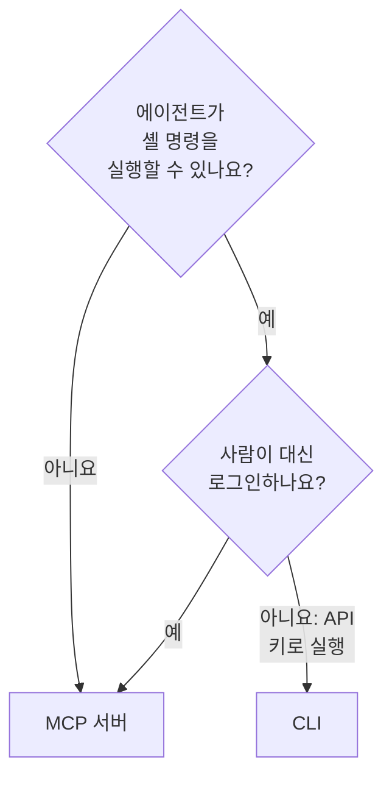

# AI 에이전트용 CLI

편집기의 코딩 에이전트나 파이프라인의 작업처럼 셸 명령을 실행할 수 있는 AI 에이전트는 [MCP 서버](/docs/ai/mcp-server) 대신 CLI로 OneUptime을 다룰 수 있습니다. 이 페이지에서는 각각이 맞는 경우와, 에이전트가 CLI를 설치하고 길을 찾고 응답을 읽는 방법을 설명합니다.

:::cards
- [CLI 또는 MCP 서버](#cli-또는-mcp-서버): 에이전트가 무엇을 써야 하는지.
- [에이전트용으로 준비하기](#에이전트용으로-준비하기): 설치하고 환경 변수로 키를 줍니다.
- [에이전트가 길을 찾는 방법](#에이전트가-길을-찾는-방법): 리소스, 그 필드, 도움말.
- [응답 읽기](#응답-읽기): 오류를 포함해 모든 명령이 JSON으로 응답합니다.
:::

## CLI 또는 MCP 서버

둘 다 OneUptime API에 접근하며, 자격 증명이 허용하는 일을 합니다. 차이는 에이전트가 거기에 접근하는 데 무엇이 필요한지입니다.



| | CLI | MCP 서버 |
| --- | --- | --- |
| 에이전트에 필요한 것 | 셸과 Node.js 22 이상 | Claude나 Cursor 같은 MCP 클라이언트 |
| 로그인 수단 | `ONEUPTIME_API_KEY`에 넣은 프로젝트 API 키 | OneUptime 계정 또는 API 키 |
| 다룰 수 있는 범위 | API의 모든 리소스, 450개 이상 | 도구가 있는 레코드와 텔레메트리, 인시던트 대응 도구 |
| 알맞은 용도 | 에이전트가 써서 사람이 보관하는 스크립트, 파이프라인의 검사, 많은 레코드를 다루는 작업 | 대화: 인시던트 조사, 모니터 설정 |

코딩 에이전트처럼 에이전트가 이미 명령을 실행하거나, 에이전트가 만든 것이 에이전트 없이 계속 실행되어야 할 때(저장소의 스크립트, 파이프라인의 단계)는 CLI를 쓰세요. 사람이 채팅 클라이언트에서 에이전트와 대화할 때는 MCP 서버를 쓰세요. 그러면 에이전트는 그 사람의 권한으로 일하고, 클라이언트는 변경 전에 묻습니다.

## 에이전트용으로 준비하기

모든 OneUptime은 자신의 릴리스에 맞는 CLI 설치 스크립트를 제공합니다. 아래 명령은 `https://oneuptime.com`에서 내려받으므로, 자체 호스팅 OneUptime에서는 이 주소를 사용 중인 URL로 바꾸세요. 스크립트는 먼저 `install.sh`로 저장되므로 실행하기 전에 내용을 읽을 수 있습니다.

```bash
curl -fsSL https://oneuptime.com/install/cli -o install.sh
ONEUPTIME_URL=https://oneuptime.com bash install.sh
```

에이전트에게는 작업에 필요한 접근 권한만 가진 프로젝트 API 키를 명령줄이 아닌 환경 변수로 주고, 먼저 키를 확인하게 하세요.

```bash
export ONEUPTIME_API_KEY="your-api-key"
export ONEUPTIME_URL=https://oneuptime.com
oneuptime whoami --check -o json
```

키는 **프로젝트 설정 → 고급 → API 키**에서 만듭니다. [API 키 만들기](/docs/api-reference/api-reference#api-키-만들기)를 참조하세요. 읽기만 할 수 있는 키라면 에이전트는 보기만 할 수 있습니다.

## 에이전트가 길을 찾는 방법

CLI는 API 키도 요청도 없이 무엇을 할 수 있는지 알려 줍니다.

| 명령 | 응답 내용 |
| --- | --- |
| `oneuptime resources -o json` | 모든 리소스: 명령, 이름, API 경로, 작업, 동작 |
| `oneuptime incident fields -o json` | 리소스의 필드: 용도, 형식, 만들기에 필요한지 여부, 플래그 |
| `oneuptime incident create --help` | 명령의 인수와 플래그 |

ID를 담는 필드는 어느 리소스의 ID를 받는지 알려 주므로, 에이전트는 먼저 그 리소스를 나열합니다. `incidentSeverityId`는 `oneuptime incident-severity list`의 ID를 받습니다. 사람을 지정하는 필드는 `--user-email`처럼 이메일 주소도 받습니다.

## 응답 읽기

에이전트가 모든 명령에 `-o json` 또는 `--json`을 붙이게 하세요. 그러면 응답이 문장인 명령을 포함해 모든 명령이 JSON으로 응답하고, 오류는 표준 오류에 나오는 JSON 객체 하나가 됩니다.

```bash
oneuptime incident acknowledge 6f1c2a40-3b1e-4c55-9a0b-3e2f8d7c1a11 -o json
```

```json
{
  "_id": "6f1c2a40-3b1e-4c55-9a0b-3e2f8d7c1a11",
  "action": "acknowledge",
  "changed": true,
  "state": {
    "_id": "0b7d5e2c-8f4a-4d1b-9c3e-5a6f7b8c9d0e",
    "name": "Acknowledged"
  }
}
```

종료 코드는 무슨 일이 있었는지 알려 줍니다. 성공하면 `0`, 실패하면 `1`, API 키가 없거나 거부되면 `2`, 레코드가 없으면 `3`입니다. 오류의 JSON에는 같은 코드가 `exitCode`에, 다음에 할 일이 `hint`에 들어 있습니다. [출력 형식](/docs/cli/output-formats#json)과 [종료 코드](/docs/cli/scripting#종료-코드)를 참조하세요.

## 다음 단계

:::cards
- [리소스 작업](/docs/cli/resource-operations): 모든 작업과 그 플래그, 필터.
- [명령 참조](/docs/cli/command-reference): 모든 명령, 옵션, 기본값.
- [MCP 서버](/docs/ai/mcp-server): 대신 채팅 클라이언트를 OneUptime에 연결합니다.
:::
