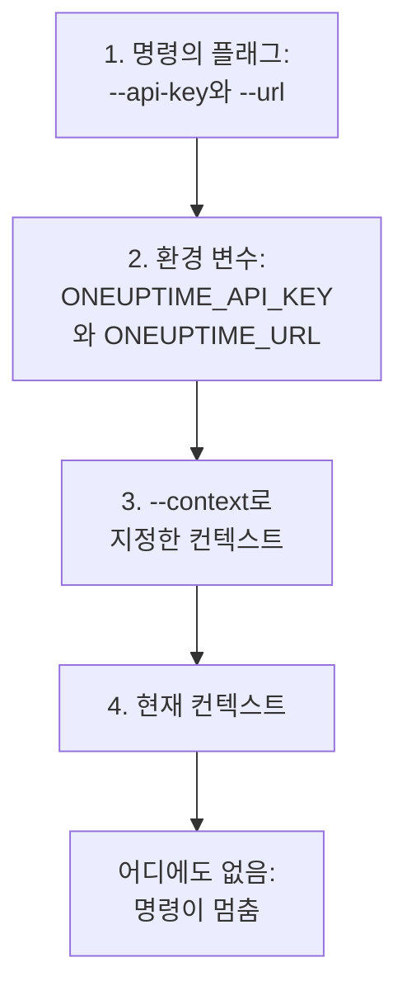

# 인증

CLI가 보내는 모든 요청에는 프로젝트의 API 키가 실립니다. `oneuptime login`으로 환경마다 컨텍스트 하나씩 키를 한 번 저장하거나, 스크립트처럼 플래그나 환경 변수로 명령에 넘깁니다. 이 페이지에서는 각 방법과, 여러 개가 있을 때 명령이 어느 것을 쓰는지 설명합니다.

:::cards
- [로그인](#로그인): API 키와 OneUptime 주소를 저장합니다.
- [컨텍스트](#컨텍스트): 프로젝트나 환경마다 저장한 로그인과 그 사이의 전환.
- [명령이 사용하는 자격 증명](#명령이-사용하는-자격-증명): 먼저 플래그, 다음 환경 변수, 그다음 컨텍스트.
- [문제 해결](#문제-해결): 자격 증명 없음, 잘못된 키, 거부.
:::

## 시작하기 전에

프로젝트의 API 키가 필요합니다. **프로젝트 설정 → 고급 → API 키**에서 **API 키 만들기**로 만들고, 명령에 필요한 접근 권한을 주세요. [API 키 만들기](/docs/api-reference/api-reference#api-키-만들기)를 참조하세요. 키는 권한이 허용하는 일을 합니다. 레코드를 읽기만 할 수 있는 키는 레코드를 나열하고 읽을 수는 있지만 바꿀 수는 없습니다.

OneUptime Cloud에서 API 키는 프로젝트가 **Growth** 플랜 이상인 동안에만 작동합니다. 그보다 낮으면 프로젝트가 업그레이드될 때까지 모든 명령이 플랜을 알려 주는 메시지와 함께 `API error (402)`로 응답하며, 업그레이드하면 같은 키가 다시 작동합니다. [플랜 미만의 API 키와 SCIM](/docs/api-reference/api-reference#플랜-미만의-api-키와-scim)을 참조하세요.

## 로그인

`oneuptime login`은 API 키와 OneUptime 주소를 컨텍스트로 저장하고 현재 컨텍스트로 만듭니다.

```bash
oneuptime login <api-key> <instance-url> [--context-name <name>]
```

| 인수 또는 옵션 | 설명 |
| --- | --- |
| `<api-key>` | 프로젝트의 API 키 |
| `<instance-url>` | OneUptime 주소: `https://oneuptime.com` 또는 `https://oneuptime.example.com` 같은 자체 서버 주소 |
| `--context-name <name>` | 컨텍스트를 저장할 이름. 기본값: `default` |

예를 들어 `production`이라는 이름의 컨텍스트는 다음과 같습니다.

```bash
oneuptime login <api-key> https://oneuptime.com --context-name production
```

`Logged in successfully. Context "production" is now active.`라고 응답합니다. 주소 끝의 슬래시는 제거되고, 같은 이름으로 다시 로그인하면 그 컨텍스트가 바뀝니다.

> [!NOTE]
> `login`은 OneUptime에 묻지 않고 키를 저장합니다. 키가 작동하는지 보려면 `oneuptime incident count` 같은 명령을 실행하세요.

## 컨텍스트

컨텍스트는 저장된 로그인으로, 이름, 주소, API 키로 이루어집니다. 프로젝트나 환경마다 하나씩 저장한 다음, 이어지는 모든 명령이나 한 명령에 쓸 것을 고릅니다.

:::steps
### 환경마다 컨텍스트 저장

```bash
oneuptime login <production-api-key> https://oneuptime.com --context-name production
oneuptime login <staging-api-key> https://oneuptime.example.com --context-name staging
```

로그인할 때마다 그 컨텍스트가 현재 컨텍스트가 되므로, 지금은 `staging`이 현재 컨텍스트입니다.

### 컨텍스트 나열

```bash
oneuptime context list
```

```text
┌───┬────────────┬───────────────────────────────┐
│   │ Name       │ URL                           │
├───┼────────────┼───────────────────────────────┤
│   │ production │ https://oneuptime.com         │
├───┼────────────┼───────────────────────────────┤
│ * │ staging    │ https://oneuptime.example.com │
└───┴────────────┴───────────────────────────────┘
```

`*`는 현재 컨텍스트를 표시합니다. API 키는 목록에 절대 나오지 않습니다.

### 다른 컨텍스트로 전환

```bash
oneuptime context use production
```

`Switched to context "production".`라고 응답하고, 이어지는 명령은 이 컨텍스트를 사용합니다.

### 한 명령에만 컨텍스트 사용

```bash
oneuptime incident list --context staging
```

현재 컨텍스트는 그대로 남습니다.
:::

| 명령 | 하는 일 |
| --- | --- |
| `oneuptime context list` | 저장된 컨텍스트를 나열합니다. `*`가 현재 것을 표시합니다. `-o json`이면 각 컨텍스트의 `name`, `apiUrl`, `isCurrent`를 내보내며 키는 절대 내보내지 않습니다 |
| `oneuptime context use <name>` | 저장된 컨텍스트를 현재 컨텍스트로 만듭니다 |
| `oneuptime context current` | 현재 컨텍스트의 이름, URL, API 키를 보여 주며, 키는 앞 네 글자와 뒤 네 글자만 남기고 가립니다 |
| `oneuptime context delete <name>` | 저장된 컨텍스트를 삭제합니다. 그것이 현재 컨텍스트였다면 남은 것 중 첫 번째 컨텍스트가 현재 컨텍스트가 됩니다 |

## 명령이 사용하는 자격 증명

명령에는 API 키와 URL이 필요합니다. 둘 각각을 다음 장소 중 값이 있는 첫 번째 장소에서 가져옵니다.



따라서 섞어 쓸 수 있습니다. 예를 들어 API 키는 환경 변수에서, URL은 현재 컨텍스트에서 가져올 수 있습니다. 환경 변수는 저장된 컨텍스트가 없는 스크립트와 CI 작업에 알맞습니다.

:::tabs
@tab Linux
```bash
export ONEUPTIME_API_KEY=<api-key>
export ONEUPTIME_URL=https://oneuptime.com
oneuptime incident list
```
@tab macOS
```bash
export ONEUPTIME_API_KEY=<api-key>
export ONEUPTIME_URL=https://oneuptime.com
oneuptime incident list
```
@tab Windows
```powershell
$env:ONEUPTIME_API_KEY = "<api-key>"
$env:ONEUPTIME_URL = "https://oneuptime.com"
oneuptime incident list
```
:::

한 명령에서는 플래그가 다른 모든 것보다 우선합니다.

```bash
oneuptime --api-key <api-key> --url https://oneuptime.com incident list
```

> [!WARNING]
> 플래그로 넘긴 키는 셸 기록에 남고, 같은 컴퓨터의 다른 사용자가 프로세스 목록에서 볼 수 있습니다. 공유 컴퓨터에서는 대신 컨텍스트나 환경 변수를 쓰세요.

## CLI가 사용할 값 확인

`oneuptime whoami`는 다음 명령이 사용할 URL과 API 키, 그리고 그 값을 가져온 컨텍스트를 보여 줍니다.

```bash
oneuptime whoami
```

```text
URL:     https://oneuptime.com
API Key: 4f1c****0a13
Context: production
```

키는 앞의 4글자와 뒤의 4글자만 보입니다. `Context` 줄은 URL과 키가 그 컨텍스트 자신의 값일 때만 나타나며, 플래그나 환경 변수가 바꾼 값이면 나타나지 않습니다. `whoami`는 OneUptime을 호출하지 않고 설정을 읽습니다. 명령이 보낼 내용을 보여 줄 뿐, OneUptime이 받아들이는지는 보여 주지 않습니다. 아무것도 저장되거나 설정되지 않았다면 이렇게 응답합니다.

```text
Not authenticated. Run `oneuptime login` to authenticate.
```

## 설정 파일

`oneuptime login`은 컨텍스트를 홈 폴더의 `~/.oneuptime/config.json`(Windows에서는 `%USERPROFILE%\.oneuptime\config.json`)에 저장합니다. CLI는 자신의 사용자만 읽고 쓸 수 있도록 이 파일을 만듭니다(모드 `0600`).

```json title="~/.oneuptime/config.json"
{
  "currentContext": "production",
  "contexts": {
    "production": {
      "name": "production",
      "apiUrl": "https://oneuptime.com",
      "apiKey": "<api-key>"
    },
    "staging": {
      "name": "staging",
      "apiUrl": "https://oneuptime.example.com",
      "apiKey": "<api-key>"
    }
  }
}
```

이 파일에는 API 키가 그대로 들어 있습니다. 공유 폴더, 백업, 저장소에 넣지 마세요. 한 컨텍스트에서 로그아웃하려면 `oneuptime context delete <name>`으로 삭제하고, 모두에서 로그아웃하려면 파일을 삭제합니다. 유출되었을 수 있는 키는 OneUptime의 **프로젝트 설정 → 고급 → API 키**에서 삭제할 때까지 유효합니다.

출력 형식과 목록 크기는 여기에 저장되지 않습니다. 각 명령에 `-o`와 `--limit`을 넘기세요.

## 문제 해결

:::details "No credentials found" 메시지
`Authentication error: No credentials found.`는 플래그, 환경 변수, 저장된 컨텍스트 중 어느 것도 명령에 API 키와 URL을 주지 않았다는 뜻입니다. `oneuptime login`을 실행하거나 `ONEUPTIME_API_KEY`와 `ONEUPTIME_URL`을 모두 설정하세요. 명령은 종료 코드 `2`로 끝납니다.
:::

:::details "API error (400): Invalid API Key" 메시지
키가 OneUptime의 API 키가 아니거나, 만료되었거나, 재설정되었습니다. **프로젝트 설정 → 고급 → API 키**에 있는 키의 페이지에서 다시 복사하고(**만료** 날짜도 거기에 있습니다), 같은 컨텍스트 이름으로 다시 로그인하세요. 명령은 종료 코드 `2`로 끝납니다.
:::

:::details "API error (402): API keys need the Growth plan" 메시지
OneUptime Cloud에서 프로젝트가 **Growth** 플랜보다 낮아서 API 키가 작동을 멈췄습니다. 프로젝트를 업그레이드하면 같은 키가 다시 작동하며, CLI에서는 바꿀 것이 없습니다.
:::

:::details "API error (422): You do not have permissions" 메시지
키의 권한이 명령이 요청하는 범위에 미치지 못합니다. **프로젝트 설정 → 고급 → API 키**에 있는 키의 페이지에서 키에 역할이나 권한을 주세요. 메시지에는 요청을 통과시킬 권한이 나옵니다.
:::

:::details "Context "staging" does not exist" 메시지
그 이름의 컨텍스트가 저장되어 있지 않습니다. `oneuptime context list`로 있는 이름을 볼 수 있습니다.
:::

:::details whoami가 컨텍스트와 다른 URL이나 키를 보여 줌
환경 변수나 플래그가 컨텍스트의 값을 바꾸고 있습니다. `env | grep ONEUPTIME`으로 설정된 변수를 볼 수 있고, `unset ONEUPTIME_API_KEY ONEUPTIME_URL`로 컨텍스트로 돌아갑니다.
:::

:::details 주소로 보낸 요청이 실패함
`Error: Request failed to https://...`는 CLI가 그 주소에서 OneUptime에 닿지 못했다는 뜻입니다. `oneuptime whoami`로 URL을 확인하세요. OneUptime을 여는 주소에 `https://`를 붙인 것입니다(예: `https://oneuptime.com`).
:::

## 다음 단계

:::cards
- [리소스 작업](/docs/cli/resource-operations): 레코드를 나열하고, 읽고, 만들고, 변경하고, 삭제하고, 셉니다.
- [스크립팅 및 CI/CD](/docs/cli/scripting): 파이프라인에 환경 변수로 키를 넘깁니다.
- [OneUptime API 참조](/docs/api-reference/api-reference): API 키가 할 수 있는 일과 각 응답의 의미.
:::
