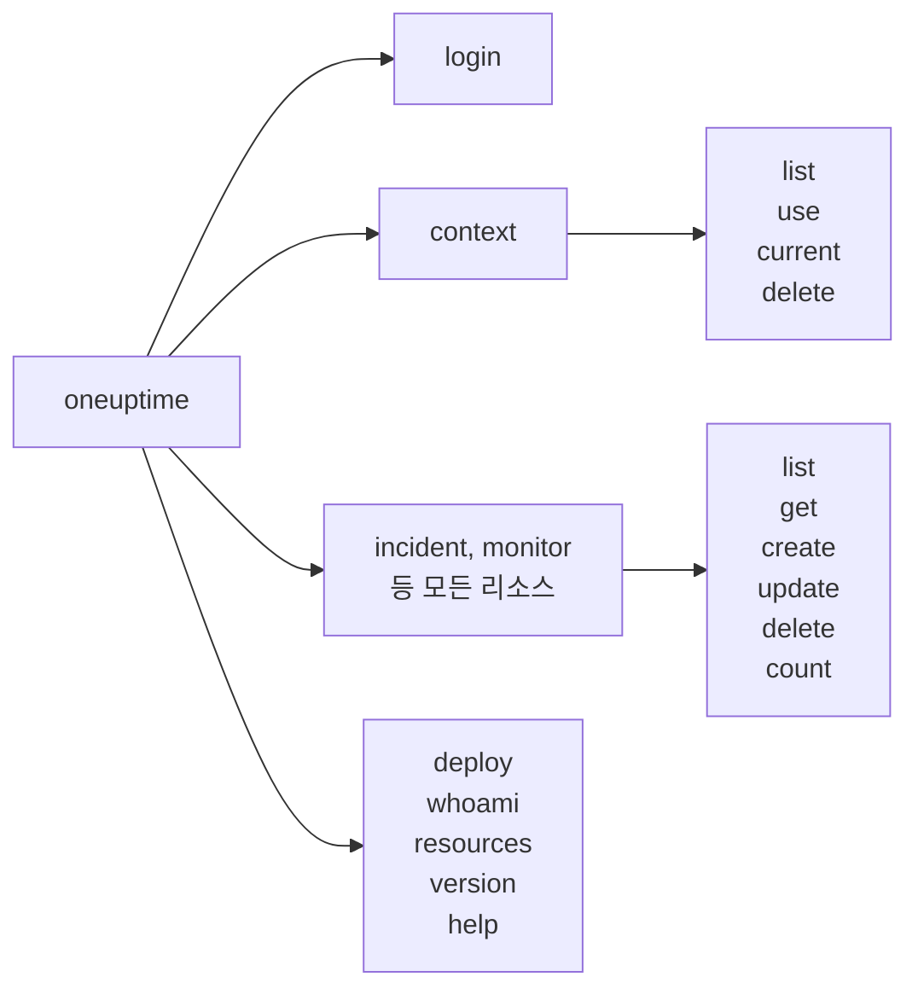

# 명령 참조

`oneuptime` CLI의 모든 명령과 그 인수, 옵션, 기본값입니다. 어떤 명령에든 `--help`를 붙이면 같은 내용을 터미널에서 볼 수 있습니다.

:::cards
- [전역 옵션](#전역-옵션): 모든 명령이 받는 옵션.
- [로그인과 컨텍스트](#로그인과-컨텍스트): login과 context 명령.
- [리소스 명령](#리소스-명령): list, get, create, update, delete, count.
- [기타 명령](#기타-명령): deploy, whoami, resources, version, help.
:::

## 명령 구성



## 전역 옵션

| 옵션 | 하는 일 | 기본값 |
| --- | --- | --- |
| `--api-key <key>` | 이 명령에 쓸 API 키 | `ONEUPTIME_API_KEY`, 그다음 컨텍스트의 키 |
| `--url <url>` | 이 명령에 쓸 OneUptime 주소 | `ONEUPTIME_URL`, 그다음 컨텍스트의 URL |
| `--context <name>` | 이 명령에 쓸 저장된 컨텍스트 | 현재 컨텍스트 |
| `-o, --output <format>` | `json`, `table` 또는 `wide` | 터미널에서는 `table`, 파이프에서는 `json` |
| `--no-color` | 색 없이 출력합니다 | 색 있음(`NO_COLOR`가 설정되지 않은 경우) |
| `-V, --version` | CLI 버전을 출력합니다 | |
| `-h, --help` | 명령의 도움말을 보여 줍니다 | |

옵션은 명령 앞이나 뒤에 씁니다. `oneuptime --context staging incident list`와 `oneuptime incident list --context staging`은 같은 일을 합니다.

## 로그인과 컨텍스트

### `oneuptime login`

API 키와 주소를 컨텍스트로 저장하고 현재 컨텍스트로 만듭니다. [로그인](/docs/cli/authentication#로그인)을 참조하세요.

```bash
oneuptime login <api-key> <instance-url> [--context-name <name>]
```

| 인수 또는 옵션 | 필수 | 설명 | 기본값 |
| --- | --- | --- | --- |
| `<api-key>` | 예 | 프로젝트의 API 키 | |
| `<instance-url>` | 예 | OneUptime 주소(예: `https://oneuptime.com`) | |
| `--context-name <name>` | 아니요 | 컨텍스트를 저장할 이름 | `default` |

### `oneuptime context list`

저장된 컨텍스트를 나열합니다. `*`가 현재 것을 표시합니다. API 키는 목록에 절대 나오지 않습니다.

```bash
oneuptime context list [-o <format>]
```

| 옵션 | 필수 | 설명 |
| --- | --- | --- |
| `-o, --output <format>` | 아니요 | `json`, `table` 또는 `wide`. JSON은 각 컨텍스트의 `name`, `apiUrl`, `isCurrent`를 줍니다 |

### `oneuptime context use`

저장된 컨텍스트를 현재 컨텍스트로 만듭니다.

```bash
oneuptime context use <name>
```

| 인수 | 필수 | 설명 |
| --- | --- | --- |
| `<name>` | 예 | 저장된 컨텍스트의 이름 |

### `oneuptime context current`

현재 컨텍스트의 이름과 URL, 그리고 앞 4글자와 뒤 4글자만 남기고 가린 API 키를 보여 줍니다.

```bash
oneuptime context current
```

### `oneuptime context delete`

저장된 컨텍스트를 삭제합니다. 그것이 현재 컨텍스트였다면 남은 것 중 첫 번째 컨텍스트가 현재 컨텍스트가 됩니다.

```bash
oneuptime context delete <name>
```

| 인수 | 필수 | 설명 |
| --- | --- | --- |
| `<name>` | 예 | 저장된 컨텍스트의 이름 |

## 리소스 명령

`<resource>`는 [리소스](#리소스) 표에 있는 레코드 종류의 명령입니다(예: `incident`, `monitor`). 예시는 [리소스 작업](/docs/cli/resource-operations)을 참조하세요.

### `oneuptime <resource> list`

레코드를 최신순으로 나열합니다. 레이블은 대신 이름순으로 나열되며, 번호가 붙은 레이블이 먼저 옵니다(`2. Team`이 `10. Owner`보다 앞).

```bash
oneuptime <resource> list [--query <json>] [--limit <n>] [--skip <n>] [--sort <json>] [-o <format>]
```

| 옵션 | 하는 일 | 기본값 |
| --- | --- | --- |
| `--query <json>` | JSON으로 쓴 필터 | 키가 읽을 수 있는 모든 레코드 |
| `--limit <n>` | 반환할 레코드의 최대 수, 최대 10,000 | `10` |
| `--skip <n>` | 먼저 건너뛸 레코드의 수 | `0` |
| `--sort <json>` | JSON으로 쓴 순서: `{"<field>":"ASC"}` 또는 `{"<field>":"DESC"}` | 최신순 |
| `-o, --output <format>` | `json`, `table` 또는 `wide` | 터미널에서는 `table`, 파이프에서는 `json` |

### `oneuptime <resource> get`

레코드 하나를 읽습니다. 레코드 전용: 텔레메트리에는 `get`이 없습니다.

```bash
oneuptime <resource> get <id> [-o <format>]
```

| 인수 또는 옵션 | 필수 | 설명 |
| --- | --- | --- |
| `<id>` | 예 | 레코드의 ID(UUID) |
| `-o, --output <format>` | 아니요 | `json`, `table` 또는 `wide` |

### `oneuptime <resource> create`

레코드를 만들고 출력합니다.

```bash
oneuptime <resource> create (--data <json> | --file <path>) [-o <format>]
```

| 옵션 | 필수 | 설명 |
| --- | --- | --- |
| `--data <json>` | 둘 중 하나 | JSON으로 쓴 레코드 |
| `--file <path>` | 둘 중 하나 | 레코드가 든 JSON 파일. `--data`와 함께 주면 파일이 쓰입니다 |
| `-o, --output <format>` | 아니요 | `json`, `table` 또는 `wide` |

### `oneuptime <resource> update`

지정한 필드를 바꿉니다. 레코드 전용: 텔레메트리에는 `update`가 없습니다.

```bash
oneuptime <resource> update <id> --data <json> [-o <format>]
```

| 인수 또는 옵션 | 필수 | 설명 |
| --- | --- | --- |
| `<id>` | 예 | 레코드의 ID |
| `--data <json>` | 예 | JSON으로 쓴, 바꿀 필드 |
| `-o, --output <format>` | 아니요 | `json`, `table` 또는 `wide` |

### `oneuptime <resource> delete`

묻지 않고 레코드를 바로 삭제합니다. 레코드 전용: 텔레메트리에는 `delete`가 없습니다.

```bash
oneuptime <resource> delete <id> [--force]
```

| 인수 또는 옵션 | 필수 | 설명 |
| --- | --- | --- |
| `<id>` | 예 | 레코드의 ID |
| `--force` | 아니요 | 받지만 아무것도 바꾸지 않습니다: `delete`는 확인을 묻지 않습니다 |

### `oneuptime <resource> count`

레코드 개수를 세어 숫자를 출력합니다.

```bash
oneuptime <resource> count [--query <json>] [-o <format>]
```

| 옵션 | 필수 | 설명 |
| --- | --- | --- |
| `--query <json>` | 아니요 | JSON으로 쓴 필터. 없으면 키가 읽을 수 있는 모든 레코드 |
| `-o, --output <format>` | 아니요 | `json`, `table` 또는 `wide` |

### 리소스

레코드는 `list`, `get`, `create`, `update`, `delete`, `count`를 받습니다.

| 영역 | 명령 |
| --- | --- |
| 모니터링 | `monitor`, `monitor-status`, `monitor-status-event` |
| 인시던트 | `incident`, `incident-state`, `incident-severity`, `incident-state-timeline`, `incident-public-note`, `incident-internal-note`, `incident-alert`, `postmortem-status` |
| 알림 | `alert`, `alert-state`, `alert-severity`, `alert-state-timeline`, `alert-internal-note` |
| 상태 페이지 | `status-page`, `status-page-announcement` |
| 예약된 유지 관리 | `scheduled-maintenance-event`, `scheduled-maintenance-state`, `scheduled-maintenance-state-timeline` |
| 팀과 온콜 | `team`, `on-call-policy` |
| 보안 | `security-case`, `security-case-note`, `security-case-priority`, `security-case-status`, `security-detection`, `security-playbook` |
| 레이블 | `label` |

텔레메트리는 `list`, `create`, `count`를 받습니다.

| 영역 | 명령 |
| --- | --- |
| 관측성 | `log`, `metric`, `span`, `exception-instance`, `monitor-log` |
| 보안 | `security-event`, `threat-intel-indicator` |
| 변경과 비용 | `change-event`, `kubernetes-cost-allocation` |

CLI는 OneUptime과 함께 릴리스되므로 `oneuptime resources`는 설치한 버전의 명령을 나열합니다.

### API 요청

각 작업은 API에 보내는 요청 하나이며, 키는 `APIKey` 헤더에 담깁니다. `<path>`는 `oneuptime resources`가 알려 주는 리소스의 API 경로입니다. `incident`는 `/incident`, `on-call-policy`는 `/on-call-duty-policy`입니다.

| 작업 | 요청 | 본문 |
| --- | --- | --- |
| `list` | `POST /api/<path>/get-list` | `query`, `select`, `skip`, `limit`, `sort` |
| `get` | `POST /api/<path>/<id>/get-item` | `select` |
| `create` | `POST /api/<path>` | `{"data": ...}` |
| `update` | `PUT /api/<path>/<id>/` | `{"data": ...}` |
| `delete` | `DELETE /api/<path>/<id>/` | 없음 |
| `count` | `POST /api/<path>/count` | `query` |

## 기타 명령

### `oneuptime deploy`

파이프라인에서 배포나 다른 변경을 기록합니다. 기록된 변경은 서비스의 차트에 표시되고, OneUptime AI가 인시던트를 조사할 때 읽습니다. 쓰기에는 API 키가 아니라 텔레메트리 수집 키를 사용합니다. [배포 및 변경 사항](/docs/telemetry/change-events)을 참조하세요.

```bash
oneuptime deploy [--service <name>] [--service-version <version>] [--previous-version <version>] [--commit <sha>] [--repository <url>] [--branch <name>] [--pull-request <number>] [--environment <name>] [--title <title>] [--description <text>] [--type <type>] [--time <time>] [--attribute <key=value...>] [--ingestion-key <key>]
```

| 옵션 | 필수 | 설명 | 기본값 |
| --- | --- | --- | --- |
| `--service <name>` | 아니요 | 배포된 서비스 | 프로젝트 전체의 변경 |
| `--service-version <version>` | 아니요 | 배포된 버전 | |
| `--previous-version <version>` | 아니요 | 대체된 버전 | |
| `--commit <sha>` | 아니요 | 배포된 커밋 | |
| `--repository <url>` | 아니요 | 커밋이 있는 저장소 | |
| `--branch <name>` | 아니요 | 배포된 브랜치 | |
| `--pull-request <number>` | 아니요 | 배포된 풀 리퀘스트 | |
| `--environment <name>` | 아니요 | 배포 대상 환경 | |
| `--title <title>` | 아니요 | 변경의 제목. 배포가 아닌 다른 종류의 변경에는 필요합니다 | `Deploy <version>` |
| `--description <text>` | 아니요 | 변경의 세부 정보 | |
| `--type <type>` | 아니요 | 변경의 종류(예: `config-change`, `rollback`) | `deployment` |
| `--time <time>` | 아니요 | 발생한 시각(예: `2026-10-19T10:00:00Z`) | 지금 |
| `--attribute <key=value...>` | 아니요 | 추가 속성. `key=value` 형식으로 하나 이상 | |
| `--ingestion-key <key>` | 아니요 | 프로젝트의 텔레메트리 수집 키 | `ONEUPTIME_TELEMETRY_INGESTION_KEY` |

### `oneuptime whoami`

다음 명령이 사용할 URL과 API 키(키는 가린 채)와 그 값을 가져온 컨텍스트를 보여 줍니다. OneUptime은 호출하지 않습니다. [CLI가 사용할 값 확인](/docs/cli/authentication#cli가-사용할-값-확인)을 참조하세요.

```bash
oneuptime whoami
```

### `oneuptime resources`

CLI에 명령이 있는 모든 레코드 종류를 나열합니다. 명령, 단수와 복수 이름, 유형, API 경로, 그리고 전체 개수를 보여 줍니다.

```bash
oneuptime resources [--type <type>] [-o <format>]
```

| 옵션 | 필수 | 설명 | 기본값 |
| --- | --- | --- | --- |
| `--type <type>` | 아니요 | 레코드는 `database`, 텔레메트리는 `analytics` | 둘 다 |
| `-o, --output <format>` | 아니요 | `json`, `table` 또는 `wide`. JSON은 각각의 `name`, `singularName`, `pluralName`, `modelType`, `apiPath`를 줍니다 | 터미널에서는 `table`, 파이프에서는 `json` |

### `oneuptime version`

`oneuptime --version`처럼 CLI 버전을 출력합니다.

```bash
oneuptime version
```

### `oneuptime help`

CLI나 명령의 도움말을 보여 줍니다.

```bash
oneuptime help [command]
```

## 환경 변수

| 변수 | 하는 일 |
| --- | --- |
| `ONEUPTIME_API_KEY` | `--api-key` 플래그가 주지 않을 때의 API 키 |
| `ONEUPTIME_URL` | `--url` 플래그가 주지 않을 때의 OneUptime 주소 |
| `ONEUPTIME_TELEMETRY_INGESTION_KEY` | `--ingestion-key` 플래그가 주지 않을 때 `oneuptime deploy`가 쓰기에 사용하는 텔레메트리 수집 키 |
| `NO_COLOR` | 아무 값이나 설정하면 색이 꺼집니다 |

## 파일

| 파일 | 담는 것 |
| --- | --- |
| `~/.oneuptime/config.json` | 저장된 컨텍스트, 그 API 키, 현재 컨텍스트 |

## 종료 코드

| 코드 | 의미 |
| --- | --- |
| `0` | 성공했습니다 |
| `1` | 실패했습니다: OneUptime이 요청을 거부했거나 명령이 잘못되었습니다 |
| `2` | 쓸 수 있는 API 키가 없습니다: 없거나, 잘못되었거나, 플랜 미만입니다 |
| `3` | 찾을 수 없습니다: OneUptime이 `404`로 응답했습니다 |

예시는 [종료 코드](/docs/cli/scripting#종료-코드)를 참조하세요.

## 다음 단계

:::cards
- [CLI 개요](/docs/cli/index): CLI를 설치하고 첫 명령을 실행합니다.
- [리소스 작업](/docs/cli/resource-operations): 각 작업의 예.
- [스크립팅 및 CI/CD](/docs/cli/scripting): 스크립트와 파이프라인에서의 CLI.
:::
