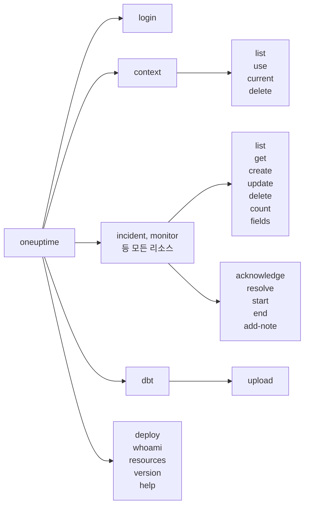

# 명령 참조

`oneuptime` CLI의 모든 명령과 그 인수, 옵션, 기본값입니다. 어떤 명령에든 `--help`를 붙이면 같은 내용을 터미널에서 볼 수 있습니다.

:::cards
- [전역 옵션](#전역-옵션): 모든 명령이 받는 옵션.
- [로그인과 컨텍스트](#로그인과-컨텍스트): login과 context 명령.
- [리소스 명령](#리소스-명령): 모든 리소스의 작업, 필드, 동작.
- [기타 명령](#기타-명령): deploy, dbt upload, data-checks apply, whoami, resources, version, help.
:::

## 명령 구성



## 전역 옵션

| 옵션 | 하는 일 | 기본값 |
| --- | --- | --- |
| `--api-key <key>` | 이 명령에 쓸 API 키 | `ONEUPTIME_API_KEY`, 그다음 컨텍스트의 키 |
| `--url <url>` | 이 명령에 쓸 OneUptime 주소 | `ONEUPTIME_URL`, 그다음 컨텍스트의 URL |
| `--context <name>` | 이 명령에 쓸 저장된 컨텍스트 | 현재 컨텍스트 |
| `-o, --output <format>` | `json`, `table` 또는 `wide` | 터미널에서는 `table`, 파이프에서는 `json` |
| `--json` | `-o json`과 같습니다 | |
| `--no-color` | 색 없이 출력합니다 | 색 있음(`NO_COLOR`가 설정되지 않은 경우) |
| `-V, --version` | CLI 버전을 출력합니다 | |
| `-h, --help` | 명령의 도움말을 보여 줍니다 | |

옵션은 명령 앞이나 뒤에 씁니다. `oneuptime --context staging incident list`와 `oneuptime incident list --context staging`은 같은 일을 합니다.

모든 명령이 `-o`와 `--json`을 받으므로 아래 표에서는 생략합니다. `delete`처럼 응답이 문장인 명령은 `-o json`이나 `--json`으로 JSON을 요청하지 않는 한 문장을 출력합니다. [출력 형식](/docs/cli/output-formats#json)을 참조하세요.

## 로그인과 컨텍스트

### `oneuptime login`

API 키와 주소를 컨텍스트로 저장하고 현재 컨텍스트로 만듭니다. [로그인](/docs/cli/authentication#로그인)을 참조하세요.

```bash
oneuptime login <api-key> <instance-url> [--context-name <name>]
```

| 인수 또는 옵션 | 필수 | 설명 | 기본값 |
| --- | --- | --- | --- |
| `<api-key>` | 예 | 프로젝트의 API 키 | |
| `<instance-url>` | 예 | OneUptime 주소(예: `https://oneuptime.com`) | |
| `--context-name <name>` | 아니요 | 컨텍스트를 저장할 이름 | `default` |

### `oneuptime context list`

저장된 컨텍스트를 나열합니다. `*`는 현재 컨텍스트를 표시합니다. API 키는 나열되지 않으며, JSON에는 각 컨텍스트의 `name`, `apiUrl`, `isCurrent`가 나옵니다.

```bash
oneuptime context list
```

### `oneuptime context use`

저장된 컨텍스트를 현재 컨텍스트로 만듭니다.

```bash
oneuptime context use <name>
```

| 인수 | 필수 | 설명 |
| --- | --- | --- |
| `<name>` | 예 | 저장된 컨텍스트의 이름 |

### `oneuptime context current`

현재 컨텍스트의 이름과 URL, 그리고 앞 4글자와 뒤 4글자만 남기고 가린 API 키를 보여 줍니다.

```bash
oneuptime context current
```

### `oneuptime context delete`

저장된 컨텍스트를 삭제합니다. 그것이 현재 컨텍스트였다면 남은 것 중 첫 번째 컨텍스트가 현재 컨텍스트가 됩니다.

```bash
oneuptime context delete <name>
```

| 인수 | 필수 | 설명 |
| --- | --- | --- |
| `<name>` | 예 | 저장된 컨텍스트의 이름 |

## 리소스 명령

`<resource>`는 [리소스](#리소스) 표에 있는 레코드 종류의 명령입니다(예: `incident`, `monitor`). 리소스에는 API가 받는 작업이 있으며 대부분은 여섯 가지 모두이고, 그 리소스의 작업은 `oneuptime <resource> --help`가 나열합니다. 예시는 [리소스 작업](/docs/cli/resource-operations)을 참조하세요.

### `oneuptime <resource> list`

레코드를 최신순으로 나열합니다. 레이블은 대신 이름순으로 나열되며, 번호가 붙은 레이블이 먼저 옵니다(`2. Team`이 `10. Owner`보다 앞).

```bash
oneuptime <resource> list [--query <json>] [--limit <n>] [--skip <n>] [--sort <json>] [--fields <names>] [--all]
```

| 옵션 | 하는 일 | 기본값 |
| --- | --- | --- |
| `--query <json>` | JSON으로 쓴 필터 | 키가 읽을 수 있는 모든 레코드 |
| `--limit <n>` | 반환할 레코드의 최대 수, 최대 10,000 | `10` |
| `--skip <n>` | 먼저 건너뛸 레코드의 수 | `0` |
| `--sort <json>` | JSON으로 쓴 순서: `{"<field>":"ASC"}` 또는 `{"<field>":"DESC"}` | 최신순 |
| `--fields <names>` | 반환할 필드. 쉼표로 구분하며, 관련 레코드의 필드는 `currentIncidentState.name`처럼 점 뒤에 씁니다 | 키가 읽을 수 있는 모든 필드 |
| `--all` | 일치하는 모든 레코드를 한 번에 100개씩, 최대 100,000개까지 `--limit`과 `--skip` 대신 가져옵니다. 레코드 전용: 텔레메트리에는 `--all`이 없습니다 | |

### `oneuptime <resource> get`

레코드 하나를 읽습니다.

```bash
oneuptime <resource> get <id> [--fields <names>]
```

| 인수 또는 옵션 | 필수 | 설명 |
| --- | --- | --- |
| `<id>` | 예 | 레코드의 ID(UUID) |
| `--fields <names>` | 아니요 | 반환할 필드. 쉼표로 구분합니다. 기본값: 키가 읽을 수 있는 모든 필드 |

### `oneuptime <resource> create`

레코드를 만들고 출력합니다.

```bash
oneuptime <resource> create [--<field> <value>]... [--data <json>] [--file <path>]
```

| 옵션 | 필수 | 설명 |
| --- | --- | --- |
| `--<field> <value>` | 만들기에 필수인 필드 | 필드의 값: `--title <text>`, `--incident-severity-id <id>`, `--labels <ids>`. `oneuptime <resource> create --help`가 나열합니다. 레코드 전용 |
| `--data <json>` | 아니요 | JSON으로 된 레코드 |
| `--file <path>` | 아니요 | 레코드가 든 JSON 파일. `--data`와 함께 주면 파일이 쓰입니다 |

플래그는 `--data`나 `--file` 위에 적용됩니다. 사용자 ID로 사람을 지정하는 필드에는 이메일 주소로 지정하는 플래그도 있습니다. `--user-email`은 `--user-id`와 짝을 이룹니다.

### `oneuptime <resource> update`

준 필드를 바꿉니다.

```bash
oneuptime <resource> update <id> [--<field> <value>]... [--data <json>] [--file <path>]
```

| 인수 또는 옵션 | 필수 | 설명 |
| --- | --- | --- |
| `<id>` | 예 | 레코드의 ID |
| `--<field> <value>` | 아니요 | 바꿀 필드: `oneuptime <resource> update --help`가 나열합니다. 레코드 전용 |
| `--data <json>` | 아니요 | JSON으로 된 바꿀 필드 |
| `--file <path>` | 아니요 | 바꿀 필드가 든 JSON 파일. `--data`와 함께 주면 파일이 쓰입니다 |

### `oneuptime <resource> delete`

묻지 않고 레코드를 바로 삭제합니다.

```bash
oneuptime <resource> delete <id> [--force]
```

| 인수 또는 옵션 | 필수 | 설명 |
| --- | --- | --- |
| `<id>` | 예 | 레코드의 ID |
| `--force` | 아니요 | 받지만 아무것도 바꾸지 않습니다: `delete`는 확인을 묻지 않습니다 |

### `oneuptime <resource> count`

레코드 개수를 세어 숫자를 출력합니다.

```bash
oneuptime <resource> count [--query <json>]
```

| 옵션 | 필수 | 설명 |
| --- | --- | --- |
| `--query <json>` | 아니요 | JSON으로 쓴 필터. 없으면 키가 읽을 수 있는 모든 레코드 |

### `oneuptime <resource> fields`

리소스의 필드를 나열합니다. 용도, 형식, 만들기에 필수인지 여부, 그것을 설정하는 플래그를 보여 줍니다. API 키도 요청도 없이 CLI 자체에서 읽습니다.

```bash
oneuptime <resource> fields
```

### `oneuptime <resource> acknowledge`

인시던트, 알림 또는 그 에피소드를 대시보드 버튼처럼 프로젝트의 인지됨 상태로 옮깁니다. 이미 인지됨이거나 그보다 뒤의 상태인 레코드는 그대로 둡니다.

```bash
oneuptime <resource> acknowledge <id>
```

| 인수 | 필수 | 설명 |
| --- | --- | --- |
| `<id>` | 예 | 레코드의 ID |

### `oneuptime <resource> resolve`

인시던트, 알림 또는 그 에피소드를 프로젝트의 해결됨 상태로 옮깁니다.

```bash
oneuptime <resource> resolve <id>
```

| 인수 | 필수 | 설명 |
| --- | --- | --- |
| `<id>` | 예 | 레코드의 ID |

### `oneuptime <resource> start`

유지 관리 이벤트를 프로젝트의 진행 중 상태로 옮깁니다.

```bash
oneuptime <resource> start <id>
```

| 인수 | 필수 | 설명 |
| --- | --- | --- |
| `<id>` | 예 | 이벤트의 ID |

### `oneuptime <resource> end`

유지 관리 이벤트를 프로젝트의 종료됨 상태로 옮깁니다.

```bash
oneuptime <resource> end <id>
```

| 인수 | 필수 | 설명 |
| --- | --- | --- |
| `<id>` | 예 | 이벤트의 ID |

### `oneuptime <resource> add-note`

인시던트, 알림, 그 에피소드 또는 유지 관리 이벤트에 메모를 추가합니다.

```bash
oneuptime <resource> add-note <id> --note <markdown> [--public]
```

| 인수 또는 옵션 | 필수 | 설명 |
| --- | --- | --- |
| `<id>` | 예 | 레코드의 ID |
| `--note <markdown>` | 예 | Markdown으로 된 메모 |
| `--public` | 아니요 | 레코드의 상태 페이지에 메모를 올리고 구독자에게 알립니다. 인시던트, 그 에피소드, 예정된 유지 관리 전용 |

### 리소스

OneUptime API의 모든 리소스는 명령이며, API가 받는 작업, `fields`, 그리고 동작이 있는 레코드라면 그 동작을 가집니다.

{{CLI_RESOURCE_COMMANDS}}

CLI는 OneUptime과 함께 릴리스되므로 `oneuptime resources`는 설치한 버전의 명령을 나열합니다.

### API 요청

각 작업은 API에 보내는 요청 하나이며, 키는 `APIKey` 헤더에 담깁니다. `<path>`는 `oneuptime resources`가 알려 주는 리소스의 API 경로입니다. `incident`는 `/incident`, `on-call-policy`는 `/on-call-duty-policy`입니다.

| 작업 | 요청 | 본문 |
| --- | --- | --- |
| `list` | `POST /api/<path>/get-list` | `query`, `select`, `skip`, `limit`, `sort` |
| `get` | `POST /api/<path>/<id>/get-item` | `select` |
| `create` | `POST /api/<path>` | `{"data": ...}` |
| `update` | `PUT /api/<path>/<id>/` | `{"data": ...}` |
| `delete` | `DELETE /api/<path>/<id>/` | 없음 |
| `count` | `POST /api/<path>/count` | `query` |

동작은 프로젝트의 상태와 레코드를 읽은 다음, 대시보드 버튼처럼 레코드의 상태 타임라인에 행을 만듭니다. 인시던트에 대한 `acknowledge`는 `incident-state-timeline`을 만듭니다. `add-note`는 `incident-internal-note`를 만들고, `--public`을 붙이면 `incident-public-note`를 만듭니다. 이메일 플래그는 먼저 그 주소를 가진 프로젝트의 팀 구성원을 나열합니다. 키가 읽을 수 없는 필드를 OneUptime이 거부하면, 목록이나 읽기는 그 필드를 빼고 다시 요청합니다.

## 기타 명령

### `oneuptime deploy`

파이프라인에서 배포나 다른 변경을 기록합니다. 기록된 변경은 서비스의 차트에 표시되고, OneUptime AI가 인시던트를 조사할 때 읽습니다. 쓰기에는 API 키가 아니라 텔레메트리 수집 키를 사용합니다. [배포 및 변경 사항](/docs/telemetry/change-events)을 참조하세요.

```bash
oneuptime deploy [--service <name>] [--service-version <version>] [--previous-version <version>] [--commit <sha>] [--repository <url>] [--branch <name>] [--pull-request <number>] [--environment <name>] [--title <title>] [--description <text>] [--type <type>] [--time <time>] [--attribute <key=value...>] [--ingestion-key <key>]
```

| 옵션 | 필수 | 설명 | 기본값 |
| --- | --- | --- | --- |
| `--service <name>` | 아니요 | 배포된 서비스 | 프로젝트 전체의 변경 |
| `--service-version <version>` | 아니요 | 배포된 버전 | |
| `--previous-version <version>` | 아니요 | 대체된 버전 | |
| `--commit <sha>` | 아니요 | 배포된 커밋 | |
| `--repository <url>` | 아니요 | 커밋이 있는 저장소 | |
| `--branch <name>` | 아니요 | 배포된 브랜치 | |
| `--pull-request <number>` | 아니요 | 배포된 풀 리퀘스트 | |
| `--environment <name>` | 아니요 | 배포 대상 환경 | |
| `--title <title>` | 아니요 | 변경의 제목. 배포가 아닌 다른 종류의 변경에는 필요합니다 | `Deploy <version>` |
| `--description <text>` | 아니요 | 변경의 세부 정보 | |
| `--type <type>` | 아니요 | 변경의 종류(예: `config-change`, `rollback`) | `deployment` |
| `--time <time>` | 아니요 | 발생한 시각(예: `2026-10-19T10:00:00Z`) | 지금 |
| `--attribute <key=value...>` | 아니요 | 추가 속성. `key=value` 형식으로 하나 이상 | |
| `--ingestion-key <key>` | 아니요 | 프로젝트의 텔레메트리 수집 키 | `ONEUPTIME_TELEMETRY_INGESTION_KEY` |

### `oneuptime dbt upload`

빌드 후 CI나 dbt Cloud 작업에서 dbt 프로젝트의 아티팩트를 데이터 관측 가능성으로 보냅니다. 프로젝트의 모델은 그 모델이 만드는 테이블에 계보와 함께 표시되고, 테스트는 OneUptime의 점검 옆에 표시되며 알림을 발생시킬 수 있고, 각 빌드는 프로젝트 파이프라인의 실행이 됩니다. dbt의 대상 폴더에서 `manifest.json`과 `run_results.json`을 읽고, 데이터 관측 가능성이 읽는 부분만 보냅니다. 쓰기에는 API 키가 아니라 텔레메트리 수집 키를 사용합니다. 대시보드의 데이터 관측 가능성 문서 페이지에 CI 작업에서 사용하는 예가 있습니다.

```bash
oneuptime dbt upload [--target-path <dir>] [--manifest <file>] [--run-results <file>] [--project <name>] [--ingestion-key <key>]
```

| 옵션 | 필수 | 설명 | 기본값 |
| --- | --- | --- | --- |
| `--target-path <dir>` | 아니요 | dbt가 아티팩트를 쓴 폴더 | `target` |
| `--manifest <file>` | 아니요 | 보낼 매니페스트 | 대상 폴더의 `manifest.json` |
| `--run-results <file>` | 아니요 | 보낼 실행 결과 | 대상 폴더의 `run_results.json` |
| `--project <name>` | 아니요 | dbt 프로젝트 이름. 매니페스트를 보내지 않을 때만 필요합니다 | 매니페스트의 프로젝트 |
| `--ingestion-key <key>` | 아니요 | 프로젝트의 텔레메트리 수집 키 | `ONEUPTIME_TELEMETRY_INGESTION_KEY` |

### `oneuptime data-checks apply`

프로젝트의 데이터 검사를 YAML 파일과 일치시켜, 검사를 저장소에 보관하고 코드처럼 리뷰할 수 있게 합니다. 파일의 어디에든 실수가 있으면 아무것도 적용하지 않고 오류와 함께 종료합니다. 파일 형식은 [검사 및 대사](/docs/data-observability/checks)에 있습니다.

```bash
oneuptime data-checks apply <file> [--dry-run] [--prune]
```

| 옵션 | 필수 | 설명 | 기본값 |
| --- | --- | --- | --- |
| `--dry-run` | 아니요 | 무엇이 바뀔지 알려 주고, 아무것도 바꾸지 않습니다 | 꺼짐 |
| `--prune` | 아니요 | 이전 apply가 만들었지만 파일에 더 이상 나오지 않는 검사를 삭제합니다 | 꺼짐 |

### `oneuptime whoami`

다음 명령이 사용할 URL과 API 키(키는 가려짐), 그리고 그 값을 가져온 컨텍스트를 보여 줍니다. `--check`가 없으면 OneUptime을 호출하지 않습니다. [CLI가 사용할 값 확인](/docs/cli/authentication#cli가-사용할-값-확인)을 참조하세요.

```bash
oneuptime whoami [--check]
```

| 옵션 | 필수 | 설명 |
| --- | --- | --- |
| `--check` | 아니요 | OneUptime에 키를 받아들이는지 묻고, 키의 프로젝트, 사용 중인 OneUptime 버전과 CLI 버전을 보여 줍니다 |

### `oneuptime resources`

CLI에 명령이 있는 모든 레코드 종류를 명령, 단수형과 복수형 이름, 유형, API 경로, 그리고 합계와 함께 나열합니다. JSON에는 각각의 `name`, `singularName`, `pluralName`, `modelType`, `apiPath`, `operations`, `actions`가 나옵니다.

```bash
oneuptime resources [--type <type>]
```

| 옵션 | 필수 | 설명 | 기본값 |
| --- | --- | --- | --- |
| `--type <type>` | 아니요 | 레코드는 `database`, 텔레메트리는 `analytics` | 둘 다 |

### `oneuptime version`

`oneuptime --version`처럼 CLI 버전을 출력합니다.

```bash
oneuptime version
```

### `oneuptime help`

CLI나 명령의 도움말을 보여 줍니다.

```bash
oneuptime help [command]
```

## 환경 변수

| 변수 | 하는 일 |
| --- | --- |
| `ONEUPTIME_API_KEY` | `--api-key` 플래그가 주지 않을 때의 API 키 |
| `ONEUPTIME_URL` | `--url` 플래그가 주지 않을 때의 OneUptime 주소 |
| `ONEUPTIME_TELEMETRY_INGESTION_KEY` | `--ingestion-key` 플래그가 주지 않을 때 `oneuptime deploy`가 쓰기에 사용하는 텔레메트리 수집 키 |
| `NO_COLOR` | 아무 값이나 설정하면 색이 꺼집니다 |

## 파일

| 파일 | 담는 것 |
| --- | --- |
| `~/.oneuptime/config.json` | 저장된 컨텍스트, 그 API 키, 현재 컨텍스트 |

## 종료 코드

| 코드 | 의미 |
| --- | --- |
| `0` | 성공했습니다 |
| `1` | 실패했습니다: OneUptime이 요청을 거부했거나 명령이 잘못되었습니다 |
| `2` | 쓸 수 있는 API 키가 없습니다: 없거나, 잘못되었거나, 플랜 미만입니다 |
| `3` | 찾을 수 없습니다: OneUptime이 `404`로 응답했습니다 |

예시는 [종료 코드](/docs/cli/scripting#종료-코드)를 참조하세요.

## 다음 단계

:::cards
- [CLI 개요](/docs/cli/index): CLI를 설치하고 첫 명령을 실행합니다.
- [리소스 작업](/docs/cli/resource-operations): 각 작업의 예.
- [스크립팅 및 CI/CD](/docs/cli/scripting): 스크립트와 파이프라인에서의 CLI.
:::
