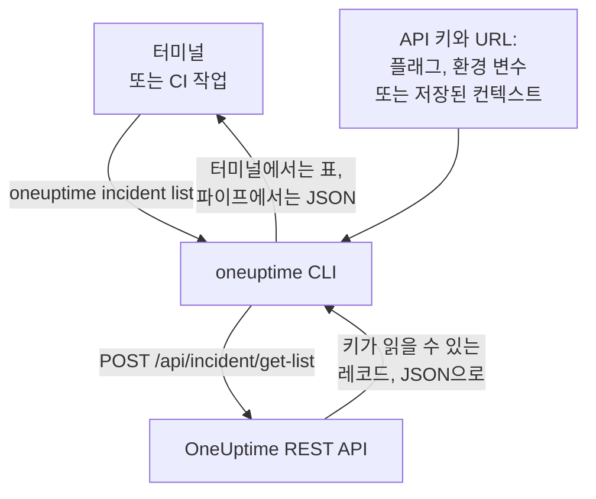

# CLI 개요

OneUptime CLI인 `oneuptime`은 터미널이나 스크립트에서 OneUptime 프로젝트를 관리합니다. 프로젝트의 API 키로 모니터, 인시던트, 알림, 상태 페이지 등 OneUptime API가 제공하는 레코드를 나열하고, 읽고, 만들고, 변경하고, 삭제하고, 개수를 셉니다.

:::cards
- [CLI의 작동 방식](#cli의-작동-방식): 명령 하나, API 요청 하나, 응답 하나.
- [CLI 설치](#cli-설치): npm 명령 하나와 고를 버전.
- [첫 명령 실행](#첫-명령-실행): API 키를 저장한 다음 인시던트를 나열합니다.
- [명령 한눈에 보기](#명령-한눈에-보기): 모든 명령과 그것을 설명하는 페이지.
:::

## CLI의 작동 방식

각 명령은 OneUptime REST API에 요청을 하나 보내고 응답을 출력합니다. CLI는 API 키와 OneUptime 주소를 플래그, 환경 변수 또는 `oneuptime login`이 저장한 컨텍스트에서 가져옵니다. 명령이 무엇을 읽고 바꿀 수 있는지는 키가 결정하며, 이는 API와 똑같습니다.



레코드용 명령은 CLI에 들어 있습니다. OneUptime API가 도구에 여는 레코드 종류마다 명령이 하나씩 있으며, [MCP 서버](/docs/ai/mcp-server)가 도구를 가진 레코드와 같습니다. 목록을 보려면 `oneuptime resources`를 실행합니다.

## 시작하기 전에

- **Node.js와 npm**: CLI를 설치할 현재 LTS 릴리스.
- **프로젝트의 API 키.** **프로젝트 설정 → 고급 → API 키**에서 **API 키 만들기**로 만듭니다. [API 키 만들기](/docs/api-reference/api-reference#api-키-만들기)를 참조하세요.
- **OneUptime Cloud에서는 Growth 플랜 이상.** 프로젝트의 API 키는 이 플랜에서만 작동합니다. [플랜 미만의 API 키와 SCIM](/docs/api-reference/api-reference#플랜-미만의-api-키와-scim)을 참조하세요.

## CLI 설치

npm에서 `@oneuptime/cli` 패키지를 설치합니다. `oneuptime` 명령이 추가되며, `--version`은 설치한 버전을 출력합니다.

```bash
npm install -g @oneuptime/cli
oneuptime --version
```

CLI는 OneUptime과 함께 릴리스되며 버전 번호가 같습니다. 자체 호스팅 OneUptime에서는 명령이 서버의 레코드와 맞도록 사용 중인 OneUptime과 같은 버전의 CLI를 설치하세요.

```bash
npm install -g @oneuptime/cli@<your-oneuptime-version>
```

> [!WARNING]
> 14.0.64 이전 버전의 CLI는 시작하자마자 `Cannot find module 'Common/Models/DatabaseModels/Index'` 같은 오류를 내며 멈춥니다. `npm install -g @oneuptime/cli@latest`로 14.0.64 이상을 설치하세요. 14.0.64보다 오래된 자체 호스팅 OneUptime에서는 먼저 [OneUptime을 업그레이드](/docs/installation/upgrading#업그레이드하는-방법)한 다음, 업그레이드한 버전의 CLI를 설치하세요.

## 첫 명령 실행

:::steps
### API 키 저장

키와 OneUptime 주소로 로그인합니다. CLI는 이를 `default`라는 이름의 컨텍스트로 저장하고 이후로 그것을 사용합니다.

```bash
oneuptime login <your-api-key> https://oneuptime.com
```

`Logged in successfully. Context "default" is now active.`라고 응답합니다. 자체 호스팅 OneUptime에서는 `https://oneuptime.com` 대신 해당 주소를 사용하세요.

### 인시던트 나열

```bash
oneuptime incident list
```

가장 최근 인시던트 10개가 표로 나타납니다. `login`은 키를 확인하지 않고 저장하므로, 키가 작동한다는 것을 처음 보여 주는 명령이 바로 이것입니다. 거부되면 [문제 해결](/docs/cli/authentication#문제-해결)을 참조하세요.

### 그 밖에 관리할 수 있는 것 보기

```bash
oneuptime resources
```

목록에는 다룰 수 있는 레코드 종류와 그 명령(예: `monitor`, `status-page`, `on-call-policy`)이 표시됩니다.
:::

## 명령 한눈에 보기

| 명령 | 하는 일 | 자세히 |
| --- | --- | --- |
| `oneuptime login <api-key> <instance-url>` | API 키와 주소를 컨텍스트로 저장합니다 | [인증](/docs/cli/authentication#로그인) |
| `oneuptime context list`, `use`, `current`, `delete` | 저장된 컨텍스트를 나열, 전환, 표시, 삭제합니다 | [인증](/docs/cli/authentication#컨텍스트) |
| `oneuptime whoami` | 다음 명령이 사용할 URL과 API 키를 보여 줍니다 | [인증](/docs/cli/authentication#cli가-사용할-값-확인) |
| `oneuptime deploy` | 차트와 OneUptime AI를 위해 배포나 다른 변경을 기록합니다 | [배포 및 변경 사항](/docs/telemetry/change-events) |
| `oneuptime <resource> list`, `get`, `create`, `update`, `delete`, `count` | 한 종류의 레코드를 다룹니다 | [리소스 작업](/docs/cli/resource-operations) |
| `oneuptime resources` | 레코드 종류를 명령과 함께 나열합니다 | [명령 참조](/docs/cli/command-reference#oneuptime-resources) |
| `oneuptime version` | CLI 버전을 출력합니다 | [명령 참조](/docs/cli/command-reference#oneuptime-version) |
| `oneuptime help [command]` | 명령의 도움말을 보여 줍니다 | [도움말 보기](#도움말-보기) |

## 전역 옵션

이 옵션은 모든 명령에서 명령 앞이나 뒤에 쓸 수 있습니다.

| 옵션 | 하는 일 |
| --- | --- |
| `--api-key <key>` | 저장된 키 대신 이 명령에 쓸 API 키 |
| `--url <url>` | 이 명령에 쓸 OneUptime 주소 |
| `--context <name>` | 현재 컨텍스트 대신 이 명령에 쓸 저장된 컨텍스트 |
| `-o, --output <format>` | `table`, `json` 또는 `wide`: [출력 형식](/docs/cli/output-formats) 참조 |
| `--no-color` | 색 없이 출력합니다 |
| `-V, --version` | CLI 버전을 출력합니다 |
| `-h, --help` | 명령의 도움말을 보여 줍니다 |

## 도움말 보기

모든 명령에는 인수, 옵션, 기본값을 보여 주는 자체 도움말이 있습니다.

```bash
oneuptime --help
oneuptime help incident
oneuptime incident list --help
```

## 다음 단계

:::cards
- [인증](/docs/cli/authentication): 환경마다의 컨텍스트와 명령이 사용하는 키.
- [리소스 작업](/docs/cli/resource-operations): 레코드를 나열하고, 읽고, 만들고, 변경하고, 삭제하고, 셉니다.
- [출력 형식](/docs/cli/output-formats): 사람에게는 표, 스크립트에는 JSON.
- [스크립팅 및 CI/CD](/docs/cli/scripting): 종료 코드, jq, 파이프라인.
- [명령 참조](/docs/cli/command-reference): 모든 명령, 옵션, 기본값.
:::
