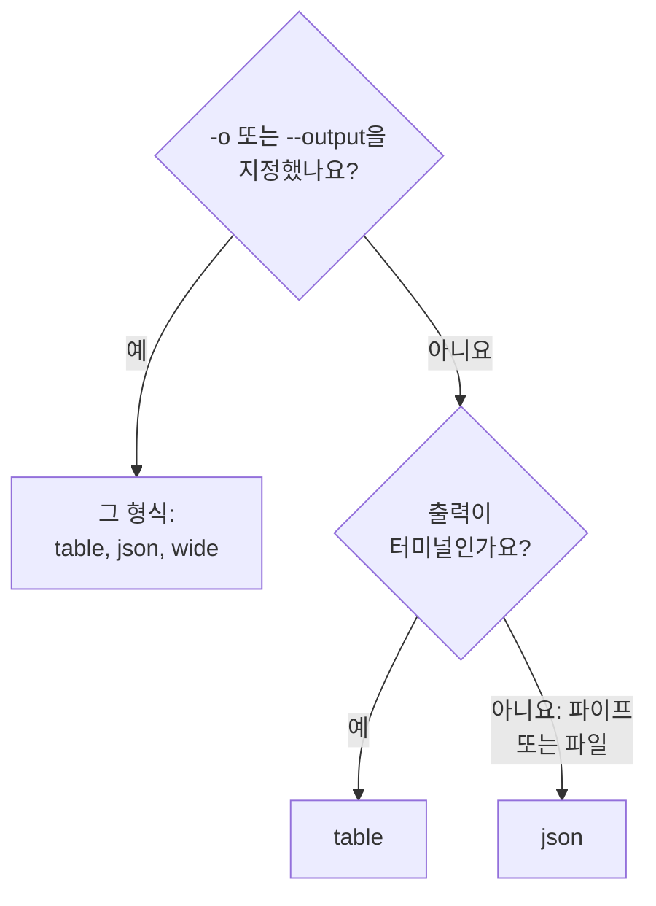

# 출력 형식

CLI는 터미널에서 응답을 읽을 때는 표를, 스크립트나 다른 프로그램이 읽을 때는 JSON을 출력합니다. 어떤 명령이든 `-o` 또는 `--output`으로 형식을 고를 수 있습니다.

:::cards
- [형식이 정해지는 방식](#형식이-정해지는-방식): 터미널은 표를, 파이프는 JSON을 받습니다.
- [표](#표): 6개 열, 각 값은 60자에서 잘림.
- [JSON](#json): 모든 필드를 자르지 않고, 스크립트와 jq를 위해.
- [와이드](#와이드): 모든 열이 있는 표.
:::

## 형식이 정해지는 방식



| 형식 | 출력하는 것 | 알맞은 용도 |
| --- | --- | --- |
| `table` | 최대 여섯 열의 표. 레코드 하나는 필드마다 한 행 | 터미널에서 읽기 |
| `json` | OneUptime이 보낸 그대로의 응답을 공백 두 칸으로 들여씀 | 스크립트, `jq`, 파일 |
| `wide` | 필드마다 열이 있는 표 | 많은 필드를 한눈에 비교 |

`-o`는 레코드를 출력하는 모든 명령, 즉 리소스의 `list`, `get`, `create`, `update`, `count`와 `oneuptime resources`, `oneuptime context list`에서 작동합니다. 명령줄 어디에 써도 됩니다. 다른 값은 요청을 보내기 전에 거부됩니다.

```text
error: option '-o, --output <format>' argument 'yaml' is invalid. Allowed choices are json, table, wide.
```

## 표

터미널에서는 표가 기본입니다. 예를 들어 `oneuptime resources --type analytics`는 다음 표를 출력합니다.

```text
┌────────────────────────────┬────────────────────────────┬─────────────────────────────┬───────────┬─────────────────────────────┐
│ Command                    │ Singular                   │ Plural                      │ Type      │ API Path                    │
├────────────────────────────┼────────────────────────────┼─────────────────────────────┼───────────┼─────────────────────────────┤
│ log                        │ Log                        │ Logs                        │ analytics │ /logs                       │
├────────────────────────────┼────────────────────────────┼─────────────────────────────┼───────────┼─────────────────────────────┤
│ span                       │ Span                       │ Spans                       │ analytics │ /span                       │
├────────────────────────────┼────────────────────────────┼─────────────────────────────┼───────────┼─────────────────────────────┤
│ metric                     │ Metric                     │ Metrics                     │ analytics │ /metrics                    │
├────────────────────────────┼────────────────────────────┼─────────────────────────────┼───────────┼─────────────────────────────┤
│ exception-instance         │ Exception Instance         │ Exception Instances         │ analytics │ /exceptions                 │
├────────────────────────────┼────────────────────────────┼─────────────────────────────┼───────────┼─────────────────────────────┤
│ monitor-log                │ Monitor Log                │ Monitor Logs                │ analytics │ /monitor-log                │
├────────────────────────────┼────────────────────────────┼─────────────────────────────┼───────────┼─────────────────────────────┤
│ kubernetes-cost-allocation │ Kubernetes Cost Allocation │ Kubernetes Cost Allocations │ analytics │ /kubernetes-cost-allocation │
├────────────────────────────┼────────────────────────────┼─────────────────────────────┼───────────┼─────────────────────────────┤
│ security-event             │ Security Event             │ Security Events             │ analytics │ /security-events            │
├────────────────────────────┼────────────────────────────┼─────────────────────────────┼───────────┼─────────────────────────────┤
│ change-event               │ Change Event               │ Change Events               │ analytics │ /change-events              │
├────────────────────────────┼────────────────────────────┼─────────────────────────────┼───────────┼─────────────────────────────┤
│ threat-intel-indicator     │ Threat Intel Indicator     │ Threat Intel Indicators     │ analytics │ /threat-intel-indicators    │
└────────────────────────────┴────────────────────────────┴─────────────────────────────┴───────────┴─────────────────────────────┘

Total: 9 resources
```

레코드 목록의 경우 표에는 최대 6개 열이 나옵니다. 먼저 `_id`, `name`, `title`, `status`, `createdAt`, `updatedAt` 중 레코드에 있는 것이, 그다음 레코드의 나머지 필드가 순서대로 나옵니다. 열은 첫 번째 레코드에서 가져옵니다. 60자보다 긴 값은 앞의 57자로 잘리고 뒤에 `...`이 붙습니다.

`get`과 `create`가 출력하는 레코드 하나는 필드 이름과 값의 두 열로 된 표이며, 필드마다 한 행입니다.

OneUptime은 날짜와 다른 레코드의 ID를 `{"_type":"DateTime","value":"2026-10-14T09:12:44.000Z"}` 같은 객체로 보내고, 표는 이를 그 텍스트 그대로 보여 줍니다. 값은 `value`에 있습니다. [JSON](#json)을 참조하세요.

## JSON

JSON은 OneUptime이 보낸 그대로의 응답이며 공백 두 칸으로 들여 씁니다. 목록은 레코드의 배열이고, 레코드 하나는 객체입니다.

```bash
oneuptime incident list --limit 1 -o json
```

```json
[
  {
    "_id": "6f1c2a40-3b1e-4c55-9a0b-3e2f8d7c1a11",
    "createdAt": {
      "_type": "DateTime",
      "value": "2026-10-14T09:12:44.000Z"
    },
    "title": "Checkout API is down",
    "currentIncidentStateId": {
      "_type": "ObjectID",
      "value": "0b7d5e2c-8f4a-4d1b-9c3e-5a6f7b8c9d0e"
    }
  }
]
```

레코드에는 키가 읽을 수 있는 모든 필드가 있으며, 이 예는 네 개로 줄였습니다. 레코드 자신의 `_id`는 텍스트이고, 다른 ID와 날짜는 `value`에 값을 담은 객체입니다.

```bash
oneuptime incident list -o json | jq -r '.[] | "\(.createdAt.value)  \(.title)"'
```

`oneuptime incident list | jq '.[].title'`처럼 출력이 터미널이 아니면, CLI는 `-o json` 없이도 JSON을 출력합니다. 그래도 스크립트에는 `-o json`을 써서 이 동작에 기대지 않도록 하세요.

## 와이드

`-o wide`는 레코드의 필드마다 열이 있는 표입니다. 각 값은 여전히 60자에서 잘리고 레코드에는 필드가 많아서, 와이드 표는 아주 넓습니다. `less -S`로 넘겨 보세요.

```bash
oneuptime incident list -o wide | less -S
```

## 색

표 머리글은 청록색이고, 메시지는 성공하면 초록색, 정보는 파란색, 오류는 빨간색입니다. `--no-color`를 쓰거나 `NO_COLOR`에 아무 값이나 설정하면 색이 꺼집니다.

```bash
oneuptime incident list --no-color
NO_COLOR=1 oneuptime incident list
```

## 명령별 출력

레코드와 개수는 표준 출력으로, 오류는 표준 오류로 가므로 파이프는 응답만 읽습니다.

| 명령 | 표일 때 | JSON일 때 |
| --- | --- | --- |
| 아무것도 찾지 못한 `list` | `No results found.` | `[]` |
| `get` 또는 `create` | 필드마다 한 행 | 레코드 |
| `count` | 숫자 | 숫자 |
| `update` | 빈 줄 | `{}` |
| `delete` | `Monitor <id> deleted successfully.` | 같은 줄 |

## 다음 단계

:::cards
- [스크립팅 및 CI/CD](/docs/cli/scripting): 스크립트와 파이프라인에서 jq로 JSON을 읽습니다.
- [리소스 작업](/docs/cli/resource-operations): 이 응답을 돌려주는 작업.
- [명령 참조](/docs/cli/command-reference): 모든 명령과 옵션.
:::
