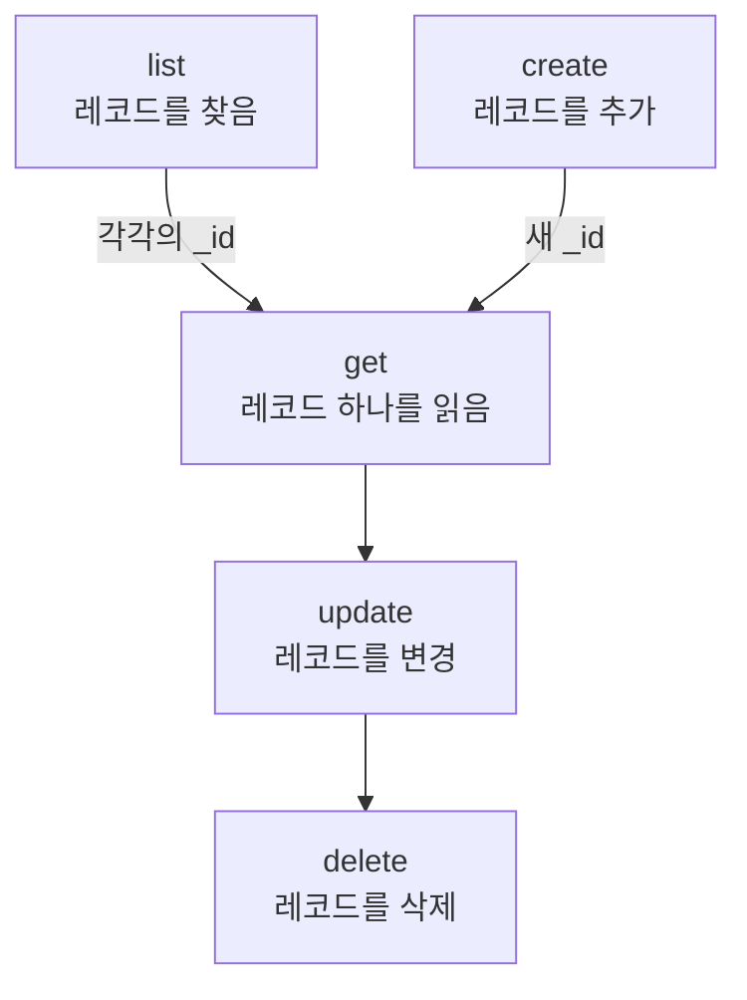

# 리소스 작업

레코드 종류마다 `incident`, `monitor`, `status-page` 같은 자체 명령이 있으며, API가 그 종류에 받는 작업을 가집니다. 대부분은 `list`, `get`, `create`, `update`, `delete`, `count`입니다. 이 페이지에서는 필터, 페이지 넘기기, 레코드를 쓰는 플래그와 함께 각 작업을 설명하고, 대시보드 버튼과 같은 일을 하는 명령도 소개합니다.

:::cards
- [레코드의 명령 찾기](#레코드의-명령-찾기): oneuptime resources로 모두 나열합니다.
- [레코드 나열](#레코드-나열): 필터링, 정렬, 페이지 넘기기.
- [레코드 만들기](#레코드-만들기): 필드마다 플래그 하나, 또는 JSON으로 된 레코드.
- [인지, 해결, 메모 추가](#인지-해결-메모-추가): 대시보드 버튼을 명령으로.
- [레코드 삭제](#레코드-삭제): 바로 삭제되며 되돌릴 수 없습니다.
:::

## 작업 사이의 관계

레코드를 읽고, 바꾸고, 삭제하려면 그 ID가 필요합니다. 나열, 개수 세기, 만들기에는 필요하지 않으며, 목록이나 만들기 결과에서 다른 작업이 쓰는 ID를 얻습니다.



ID는 `6f1c2a40-3b1e-4c55-9a0b-3e2f8d7c1a11` 같은 UUID입니다. OneUptime의 레코드 페이지에서 복사할 수도 있습니다. [리소스의 ID 찾기](/docs/api-reference/api-reference#리소스의-id-찾기)를 참조하세요.

## 레코드의 명령 찾기

```bash
oneuptime resources
```

목록에는 레코드 종류마다 명령, 이름, 유형, API 경로가 나옵니다. 유형은 두 가지입니다.

| 유형 | 담는 내용 |
| --- | --- |
| `database` | 관리하는 레코드: 모니터, 인시던트, 알림, 상태 페이지, 팀 등 |
| `analytics` | 텔레메트리: 로그, 스팬, 메트릭, 예외 및 기타 이벤트 |

`oneuptime resources --type database` 또는 `--type analytics`로 한 유형만 볼 수 있습니다. [명령 참조](/docs/cli/command-reference#리소스)에 모든 명령이 있습니다.

리소스는 API가 그 리소스에 받는 작업을 받습니다. 대부분은 여섯 가지를 모두 받지만, 이메일 로그처럼 OneUptime이 직접 쓰는 리소스는 읽기 전용입니다. `oneuptime <resource> --help`는 리소스의 하위 명령을 나열합니다.

## 리소스의 필드 보기

`fields`는 API 키도 요청도 없이 CLI 자체에서 리소스의 필드를 나열합니다.

```bash
oneuptime incident fields
```

각 필드에는 형식, 용도, 만들기에 필수인지 여부, 그것을 설정하는 플래그가 있습니다. ID를 담는 필드는 그 ID가 속한 리소스를 알려 줍니다. `incidentSeverityId`는 `oneuptime incident-severity list`의 ID를 받습니다. `-o json`을 쓰면 스크립트나 AI 에이전트가 같은 내용을 모든 필드에서 같은 키 `name`, `title`, `type`, `description`, `required`, `create`, `update`, `read`, `flag`, `emailFlag`, `relatedResource`로 읽습니다.

## 레코드 나열

```bash
oneuptime <resource> list [--query <json>] [--limit <n>] [--skip <n>] [--sort <json>] [--fields <names>] [--all] [-o <format>]
```

| 옵션 | 하는 일 | 기본값 |
| --- | --- | --- |
| `--query <json>` | 일치하는 레코드만 반환합니다: [목록 필터링](#목록-필터링) 참조 | 키가 읽을 수 있는 모든 레코드 |
| `--limit <n>` | 반환할 레코드의 최대 수, 최대 10,000 | `10` |
| `--skip <n>` | 먼저 건너뛸 일치 레코드의 수 | `0` |
| `--sort <json>` | 순서. `{"createdAt":"ASC"}`처럼 쓰며, 최신순은 `"DESC"` | 최신순 |
| `--fields <names>` | 반환할 필드. `title,createdAt`처럼 쉼표로 구분합니다 | 키가 읽을 수 있는 모든 필드 |
| `--all` | `--limit`과 `--skip` 대신 일치하는 모든 레코드를 페이지마다 가져옵니다. 레코드 전용 | |
| `-o, --output <format>` | `table`, `json` 또는 `wide` | 터미널에서는 `table`, 파이프에서는 `json` |

```bash
# The ten newest incidents
oneuptime incident list

# The oldest monitors first, 50 at a time: the second page
oneuptime monitor list --sort '{"createdAt":"ASC"}' --limit 50 --skip 50

# Every field of each incident, as JSON
oneuptime incident list -o json

# The title, the state and the creation date of every incident
oneuptime incident list --all --fields title,currentIncidentState.name,createdAt -o json
```

목록은 키가 읽을 수 있는 각 레코드의 모든 필드를 OneUptime에 요청합니다. `--fields`는 대신 지정한 필드를 요청하고, `currentIncidentState.name`처럼 점 뒤에 쓰면 관련 레코드의 필드를 요청합니다. 표에는 6개 필드가 나오고, JSON에는 모두 나옵니다([출력 형식](/docs/cli/output-formats) 참조). `--all`은 한 번에 100개씩, 최대 100,000개까지 모든 페이지를 읽습니다. 전체 개수는 `count`가 알려 줍니다.

레이블은 최신순이 아니라 이름순으로 나열됩니다. 이름이 숫자로 시작하는 레이블이 그 숫자의 순서대로 먼저 오고(`2. Team`이 `10. Owner`보다 앞), 그다음 나머지 레이블이 알파벳순으로 옵니다. 다른 순서로 나열하려면 `--sort`를 지정하세요.

### 목록 필터링

`--query`는 API와 같은 필터를 받습니다. 값이 있는 필드는 그 값과 일치하고, `_type`이 있는 객체는 비교를 합니다.

| 필터 | 일치하는 것 |
| --- | --- |
| `{"title":"Checkout API is down"}` | 정확히 그 값을 가진 레코드 |
| `{"title":{"_type":"Search","value":"checkout"}}` | 값을 포함하는 텍스트 |
| `{"createdAt":{"_type":"GreaterThan","value":"2026-10-01T00:00:00.000Z"}}` | 더 늦은 날짜 또는 더 큰 숫자 |
| `{"currentIncidentState":{"isResolvedState":false}}` | 리소스가 가리키는 레코드의 필드: 여기서는 해결되지 않은 인시던트 |

```bash
oneuptime incident list --query '{"title":{"_type":"Search","value":"checkout"}}'
```

모든 `_type`은 API 참조의 [필터링, 정렬, 페이지 넘기기](/docs/api-reference/api-reference#필터링-정렬-페이지-넘기기)에 있습니다.

## 레코드 읽기

```bash
oneuptime <resource> get <id> [--fields <names>] [-o <format>]
```

```bash
oneuptime incident get 6f1c2a40-3b1e-4c55-9a0b-3e2f8d7c1a11
```

표는 레코드의 필드마다 한 행을 보여 주며, 각 값은 60자에서 잘립니다. `-o json`은 값을 자르지 않고 보여 줍니다. 키가 읽을 수 있는 레코드를 가리키지 않는 ID에는 `Not found`가 돌아오고, 명령은 종료 코드 `3`으로 끝납니다.

## 레코드 만들기

```bash
oneuptime <resource> create [--<field> <value>]... [--data <json>] [--file <path>] [-o <format>]
```

만들기가 받는 필드마다 플래그가 있습니다. `--title <text>`, `--incident-severity-id <id>`, 쉼표로 구분한 ID를 받는 `--labels <ids>`, 예/아니요 필드로 단독으로 쓰면 true가 되는 `--is-visible-on-status-page [true|false]`, JSON을 담는 필드의 `--monitor-steps <json>` 등입니다. `oneuptime <resource> create --help`가 이를 나열하고, 각 필드의 용도는 [`fields`](#리소스의-필드-보기)가 알려 줍니다. 프로젝트는 API 키에서 정해지므로 레코드에 프로젝트를 쓰지 않습니다.

```bash
# A manual monitor
oneuptime monitor create --name "Checkout API" --monitor-type Manual

# An incident with one of your severities
oneuptime incident create --title "Checkout API is down" --incident-severity-id <severity-id>

# The same incident, from a file
oneuptime incident create --file incident.json
```

`--data`는 레코드를 JSON으로 받고, `--file`은 JSON 파일에서 읽으며, 필드는 API의 필드입니다. [API 참조](/reference)에 각 리소스의 필드가 나옵니다. 둘 다 주면 파일이 쓰이고, 플래그는 어느 쪽이든 그 위에 적용됩니다.

사용자 ID로 사람을 지정하는 필드에는 이메일 주소로 지정하는 두 번째 플래그가 있습니다. `--user-email`은 `--user-id`와, `--owner-user-emails`는 `--owner-users`와 짝을 이룹니다. CLI는 API 키 프로젝트의 구성원과 초대된 사람 중에서 그 사람을 찾습니다. 프로젝트의 누구도 갖고 있지 않은 주소로 지정한 팀 구성원은, 대시보드에서 초대할 때처럼 프로젝트에 초대됩니다.

```bash
oneuptime team-member create --team-id <team-id> --user-email alice@example.com
```

CLI는 새 레코드를 `_id`와 함께 출력합니다. 인시던트는 `currentIncidentStateId`가 다른 상태를 지정하지 않는 한 프로젝트의 생성됨 상태에서 시작합니다. [새 레코드가 시작하는 상태](/docs/api-reference/api-reference#새-레코드가-시작하는-상태)를 참조하세요. 심각도의 ID를 찾으려면 다음과 같이 합니다.

```bash
oneuptime incident-severity list -o json | jq -r '.[] | "\(._id)  \(.name)"'
```

> [!TIP]
> Windows에서는 필드를 플래그로 주거나, JSON을 파일에 넣고 `--file`을 쓰세요. PowerShell과 명령 프롬프트는 명령줄의 JSON을 Bash와 다르게 따옴표로 감쌉니다.

## 레코드 업데이트

```bash
oneuptime <resource> update <id> [--<field> <value>]... [--data <json>] [--file <path>] [-o <format>]
```

바꿀 필드만 플래그나 JSON으로 주세요.

```bash
# Rename a monitor
oneuptime monitor update <monitor-id> --name "Checkout API (EU)"

# Record an incident's root cause
oneuptime incident update <incident-id> --root-cause "A full disk on the primary database"
```

OneUptime은 업데이트에 빈 객체로 응답합니다. CLI는 빈 줄을 출력하고, `-o json`이면 `{}`를 출력합니다. 지금 상태의 레코드를 보려면 `get`을 실행하세요. 인시던트를 다른 상태로 옮기려면 `--current-incident-state-id`를 주세요. 대시보드처럼 그 변경이 타임라인에 기록되며, 현재 상태보다 앞선 상태는 거부됩니다. [`acknowledge`와 `resolve`](#인지-해결-메모-추가)는 상태를 대신 찾아 줍니다. 프로젝트 순서에서 첫 번째인 해결됨 상태의 ID를 찾으려면 다음과 같이 합니다.

```bash
oneuptime incident-state list --query '{"isResolvedState":true}' --sort '{"order":"ASC"}' --limit 1 -o json | jq -r '.[0]._id'
```

## 인지, 해결, 메모 추가

인시던트, 알림, 그 에피소드, 예정된 유지 관리 이벤트에는 대시보드 버튼이 하는 일을 하는 명령이 있습니다.

| 명령 | 하는 일 | 리소스 |
| --- | --- | --- |
| `acknowledge <id>` | 레코드를 프로젝트의 인지됨 상태로 옮깁니다 | `incident`, `alert`, `incident-episode`, `alert-episode` |
| `resolve <id>` | 프로젝트의 해결됨 상태로 옮깁니다 | 같은 네 가지 |
| `start <id>` | 이벤트를 프로젝트의 진행 중 상태로 옮깁니다 | `scheduled-maintenance-event` |
| `end <id>` | 프로젝트의 종료됨 상태로 옮깁니다 | `scheduled-maintenance-event` |
| `add-note <id> --note <markdown>` | 레코드를 볼 수 있는 사람만 읽을 수 있는 메모를 추가하고, `--public`을 붙이면 레코드의 상태 페이지에 메모를 올립니다 | 다섯 가지 모두 |

```bash
oneuptime incident acknowledge 6f1c2a40-3b1e-4c55-9a0b-3e2f8d7c1a11
oneuptime incident add-note 6f1c2a40-3b1e-4c55-9a0b-3e2f8d7c1a11 --note "Rolled back the 14:05 deploy."
oneuptime incident resolve 6f1c2a40-3b1e-4c55-9a0b-3e2f8d7c1a11
```

`acknowledge`는 `Incident 6f1c2a40-3b1e-4c55-9a0b-3e2f8d7c1a11 acknowledged: it is in Acknowledged now.`라고 응답합니다. 이미 그 상태이거나 그보다 뒤의 상태인 레코드는 그대로 둡니다. 명령은 그렇다고 알리고 `0`으로 끝납니다. `-o json`이면 레코드의 `_id`, `action`, 무언가 바뀌었는지를 나타내는 `changed`, 레코드가 있는 `state`로 응답합니다. 알림과 알림 에피소드는 내부 메모만 받습니다.

## 레코드 삭제

```bash
oneuptime <resource> delete <id>
```

```bash
oneuptime monitor delete 6f1c2a40-3b1e-4c55-9a0b-3e2f8d7c1a11
```

`Monitor 6f1c2a40-3b1e-4c55-9a0b-3e2f8d7c1a11 deleted successfully.`라고 응답합니다. `-o json`이면 레코드의 `_id`와 `"deleted": true`로 응답합니다.

> [!CAUTION]
> `delete`는 레코드를 바로 삭제합니다. CLI는 확인을 묻지 않으며 되돌릴 수 없습니다. 그 플래그로 작성된 스크립트를 위해 `--force`를 받지만, `--force`는 아무것도 바꾸지 않습니다.

## 레코드 개수 세기

```bash
oneuptime <resource> count [--query <json>]
```

```bash
# Every incident
oneuptime incident count

# Incidents that are not resolved
oneuptime incident count --query '{"currentIncidentState":{"isResolvedState":false}}'
```

CLI는 숫자 하나를 출력하며, 표에서도 JSON에서도 같으므로 스크립트가 그대로 읽을 수 있습니다.

## 문제 해결

:::details "Not found: API error (404)" 메시지
레코드가 없거나, 다른 프로젝트에 있거나, 키가 읽을 수 없는 레코드입니다. OneUptime은 어느 경우에나 같은 응답을 합니다. `list`로 ID를 확인하고 키의 권한도 확인하세요. 명령은 종료 코드 `3`으로 끝납니다.
:::

:::details "Left out fields this API key may not read" 메시지
목록이나 읽기는 레코드의 모든 필드를 요청하고, OneUptime은 키가 읽을 수 없는 필드를 거부합니다. CLI는 그 필드를 빼고 다시 요청하며, 뺀 필드를 표준 오류에 알려 줍니다. 그 필드를 읽을 수 있는 권한을 키에 주거나, 필요한 필드를 `--fields`로 지정하세요. 지정한 필드를 키가 읽을 수 없으면 명령은 `API error (422)`로 멈춥니다.
:::

:::details "Error: Invalid JSON" 메시지
`--query`, `--sort`, `--data`의 값이 JSON이 아닙니다. Bash와 zsh에서는 작은따옴표로 감싸고, Windows에서는 필드를 플래그로 주거나 레코드를 파일에 넣어 `--file`을 쓰세요.
:::

:::details 만들기나 업데이트에서 API error (400)가 돌아옴
OneUptime이 필드를 거부했습니다. 메시지에 그 필드가 나오고, `oneuptime <resource> fields`가 필드와 그것을 설정하는 플래그를 나열합니다. 필드를 하나도 주지 않은 명령은 보내기 전에, 줘야 할 플래그와 함께 거부됩니다.
:::

:::details "No one in this project, or invited to it, has the email address" 메시지
이메일 플래그가 API 키 프로젝트의 구성원도 아니고 초대되지도 않은 사람을 지정했습니다. `oneuptime team-member create --team-id <team-id> --user-email <email>`로 초대하거나, 사용자 ID로 지정하세요.
:::

## 다음 단계

:::cards
- [출력 형식](/docs/cli/output-formats): 응답을 표나 JSON으로 읽습니다.
- [스크립팅 및 CI/CD](/docs/cli/scripting): 이 작업을 스크립트와 파이프라인에서 씁니다.
- [명령 참조](/docs/cli/command-reference): 모든 명령, 옵션, 기본값.
:::
