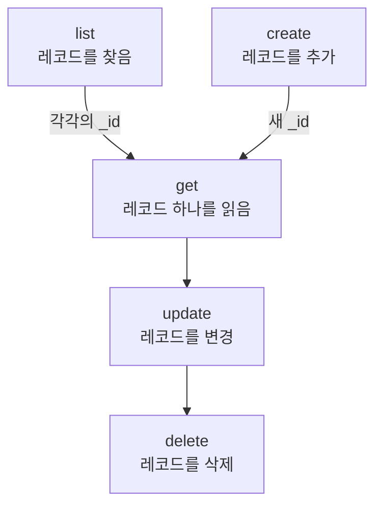

# 리소스 작업

레코드 종류마다 `incident`, `monitor`, `status-page` 같은 자체 명령이 있고, 모두 같은 작업 `list`, `get`, `create`, `update`, `delete`, `count`를 받습니다. 이 페이지에서는 필터, 페이지 넘기기, 레코드를 쓰는 JSON과 함께 각 작업을 설명합니다.

:::cards
- [레코드의 명령 찾기](#레코드의-명령-찾기): oneuptime resources로 모두 나열합니다.
- [레코드 나열](#레코드-나열): 필터링, 정렬, 페이지 넘기기.
- [레코드 만들기](#레코드-만들기): 명령줄이나 파일의 JSON에서 만듭니다.
- [레코드 삭제](#레코드-삭제): 바로 삭제되며 되돌릴 수 없습니다.
:::

## 작업 사이의 관계

레코드를 읽고, 바꾸고, 삭제하려면 그 ID가 필요합니다. 나열, 개수 세기, 만들기에는 필요하지 않으며, 목록이나 만들기 결과에서 다른 작업이 쓰는 ID를 얻습니다.



ID는 `6f1c2a40-3b1e-4c55-9a0b-3e2f8d7c1a11` 같은 UUID입니다. OneUptime의 레코드 페이지에서 복사할 수도 있습니다. [리소스의 ID 찾기](/docs/api-reference/api-reference#리소스의-id-찾기)를 참조하세요.

## 레코드의 명령 찾기

```bash
oneuptime resources
```

목록에는 레코드 종류마다 명령, 이름, 유형, API 경로가 나옵니다. 유형은 두 가지입니다.

| 유형 | 담는 것 | 작업 |
| --- | --- | --- |
| `database` | 관리하는 레코드: 모니터, 인시던트, 알림, 상태 페이지, 팀 등 | `list`, `get`, `create`, `update`, `delete`, `count` |
| `analytics` | 텔레메트리: 로그, 스팬, 메트릭, 예외, 기타 이벤트 | `list`, `create`, `count` |

`oneuptime resources --type database` 또는 `--type analytics`로 한 유형만 볼 수 있습니다. [명령 참조](/docs/cli/command-reference#리소스)에 모든 명령이 있습니다.

## 레코드 나열

```bash
oneuptime <resource> list [--query <json>] [--limit <n>] [--skip <n>] [--sort <json>] [-o <format>]
```

| 옵션 | 하는 일 | 기본값 |
| --- | --- | --- |
| `--query <json>` | 일치하는 레코드만 반환합니다: [목록 필터링](#목록-필터링) 참조 | 키가 읽을 수 있는 모든 레코드 |
| `--limit <n>` | 반환할 레코드의 최대 수, 최대 10,000 | `10` |
| `--skip <n>` | 먼저 건너뛸 일치 레코드의 수 | `0` |
| `--sort <json>` | 순서. `{"createdAt":"ASC"}`처럼 쓰며, 최신순은 `"DESC"` | 최신순 |
| `-o, --output <format>` | `table`, `json` 또는 `wide` | 터미널에서는 `table`, 파이프에서는 `json` |

```bash
# The ten newest incidents
oneuptime incident list

# The oldest monitors first, 50 at a time: the second page
oneuptime monitor list --sort '{"createdAt":"ASC"}' --limit 50 --skip 50

# Every field of each incident, as JSON
oneuptime incident list -o json
```

목록은 키가 읽을 수 있는 각 레코드의 모든 필드를 OneUptime에 요청합니다. 표에는 그중 6개가 나오고, JSON에는 모두 나옵니다([출력 형식](/docs/cli/output-formats) 참조). 모든 레코드를 넘겨 보려면 페이지가 빈 채로 돌아올 때까지 `--skip`을 `--limit`만큼 늘리세요. 전체 개수는 `count`가 알려 줍니다.

레이블은 최신순이 아니라 이름순으로 나열됩니다. 이름이 숫자로 시작하는 레이블이 그 숫자의 순서대로 먼저 오고(`2. Team`이 `10. Owner`보다 앞), 그다음 나머지 레이블이 알파벳순으로 옵니다. 다른 순서로 나열하려면 `--sort`를 지정하세요.

### 목록 필터링

`--query`는 API와 같은 필터를 받습니다. 값이 있는 필드는 그 값과 일치하고, `_type`이 있는 객체는 비교를 합니다.

| 필터 | 일치하는 것 |
| --- | --- |
| `{"title":"Checkout API is down"}` | 정확히 그 값을 가진 레코드 |
| `{"title":{"_type":"Search","value":"checkout"}}` | 값을 포함하는 텍스트 |
| `{"createdAt":{"_type":"GreaterThan","value":"2026-10-01T00:00:00.000Z"}}` | 더 늦은 날짜 또는 더 큰 숫자 |
| `{"currentIncidentState":{"isResolvedState":false}}` | 리소스가 가리키는 레코드의 필드: 여기서는 해결되지 않은 인시던트 |

```bash
oneuptime incident list --query '{"title":{"_type":"Search","value":"checkout"}}'
```

모든 `_type`은 API 참조의 [필터링, 정렬, 페이지 넘기기](/docs/api-reference/api-reference#필터링-정렬-페이지-넘기기)에 있습니다.

## 레코드 읽기

```bash
oneuptime <resource> get <id> [-o <format>]
```

```bash
oneuptime incident get 6f1c2a40-3b1e-4c55-9a0b-3e2f8d7c1a11
```

표는 레코드의 필드마다 한 행을 보여 주며, 각 값은 60자에서 잘립니다. `-o json`은 값을 자르지 않고 보여 줍니다. 키가 읽을 수 있는 레코드를 가리키지 않는 ID에는 `Not found`가 돌아오고, 명령은 종료 코드 `3`으로 끝납니다.

## 레코드 만들기

```bash
oneuptime <resource> create --data <json> [-o <format>]
oneuptime <resource> create --file <path> [-o <format>]
```

`--data`는 레코드를 JSON으로 받고, `--file`은 JSON 파일에서 읽습니다. 둘 중 하나를 주세요. 둘 다 주면 파일이 쓰입니다. 필드는 API의 필드이며, [API 참조](/reference)에 각 리소스의 필드가 나옵니다. 프로젝트는 API 키에서 정해지므로 레코드에 프로젝트를 쓰지 않습니다.

```bash
# A manual monitor
oneuptime monitor create --data '{"name":"Checkout API","monitorType":"Manual"}'

# An incident with one of your severities
oneuptime incident create --data '{"title":"Checkout API is down","incidentSeverityId":"<severity-id>"}'

# The same incident, from a file
oneuptime incident create --file incident.json
```

CLI는 새 레코드를 `_id`와 함께 출력합니다. 인시던트는 `currentIncidentStateId`가 다른 상태를 지정하지 않는 한 프로젝트의 생성됨 상태에서 시작합니다. [새 레코드가 시작하는 상태](/docs/api-reference/api-reference#새-레코드가-시작하는-상태)를 참조하세요. 심각도의 ID를 찾으려면 다음과 같이 합니다.

```bash
oneuptime incident-severity list -o json | jq -r '.[] | "\(._id)  \(.name)"'
```

> [!TIP]
> Windows에서는 JSON을 파일에 넣고 `--file`을 쓰세요. PowerShell과 명령 프롬프트는 명령줄의 JSON을 Bash와 다르게 따옴표로 감쌉니다.

## 레코드 업데이트

```bash
oneuptime <resource> update <id> --data <json> [-o <format>]
```

`--data`는 필수이며 바꿀 필드만 담습니다.

```bash
# Rename a monitor
oneuptime monitor update <monitor-id> --data '{"name":"Checkout API (EU)"}'

# Move an incident to your resolved state
oneuptime incident update <incident-id> --data '{"currentIncidentStateId":"<resolved-state-id>"}'
```

OneUptime은 업데이트에 빈 객체로 응답합니다. CLI는 빈 줄을 출력하고, `-o json`이면 `{}`를 출력합니다. 지금 상태의 레코드를 보려면 `get`을 실행하세요. 이 방법으로 인시던트를 다른 상태로 옮기면 대시보드처럼 그 변경이 타임라인에 기록되며, 현재 상태보다 앞선 상태는 거부됩니다. 프로젝트 순서에서 첫 번째인 해결됨 상태의 ID를 찾으려면 다음과 같이 합니다.

```bash
oneuptime incident-state list --query '{"isResolvedState":true}' --sort '{"order":"ASC"}' --limit 1 -o json | jq -r '.[0]._id'
```

## 레코드 삭제

```bash
oneuptime <resource> delete <id>
```

```bash
oneuptime monitor delete 6f1c2a40-3b1e-4c55-9a0b-3e2f8d7c1a11
```

`Monitor 6f1c2a40-3b1e-4c55-9a0b-3e2f8d7c1a11 deleted successfully.`라고 응답합니다.

> [!CAUTION]
> `delete`는 레코드를 바로 삭제합니다. CLI는 확인을 묻지 않으며 되돌릴 수 없습니다. 그 플래그로 작성된 스크립트를 위해 `--force`를 받지만, `--force`는 아무것도 바꾸지 않습니다.

## 레코드 개수 세기

```bash
oneuptime <resource> count [--query <json>]
```

```bash
# Every incident
oneuptime incident count

# Incidents that are not resolved
oneuptime incident count --query '{"currentIncidentState":{"isResolvedState":false}}'
```

CLI는 숫자 하나를 출력하며, 표에서도 JSON에서도 같으므로 스크립트가 그대로 읽을 수 있습니다.

## 유형별로 할 수 있는 일

| 작업 | `database` | `analytics` |
| --- | --- | --- |
| `list` | 예 | 예 |
| `get` | 예 | 아니요 |
| `create` | 예 | 예 |
| `update` | 예 | 아니요 |
| `delete` | 예 | 아니요 |
| `count` | 예 | 예 |

## 문제 해결

:::details "Not found: API error (404)" 메시지
레코드가 없거나, 다른 프로젝트에 있거나, 키가 읽을 수 없는 레코드입니다. OneUptime은 어느 경우에나 같은 응답을 합니다. `list`로 ID를 확인하고 키의 권한도 확인하세요. 명령은 종료 코드 `3`으로 끝납니다.
:::

:::details "API error (422): You do not have permissions to select on" 메시지
목록이나 읽기는 레코드의 모든 필드를 요청하는데, 키가 그중 하나를 읽을 수 없습니다. 메시지에 그 필드와 그것을 읽을 수 있는 권한이 나옵니다. 키에 그 권한 중 하나를 주세요.
:::

:::details "Error: Invalid JSON" 메시지
`--query`, `--sort`, `--data`의 값이 JSON이 아닙니다. Bash와 zsh에서는 작은따옴표로 감싸고, Windows에서는 레코드를 파일에 넣어 `--file`을 쓰세요.
:::

:::details 만들기나 업데이트에서 API error (400)가 돌아옴
OneUptime이 필드를 거부했습니다. 메시지에 그 필드가 나옵니다. `No fields to update`는 `--data`에 바꿀 필드가 없었다는 뜻입니다.
:::

## 다음 단계

:::cards
- [출력 형식](/docs/cli/output-formats): 응답을 표나 JSON으로 읽습니다.
- [스크립팅 및 CI/CD](/docs/cli/scripting): 이 작업을 스크립트와 파이프라인에서 씁니다.
- [명령 참조](/docs/cli/command-reference): 모든 명령, 옵션, 기본값.
:::
