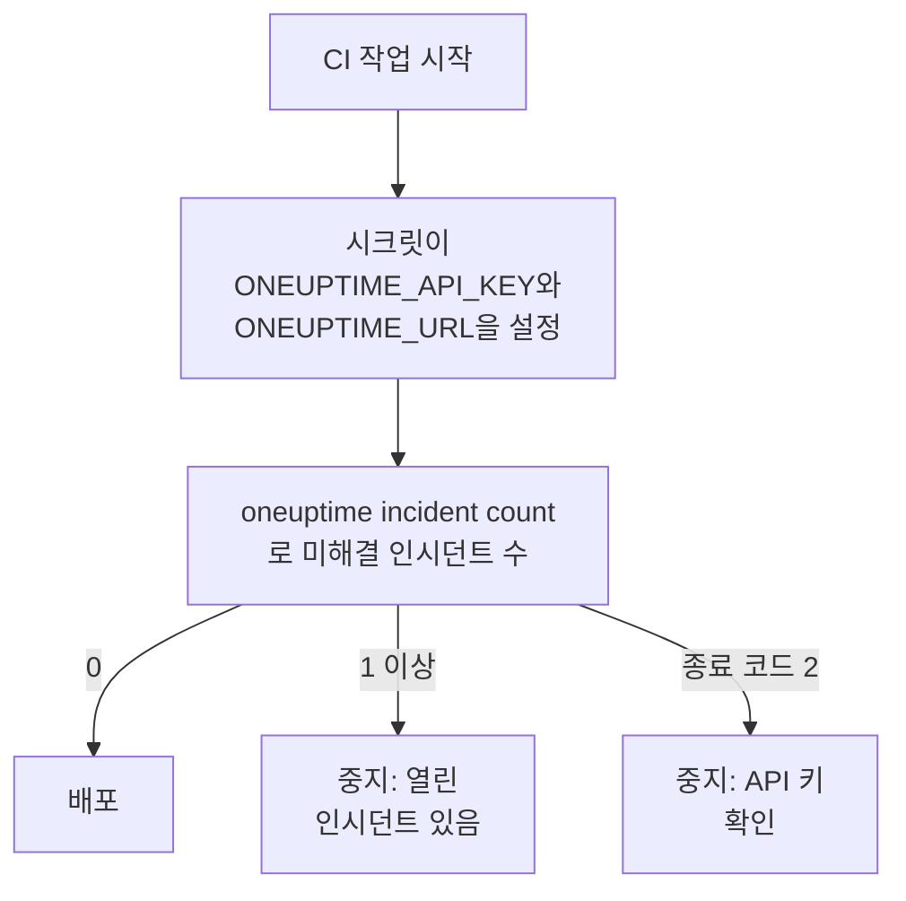

# 스크립팅 및 CI/CD

CLI는 스크립트에서도 터미널에서와 똑같이 작동합니다. 환경 변수로 API 키를 주고, 응답을 JSON으로 읽고, 종료 코드로 무슨 일이 있었는지 스크립트에 알리세요. 이 페이지에서는 각각의 방법과 GitHub Actions, GitLab CI, Docker용 완전한 파이프라인을 보여 줍니다.

:::cards
- [스크립트에 API 키 주기](#스크립트에-api-키-주기): 환경 변수 두 개, 저장된 컨텍스트 없음.
- [종료 코드](#종료-코드): 성공하면 0, 실패하면 그 이유.
- [jq로 응답 읽기](#jq로-응답-읽기): JSON에서 ID, 제목, 날짜를 꺼냅니다.
- [파이프라인 예](#파이프라인-예): GitHub Actions, GitLab CI, Docker.
:::

## 스크립트가 CLI를 쓰는 방식

배포는 먼저 OneUptime에 열린 인시던트가 있는지 묻고, 있으면 멈출 수 있습니다.



## 스크립트에 API 키 주기

CI 시스템의 시크릿에서 `ONEUPTIME_API_KEY`와 `ONEUPTIME_URL`을 설정하세요. 그러면 CLI에 `login`도 설정 파일도 필요 없습니다. 한 명령에서는 여전히 플래그가 이것들보다 우선하고, 이것들은 저장된 컨텍스트보다 우선합니다.

```bash
export ONEUPTIME_API_KEY="$CI_ONEUPTIME_API_KEY"
export ONEUPTIME_URL="https://oneuptime.com"
oneuptime incident count
```

> [!TIP]
> 파이프라인마다 필요한 접근 권한만 가진 전용 API 키를 주세요. 읽기만 하는 검사에는 읽기만 하는 키가 필요합니다. 파이프라인을 없앨 때는 OneUptime에서 그 키를 삭제하세요.

한 컴퓨터가 여러 프로젝트의 작업을 실행한다면, 프로젝트마다 컨텍스트를 저장하고 모든 명령에서 지정해 한 작업이 다른 작업의 현재 컨텍스트를 쓰지 않도록 하세요.

```bash
oneuptime --context production incident count
oneuptime --context staging monitor count
```

## 종료 코드

| 코드 | 의미 | 예 |
| --- | --- | --- |
| `0` | 성공했습니다 | 목록(아무것도 찾지 못한 목록도 포함) |
| `1` | 실패했습니다 | OneUptime이 요청을 거부함(예: `API error (422)`), 잘못된 JSON, 빠졌거나 알 수 없는 옵션, 저장되지 않은 컨텍스트 |
| `2` | 쓸 수 있는 API 키가 없습니다 | 자격 증명 없음, 잘못된 API 키, 플랜 미만의 키(`402`), `401` |
| `3` | 찾을 수 없습니다 | OneUptime이 `404`로 응답함: 레코드가 없거나, 다른 프로젝트에 있거나, 키가 읽을 수 없음 |

`whoami`와 `context current`는 아무것도 저장되지 않았어도 `0`으로 끝납니다. 설정된 내용을 알려 줄 뿐 확인하지는 않기 때문입니다. 스크립트는 코드로 경우를 구분합니다.

```bash
oneuptime incident get "$INCIDENT_ID" -o json > incident.json
case $? in
  0) echo "Saved the incident to incident.json" ;;
  2) echo "Check ONEUPTIME_API_KEY and ONEUPTIME_URL" >&2; exit 1 ;;
  3) echo "There is no incident $INCIDENT_ID" >&2; exit 1 ;;
  *) echo "OneUptime refused the request" >&2; exit 1 ;;
esac
```

오류 메시지는 표준 오류로 가므로 `incident.json`에는 응답만 담깁니다.

## jq로 응답 읽기

스크립트에는 `-o json`을 쓰세요. 파이프 안에서는 CLI가 어차피 JSON을 출력하지만, 이 플래그가 있으면 어디서 실행하든 스크립트가 계속 작동합니다.

```bash
# The title of each incident
oneuptime incident list -o json | jq -r '.[].title'

# The ID of a new monitor
MONITOR_ID=$(oneuptime monitor create --data '{"name":"Checkout API","monitorType":"Manual"}' -o json | jq -r '._id')

# When each incident was created: dates come as objects
oneuptime incident list -o json | jq -r '.[] | "\(.createdAt.value)  \(.title)"'

# The newest 100 incidents as CSV
oneuptime incident list --limit 100 -o json | jq -r '.[] | [._id, .title, .createdAt.value] | @csv'
```

개수 세기는 숫자 하나만 출력하므로 바로 비교할 수 있습니다.

```bash
OPEN=$(oneuptime incident count --query '{"currentIncidentState":{"isResolvedState":false}}')
echo "$OPEN incidents are open"
```

## 파일에서 레코드 만들기

레코드를 코드 옆에 JSON 파일로 두고 거기서 만드세요.

```json title="monitors/checkout-api.json"
{
  "name": "Checkout API",
  "monitorType": "Manual"
}
```

```bash
oneuptime monitor create --file monitors/checkout-api.json
```

JSON 배열 하나에서 여러 레코드를 하나씩 만듭니다.

```bash
jq -c '.[]' monitors.json | while IFS= read -r monitor; do
  oneuptime monitor create --data "$monitor" -o json | jq -r '._id'
done
```

> [!NOTE]
> 실행할 때마다 새 레코드가 만들어집니다. 모니터와 상태 페이지를 파일과 맞춰 두고, 바뀐 것만 바꾸고 사라진 것은 지우려면 [Terraform 공급자](/docs/terraform/index)를 쓰세요.

## 파이프라인 예

:::tabs
@tab GitHub Actions
```yaml title=".github/workflows/deploy.yml"
name: Deploy
on:
  push:
    branches: [main]

jobs:
  deploy:
    runs-on: ubuntu-latest
    steps:
      - uses: actions/checkout@v4
      - uses: actions/setup-node@v4
        with:
          node-version: lts/*
      - name: Install the OneUptime CLI
        run: npm install -g @oneuptime/cli
      - name: Stop while an incident is open
        env:
          ONEUPTIME_API_KEY: ${{ secrets.ONEUPTIME_API_KEY }}
          ONEUPTIME_URL: https://oneuptime.com
        run: |
          OPEN=$(oneuptime incident count --query '{"currentIncidentState":{"isResolvedState":false}}')
          if [ "$OPEN" -gt 0 ]; then
            echo "$OPEN incidents are open: not deploying."
            exit 1
          fi
      - name: Deploy
        run: ./deploy.sh
```
@tab GitLab CI
```yaml title=".gitlab-ci.yml"
check-incidents:
  stage: test
  image: node:lts
  variables:
    ONEUPTIME_URL: https://oneuptime.com
  script:
    - npm install -g @oneuptime/cli
    - OPEN=$(oneuptime incident count --query '{"currentIncidentState":{"isResolvedState":false}}')
    - echo "$OPEN incidents are open"
    - test "$OPEN" -eq 0
```
@tab Docker
```dockerfile title="Dockerfile"
FROM node:lts-slim
RUN npm install -g @oneuptime/cli
ENTRYPOINT ["oneuptime"]
```
:::

GitHub Actions에서는 저장소의 **Settings → Secrets and variables → Actions**에 `ONEUPTIME_API_KEY`를 추가하고, GitLab에서는 마스킹된 CI/CD 변수로 추가합니다. Docker 이미지에서는 실행할 때마다 변수를 넘깁니다.

```bash
docker build -t oneuptime-cli .
docker run --rm -e ONEUPTIME_API_KEY -e ONEUPTIME_URL oneuptime-cli incident count
```

## 다음 단계

:::cards
- [인증](/docs/cli/authentication): 여러 개가 설정되어 있을 때 명령이 쓰는 키.
- [출력 형식](/docs/cli/output-formats): 스크립트가 읽는 JSON.
- [리소스 작업](/docs/cli/resource-operations): 필터, 페이지 넘기기, 레코드의 필드.
- [Terraform 공급자](/docs/terraform/index): OneUptime 설정을 파일로 관리합니다.
:::
