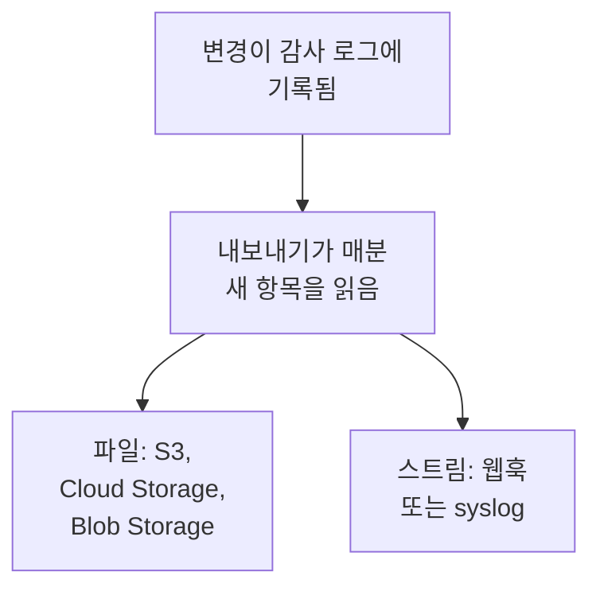

# 감사 로그 내보내기

감사 로그를 기록되는 대로 원하는 스토리지나 서비스로 보냅니다. 대상은 Amazon S3 또는 S3 호환 스토리지, Google Cloud Storage, Azure Blob Storage, 웹훅, syslog입니다. 규정 준수 검토에 필요한 만큼 항목을 그곳에 보관하고 SIEM에서 검색하세요. 프로젝트의 소유자와 관리자는 프로젝트 설정에서 그 프로젝트의 감사 로그를 내보내고, 마스터 관리자는 Admin Dashboard에서 모든 프로젝트의 감사 로그를 내보냅니다. OneUptime Cloud에서는 Enterprise 요금제에, 자체 호스팅에서는 Enterprise Edition에 포함됩니다.

:::cards
- [내보내기 설정](#내보내기-설정): 대상을 고르고, 테스트하고, 저장합니다.
- [보내는 내용](#보내는-내용): 항목마다 JSON 객체 하나, 안정된 스키마로.
- [항목을 보내는 시점](#항목을-보내는-시점): 매분, 각 항목을 한 번씩, 순서대로.
- [대상이 실패할 때](#대상이-실패할-때): 재시도와 오류 표시, 건너뛰는 항목은 없습니다.
:::

## 항목이 대상에 도착하는 과정



- **내보내기 하나에 대상 하나.** 프로젝트는 여러 내보내기를 가질 수 있으며, 각 내보내기는 모든 항목을 자기 대상으로 보냅니다.
- **프로젝트의 것, 또는 인스턴스의 것.** 프로젝트의 내보내기는 그 프로젝트의 항목을 보냅니다. Admin Dashboard에서 설정한 내보내기는 감사 로그를 기록하는 모든 프로젝트의 항목을 보냅니다.
- **저장한 때부터.** 내보내기는 저장된 뒤에 기록된 것을 보냅니다. **내보내기 시작 시점**을 더 이른 날짜로 정하면 그때부터 보냅니다.

## 시작하기 전에

- **OneUptime Cloud에서는 Enterprise 요금제.** 다른 요금제에서는 이 페이지에 기능이 하는 일과 얻는 방법이 표시됩니다.
- **자체 호스팅에서는 Enterprise Edition**과 감사 로그를 포함하는 라이선스. [엔터프라이즈 에디션](/docs/self-hosted/enterprise)을 참조하세요.
- **감사 로그 기록 켜기**: 내보내는 각 프로젝트에서 켜져 있어야 합니다. [감사 로그](/docs/configuration/audit-logs)를 참조하세요.
- **Project Owner 또는 Project Admin**이 프로젝트의 감사 로그를 내보내고, 마스터 관리자가 인스턴스의 감사 로그를 내보냅니다.

## 내보내기 설정

:::steps
### 내보내기 페이지 열기

프로젝트의 경우 **프로젝트 설정 → 감사 로그 → 내보내기**로 이동합니다. 인스턴스 전체의 경우 Admin Dashboard에서 **설정 → 감사 로그 내보내기**로 이동합니다.

### 대상 고르기

**내보내기 추가**를 클릭하고 아래 여섯 가지 대상 중 하나를 고릅니다. 내보내기의 대상은 나중에 바꿀 수 없습니다.

### 연결 방법 입력하기

대상이 요구하는 내용을 입력합니다. 대부분의 사람이 그대로 두는 설정은 **추가 필드** 안에 있고, **설정 가이드**는 이 페이지에서 그 대상의 섹션을 엽니다.

### 테스트 보내기

**테스트 파일 쓰기** 또는 **테스트 항목 보내기**를 클릭합니다. 스토리지는 폴더에 `oneuptime-audit-log-export-test.ndjson.gz` 파일을 받고, 웹훅이나 syslog는 작업이 `Test`인 항목 하나를 받습니다. 테스트가 실패하면 무엇을 고쳐야 하는지 알려 줍니다.

### 내보내기 시작하기

**다음**을 클릭하고 내보내기에 이름을 붙인 다음 **내보내기 시작**을 클릭합니다. 첫 항목은 몇 분 안에 도착합니다.
:::

내보내기의 행에는 상태가 표시됩니다: **내보내는 중**, **실패 중**, **일시 중지됨**, **항목 대기 중**, **시작 중**. **테스트 보내기**는 저장된 설정으로 테스트를 보내고, **편집**은 설정을 바꿉니다. 비워 둔 자격 증명은 저장된 값을 그대로 유지합니다.

## 대상

| 대상 | 도착하는 것 | 인증 방법 |
| --- | --- | --- |
| [Amazon S3](#amazon-s3) | 압축된 NDJSON 파일 | 액세스 키 |
| [S3 호환 스토리지](#s3-호환-스토리지) | 압축된 NDJSON 파일 | 액세스 키 |
| [Google Cloud Storage](#google-cloud-storage) | 압축된 NDJSON 파일 | 서비스 계정 키 |
| [Azure Blob Storage](#azure-blob-storage) | 압축된 NDJSON 파일 | SAS 토큰 또는 액세스 키 |
| [웹훅](#웹훅) | HTTPS 요청 | 선택 사항인 헤더와 서명 시크릿 |
| [Syslog](#syslog) | RFC 5424 메시지 | 없음 |

### Amazon S3

| 필드 | 입력할 내용 |
| --- | --- |
| **버킷** | 파일을 쓸 버킷입니다. |
| **지역** | 버킷의 지역입니다. 처음에는 `us-east-1`로 되어 있습니다. |
| **액세스 키 ID** | 버킷에 객체를 쓸 수 있는 액세스 키입니다. |
| **비밀 액세스 키** | 그 키의 비밀입니다. |
| **폴더** | **추가 필드** 안에 있습니다. 비워 두면 파일이 `oneuptime/audit-logs/`에 저장됩니다. |

키에는 폴더에 대한 `s3:PutObject`만 있으면 됩니다:

```json
{
  "Version": "2012-10-17",
  "Statement": [
    {
      "Effect": "Allow",
      "Action": "s3:PutObject",
      "Resource": "arn:aws:s3:::my-audit-logs/oneuptime/audit-logs/*"
    }
  ]
}
```

### S3 호환 스토리지

Amazon S3와 같은 필드에, 먼저 **엔드포인트**를 입력합니다. 스토리지의 S3 주소로, 예를 들면 `https://minio.example.com:9000` 또는 `https://<account>.r2.cloudflarestorage.com`입니다. **지역**은 스토리지가 기대하는 값으로 설정하세요. MinIO와 Wasabi의 기본값은 `us-east-1`, Cloudflare R2는 `auto`입니다.

### Google Cloud Storage

**버킷**을 입력하고, 버킷에 대한 Storage Object Creator 역할이 있는 서비스 계정의 **서비스 계정 키**(JSON)를 붙여 넣습니다. **폴더**는 **추가 필드** 안에 있습니다.

### Azure Blob Storage

**스토리지 계정**과 **컨테이너**를 입력하고 **로그인 방법**을 고릅니다. 컨테이너에 대한 Create 및 Write 권한이 있는 **SAS 토큰**, 또는 스토리지 계정의 **액세스 키** 중 하나입니다. SAS 토큰은 이 컨테이너로만 제한할 수 있으므로 더 안전한 선택입니다. **클라우드**와 **폴더**는 **추가 필드** 안에 있습니다.

### 웹훅

OneUptime은 각 배치를 **URL**로 POST합니다. 형식은 **본문 형식**에 따라 JSON 배열(`application/json`) 또는 줄마다 항목 하나(`application/x-ndjson`)이며, 다음 헤더가 붙습니다:

| 헤더 | 값 |
| --- | --- |
| `X-OneUptime-Event` | `audit-log-export` |
| `X-OneUptime-Batch-Id` | 배치의 첫 항목 ID입니다. 같은 배치를 다시 보내면 같은 ID가 붙습니다. |
| `X-OneUptime-Entry-Count` | 본문에 담긴 항목 수입니다. |
| `X-OneUptime-Signature` | **서명 시크릿**이 설정된 경우, `sha256=` 뒤에 그것으로 계산한 본문의 HMAC-SHA256이 붙습니다. |

`Bearer <token>` 같은 **자격 증명**은 **헤더 이름**에서 고른 헤더로 보내며, 바꾸지 않으면 `Authorization`입니다. **본문 형식**, **헤더 이름**, **서명 시크릿**은 **추가 필드** 안에 있습니다. 2xx 응답은 모두 전달 성공으로 봅니다. `413`이 오면 배치를 둘로 나누고, 그 밖의 거부는 나중에 배치 전체를 다시 보냅니다.

### Syslog

각 항목은 **호스트**와 **포트**로 보내는 RFC 5424 메시지 하나입니다. **프로토콜**에서 TCP를 고르지 않으면 포트 `6514`에서 TLS를 쓰며, facility는 13(log audit), severity는 6(informational)입니다:

```text
<110>1 2026-10-24T09:15:03.000Z oneuptime.example.com oneuptime - audit-log - {"schemaVersion":1,"id":"..."}
```

메시지는 옥텟 카운팅(RFC 5425)으로 구분합니다. **프레이밍**에서 줄마다 메시지 하나를 고르면 그 방식을 씁니다. 사설 CA가 서명한 인증서를 쓰는 수신자에게는 **CA 인증서**에 그 CA의 인증서가 필요합니다. 둘 다 **추가 필드** 안에 있습니다.

## 보내는 내용

각 항목은 JSON 객체 하나이며, 키는 항상 다음 순서입니다:

| 키 | 담긴 내용 |
| --- | --- |
| `schemaVersion` | `1`. 스키마가 바뀌면 새 버전이 됩니다. |
| `id` | 항목의 ID입니다. 같은 항목을 두 번 보내도 ID는 같습니다. |
| `createdAt` | 변경이 기록된 시각(UTC)입니다. |
| `projectId` | 변경이 일어난 프로젝트입니다. |
| `action` | `Create`, `Update`, `Delete` 또는 `Download`입니다. |
| `resourceType`, `resourceId`, `resourceName` | 변경된 대상입니다. |
| `rootResourceType`, `rootResourceId` | 그것이 속한 리소스입니다. 예를 들어 규칙에 대한 SLO입니다. |
| `userId`, `userName`, `userEmail`, `userType` | 변경한 사람입니다. |
| `apiKeyId`, `apiKeyName` | 변경에 쓰인 API 키입니다(있는 경우). |
| `mcpOAuthGrantId`, `mcpClientName` | 변경을 거친 MCP 클라이언트입니다(있는 경우). |
| `workflowId`, `workflowName` | 변경한 워크플로입니다(있는 경우). |
| `changes` | 변경된 각 필드입니다. `field`와 `oldValue`, `newValue`가 들어 있습니다. |

파일은 줄마다 항목 하나를 담아 gzip으로 압축하며, 첫 항목의 시각을 기준으로 시간별로 정리됩니다: `oneuptime/audit-logs/2026/10/24/09/20261024T091503Z_<first entry id>.ndjson.gz`.

키, 토큰, 비밀번호는 절대 밖으로 나가지 않습니다. 이들은 `[REDACTED]`로 기록되고, 아무도 읽을 수 없는 필드는 모든 항목에서 빠집니다.

## 항목을 보내는 시점

- **매분.** 일 분 이상 전에 기록된 항목을 오래된 것부터 읽어 배치로 보냅니다. 파일 하나에 최대 5,000개 항목 또는 16 MB, 웹훅 요청이나 syslog 연결 하나에 500개 항목입니다.
- **파일은 항목마다 쓰지 않습니다.** 파일은 배치가 가득 차거나 첫 항목이 기록된 지 오 분이 지나면 씁니다.
- **각 항목을 한 번씩, 순서대로.** 전달할 때마다 내보내기는 마지막으로 보낸 항목을 기억하므로, 다시 시작하거나 다른 워커가 맡아도 그 지점부터 이어 갑니다.
- **반복을 알아볼 수 있습니다.** 장애 뒤에 다시 보낸 배치는 같은 파일 이름으로 쓰이거나 같은 `X-OneUptime-Batch-Id`를 가지며, 모든 항목에는 `id`가 있습니다.

## 대상이 실패할 때

배치는 몇 초 간격으로 세 번 시도하고, 그 뒤에는 기다렸다가 다시 시도합니다. 처음에는 일 분, 다음에는 이 분, 사 분처럼 늘어나며 최대 한 시간입니다. 행에는 **실패 중**이 표시되고, **오류 보기**에서 대상의 응답과 다음 시도 시각을 볼 수 있습니다.

건너뛰는 항목은 없습니다. 항목은 감사 로그에서 기다리고, 다음에 성공한 전달이 가장 오래된 것부터 따라잡습니다. 프로젝트의 감사 로그 보존 기간보다 오래된 항목은 보내기 전에 삭제되므로, 실패하는 내보내기는 그 기간 안에 고치세요.

내보내기를 일시 중지하려면 해당 행의 메뉴에서 **끄기**를 선택합니다. 위치는 유지되며, **켜기**를 누르면 그동안 기록된 것을 보냅니다. OneUptime Cloud에서는 Enterprise 요금제를 떠난 프로젝트가 내보내기를 멈추고, 그 내보내기는 업그레이드 카드 아래에서 기다리며 그곳에서 끄거나 삭제할 수 있습니다. 자체 호스팅에서는 라이선스에 감사 로그가 포함되지 않는 동안 내보내기가 멈추고, 감사 로그를 포함하는 라이선스가 생기면 멈춘 곳부터 다시 이어 갑니다.

## 문제 해결

:::details 테스트에서 접근이 거부됨
키, 토큰 또는 서비스 계정에 내보내기가 쓰는 곳에 쓸 권한이 없습니다. 위의 각 대상 섹션에 나온 대로 폴더에 객체를 만들 권한을 준 다음 테스트를 다시 보내세요.
:::

:::details 테스트가 주소에 닿지 못함
OneUptime Cloud의 프로젝트 내보내기는 사설 네트워크 주소에 닿을 수 없습니다. 자체 호스팅에서는 `DATA_SOURCE_BLOCK_PRIVATE_ADDRESSES`가 `true`가 아니면 닿을 수 있고, Admin Dashboard에서 설정한 내보내기는 항상 닿을 수 있습니다. 루프백과 링크 로컬 주소에는 절대 닿지 않습니다.
:::

:::details 아무것도 도착하지 않음
프로젝트에서 감사 로그 기록이 켜져 있는지, 그리고 내보내기를 저장한 뒤 누군가 무언가를 바꿨는지 확인하세요. 스토리지는 배치가 가득 차거나 오 분이 지나야 파일을 받습니다.
:::

## 다음 단계

:::cards
- [감사 로그](/docs/configuration/audit-logs): 무엇이 기록되고 얼마나 오래 보관되는지.
- [사용자, 팀 및 권한](/docs/permissions/index): 내보내기를 설정할 수 있는 사람을 정합니다.
- [엔터프라이즈 에디션](/docs/self-hosted/enterprise): 자체 호스팅 설치의 감사 로그.
:::
