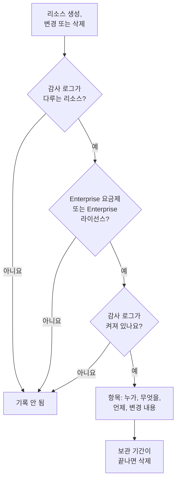

# 감사 로그

감사 로그는 프로젝트에서 누가 무엇을 바꿨는지 기록합니다. 감사 로그가 다루는 리소스의 모든 생성, 변경, 삭제를 변경 전후 값과 함께 기록하고, 누군가 로그인하거나 로그아웃할 때마다 기록합니다. 누가 모니터를 껐는지, 누가 API 키를 바꿨는지, 누가 어디에서 로그인했는지 알아내고, 규정 준수 검토를 위한 기록을 남기는 데 사용하세요. OneUptime Cloud에서는 Enterprise 요금제에, 자체 호스팅에서는 Enterprise Edition에 포함됩니다.

:::cards
- [감사 로그 켜기](#감사-로그-켜기): 모든 프로젝트에서 처음에는 꺼져 있습니다.
- [감사 로그 읽기](#감사-로그-읽기): 누가 무엇을 언제 바꿨는지.
- [기록되는 내용](#기록되는-내용): 다루는 리소스와 작업.
- [로그인과 세션](#로그인과-세션): 누가 로그인했는지, 각 세션이 어떻게 끝났는지.
- [항목 보관 기간](#항목-보관-기간): 7일에서 180일까지.
:::

## 변경이 항목이 되는 과정

- **처음에는 꺼져 있습니다.** 누군가 감사 로그를 켤 때까지 프로젝트는 아무것도 기록하지 않으며, 그 이전의 일도 기록하지 않습니다.
- **사람이 한 일을 기록합니다.** 사람, API 키, MCP 클라이언트 또는 워크플로가 한 변경이 기록됩니다. 백그라운드 작업처럼 OneUptime 자체가 한 변경은 **시스템 이벤트 저장**을 켜지 않으면 기록되지 않습니다.
- **항목은 변경할 수 없습니다.** 대시보드에서도 API로도 항목을 편집하거나 삭제할 수 없습니다. 항목은 보관 기간이 끝날 때만 사라집니다.

## 시작하기 전에

- **OneUptime Cloud에서는 Enterprise 요금제.** 다른 요금제에서는 감사 로그 페이지에 기능이 하는 일과 얻는 방법이 표시됩니다.
- **자체 호스팅에서는 Enterprise Edition**과 감사 로그를 포함하는 라이선스. [엔터프라이즈 에디션](/docs/self-hosted/enterprise)을 참조하세요.
- **감사 로그를 읽을 수 있는 역할.** Project Owner, Project Admin, Settings Admin 또는 **Read Audit Log** 권한. 감사 로그를 켜고 설정을 바꾸려면 Project Owner, Project Admin 또는 프로젝트를 편집할 권한이 있어야 합니다.

## 감사 로그 켜기

:::steps
### 감사 로그 설정 열기

**프로젝트 설정 → 감사 로그 → 설정**으로 이동합니다. 측면 메뉴의 **감사 로그**는 처음에 접혀 있으니 클릭해 여세요.

### 설정 편집

**Edit Audit Log Settings**를 클릭합니다.

### 켜기

**감사 로그 활성화**를 켜고, **보존 기간(일)** 값을 정하고, **시스템 이벤트 저장** 여부를 고릅니다. **변경 사항 저장**을 클릭합니다.
:::

| 설정 | 초기값 | 하는 일 |
| --- | --- | --- |
| **감사 로그 활성화** | 꺼짐 | 지금부터 프로젝트 리소스의 변경을 기록합니다. |
| **보존 기간(일)** | 7 | 각 항목을 보관하는 일수: 7에서 180까지. |
| **시스템 이벤트 저장** | 꺼짐 | 사람이나 키가 시작하지 않은, OneUptime 자체가 한 변경도 기록합니다. |

이 설정을 바꾸면 일 분 안에 적용됩니다.

## 감사 로그 읽기

**프로젝트 설정 → 감사 로그 → 감사 로그**에는 프로젝트의 모든 항목이 최신순으로 나열됩니다.

| 열 | 표시 내용 |
| --- | --- |
| **시점** | 얼마나 전인지, 날짜와 시간과 함께. |
| **작업** | `Create`, `Update` 또는 `Delete`, 누군가 다운로드한 패킷 캡처 파일의 경우 `Download`, 또는 세션의 경우 `Sign In`, `Sign Out`, `Session Timeout` 또는 `Session Revoked`. |
| **리소스** | 리소스 이름(존재하는 동안 리소스를 엽니다)과 종류. |
| **행위자** | 변경한 주체: 사람, API 키, 워크플로, 또는 OneUptime 자체가 한 변경이면 `System`. MCP 클라이언트를 통한 사람의 변경에는 어떤 클라이언트인지 표시됩니다. |
| **변경 사항** | 변경된 필드 수, 또는 생성이나 삭제 시 기록된 필드 수. 세션의 경우 어떻게 로그인했는지 또는 왜 끝났는지. 클릭하면 각 필드를 볼 수 있습니다. |

**리소스 유형**, **리소스 이름**, **작업**, **사용자 이메일**, **시간**으로 필터링합니다. 변경에는 바뀐 필드만 변경 전후로 표시되며, 아무것도 바꾸지 않는 저장은 항목을 추가하지 않습니다.

자체 이름이 없는 리소스는 OneUptime에서 그것을 가리키는 것으로 이름이 붙습니다. 예외는 유형과 메시지의 앞부분으로(ID, 주소, 비밀처럼 보이는 모든 것은 가려집니다), Runbook 실행은 해당 Runbook으로, 수신 전화 정책의 전화번호는 그 번호로, 템플릿이나 도메인은 자체 이름으로 이름이 붙습니다.

모니터, 인시던트, 경고, 상태 페이지, SLO 및 기타 많은 리소스에도 측면 메뉴의 접힌 섹션(예: **고급**)에 자체 **감사 로그** 페이지가 있습니다. 이 페이지에는 그 리소스의 항목과 그 리소스에 속한 것의 항목만 표시됩니다. SLO 페이지에는 그 SLO의 규칙과 소유자도 표시됩니다.

## 기록되는 내용

프로젝트에서 사람들이 만들고, 변경하고, 삭제하는 모든 것이 기록됩니다. 모니터, 인시던트, 알림, 상태 페이지, 워크플로와 그 단계, 큐, 대시보드, 온콜 정책, 팀과 팀원, API 키, 그리고 모든 설정입니다. **리소스 유형**은 `Monitor`, `Workflow`, `Queue`처럼 항목이 무엇에 관한 것인지 알려 줍니다.

| 기록되지 않는 것 | 이유 |
| --- | --- |
| 메시지 로그 | 각각이 이미 OneUptime이 보내거나 받은 이메일, SMS, 전화, 푸시 알림, 채팅 메시지의 기록입니다. |
| 실행 기록 | 각각이 이미 워크플로 실행, 온콜 에스컬레이션, 스캔, 가져오기, AI 실행의 기록입니다. |
| 에이전트와 텔레메트리가 보고하는 내용 | 발견된 리소스, 측정값, 사용량은 누군가 바꿔서가 아니라 보고할 때마다 바뀝니다. |
| 활동 피드 | 피드에는 감사 로그가 이미 기록하는 변경 사항이 나옵니다. |
| OneUptime의 작업 상태 | 상태 페이지 열람자의 세션, 대기 중인 작업, 그리고 OneUptime이 작업하는 동안 유지하는 그 밖의 상태입니다. |
| 개인의 알림 설정 | 각 사람의 주소, 번호, 나에게 연락하는 방법은 그 사람만의 것입니다. |
| 개인의 환경설정 | 각 사람이 자신의 상단 바에 고정한 제품은 그 사람만의 것이며, 그 사람에게만 보입니다. |

관리자가 다른 사람의 계정에서 알림 방법이나 나에게 연락하는 방법을 추가하거나 제거한 경우에도 기록되며, 주소나 번호 자체는 기록되지 않습니다.

호스트가 마지막으로 확인된 시각처럼 OneUptime만 쓰는 필드는 누구도 읽을 수 없는 필드와 마찬가지로 모든 항목에서 빠집니다. 누군가의 요청으로 OneUptime이 그런 필드를 쓰는 경우, 예를 들어 예외를 다른 예외에 병합하거나 웹후크 URL을 재설정하면, 항목에는 그 사람의 변경으로 기록됩니다. 키, 토큰, 비밀번호는 `[REDACTED]`로 기록됩니다. 항목에는 변경되었다는 사실만 나오고 값은 나오지 않습니다. 워크플로의 단계는 무엇이 바뀌었는지로 기록되며, 단계 설정의 이름은 나오지만 거기에 입력한 내용은 절대 나오지 않고, 캔버스에서 단계를 옮기는 것은 기록되지 않습니다.

누군가의 요청으로 OneUptime이 한 다음 일도 프로젝트가 시스템 이벤트를 저장하는지와 관계없이 그 사람의 변경으로 기록됩니다.

- Runbook 실행의 시작, 승인, 완료, 건너뛰기, 취소. 그 단계는 각 단계에 한 일로 기록되며(예: `Approved "Restart the API" (step 3)`), 단계가 출력한 내용은 기록되지 않습니다.
- 누군가 규칙을 실행할 때 규칙이 바꾸는 것: 규칙이 추가하는 레이블과 소유자, 개인정보 규칙이 비공개로 만드는 레코드, 사이트 할당 규칙이 옮기는 장치, 자동 가져오기 규칙이 만드는 장치와 모니터, 상태 페이지나 SLO의 모니터 규칙이 그 페이지나 SLO에서 바꾸는 내용.
- 수신 전화 정책 전화번호의 구매, 연결, 해제.
- 누군가 예상된 것 또는 문제 아님으로 표시한 데이터 알림의 해결.
- 캘린더 피드 링크 재설정.
- SSO로 로그인할 때 참여하는 팀.

규칙이 스스로 하는 일은 OneUptime 자체의 변경으로, **시스템 이벤트 저장**이 켜져 있을 때 기록됩니다. 레코드가 생성될 때 규칙이 추가하는 레이블과 소유자 및 그때 비공개로 만드는 레코드, 자동 가져오기 규칙이 새 스캔 결과로 만드는 장치와 모니터, 규칙이나 모니터나 레이블이 저장될 때 상태 페이지나 SLO의 모니터 규칙이 바꾸는 내용이 그렇습니다.

호스트, 클러스터 또는 클라우드 계정의 AI 에이전트를 재설정하면 해당 리소스 자체의 **감사 로그** 페이지에 재설정한 사람의 `aiAgentResetAt` 변경으로 기록됩니다. 누가, 언제 재설정했는지 알 수 있습니다. 클라우드 계정의 AI 에이전트용 키를 만드는 것도 마찬가지입니다. 키는 변경된 것으로 표시되며 키나 해시가 담기지 않습니다. 에이전트가 연결하고 상태를 보고할 때 알리는 내용은 이전처럼 기록되지 않습니다.

## 로그인과 세션

프로젝트 멤버가 OneUptime에 로그인할 때마다 감사 로그가 이를 기록하고, 그 세션이 끝날 때 다시 기록합니다. 로그인은 한 프로젝트가 아니라 OneUptime에 하는 것이므로, 그 사람이 멤버인 모든 프로젝트에 기록됩니다.

| 작업 | 기록되는 때 |
| --- | --- |
| `Sign In` | 누군가 로그인할 때. 비밀번호나 로그인 링크, 패스키, Google, Microsoft, Vercel 또는 싱글 사인온으로 로그인하는 경우입니다. |
| `Sign Out` | 그 사람이 로그아웃할 때. |
| `Session Timeout` | OneUptime이 기한에 따라 세션을 끝낼 때. 서버 관리자가 설정한 활동 없는 시간이나 세션 길이에 도달했거나, 30일 동안 사용하지 않은 경우입니다. |
| `Session Revoked` | 비밀번호가 바뀌었거나, 계정이 차단되었거나, 서버 관리자가 이중 인증을 재설정하거나 필수로 지정해서 OneUptime이 세션을 끝낼 때. |

항목의 **리소스**는 세션이며, `Chrome 130 on macOS`처럼 로그인한 기기로 이름이 붙습니다. **행위자**는 그 세션의 주인이므로, **사용자 이메일**로 필터링하면 그 사람의 모든 로그인과 세션을 찾을 수 있습니다. 세부 정보에는 로그인 방법과 사용한 두 번째 인증 요소, IP 주소와 위치가 나오며, 끝난 세션의 경우 로그인한 시각, 마지막으로 사용된 시각, 시간이 초과된 시각도 나옵니다. 프로젝트 자체의 SSO 공급자는 그 프로젝트의 감사 로그에서만 이름이 나옵니다.

로그인과 세션은 프로젝트가 시스템 이벤트를 저장하는지와 관계없이 기록됩니다. 세션 길이나 30일 미사용에 따른 종료는 기한이 지난 뒤 몇 분 안에 기록됩니다. 활동 없는 시간에 따른 종료는 그 사람의 열린 탭이나 모바일 앱이 다음에 OneUptime에 연결될 때 기록됩니다.

## 항목 보관 기간

각 항목은 기록될 때 프로젝트에 설정되어 있던 **보존 기간(일)** 동안 보관된 뒤 삭제됩니다. 새 보존 기간은 새 항목에 적용되며, 이미 기록된 항목의 날짜는 그대로입니다. API에서도 보존 기간은 7에서 180까지의 정수 일수입니다. 다른 값은 거부됩니다.

180일보다 오래 보관하려면 항목을 기록되는 대로 자체 스토리지나 SIEM으로 보내세요. [감사 로그 내보내기](/docs/configuration/audit-log-export)를 참조하세요. **Read Audit Log** 권한이 있는 API 키로 API를 통해 항목을 읽어 필요한 곳에 저장할 수도 있습니다. [OneUptime API 참조](/docs/api-reference/api-reference)를 참조하세요.

## 요금제나 라이선스에 감사 로그가 더 이상 포함되지 않을 때

- **OneUptime Cloud에서는** Enterprise 요금제를 떠난 프로젝트가 기록을 멈추고, 요금제로 돌아올 때까지 감사 로그 페이지에 업그레이드 카드가 표시됩니다.
- **자체 호스팅에서는** 라이선스 없이 Enterprise 평가판 기간이나 유예 기간이 끝나거나, 라이선스에 감사 로그가 포함되지 않으면 감사 로그가 기록을 멈춥니다. 감사 로그에 빨간색으로 표시됩니다. 이미 기록된 항목은 보관되며, 라이선스를 활성화하는 즉시 같은 설정으로 기록이 다시 시작됩니다. [라이선스가 만료되었거나 없을 때](/docs/self-hosted/enterprise#라이선스가-만료되었거나-없을-때)를 참조하세요.

## 문제 해결

:::details 감사 로그가 비어 있음
감사 로그는 처음에 꺼져 있으며, 켜기 전의 일은 기록하지 않습니다. 목록에 감사 로그가 꺼져 있다고 표시되면 그 링크를 따라 설정으로 가서 켜세요. 그렇지 않으면 모니터나 인시던트를 변경한 다음 목록을 새로 고치세요.
:::

:::details 감사 로그에 변경이 없음
리소스가 [기록되는 내용](#기록되는-내용)에 있는지, 그리고 감사 로그를 켠 뒤에 변경되었는지 확인하세요. OneUptime 자체가 한 변경은 **시스템 이벤트 저장**이 켜져 있을 때만 기록됩니다.
:::

## 다음 단계

:::cards
- [감사 로그 내보내기](/docs/configuration/audit-log-export): 감사 로그를 자체 스토리지나 SIEM으로 보냅니다.
- [사용자, 팀 및 권한](/docs/permissions/index): 감사 로그를 읽을 수 있는 사람을 정합니다.
- [프로젝트 설정](/docs/configuration/project-settings): 프로젝트의 그 밖의 설정.
- [결제 및 사용량](/docs/configuration/billing): 프로젝트의 요금제를 변경합니다.
- [엔터프라이즈 에디션](/docs/self-hosted/enterprise): 자체 호스팅 설치의 감사 로그.
:::
