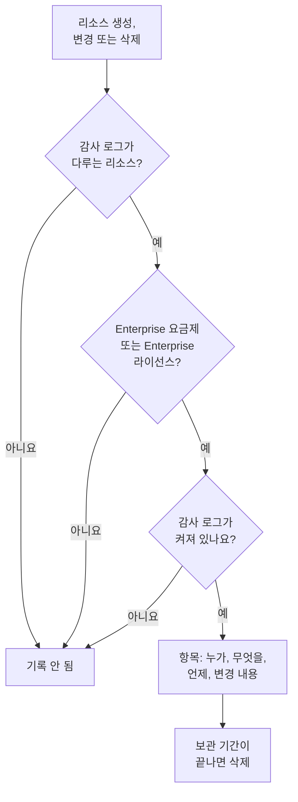

# 감사 로그

감사 로그는 프로젝트에서 누가 무엇을 바꿨는지 기록합니다. 감사 로그가 다루는 리소스의 모든 생성, 변경, 삭제를 변경 전후 값과 함께 기록합니다. 누가 모니터를 껐는지, 누가 API 키를 바꿨는지 알아내고, 규정 준수 검토를 위한 기록을 남기는 데 사용하세요. OneUptime Cloud에서는 Enterprise 요금제에, 자체 호스팅에서는 Enterprise Edition에 포함됩니다.

:::cards
- [감사 로그 켜기](#감사-로그-켜기): 모든 프로젝트에서 처음에는 꺼져 있습니다.
- [감사 로그 읽기](#감사-로그-읽기): 누가 무엇을 언제 바꿨는지.
- [기록되는 내용](#기록되는-내용): 다루는 리소스와 작업.
- [항목 보관 기간](#항목-보관-기간): 7일에서 180일까지.
:::

## 변경이 항목이 되는 과정

- **처음에는 꺼져 있습니다.** 누군가 감사 로그를 켤 때까지 프로젝트는 아무것도 기록하지 않으며, 그 이전의 일도 기록하지 않습니다.
- **사람이 한 일을 기록합니다.** 사람, API 키, MCP 클라이언트 또는 워크플로가 한 변경이 기록됩니다. 백그라운드 작업처럼 OneUptime 자체가 한 변경은 **시스템 이벤트 저장**을 켜지 않으면 기록되지 않습니다.
- **항목은 변경할 수 없습니다.** 대시보드에서도 API로도 항목을 편집하거나 삭제할 수 없습니다. 항목은 보관 기간이 끝날 때만 사라집니다.

## 시작하기 전에

- **OneUptime Cloud에서는 Enterprise 요금제.** 다른 요금제에서는 감사 로그 페이지에 기능이 하는 일과 얻는 방법이 표시됩니다.
- **자체 호스팅에서는 Enterprise Edition**과 감사 로그를 포함하는 라이선스. [엔터프라이즈 에디션](/docs/self-hosted/enterprise)을 참조하세요.
- **감사 로그를 읽을 수 있는 역할.** Project Owner, Project Admin, Settings Admin 또는 **Read Audit Log** 권한. 감사 로그를 켜고 설정을 바꾸려면 Project Owner, Project Admin 또는 프로젝트를 편집할 권한이 있어야 합니다.

## 감사 로그 켜기

:::steps
### 감사 로그 설정 열기

**프로젝트 설정 → 감사 로그 → 설정**으로 이동합니다. 측면 메뉴의 **감사 로그**는 처음에 접혀 있으니 클릭해 여세요.

### 설정 편집

**Edit Audit Log Settings**를 클릭합니다.

### 켜기

**감사 로그 활성화**를 켜고, **보존 기간(일)** 값을 정하고, **시스템 이벤트 저장** 여부를 고릅니다. **변경 사항 저장**을 클릭합니다.
:::

| 설정 | 초기값 | 하는 일 |
| --- | --- | --- |
| **감사 로그 활성화** | 꺼짐 | 지금부터 프로젝트 리소스의 변경을 기록합니다. |
| **보존 기간(일)** | 7 | 각 항목을 보관하는 일수: 7에서 180까지. |
| **시스템 이벤트 저장** | 꺼짐 | 사람이나 키가 시작하지 않은, OneUptime 자체가 한 변경도 기록합니다. |

이 설정을 바꾸면 일 분 안에 적용됩니다.

## 감사 로그 읽기

**프로젝트 설정 → 감사 로그 → 감사 로그**에는 프로젝트의 모든 항목이 최신순으로 나열됩니다.

| 열 | 표시 내용 |
| --- | --- |
| **시점** | 얼마나 전인지, 날짜와 시간과 함께. |
| **작업** | `Create`, `Update` 또는 `Delete`, 또는 누군가 다운로드한 패킷 캡처 파일의 경우 `Download`. |
| **리소스** | 리소스 이름(존재하는 동안 리소스를 엽니다)과 종류. |
| **행위자** | 변경한 주체: 사람, API 키, 워크플로, 또는 OneUptime 자체가 한 변경이면 `System`. MCP 클라이언트를 통한 사람의 변경에는 어떤 클라이언트인지 표시됩니다. |
| **변경 사항** | 변경된 필드 수, 또는 생성이나 삭제 시 기록된 필드 수. 클릭하면 각 필드를 볼 수 있습니다. |

**리소스 유형**, **리소스 이름**, **작업**, **사용자 이메일**, **시간**으로 필터링합니다. 변경에는 바뀐 필드만 변경 전후로 표시되며, 아무것도 바꾸지 않는 저장은 항목을 추가하지 않습니다.

모니터, 인시던트, 경고, 상태 페이지, SLO 및 기타 많은 리소스에도 측면 메뉴의 접힌 섹션(예: **고급**)에 자체 **감사 로그** 페이지가 있습니다. 이 페이지에는 그 리소스의 항목과 그 리소스에 속한 것의 항목만 표시됩니다. SLO 페이지에는 그 SLO의 규칙과 소유자도 표시됩니다.

## 기록되는 내용

| 리소스 | 로그의 **리소스 유형** |
| --- | --- |
| 모니터 | `Monitor` |
| 인시던트 | `Incident` |
| 경고 | `Alert` |
| 상태 페이지 | `Status Page` |
| 예정된 유지 관리 이벤트 | `Scheduled Maintenance Event` |
| 온콜 정책 | `On-Call Policy` |
| 서비스 수준 목표(SLO) | `Service Level Objective` |
| SLO의 규칙과 소유자 | `SLO Burn Rate Rule`, `SLO Monitor Rule`, `Service Level Objective User Owner`, `Service Level Objective Team Owner` |
| 팀 | `Team` |
| 사용자 정의 역할과 그 역할을 받은 팀 및 API 키 | `Custom Role`, `Team Custom Role`, `API Key Custom Role` |
| 레이블 | `Label` |
| 인시던트 상태 및 심각도 | `Incident State`, `Incident Severity` |
| 알림 상태 및 심각도 | `Alert State`, `Alert Severity` |
| 모니터 상태 | `Monitor Status` |
| 예정된 유지 관리 상태 | `Scheduled Maintenance State` |
| 인시던트 역할 | `Incident Role` |
| 포스트모템 상태 | `Postmortem Status` |
| API 키 | `API Key` |
| 사람들이 연결하는 MCP 클라이언트 | `MCP Client Authorization` |
| 인벤토리 항목 | `Inventory Item` |
| 컬렉터 구성 | `Collector Config` |
| vCenter 서버 | `vCenter` |
| 패킷 캡처와 그 다운로드 | `Packet Capture` |
| 보안 케이스와 그 우선순위·상태, 플레이북과 그 실행, 보호 대상 엔터티, 엔터티 중요도, 누군가 초기화한 엔터티 위험 | `Security Case`, `Security Case Priority`, `Security Case Status`, `Security Playbook`, `Security Playbook Run`, `Protected Entity`, `Entity Criticality`, `Entity Risk` |
| 규칙 예외 | `Rule Exception` |
| 관심 목록 | `Watchlist` |
| 관심 목록 값 | `Watchlist Value` |
| 보안 케이스의 작업과 증거 | `Security Case Task`, `Security Case Evidence` |
| 데이터 저장소와 그 발견 사항, 그리고 데이터 보안의 이슈, 설정, 검사 설정, 사용자 지정 데이터 유형, 데이터 상주 규칙 | `Data Store`, `Data Store Finding`, `Data Security Issue`, `Data Security Setting`, `Check Setting`, `Custom Data Type`, `Residency Rule` |
| 감사 로그 내보내기 | `Audit Log Export` |

관리자가 다른 사람의 계정에서 알림 방법이나 개인 온콜 규칙을 추가하거나 제거한 경우에도 기록되며, 주소나 번호 자체는 기록되지 않습니다.

팀에 누가 속해 있는지나 팀에 따로 추가된 권한 같은 그 밖의 데이터는 감사 로그에 없습니다. 누구도 읽을 수 없는 필드는 모든 항목에서 빠지며, 키, 토큰, 비밀번호는 `[REDACTED]`로 기록됩니다. 항목에는 변경되었다는 사실만 나오고 값은 나오지 않습니다.

## 항목 보관 기간

각 항목은 기록될 때 프로젝트에 설정되어 있던 **보존 기간(일)** 동안 보관된 뒤 삭제됩니다. 새 보존 기간은 새 항목에 적용되며, 이미 기록된 항목의 날짜는 그대로입니다.

180일보다 오래 보관하려면 항목을 기록되는 대로 자체 스토리지나 SIEM으로 보내세요. [감사 로그 내보내기](/docs/configuration/audit-log-export)를 참조하세요. **Read Audit Log** 권한이 있는 API 키로 API를 통해 항목을 읽어 필요한 곳에 저장할 수도 있습니다. [OneUptime API 참조](/docs/api-reference/api-reference)를 참조하세요.

## 요금제나 라이선스에 감사 로그가 더 이상 포함되지 않을 때

- **OneUptime Cloud에서는** Enterprise 요금제를 떠난 프로젝트가 기록을 멈추고, 요금제로 돌아올 때까지 감사 로그 페이지에 업그레이드 카드가 표시됩니다.
- **자체 호스팅에서는** 라이선스 없이 Enterprise 평가판 기간이나 유예 기간이 끝나거나, 라이선스에 감사 로그가 포함되지 않으면 감사 로그가 기록을 멈춥니다. 감사 로그에 빨간색으로 표시됩니다. 이미 기록된 항목은 보관되며, 라이선스를 활성화하는 즉시 같은 설정으로 기록이 다시 시작됩니다. [라이선스가 만료되었거나 없을 때](/docs/self-hosted/enterprise#라이선스가-만료되었거나-없을-때)를 참조하세요.

## 문제 해결

:::details 감사 로그가 비어 있음
감사 로그는 처음에 꺼져 있으며, 켜기 전의 일은 기록하지 않습니다. 목록에 감사 로그가 꺼져 있다고 표시되면 그 링크를 따라 설정으로 가서 켜세요. 그렇지 않으면 모니터나 인시던트를 변경한 다음 목록을 새로 고치세요.
:::

:::details 감사 로그에 변경이 없음
리소스가 [기록되는 내용](#기록되는-내용)에 있는지, 그리고 감사 로그를 켠 뒤에 변경되었는지 확인하세요. OneUptime 자체가 한 변경은 **시스템 이벤트 저장**이 켜져 있을 때만 기록됩니다.
:::

## 다음 단계

:::cards
- [감사 로그 내보내기](/docs/configuration/audit-log-export): 감사 로그를 자체 스토리지나 SIEM으로 보냅니다.
- [사용자, 팀 및 권한](/docs/permissions/index): 감사 로그를 읽을 수 있는 사람을 정합니다.
- [프로젝트 설정](/docs/configuration/project-settings): 프로젝트의 그 밖의 설정.
- [결제 및 사용량](/docs/configuration/billing): 프로젝트의 요금제를 변경합니다.
- [엔터프라이즈 에디션](/docs/self-hosted/enterprise): 자체 호스팅 설치의 감사 로그.
:::
