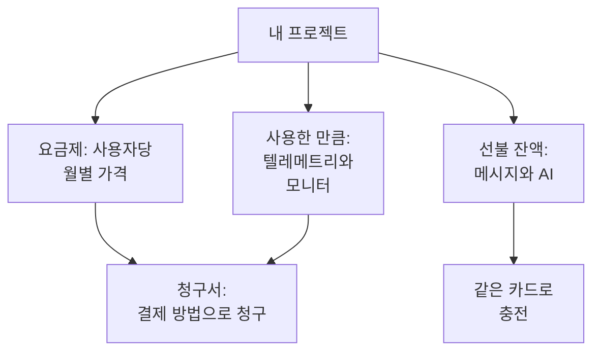

# 결제 및 사용량

OneUptime Cloud에서 프로젝트는 사용자당 요금제 비용과 사용한 만큼의 비용을 냅니다. 사용한 만큼이란 텔레메트리, 활성 모니터, 그리고 선불 잔액에서 지불하는 메시지와 AI 작업입니다. 이 페이지에서는 각각을 어디에서 보고 바꾸는지, 누가 할 수 있는지 설명합니다. 자체 호스팅 설치에는 결제도, 이 페이지들도 없습니다.

:::cards
- [요금제와 좌석](#요금제와-좌석): 요금제 비용과 좌석으로 계산되는 사람.
- [결제 방법](#결제-방법): 청구서가 청구되는 카드.
- [청구서](#청구서): 결제하고, 다운로드하고, 사용한 내역을 확인합니다.
- [선불 잔액](#선불-잔액): 메시지와 AI. 직접 또는 자동으로 충전합니다.
:::

## 프로젝트가 내는 비용

| 항목 | 가격 책정 방식 |
| --- | --- |
| 요금제 | 사용자당 월별 가격이며, 월간 또는 연간으로 청구됩니다. 프로젝트의 모든 사람이 각각 좌석입니다. |
| 텔레메트리 | 수집한 GB당 $0.10이며, 보존 기간은 15일입니다. 보존 기간이 길수록 비용이 더 들고, 7일 미만의 보존은 7일로 청구됩니다. [보존 비용](/docs/telemetry/data-retention#보존-비용)을 참조하세요. |
| 세션 리플레이 | GB당 $2이며, 보존 기간은 15일입니다. |
| 활성 모니터 | 모니터당 월 $1. 수동 모니터를 제외한 모든 모니터는 꺼져 있어도 활성입니다. |
| SMS, 전화, WhatsApp, Telegram | 메시지를 보낼 때마다 프로젝트 잔액에서 지불됩니다. |
| OneUptime AI | 자체 LLM 공급자에서 실행하지 않는 한 프로젝트의 AI 크레딧에서 지불됩니다. |

[가격 페이지](https://oneuptime.com/pricing)에서 요금제를 비교할 수 있습니다.

## 시작하기 전에

- **OneUptime Cloud.** **프로젝트 설정**의 **결제 및 청구서** 섹션은 OneUptime Cloud에만 있으며 처음에는 접혀 있습니다. 제목을 클릭해 엽니다.
- **결제를 읽을 수 있는 역할.** Project Owner, **Manage Billing** 권한이 있는 사람, 그리고 세 가지 결제 역할은 모든 결제 페이지를 읽습니다. [누가 무엇을 할 수 있는지](#누가-무엇을-할-수-있는지)를 참조하세요.

## 요금제와 좌석

**프로젝트 설정 → 결제 및 청구서 → 결제**로 이동합니다. **현재 요금제** 카드에는 프로젝트의 요금제와 사용자당 가격, 그리고 **좌석**이 표시됩니다. 좌석은 프로젝트의 사람마다 하나입니다.

사람은 초대한 순간부터, 수락하기 전에도, 제거할 때까지 좌석으로 계산됩니다. 좌석 수를 바꾸려면 사람을 초대하거나 제거하세요. [사람 초대](/docs/permissions/inviting-people)를 참조하세요.

## 요금제 변경하기

:::steps
### 먼저 결제 수단 추가

요금제를 변경하려면 결제 수단이 필요합니다. 결제 수단이 없으면 **Change Plan**이 대신 **Add a Payment Method**를 엽니다. [결제 방법](#결제-방법)을 참조하세요.

### Change Plan 클릭

**현재 요금제** 카드에서 **Change Plan**을 클릭합니다. **연간 플랜**은 처음에 켜져 있습니다. 월간 가격을 보려면 끄세요.

### 요금제 선택

각 요금제에는 사용자당 가격이 표시됩니다. 요금제 아래의 안내에는 평가판이 어떻게 되는지 나옵니다. 프로젝트가 아직 평가판 기간이면 **Your free trial carries over**, 그렇지 않으면 **Changing plan does not start a free trial**입니다.

### 변경 저장

**변경 사항 저장**을 클릭합니다. 유료 요금제는 변경한 순간부터 청구되며, 그 요금제에서 초대하는 모든 사람은 초대할 때 청구됩니다.
:::

API 키에는 Growth 이상의 요금제가 필요하며, Scale 요금제 미만에서는 SCIM 연결이 사람을 제거하는 것만 할 수 있습니다. 이들을 멈추는 요금제는 선택하기 전에 몇 개가 해당되는지 알려 주며, 멈춰 있는 동안 **결제** 페이지에 **이 요금제에 포함되지 않음**이 표시됩니다. 아무것도 삭제되지 않으며, 이들을 포함하는 요금제에서 다시 작동합니다.

> [!NOTE]
> 리셀러나 클라우드 마켓플레이스(AWS Marketplace, Microsoft Marketplace, Google Cloud Marketplace 또는 Vercel Marketplace)를 통해 OneUptime을 구매했나요? **결제** 페이지에 그렇게 표시됩니다. 리셀러는 요금제를 대신 변경해 주며, 마켓플레이스는 프로젝트의 요금제와 사용량을 클라우드 청구서에 청구합니다.

## 결제 방법

**결제 방법** 카드에는 프로젝트에 등록된 카드가 나열됩니다. 청구서는 기본 카드로 자동 청구됩니다.

:::steps
### 결제 수단 추가 클릭

**결제 방법** 카드에서 **결제 수단 추가**를 클릭합니다.

### 카드 입력

결제 정보를 입력하고 **Save payment method**를 클릭합니다. 추가한 결제 수단이 기본값이 되며, 추가하면 사용량 기반 결제가 활성화됩니다. 요금제는 바뀌지 않습니다.
:::

- **기본값으로 설정**은 목록의 다른 결제 수단을 청구서가 청구되는 수단으로 만듭니다.
- 기본 결제 수단의 **Re-sync Autopay**는 여전히 이전 카드로 청구되는 갱신을 바로잡습니다.
- 프로젝트에는 결제 수단이 최소 하나 남아 있어야 합니다. 마지막 수단을 삭제하기 전에 다른 수단을 추가하세요.

## 청구지 주소와 청구서 이메일

**비즈니스 세부 정보 / 청구 주소** 카드에는 청구서에 표시되는 여러분의 정보가 들어 있습니다. **업데이트**를 클릭하고 두 단계를 채웁니다.

| 단계 | 필드 |
| --- | --- |
| **청구지 주소** | **비즈니스 세부 정보 / 청구 주소**: 회사의 법적 이름, 주소, VAT 또는 세금 ID. **국가**: 청구 국가. |
| **청구서** | **재무 / 회계 이메일**: 청구서, 영수증, 결제 메시지를 받을 곳이며, 여러 주소는 쉼표로 구분합니다. **이메일로 인보이스 전송**: 청구서가 발행되는 즉시 그곳으로 보냅니다. |

## 청구서

**프로젝트 설정 → 결제 및 청구서 → 청구서**에는 프로젝트의 청구서가 **청구서 번호**, **청구서 날짜**, **금액**, **청구서 상태**와 함께 나열됩니다.

- **청구서 결제**로 아직 결제되지 않은 청구서를 결제합니다.
- **다운로드**로 청구서를 PDF로 엽니다. 아직 결제되지 않은 청구서에서는 행 메뉴(**⋯**) 안에 있습니다.

은행이 아직 결제를 처리 중이면 OneUptime이 그렇게 알려 줍니다. 일부 은행은 카드 결제를 확인하는 데 최대 2일이 걸리며, 청구서는 저절로 업데이트됩니다. 다시 결제하지 마세요.

## 사용 기록

**프로젝트 설정 → 결제 및 청구서 → 사용 기록**에는 프로젝트가 보낸 텔레메트리가 제품, 서비스, 날짜마다 한 행씩 표시됩니다.

| 열 | 표시 내용 |
| --- | --- |
| **제품** | 로그, 트레이스, 메트릭 및 기타 종류의 텔레메트리. |
| **일** | 보낸 날짜. |
| **서비스** | 보낸 서비스, 또는 호스트, 클러스터나 기타 리소스. |
| **수집된 데이터(GB)** | 들어온 양. |
| **데이터 보존(일)** | 보존되는 기간. |
| **총 비용** | 든 비용(미국 달러). |

하루의 사용량은 그날이 끝나면 표시됩니다. 늘어난 것을 찾으려면 **제품**, **일**, **서비스**로 필터링하세요.

## 선불 잔액

SMS, 전화, WhatsApp 및 Telegram 메시지는 프로젝트 잔액에서, OneUptime AI는 AI 크레딧에서 지불됩니다. 각각 미리 충전합니다.

| 잔액 | 위치 |
| --- | --- |
| SMS, 전화, WhatsApp, Telegram | **프로젝트 설정 → 알림 → 알림 설정** |
| OneUptime AI | **프로젝트 설정 → AI → AI 크레딧** |

:::steps
### 지금 충전

페이지의 **현재 잔액** 카드에서 **잔액 충전**을 클릭합니다. $20에서 $1,000 사이의 금액을 입력하고 **충전**을 클릭합니다. 금액은 프로젝트의 카드로 청구됩니다.

### 또는 자동으로 충전

**자동 충전** 카드에서 **자동 충전 편집**을 클릭하고 **자동 충전 활성화**를 켭니다. 처음에는 꺼져 있습니다. 켜 두면 잔액이 $10까지 떨어질 때마다 OneUptime이 $20을 추가합니다. 금액은 원하는 대로 정할 수 있습니다.
:::

잔액으로 지불할 수 없으면 메시지가 전송되지 않거나 OneUptime AI가 멈추고, 프로젝트 소유자에게 이메일이 갑니다. [호출이 전송되지 않는 경우](/docs/on-call/escalation-rules#호출이-전송되지-않는-경우)와 [AI 크레딧이 떨어졌을 때](/docs/ai/ai-sre#ai-크레딧이-떨어졌을-때)를 참조하세요.

## 누가 무엇을 할 수 있는지

| 하려는 일 | 필요한 것 |
| --- | --- |
| 결제 페이지 읽기: 요금제, 청구서, 사용량, 잔액, 결제 방법 | Project Owner, **Manage Billing**, **Billing Admin**, **Billing Member** 또는 **Billing Viewer** |
| 청구서 다운로드 | Project Owner, Project Admin, **Manage Billing**, **Read Invoices**, **Billing Admin** 또는 **Billing Member** |
| 청구지 주소와 청구서 이메일 변경 | Project Owner, **Manage Billing**, **Billing Admin** 또는 **Billing Member** |
| SMS, 전화, WhatsApp 또는 Telegram 켜기 및 끄기 | Project Owner, **Manage Billing** 또는 **Billing Admin** |
| 결제 수단 추가 | Project Owner, **Manage Billing** 또는 **Create Payment Method** |
| 청구서 결제 | Project Owner, **Manage Billing** 또는 **Edit Invoices** |
| 요금제 변경, 잔액 충전, 자동 충전 변경 | Project Owner 또는 **Manage Billing** |

사용할 수 없는 버튼은 잠긴 상태로 표시되며 누가 사용할 수 있는지 알려 줍니다. 결제 역할은 [사용자, 팀 및 권한](/docs/permissions/index#팀)을 참조하세요.

## 요금제가 필요한 설정

OneUptime Cloud에서는 다음 관리 설정에 요금제가 필요합니다. 가입하지 않은 요금제의 페이지에는 기능이 하는 일과 필요한 요금제가 표시됩니다.

| 설정 | 필요한 요금제 |
| --- | --- |
| 레이블 | Growth |
| API 키 | Growth |
| 자체 SMTP 서버와 Twilio 계정 | Growth |
| 자체 LLM 공급자 | Growth |
| MCP 클라이언트 연결 | Growth |
| 팀 만들기 | Scale |
| SSO, OIDC, SCIM | Scale |
| 보존 기간 재정의 | Scale |
| 감사 로그 | Enterprise |

## 요금제 해지

프로젝트 비용을 그만 내려면 프로젝트를 삭제하세요. 삭제되면 청구가 멈춥니다. [프로젝트 삭제](/docs/configuration/project-settings#프로젝트-삭제)를 참조하세요. 리셀러를 통해 구매한 프로젝트는 리셀러에게서, 클라우드 마켓플레이스를 통해 구매한 프로젝트는 마켓플레이스에서 해지합니다.

## 문제 해결

:::details "Add a payment method in Project Settings > Billing and Invoices > Billing before using paid monitoring or telemetry"
Free 요금제 프로젝트는 활성 모니터를 만들거나 텔레메트리를 보내기 전에 결제 수단이 있어야 합니다. 이들은 사용한 만큼 비용을 내기 때문입니다. [결제 방법](#결제-방법)에서 추가하세요. 수동 모니터는 계속 무료입니다.
:::

:::details 미결제 청구서가 있다는 빨간 배너가 표시됨
미결제 청구서가 있는 프로젝트는 비활성화되며, 계속 미결제 상태이면 삭제됩니다. **청구서**를 열고 아직 결제되지 않은 각 청구서에서 **청구서 결제**를 클릭하세요.
:::

:::details Change Plan을 누르면 Add a Payment Method가 열림
프로젝트에 아직 결제 수단이 없습니다. 결제 수단을 추가한 다음 요금제를 변경하세요.
:::

:::details 사용 기록이 비어 있음
사용량은 하루 단위로 집계되며, 하루가 끝나면 표시됩니다. 텔레메트리를 보내지 않은 프로젝트에는 행이 없습니다.
:::

## 다음 단계

:::cards
- [프로젝트 설정](/docs/configuration/project-settings): 프로젝트 전체에 적용되는 그 밖의 모든 것.
- [사람 초대](/docs/permissions/inviting-people): 좌석을 쓸 사람을 추가합니다.
- [데이터 보존](/docs/telemetry/data-retention): 텔레메트리를 필요한 만큼만 보존합니다.
- [드롭 필터 및 스크럽 규칙](/docs/telemetry/drop-filters-and-scrub-rules): 쓰지 않는 텔레메트리에 비용을 내지 마세요.
:::
