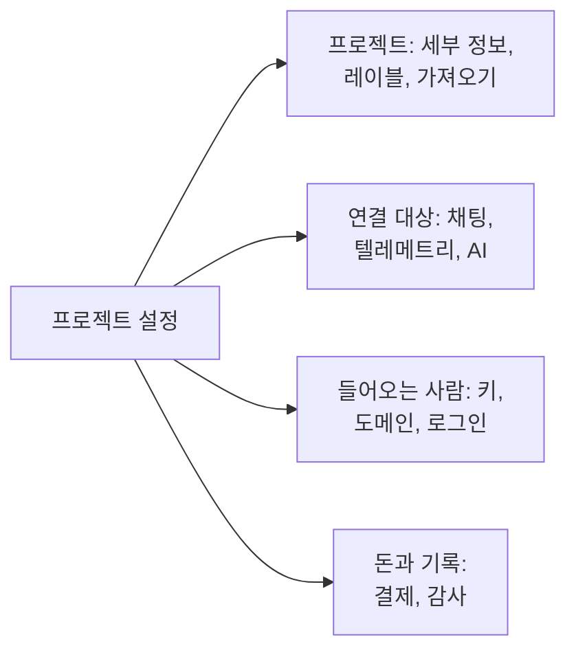

# 프로젝트 설정

프로젝트 설정에는 프로젝트 전체에 적용되는 것이 모여 있습니다. 이름, 연결된 도구, 키, 사람들이 로그인하는 방식, 결제, 감사 기록입니다. 대부분은 한 번 설정하면 다시 볼 일이 거의 없습니다. 이 페이지는 그 전체 지도이며, 별도 페이지가 없는 설정인 프로젝트 세부 정보, 레이블, 기능 플래그, 프로젝트 삭제를 다룹니다.

:::cards
- [설정 찾기](#설정-찾기): 측면 메뉴의 각 섹션에 있는 것.
- [프로젝트 세부 정보](#프로젝트-세부-정보): 이름, ID, 지원팀 액세스.
- [레이블](#레이블): 리소스, 권한, 규칙을 위한 태그.
- [프로젝트 삭제](#프로젝트-삭제): 필요한 것과 함께 사라지는 것.
:::

## 프로젝트 설정 열기

**제품 → 설정 → 프로젝트 설정**으로 이동합니다. 측면 메뉴는 페이지를 섹션으로 묶으며, 처음에는 **기본**만 열려 있습니다. 섹션 제목을 클릭하면 열립니다. 섹션 안의 어느 페이지에서든 그 섹션은 저절로 열립니다.

## 시작하기 전에

- **프로젝트를 변경할 수 있는 역할.** 이 설정 대부분은 Project Owner와 Project Admin이 변경합니다. 결제, 알림 채널, 프로젝트 삭제에는 각 섹션에 적힌 대로 더 많은 권한이 필요합니다.
- **OneUptime Cloud에서는 해당 설정이 포함된 요금제.** 일부 설정에는 요금제가 필요합니다. [요금제가 필요한 설정](/docs/configuration/billing#요금제가-필요한-설정)을 참조하세요.

## 설정 찾기

| 섹션 | 페이지 | 자세히 읽기 |
| --- | --- | --- |
| **기본** | **프로젝트**, **레이블** | [프로젝트 세부 정보](#프로젝트-세부-정보), [레이블](#레이블) |
| **워크스페이스** | **Slack**, **Microsoft Teams**, **Video Calls** | [Slack](/docs/workspace-connections/slack), [Microsoft Teams](/docs/workspace-connections/microsoft-teams), [화상 통화](/docs/workspace-connections/video-calls) |
| **텔레메트리 및 APM** | **수집 키**, **데이터 보존** | [수집 키](/docs/telemetry/ingestion-keys), [데이터 보존](/docs/telemetry/data-retention) |
| **알림** | **알림 설정**, **알림 로그**, **모바일 앱** | [알림](#알림) |
| **AI** | **AI Features**, **LLM 공급자**, **외부 MCP 서버**, **AI 크레딧**, **AI 로그**, **MCP 서버** | [LLM 공급자](/docs/ai/llm-provider), [외부 MCP 서버](/docs/ai/external-mcp-servers), [MCP 서버](/docs/ai/mcp-server), [AI SRE](/docs/ai/ai-sre#비용-관리) |
| **고급** | **도메인**, **API 키**, **기능 플래그**, **다른 도구에서 가져오기** | [사용자 지정 도메인](/docs/status-pages/branding-and-domains#사용자-정의-도메인), [API 키](/docs/permissions/index#api-키), [기능 플래그](#기능-플래그), [Opsgenie에서 이전](/docs/moving-to-oneuptime/opsgenie) 및 기타 이전 가이드 |
| **보안** | **SSO**, **SCIM** | [SSO](/docs/identity/sso), [SCIM](/docs/identity/scim) |
| **결제 및 청구서** | **결제**, **사용 기록**, **청구서** | [결제 및 사용량](/docs/configuration/billing) |
| **감사 로그** | **감사 로그**, **설정**, **내보내기** | [감사 로그](/docs/configuration/audit-logs), [감사 로그 내보내기](/docs/configuration/audit-log-export) |
| **위험 영역** | **위험 영역** | [프로젝트 삭제](#프로젝트-삭제) |

**결제 및 청구서**와 **AI 크레딧**은 OneUptime Cloud에만 있습니다. 자체 호스팅 설치에는 결제가 없습니다.

## 프로젝트 세부 정보

**프로젝트 설정 → 기본 → 프로젝트**에는 카드가 두 개 있습니다.

**프로젝트 세부 정보**에는 프로젝트의 이름과 ID가 표시됩니다.

- **프로젝트 이름**: 프로젝트 이름을 바꾸려면 **프로젝트 편집**을 클릭합니다. 이름은 2자 이상입니다. 이름을 바꾸려면 Project Owner이거나 프로젝트를 편집하거나 결제를 관리할 권한이 있어야 합니다.
- **프로젝트 ID**: API, CLI, Terraform에 쓰거나 지원팀에 문의할 때 복사합니다.
- **Data Residency**: OneUptime Cloud에서 OneUptime이 기록한, 프로젝트 데이터가 보관되는 위치. OneUptime만 설정합니다.

**고객 지원 액세스**는 OneUptime Cloud에서 OneUptime 지원팀이 프로젝트를 열 수 있는지 결정합니다. 도움이 필요하면 **OneUptime 지원팀의 이 프로젝트 액세스 허용**을 켭니다. 지원팀이 프로젝트의 모든 것을 보고 변경할 수 있게 되므로 OneUptime이 먼저 확인을 요청하며, 그때 **지원팀 허용**을 클릭합니다. 지원이 끝나면 끕니다. 변경은 바로 저장됩니다. Project Owner와 Project Admin이 이것을 변경합니다.

## 레이블

레이블은 모니터, 인시던트, 상태 페이지 및 기타 리소스에 붙이는 태그입니다. 목록을 필터링하고 그룹으로 묶으며, 팀의 권한과 프로젝트 규칙이 미치는 범위를 제한합니다.

:::steps
### 레이블 열기

**프로젝트 설정 → 기본 → 레이블**로 이동합니다.

### 레이블 만들기

**레이블 만들기**를 클릭합니다. **이름**과, 원하면 **설명**을 입력합니다. **레이블 색상**에는 페이지의 어떤 레이블도 아직 쓰지 않는 색이 이미 선택되어 있습니다. 원하면 다른 색을 고르세요. **레이블 만들기**를 클릭해 저장합니다.
:::

OneUptime Cloud에서 레이블을 만들고 변경하려면 Growth 요금제가 필요합니다. 레이블이 권한을 제한하는 방식은 [레이블](/docs/permissions/index#라벨)을, 리소스가 만들어질 때 레이블을 붙이는 방법은 [레이블 및 소유자 규칙](/docs/configuration/label-and-owner-rules)을 참조하세요.

목록에서는 레코드의 레이블이 위아래로 하나씩 표시됩니다. 네 개를 넘으면 처음 세 개와 나머지를 보여 주는 링크가 표시됩니다. 레이블이 나열되는 모든 곳(목록, 레코드 페이지, 모든 레이블 선택기)에서 레이블은 자연스러운 순서로 놓입니다. 이름이 숫자로 시작하는 레이블이 그 숫자의 순서대로 먼저 오고(`2. Team`이 `10. Owner`보다 앞), 그다음 나머지 레이블이 대소문자와 관계없이 알파벳순으로 옵니다. 레이블의 순서를 정하려면 `1. Category`, `2. Subcategory`처럼 이름을 숫자로 시작하세요.

### 레이블 보관

레이블 사용을 중단하려면 삭제하는 대신 행의 **⋯** 메뉴에서 보관하세요. 레이블이 붙은 항목은 그대로 유지되고 계속 필터로 사용할 수 있지만, 더 이상 어디에도 추가할 수 없습니다. 모든 레이블 선택기에서 제외되며 API, Terraform, MCP는 거부합니다. 대화 상자에는 이 레이블을 사용하도록 설정된 규칙과 권한이 표시되며, 이들은 변경하기 전까지 계속 레이블을 사용합니다. 보관된 레이블은 접힌 섹션 **보관된 레이블**에 따로 표시되며, **보관 취소**로 되돌릴 수 있습니다. **삭제**는 먼저 레이블이 제거될 항목을 모두 보여 주고 **대신 보관**를 제안합니다.

## 알림

**프로젝트 설정 → 알림**에서는 프로젝트가 알림을 보내는 방식을 정합니다.

- **알림 설정**: **알림 채널** 카드에서 프로젝트의 SMS, 전화, WhatsApp, Telegram을 켜거나 끕니다. 처음에는 모두 꺼져 있습니다. Project Owner, **Billing Admin**, 또는 **Manage Billing** 권한이 있는 사람이 켭니다. 이 페이지에는 **사용자 지정 SMTP 구성**에 있는 프로젝트 자체 메일 서버([SMTP](/docs/emails/smtp) 참조)와 프로젝트 자체 Twilio 계정([Twilio 통합](/docs/self-hosted/twilio-integration) 참조)도 있습니다. OneUptime Cloud에서는 이 메시지들의 비용을 내는 잔액도 여기 있습니다. [선불 잔액](/docs/configuration/billing#선불-잔액)을 참조하세요.
- **알림 로그**: 프로젝트가 보낸 모든 알림. 채널마다 탭이 있습니다: **이메일**, **SMS**, **WhatsApp**, **Telegram**, **웹훅**, **호출**, **푸시**, **워크스페이스**.
- **모바일 앱**: iOS 및 Android 앱을 받는 곳. [앱 개요](/docs/mobile-desktop-apps/index)를 참조하세요.

## 기능 플래그

**프로젝트 설정 → 고급 → 기능 플래그**에서는 프로젝트의 선택 기능을 켜거나 끕니다. 각각은 전환하는 즉시 저장되는 스위치입니다. 현재 이 페이지에는 **모니터 그룹**이 있으며, 새 프로젝트에서는 꺼져 있습니다. 켜면 모니터 메뉴에 모니터 그룹이 추가됩니다. 꺼도 그룹은 삭제되지 않습니다. [모니터 그룹](/docs/monitor/monitor-groups)을 참조하세요.

## 프로젝트 삭제

프로젝트를 삭제하면 모든 구성원에게서 그 안의 모든 것이 삭제됩니다. 모니터, 인시던트, 상태 페이지, 온콜 설정, 텔레메트리입니다. 되돌릴 방법은 없습니다.

:::steps
### 위험 영역 열기

**프로젝트 설정 → 위험 영역**으로 이동합니다.

### 삭제 버튼 클릭

**프로젝트 삭제**를 클릭합니다. 확인을 요청하는 대화 상자가 열립니다.

### 프로젝트 이름 입력

이름을 정확히 그대로 입력합니다. 입력할 때까지 **프로젝트 삭제**는 잠겨 있습니다. OneUptime Cloud에서는 대화 상자가 떠나는 이유도 묻습니다. 답변은 선택 사항입니다.

### 확인

**프로젝트 삭제**를 클릭합니다. OneUptime이 프로젝트를 삭제하고 여러분을 프로젝트에서 내보냅니다.
:::

> [!CAUTION]
> 프로젝트 삭제는 되돌릴 수 없습니다. Project Owner이거나 프로젝트를 삭제할 권한이 있어야 합니다.

OneUptime Cloud에서는 프로젝트를 삭제하는 것으로 프로젝트의 요금제를 해지합니다. 프로젝트가 삭제되면 청구가 멈춥니다. 클라우드 마켓플레이스를 통해 청구되는 프로젝트는 사용량에 대한 마지막 요금이 청구되며, 마켓플레이스에서의 구매는 그곳에서 해지할 때까지 유지됩니다.

## 문제 해결

:::details 측면 메뉴의 섹션이 없어 보임
**기본**을 제외한 모든 섹션은 처음에 접혀 있습니다. 섹션 제목을 클릭해 여세요. 자체 호스팅 설치에는 **결제 및 청구서** 섹션도 **AI 크레딧** 페이지도 없습니다.
:::

:::details 프로젝트 편집이 잠겨 있음
이름을 바꾸려면 Project Owner이거나 프로젝트를 편집하거나 결제를 관리할 권한이 있어야 합니다. 잠긴 버튼에 부족한 권한이 표시됩니다.
:::

:::details 대화 상자에서 프로젝트 삭제가 계속 잠겨 있음
대화 상자에 표시된 그대로 프로젝트 이름을 정확히 입력하세요. 대문자와 소문자를 구분합니다.
:::

## 다음 단계

:::cards
- [사람 초대](/docs/permissions/inviting-people): 팀을 프로젝트에 데려옵니다.
- [결제 및 사용량](/docs/configuration/billing): 요금제, 결제 방법, 청구서, 사용량.
- [감사 로그](/docs/configuration/audit-logs): 프로젝트에서 누가 무엇을 바꿨는지 봅니다.
- [SSO](/docs/identity/sso): 사람들이 ID 공급자로 로그인하게 합니다.
:::
