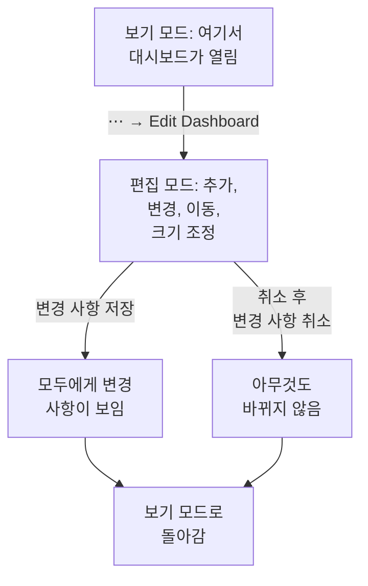

# 대시보드 작성

대시보드를 만들려면 **제품 → 대시보드**를 열고 **대시보드 만들기**를 클릭합니다. **대시보드 만들기** 대화 상자는 어떻게 시작할지 묻고, 그다음 이름을 묻습니다. **처음부터 시작**은 빈 대시보드를 만들고, 템플릿은 위젯을, 그리고 대개 변수도 대신 만들어 주며 이름도 채워 줍니다(프로젝트에 이미 같은 이름이 있으면 "Kubernetes Dashboard 2"처럼 번호가 붙습니다). **대시보드 만들기**를 클릭하면 새 대시보드가 열립니다. 빈 대시보드는 캔버스로 열리며, 첫 위젯을 위한 **위젯 추가** 버튼이 있습니다.

:::cards
- [대시보드 생성](#대시보드-생성): 처음부터 또는 템플릿에서 시작합니다.
- [편집과 저장](#편집과-저장): 변경 사항 저장을 클릭하기 전까지는 누구에게도 아무것도 바뀌지 않습니다.
- [위젯 추가](#위젯-추가): 카탈로그에서 고르고, 설정하고, 배치합니다.
- [급증 구간 확대](#급증-구간-확대): 차트를 드래그해 그 순간의 대시보드 전체를 읽습니다.
:::

## 시작하기 전에

프로젝트 소유자와 관리자는 모든 대시보드를 만들고 편집할 수 있습니다. 그 밖의 사용자에게는 팀 권한이 필요합니다. 대시보드를 만들려면 `CreateDashboard`, 변경하려면 `EditDashboard`가 필요합니다. 프로젝트 멤버와 뷰어는 둘 중 어느 것도 없이 대시보드를 읽을 수 있습니다. 대시보드를 편집할 수 없는 사람도 **⋯** 메뉴는 열 수 있지만, 그곳의 **대시보드 편집**은 잠겨 있으며 필요한 권한을 알려 줍니다.

## 대시보드 생성

:::steps
### 시작 방법 고르기

**제품 → 대시보드**를 열고 **대시보드 만들기**를 클릭합니다. **대시보드 만들기** 대화 상자는 **처음부터 시작**에서 시작합니다. 직접 위젯을 추가할 빈 대시보드입니다. 그 아래 **또는 템플릿에서 시작**에 **추천** 템플릿 6개가 표시됩니다.

### 템플릿 고르기

템플릿을 클릭하면 무엇이 추가되는지 볼 수 있습니다. **위젯 추가**에서 부르는 이름 그대로의 위젯과, 도구 모음에서 범위를 좁히는 변수입니다. 다른 템플릿은 검색 상자 옆에서 카테고리나 **모든 템플릿**을 고르거나, **템플릿 검색…** 상자에 입력해 찾습니다. 입력한 모든 단어가 일치해야 합니다. 그런 다음 **이 템플릿 사용**을 클릭하거나 템플릿을 두 번 클릭합니다. 검색 상자에서는 화살표 키로 템플릿을 고르고 **Enter** 키로 사용합니다.

### 대시보드 이름 지정

템플릿의 이름은 이미 채워져 있으며, 프로젝트에 있는 이름 다음 번호가 붙습니다. **처음부터 시작**은 이름이 비어 있으니 입력하세요. 설명은 선택 사항으로 **추가 필드** 아래에 접혀 있으며, 나중에 대시보드의 **개요** 페이지에서 추가할 수도 있습니다. **뒤로**를 누르면 떠날 때 그대로의 템플릿으로 돌아갑니다.

### 만들기

**대시보드 만들기**를 클릭합니다. 새 대시보드가 열립니다. 템플릿이면 바로 위젯이 보이고, 그렇지 않으면 **위젯 추가**가 있는 빈 캔버스가 보입니다.
:::

선택기에서 묶어 보여 주는 카테고리별 템플릿은 다음과 같습니다.

| 카테고리 | 템플릿 |
| --- | --- |
| 모니터링 및 APM | Monitor Dashboard, Metrics Dashboard, Real User Monitoring Dashboard, SLO Dashboard |
| 인시던트 대응 | Incident Dashboard, Alert Dashboard |
| 인프라 | Kubernetes Dashboard, Kubernetes Cost Dashboard, Hosts Dashboard, Proxmox Dashboard, VMware Dashboard, Ceph Dashboard, Storage Array Dashboard, Docker Swarm Dashboard, Network Dashboard |

**추천**에는 Monitor Dashboard, Incident Dashboard, Alert Dashboard, Kubernetes Dashboard, Hosts Dashboard, Metrics Dashboard가 있습니다. 템플릿은 출발점일 뿐 연결이 아닙니다. 대시보드를 만든 뒤에는 원하는 대로 바꾸세요. 나중에 템플릿이 대시보드를 업데이트하는 일은 없습니다.

## 편집과 저장

대시보드는 읽기용 보기 모드로 열립니다. 바꾸려면 툴바의 **⋯** 메뉴를 열고 **대시보드 편집**을 고릅니다. 툴바의 이름 옆에 **편집 중**이 표시되고, 시간 범위와 다른 컨트롤이 **위젯 추가**, **변수**, **취소**, **변경 사항 저장**으로 바뀝니다. 그 아래에는 대시보드의 **기본 기간**과 **기본 자동 새로고침**을 정하는 줄이 나타납니다.

변경 사항은 저장하기 전까지 나만 볼 수 있습니다. 편집하는 동안에는 아무것도 저장되지 않으므로, 다른 사람에게는 대시보드가 원래대로 보입니다.

- **변경 사항 저장**은 위젯, 위치와 크기, 변수, 기본 기간과 자동 새로 고침을 한꺼번에 저장하고 보기 모드로 돌아갑니다. 예를 들어 그사이 권한을 잃어서 저장이 거부되면, 변경 사항을 유지한 채 편집 모드에 머무르고 그리드 위에 이유가 표시됩니다.
- **취소**는 변경 사항을 버리므로 먼저 묻습니다. **변경 사항 취소**는 저장된 대시보드로 돌아가고, **계속 편집**은 작업으로 돌아갑니다.

편집하는 동안에는 자동 새로 고침이 일시 중지되고, 확대한 시간 범위는 선택해 둔 범위로 돌아갑니다.

## 위젯 추가

:::steps
### 위젯 카탈로그 열기

**위젯 추가**를 클릭합니다. 편집 중이면 툴바에, 빈 대시보드면 캔버스에 있습니다. 카탈로그는 위젯을 보여 주는 내용별로 묶어 둡니다. 검색 상자에 입력해 이름이나 용도로 찾고("error budget", "pods"), Enter 키를 누르면 첫 번째 결과가 추가됩니다.

### 위젯 고르기

클릭합니다. 위젯은 그리드에서 들어갈 수 있는 첫 번째 빈 자리에 놓이고, 설정이 열립니다.

### 표시할 내용 설정

설정 대화 상자는 설정 위에 위젯의 **Live Preview**를 보여 주며, 미리 보기는 변경할 때마다 따라옵니다. 위젯이 읽을 내용(메트릭 쿼리, 필터, 텍스트)과 모양을 고른 다음 **완료**를 클릭합니다.

### 배치하기

위젯을 끌어서 옮기고, 가장자리나 모서리를 끌어서 크기를 조정합니다. [그리드 위의 위젯](#그리드-위의-위젯)을 참고하세요.
:::

[대시보드 위젯](/docs/dashboards/widgets)에서 모든 위젯과 그 설정을 설명합니다.

## 그리드 위의 위젯

캔버스는 너비가 열두 열인 그리드입니다. 위젯은 그리드에 맞춰 붙고, 행을 추가할수록 페이지가 아래로 늘어납니다. 위젯을 끄는 동안에는 점선 윤곽이 놓일 위치를 열과 행과 함께 보여 주고, 크기를 조정하는 동안에는 윤곽이 그리드 단위의 크기를 보여 줍니다. 방해되는 위젯은 옆으로 비켜나므로, 위젯 두 개가 겹치는 일은 없습니다.

위젯 종류마다 최소 크기가 있어서 그리는 내용을 읽을 수 있게 유지됩니다. 차트는 너비가 최소 여섯 열, 높이가 최소 세 행이고, 숫자 하나는 한 칸에 들어갑니다.

나중에 위젯을 바꾸려면 편집 중에 위젯을 클릭합니다. 설정이 다시 열리고, 아래쪽에 버튼 두 개가 더 있습니다.

- **Duplicate Widget**은 같은 설정의 복사본을 첫 번째 빈 자리에 추가합니다.
- **위젯 삭제**는 확인을 거친 뒤 위젯을 제거합니다.

## 시간 범위와 자동 새로 고침

보기 모드에서 툴바의 시간 범위 선택기는 모든 차트, 숫자, 로그, 트레이스 위젯이 읽는 구간을 정합니다. 최근 5분부터 최근 3개월까지의 프리셋이나, 사용자 지정 시작과 끝을 고르세요. 대시보드는 기본 기간으로 열립니다. 편집하는 사람이 다른 기간을 정하지 않으면 최근 한 시간입니다.

인시던트, 경고, 모니터, 리소스 목록은 시간 범위와 상관없이 현재 상태를 보여 줍니다.

시간 범위 옆의 자동 새로 고침 메뉴는 5초, 10초, 30초, 1분, 5분, 15분마다 모든 위젯을 다시 읽고, 다음 새로 고침까지 카운트다운을 보여 줍니다. 조사하는 동안에는 화면이 멈춰 있도록 꺼 두세요. 대시보드는 기본 자동 새로 고침으로 열립니다. 편집하는 사람이 다른 간격을 정하지 않으면 꺼져 있습니다.

시간 범위 선택기, 변수, 자동 새로 고침은 대시보드에 위젯이 하나라도 있으면 나타납니다.

### 대시보드의 기본값

대시보드를 편집하는 동안에는 툴바 버튼 아래의 줄에서 모두가 대시보드를 열 때의 설정을 정합니다. **기본 기간**은 최근 5분부터 최근 3개월까지의 프리셋 중에서 고르고, **기본 자동 새로고침**도 같은 줄에서 고릅니다. **변경 사항 저장**은 이 값들을 대시보드의 나머지와 함께 저장하며, 팀과 공개 링크의 방문자 모두에게 똑같이 적용됩니다. 사용자 지정 시작과 끝은 기본값이 될 수 없습니다. 대시보드가 그 순간에 계속 멈춰 있게 되기 때문입니다. 이 줄은 대시보드에 위젯이 하나라도 있으면 나타납니다.

이 설정이 생기기 전에 저장된 대시보드는 최근 한 시간으로, 원래의 자동 새로 고침 그대로 열립니다. API와 Terraform에서는 둘 다 대시보드의 `dashboardViewConfig`에 있습니다. `timeRange`는 API 참조에 적힌 대로의 프리셋(예: `Past 1 Day`)이고, `refreshInterval`은 `1m` 같은 값입니다. 다른 값은 거부됩니다.

### 직접 고른 설정

보기 모드에서 고른 시간 범위와 자동 새로 고침은 나만의 것이며, 브라우저가 대시보드마다 기억합니다. 새로 고침, 브라우저 재시작, 벽면 스크린 재부팅 후에도 대시보드는 떠날 때 그대로 열립니다. 기억되는 것은 프리셋뿐입니다. 사용자 지정 범위나 확대는 페이지를 떠날 때까지만 유지되므로, 대시보드가 과거의 한 순간에 멈춰 있는 일은 없습니다.

각 선택기의 첫 항목은 기본값 (Past 1 Day)처럼 대시보드의 기본값을 보여 줍니다. 이 항목을 고르면 기본값으로 돌아갑니다. 브라우저는 내 선택을 잊고, 대시보드는 다시 기본값을 따릅니다. 나중에 누군가 기본값을 바꿔도 마찬가지입니다. 직접 새 기본값을 저장하면 바로 그 값이 보입니다.

### 급증 구간 확대

급증을 살펴보려고 시간 범위 선택기를 쓸 필요는 없습니다. 선 차트나 영역 차트에서 궁금한 구간을 드래그하면, 시간 범위 선택기에서 고른 것과 똑같이 **대시보드 전체**가 그 구간으로 이동합니다. 시간 범위를 쓰는 모든 위젯이 함께 쿼리를 다시 실행하므로, 이웃과 축척이 다른 차트 하나가 아니라 대시보드 전체에서 같은 순간을 읽게 됩니다. 실시간 목록은 늘 그렇듯 지금 일어나는 일을 계속 보여 줍니다.

**아무 차트나 더블클릭**하면 되돌립니다. 몇 번을 확대했든 대시보드는 확대를 시작하기 전의 범위로 돌아갑니다. 확대가 활성화되어 있는 동안에는 시간 범위 선택기 옆에 **확대/축소 초기화** 버튼이 나타나며, 확대하지 않은 대시보드를 더블클릭하면 아무 일도 일어나지 않습니다.

확대한 구간은 고정되므로, 자동 새로 고침이 켜져 있어도 앞으로 이동하지 않습니다. 의도된 동작입니다. 조사 도중에 구간이 미끄러져 가는 편이 더 나쁘기 때문입니다. 다시 이동하게 하려면 확대를 초기화하세요.

확대는 보기 모드에서만 작동합니다. 편집 모드에서 드래그하면 위젯을 옮기고 크기를 조정합니다. 막대 차트도 같은 방식으로 확대되며(막대 위를 드래그합니다), 막대 차트를 더블클릭하면 다른 차트처럼 대시보드가 초기화됩니다. 확대는 드래그로만 됩니다. 차트를 그냥 클릭해서는 대시보드의 시간 범위가 바뀌지 않습니다. 같은 동작은 OneUptime 전체의 차트에서 통합니다. [시간 범위 확대](/docs/telemetry/charts-and-time-ranges)를 참고하세요.

## 전체 화면

**⋯ → 전체 화면**은 대시보드의 위젯을 화면 전체에 표시합니다. 벽면 디스플레이나 회의에 좋습니다. Esc 키를 누르면 나갑니다.

## 오래 쓰는 대시보드를 위한 팁

- **대시보드 하나에 주제 하나.** 초점이 분명한 대시보드 몇 개가 모니터링하는 모든 것을 담은 한 페이지보다 낫습니다.
- **가장 중요한 위젯을 맨 위에.** 사람은 위에서 아래로 읽으므로, 가장 먼저 보이는 것이 "정상인가?"에 답하게 하세요.
- **텍스트 위젯으로 섹션에 이름 붙이기.** 몇 행마다 짧은 제목("지연 시간", "오류", "용량")을 두면 방 건너편에서도 페이지를 훑어보기 쉽습니다.
- **복사본 대신 변수 사용.** 두 번째 서비스를 위해 같은 대시보드를 만들려 한다면, 대신 `service` 변수를 추가하세요. [대시보드 변수 및 필터](/docs/dashboards/variables)를 참고하세요.
- **큰 변경 전에 복사본 만들기.** 대시보드의 **설정** 페이지에 있는 **대시보드 복제**로 아이디어를 시험할 안전한 복사본을 만듭니다.

## 다음 단계

:::cards
- [대시보드 위젯](/docs/dashboards/widgets): 모든 위젯, 그 설정, 어떤 것을 고를지.
- [대시보드 변수 및 필터](/docs/dashboards/variables): 서비스, 호스트, 고객마다 대시보드 하나.
- [공유 및 공개 대시보드](/docs/dashboards/sharing): 팀 밖으로 대시보드를 공유합니다.
- [대시보드 설정 및 권한](/docs/dashboards/configuration): 소유자, 레이블, 보관, 그리고 누가 무엇을 할 수 있는지.
:::
