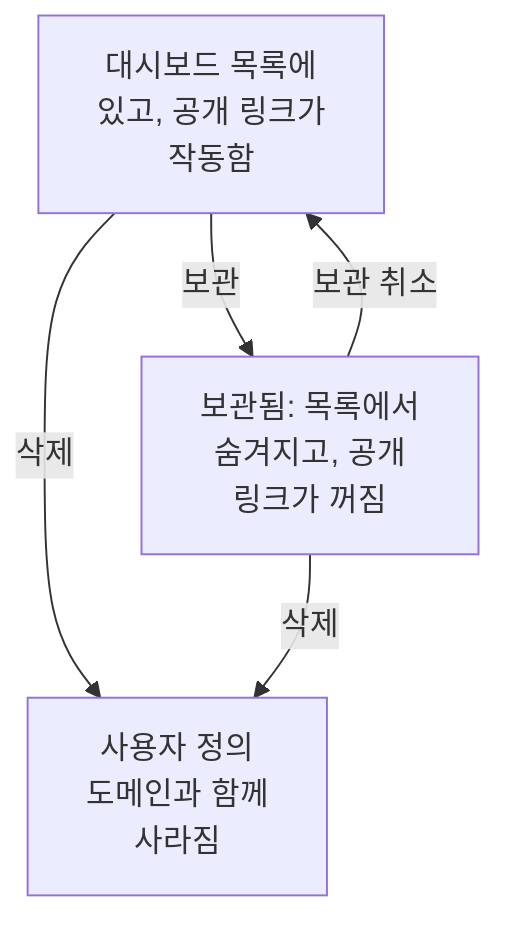

# 대시보드 설정 및 권한

계속 둘 만한 대시보드가 생겼다면, 이 페이지에서 누가 그것을 읽고 바꿀 수 있는지, 소유자와 레이블로 대시보드를 어떻게 정리하는지, 그리고 대시보드를 복사, 내보내기, 보관, 삭제하는 방법을 알아보세요.

:::cards
- [누가 무엇을 할 수 있나](#누가-무엇을-할-수-있나): 각 작업 뒤에 있는 권한과, 그 권한을 가진 사람.
- [소유자](#소유자): 대시보드가 속한 사용자와 팀.
- [대시보드 복제](#대시보드-복제): 번호가 자동으로 붙는 안전한 복사본.
- [대시보드 보관](#대시보드-보관): 삭제하지 않고 대시보드를 치워 둡니다.
:::

## 누가 무엇을 할 수 있나

대시보드는 프로젝트의 [권한](/docs/permissions/index)을 따릅니다. 각 작업에는 팀을 통해 받은 다음 권한 중 하나가 필요합니다.

| 작업 | 필요한 것 |
| --- | --- |
| 대시보드 읽기 | `ReadDashboard` 또는 프로젝트 역할: Project Owner, Project Admin, Project Member, Viewer 또는 Settings 역할 |
| 대시보드 만들기 | `CreateDashboard`, Project Owner 또는 Project Admin |
| 대시보드 변경: 위젯, 변수, 공유, 브랜딩, 그리고 보관 | `EditDashboard`, Project Owner 또는 Project Admin |
| 대시보드 삭제 | `DeleteDashboard`, Project Owner 또는 Project Admin |
| 소유자 추가 및 제거 | 대시보드 소유자 권한, Project Owner, Project Admin 또는 Project Member |
| 사용자 정의 도메인 추가 및 변경 | 대시보드 도메인 권한, Project Owner, Project Admin, Project Member, Settings Admin 또는 Settings Member |
| 소유자 규칙과 레이블 규칙 만들기 | 규칙 권한, Project Owner 또는 Project Admin |

즉 Project Member는 모든 대시보드를 읽지만, 대시보드를 만들려면 `CreateDashboard`와 `EditDashboard`가 필요합니다. 읽기, 편집, 삭제는 각각 팀이 소유한 대시보드나 특정 레이블이 있는 대시보드로 제한할 수 있습니다. [범위: 허용 권한이 미치는 넓이](/docs/permissions/index#범위-허용-권한이-미치는-넓이)를 참고하세요.

권한은 팀의 **권한** 페이지에서 할당합니다. **제품 → 팀**을 열고 팀을 고르세요.

프로젝트 밖에서 누가 대시보드를 볼 수 있는지는 별개의 문제로, 대시보드의 **공유 설정** 페이지에서 정합니다. [공개 대시보드 접근](#공개-대시보드-접근)을 참고하세요.

## 소유자

대시보드의 **소유자**는 대시보드가 속한 사용자와 팀입니다. 대시보드의 **소유자** 페이지에서 추가하거나, **대시보드** 목록에서 여러 대시보드를 골라 한꺼번에 소유자를 추가합니다.

소유자는 그렇게 지정했을 때 접근을 좁힙니다. 팀이 소유한 대시보드로 범위를 정한 팀 권한은, 그 팀이나 작업하는 본인이 소유자로 등록된 대시보드에만 미칩니다. 소유 자체로는 아무것도 부여되지 않습니다.

**대시보드** 목록에는 각 대시보드의 소유자가 표시되며, **소유자** 필터로 어떤 사람이나 팀이 소유한 대시보드를 찾을 수 있습니다.

## 레이블

레이블은 대시보드를 정리하는 태그입니다. 대시보드의 **개요** 페이지(이름과 설명도 여기서 편집합니다)에서 추가하거나, **대시보드** 목록에서 여러 대시보드에 한꺼번에 추가합니다.

흔한 패턴:

- **팀별**: `team:platform`, `team:checkout`, `team:growth`.
- **환경별**: `env:prod`, `env:staging`.
- **용도별**: `purpose:oncall`, `purpose:exec`, `purpose:investigation`.

**대시보드** 목록의 **레이블** 필터는 대시보드가 많이 쌓인 프로젝트에서 원하는 대시보드를 찾는 가장 빠른 방법입니다. 레이블은 권한도 제한합니다. 특정 레이블로 제한한 팀 권한은 그 레이블 중 하나가 있는 대시보드에만 미칩니다.

## 소유자 및 레이블 규칙

소유자와 레이블을 직접 추가하는 대신 규칙에 맡길 수 있습니다. **대시보드** 사이드 메뉴의 **설정** 아래에서, **소유자 규칙**은 소유자를, **레이블 규칙**은 레이블을 조건에 맞는 새 대시보드에 추가합니다. 조건은 이미 있는 레이블이나, 이름 또는 설명에 있는 패턴입니다. 규칙이 어떻게 일치하는지, 그리고 기존 대시보드에 규칙을 실행하는 방법은 [레이블 및 소유자 규칙](/docs/configuration/label-and-owner-rules)에서 설명합니다.

## 공개 대시보드 접근

프로젝트 밖에서 누가 대시보드를 볼 수 있는지는 대시보드의 **공유 설정** 페이지(대시보드 자체의 **⋯ → 공유**로도 열립니다. [공유 및 공개 대시보드](/docs/dashboards/sharing) 참고)에서 하는 선택 하나입니다.

1. **이 프로젝트의 멤버만** (기본값) — 대시보드에 공개 링크가 없으며, 공개 주소에는 찾을 수 없음 페이지가 표시됩니다.
2. **링크가 있는 모든 사람** — 공개 링크가 있는 사람은 누구나 로그인하지 않고 볼 수 있습니다.
3. **링크와 비밀번호가 있는 모든 사람** — 방문자는 대시보드가 나타나기 전에 비밀번호를 입력합니다.

같은 페이지의 **추가 설정** 아래에 있는 **IP 허용 목록**(Scale 요금제)은 목록에 없는 IP 주소에서 공개 링크로 오는 요청을 거부합니다. 가장 엄격한 공개 구성은 **링크와 비밀번호가 있는 모든 사람**에 IP 허용 목록을 더한 것으로, 두 겹의 보호가 필요한 파트너 포털에 유용합니다.

## 대시보드 복제

대시보드를 복사하려면 대시보드를 열고 **설정** 페이지로 가서 **대시보드 복제**를 클릭합니다. 복사본의 이름은 자동으로 채워집니다. 대시보드 이름에, 프로젝트에 이미 있는 이름 다음 번호가 붙습니다("Checkout API"의 복사본은 "Checkout API 2", 그 복사본은 "Checkout API 3"). 원하면 이름을 바꾸고 **대시보드 복제**로 확인하면 복사본이 열립니다. 복사본에는 대시보드의 위젯, 변수, 설명, 레이블이 들어 있습니다. 브랜딩과 사용자 정의 도메인은 원본에 남고, 공개 공유는 항상 꺼진 상태로 시작하므로 켤지 직접 정할 수 있습니다.

템플릿(예: "우리 온콜 대시보드")에서 특정 서비스용 복사본을 갈라 낼 때 알맞은 방법입니다.

## 내보내기와 가져오기

대시보드는 JSON으로 옮길 수 있습니다.

- 대시보드의 **설정** 페이지에 있는 **대시보드 내보내기**는 대시보드를 JSON 파일로 내려받습니다. 여러 개를 내보내려면 **대시보드** 목록에서 고른 다음 **JSON 내보내기**를 선택합니다.
- **대시보드** 목록 위의 **JSON 가져오기**는 그런 파일에서 이 프로젝트나 다른 프로젝트에 대시보드를 만듭니다.

내보낸 파일에는 위젯과 변수를 포함한 대시보드 자체의 설정이 들어 있습니다. 소유자와 레이블은 빠지며, SLO나 데이터 소스처럼 이 프로젝트의 리소스를 가리키는 위젯은 다른 프로젝트에서 그것들을 다시 골라야 할 수 있습니다.

## 대시보드 보관

더 이상 쓰지 않지만 남겨 두고 싶은 대시보드는 보관하세요. 보관한 대시보드는 **대시보드** 목록에서 사라지며, 공개되어 있었다면 공개 링크가 작동하지 않습니다. URL과 사용자 정의 도메인은 "Dashboard not found"로 응답합니다. 위젯, 변수, 브랜딩, 도메인, 공개 설정은 모두 유지되므로, 보관을 취소하면 공개 링크까지 포함해 원래대로 돌아옵니다.

대시보드 하나를 보관하려면 대시보드를 열고 **설정** 페이지로 가서 **보관**을 클릭합니다. 여러 개를 보관하려면 **대시보드** 목록에서 고른 다음 **보관**을 선택합니다. 되돌리려면 **대시보드 → 고급 → 보관됨**을 열고 대시보드를 고른 다음 **보관 취소**를 선택하거나, 대시보드를 열어 페이지 맨 위 배너의 **보관 취소**를 클릭합니다.

보관은 삭제를 대신하는, 되돌릴 수 있는 방법입니다. 확실하지 않을 때는 먼저 보관하세요.

## 대시보드 삭제

대시보드의 **삭제** 페이지를 엽니다. 삭제는 되돌릴 수 없습니다. 대시보드, 그 위젯과 변수, 그리고 대시보드에 연결된 모든 사용자 정의 도메인이 제거됩니다. 텔레메트리에는 영향이 없습니다.

대시보드가 사용자 정의 도메인에 공개되어 있다면, 삭제하는 즉시 그 주소는 응답하지 않습니다. 그 주소를 계속 제공하려면, 이 대시보드를 삭제한 뒤 도메인을 다른 대시보드에 추가하세요. 도메인은 한 번에 대시보드 하나에만 속합니다.

## 감사 로그

대시보드의 **감사 로그** 페이지에는 대시보드에 대한 모든 변경 사항과 변경한 사람이 나열됩니다. 감사 로그는 Enterprise 요금제와 [엔터프라이즈 에디션](/docs/self-hosted/enterprise)의 기능입니다.

## 데이터 보존과 백업

대시보드 자체에는 만료가 없습니다. 대시보드가 보여 주는 데이터는 프로젝트의 보존 설정을 따릅니다. 시간 범위를 최근 3개월로 정해도, 로그를 15일 동안 보존하는 프로젝트에서는 최근 15일치가 표시됩니다.

OneUptime을 자체 호스팅한다면 데이터베이스를 정기적으로 백업하는 것으로 충분합니다. 대시보드 설정은 프로젝트의 나머지 데이터와 함께 저장됩니다. OneUptime Cloud에서는 백업이 자동으로 이루어집니다. 직접 사본을 가지려면 대시보드를 JSON으로 내보내거나, [OneUptime API](/docs/api-reference/api-reference)로 읽으세요.

## 다음 단계

:::cards
- [공유 및 공개 대시보드](/docs/dashboards/sharing): 공개 링크, 비밀번호, IP 허용 목록, 사용자 정의 도메인.
- [사용자, 팀 및 권한](/docs/permissions/index): 팀, 역할, 범위, 차단.
- [대시보드 변수 및 필터](/docs/dashboards/variables): 서비스마다 대시보드 하나.
- [대시보드 개요](/docs/dashboards/index): 전체 그림.
:::
