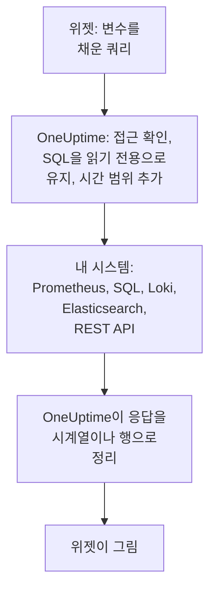

# 외부 데이터 소스

외부 데이터 소스는 Prometheus, SQL 데이터베이스, ClickHouse, Loki, Elasticsearch, REST API처럼 OneUptime 밖에 있는 시스템을 연결해, 대시보드가 그 데이터를 내 데이터 옆에 차트로 보여 줄 수 있게 합니다. 시스템은 한 번만 연결하면 되고, 그 뒤에는 각 위젯이 그 시스템의 언어로 읽기 전용 쿼리를 실행합니다.

:::cards
- [데이터 소스 연결](#데이터-소스-연결): 유형을 고른 다음, 위치와 로그인 방법을 알려 줍니다.
- [쿼리 작성](#쿼리-작성): PromQL, SQL, LogQL, Query DSL 또는 요청.
- [제한](#제한): 양쪽을 보호하는 시간 제한과 상한.
- [안전하게 지키기](#안전하게-지키기): 읽기 전용 쿼리와 쓰기 전용 자격 증명.
:::

## 쿼리가 실행되는 방식

위젯은 변수를 채운 쿼리를 OneUptime으로 보냅니다. OneUptime은 내가 그 데이터 소스를 읽을 수 있는지 확인하고, 시간 범위를 채운 다음, 보관 중인 자격 증명으로 내 시스템에 질의합니다. 그리고 응답을 위젯이 그릴 시계열이나 행으로 정리합니다.



## 시작하기 전에

- **이 기능이 포함된 요금제.** OneUptime Cloud에서 데이터 소스를 만들고 바꾸려면 **Growth** 요금제가 필요합니다. 삭제는 모든 요금제에서 할 수 있습니다.
- **추가할 권한.** 프로젝트 소유자와 관리자는 데이터 소스를 추가할 수 있습니다. 그 밖의 사용자는 `CreateDataSource`가 필요하고, 바꾸고 삭제하려면 `EditDataSource`와 `DeleteDataSource`가 필요합니다. 프로젝트의 데이터 소스를 읽을 수 있는 모든 사람(멤버와 뷰어 포함)은 그 위젯의 데이터를 볼 수 있습니다.
- **읽기 전용 계정.** 대시보드는 읽기만 합니다. 데이터베이스는 읽기만 할 수 있는 계정으로, HTTP 소스는 쿼리만 할 수 있는 토큰으로 연결하세요.
- **접근 경로.** 내 시스템에 연결하는 것은 OneUptime의 API 서버이므로, 그 서버에서 시스템에 닿을 수 있어야 합니다. 거부되는 주소는 [안전하게 지키기](#안전하게-지키기)를 참고하세요.

## 지원하는 시스템

| 유형 | 쿼리 언어 | 함께 쓰는 시스템 |
| --- | --- | --- |
| Prometheus | PromQL | Prometheus, Thanos, Cortex, Mimir, VictoriaMetrics |
| PostgreSQL | SQL | PostgreSQL, TimescaleDB, CockroachDB |
| MySQL | SQL | MySQL, MariaDB |
| Microsoft SQL Server | T-SQL | SQL Server, Azure SQL |
| ClickHouse | SQL | ClickHouse(HTTP 인터페이스를 통해) |
| Grafana Loki | LogQL | Loki 및 Loki 호환 엔드포인트 |
| Elasticsearch | Query DSL (JSON) | Elasticsearch, OpenSearch |
| REST API | 요청 (JSON) | JSON으로 응답하는 모든 HTTP(S) API |

## 데이터 소스 연결

:::steps
### 데이터 소스 열기

**제품 → 대시보드**를 열고, 사이드 메뉴에서 **설정**을 펼친 다음 **데이터 소스**를 클릭합니다.

### 유형 고르기

**Data Source 만들기**를 클릭합니다. **Choose a Data Source Type** 대화 상자는 유형을 담는 내용(메트릭, 로그, 데이터베이스, 검색, API)별로 묶어 보여 줍니다. 하나를 클릭하세요.

### 이름 지정

**기본 정보**에서 **이름**(예: "프로덕션 Prometheus")을 지정하고, 원하면 **설명**도 입력합니다.

### 위치 알려 주기

**연결**에서 HTTP 소스는 응답하는 **URL**을 받습니다. 데이터베이스는 **Database Host**, **Database Port**(5432, 3306, 1433, 8123이면 비워 둡니다), **데이터베이스 이름**을 받습니다.

### 로그인 방법 알려 주기

**인증**에서 **사용자 이름**과 **비밀번호**를 입력하거나, HTTP 소스라면 Bearer 토큰으로 보내는 **API 토큰**을 입력합니다. **추가 필드**에는 `{ "X-Scope-OrgID": "tenant-1" }` 같은 **Custom HTTP Headers**와 **Additional Options**가 있습니다. Additional Options는 데이터베이스용 `sslEnabled`와 `sslRejectUnauthorized`, Elasticsearch용 `elasticsearchIndex`이며, Elasticsearch는 이것이 없으면 모든 인덱스(`*`)를 읽습니다.

### 테스트하기

**Data Source 만들기**를 클릭한 다음, 그 행의 **테스트**를 클릭합니다. OneUptime이 입력한 정보로 연결해 보고, 성공했는지 아니면 무엇이 잘못되었는지 알려 줍니다.
:::

나중에 데이터 소스를 바꾸려면 목록에서 엽니다. **Data Source Details**의 **편집**은 비밀 값을 뺀 모든 것을 바꿉니다. **자격 증명 업데이트**는 비밀번호, 토큰, 헤더를 바꾸고, 비워 둔 필드는 그대로 둡니다. **테스트**로 다시 확인할 수 있습니다.

## 위젯에서 사용

대시보드를 편집하고 **위젯 추가**를 클릭한 다음, 외부 데이터 소스 그룹의 위젯(**차트**, **값**, **게이지**, **테이블**)을 고릅니다. 설정에서는 다음을 할 수 있습니다.

- **Data Source**를 고르고 **쿼리**를 작성합니다. 편집기는 쿼리 언어 이름과 그 유형의 예시를 보여 줍니다.
- 차트에서는 **쿼리 추가**로 같은 축에 쿼리를 더 겹치고, **Legend (optional)** 설정으로 각 계열의 이름을 레이블에서 만듭니다. `{{instance}} — errors`는 계열의 `instance` 레이블을 앞에 씁니다.
- 값이나 게이지에서는 **Reduce**가 점들을 숫자 하나로 줄입니다. 마지막 값(기본값), 첫 값, 평균, 합계, 최솟값, 최댓값 중 하나입니다. **Unit**은 접미사를 붙이고, 알려진 단위는 크기도 맞춥니다. `Bytes`는 1.5 MB로, `ms`는 2.4 s로 읽힙니다.
- 테이블에서는 읽기 전용 쿼리라면 무엇이든 쓸 수 있고, 행은 돌아온 그대로 표시됩니다.

## 쿼리 작성

유형마다 고유한 언어를 쓰지만, 돌려줘야 하는 결과의 규칙은 같습니다.

- **차트, 값, 게이지에는 시계열이 필요합니다.** SQL 쿼리는 이름이 `time`, `timestamp`, `date`, `ts` 중 하나인 시간 열과 숫자형 `value` 열(또는 첫 번째 숫자형 열)을 돌려줍니다. 나머지 열은 모두 계열 레이블이 됩니다. Elasticsearch에는 `date_histogram` 집계가, Loki에는 `rate()`나 `count_over_time()` 같은 메트릭 쿼리가 필요합니다.
- **테이블은 행을 보여 줍니다.** 쿼리가 돌려준 그대로 SQL 행, Prometheus 계열, Loki 로그 줄, Elasticsearch 히트, 또는 REST API의 `rowsPath`에 있는 객체입니다.

:::tabs
@tab Prometheus
```text title="PromQL"
sum by (job) (rate(http_requests_total{job=~"{{job}}"}[5m]))
```
@tab SQL
```sql title="SQL"
SELECT date_trunc('minute', created_at) AS time, COUNT(*) AS value
FROM orders
WHERE created_at BETWEEN $__startTime AND $__endTime
GROUP BY 1
ORDER BY 1
```
@tab Loki
```text title="LogQL"
sum by (app) (rate({app="api"} |= "error" [5m]))
```
@tab Elasticsearch
```json title="Query DSL"
{
  "query": { "range": { "@timestamp": { "gte": "$__startTime", "lte": "$__endTime" } } },
  "aggs": {
    "over_time": {
      "date_histogram": { "field": "@timestamp", "fixed_interval": "1m" }
    }
  }
}
```
@tab REST API
```json title="Request"
{
  "path": "/api/stats?from=$__startTimeMs&to=$__endTimeMs",
  "method": "GET",
  "rowsPath": "data.items",
  "timestampField": "time",
  "valueField": "count",
  "seriesField": "service"
}
```
:::

### 시간 매크로

Prometheus와 Loki는 요청마다 대시보드의 시간 범위를 받으므로, 쿼리에 더 넣을 것이 없습니다. 다른 유형은 매크로를 쓴 자리에 시간 범위가 들어갑니다.

| 매크로 | 바뀌는 값 | 쓰는 곳 |
| --- | --- | --- |
| `$__startTime`, `$__endTime` | 범위의 시작과 끝(UTC). SQL에서는 `'2026-10-13 09:00:00'`, 그 밖에서는 ISO 8601 | SQL, Elasticsearch, REST API |
| `$__startTimeMs`, `$__endTimeMs` | 같은 값을 1970년 이후의 밀리초로 나타낸 것 | SQL, Elasticsearch, REST API |
| `$__rangeSeconds` | 범위의 길이(초) | SQL |

SQL 매크로는 UTC로 쓰이므로, 데이터베이스 세션을 UTC로 실행하거나 쿼리 안에서 변환하세요.

### 대시보드 변수

쿼리 어디에든 `{{name}}`을 쓰면, 위젯이 쿼리를 보내기 전에 그 자리에 변수 값을 넣습니다. 다중 선택 변수의 여러 값은 `|`로 이어지며, 이것이 PromQL이나 LogQL의 정규식 매처가 필요로 하는 형태입니다: `job=~"{{job}}"`. 아무것도 고르지 않은 변수는 자리 표시자를 쓴 그대로 남기므로, 오류에 그 이름이 나옵니다. 변수를 추가하는 방법은 [대시보드 변수 및 필터](/docs/dashboards/variables)를 참고하세요.

## 제한

모든 쿼리에는 한도가 있어서, 매분 새로 고쳐지는 위젯 스무 개짜리 대시보드가 OneUptime이나 내 시스템에 과부하를 줄 수 없습니다.

| 제한 | 값 |
| --- | --- |
| 연결 | 10초 |
| 쿼리 실행 | 30초 |
| 시계열 응답의 점 | 11,000 |
| 테이블의 행 | 1,000 |
| 응답 하나의 계열 | 100 |
| HTTP 소스의 응답 | 20 MB |

Prometheus와 Loki의 범위 쿼리는 시간 범위 전체에 걸쳐 약 250개의 점을 요청하며, 점 사이 간격은 10초 이상, 하루 이하입니다.

## 안전하게 지키기

- **SQL은 읽기 전용으로 유지됩니다.** 쿼리는 `SELECT`, `WITH`, `SHOW`, `EXPLAIN`, `DESCRIBE`, `DESC` 중 하나로 시작하는 문 하나여야 합니다. `INSERT`, `UPDATE`, `DELETE`, `DROP`, `INTO`, `SET`처럼 쓰기를 하거나 세션을 바꾸는 단어는 문자열과 따옴표로 묶은 이름 밖에서는 어디서든 거부되므로, 이런 단어와 이름이 같은 열은 따옴표로 묶으세요. 문자열 안의 따옴표는 따옴표 두 개(`''`)로 씁니다. 따옴표 앞의 백슬래시는 거부됩니다. PostgreSQL, MySQL, ClickHouse 세션도 읽기 전용입니다. SQL Server에는 읽기 전용 세션이 없으므로 읽기 전용 로그인으로 연결하세요.
- **자격 증명은 쓰기 전용입니다.** **비밀번호**, **API 토큰**, **Custom HTTP Headers**는 저장할 때 암호화되며, API는 이를 절대 돌려주지 않습니다. 나에게도 마찬가지입니다.
- **주소를 검사합니다.** 루프백, 링크 로컬(클라우드 메타데이터가 있는 곳) 등 예약된 주소는 어디서든 거부됩니다. 사설 주소는 OneUptime Cloud에서는 거부되고, 자체 호스팅 설치에서는 `DATA_SOURCE_BLOCK_PRIVATE_ADDRESSES`가 `true`가 아니면 허용됩니다. [프라이빗 네트워크 접근](/docs/self-hosted/private-network-access)을 참고하세요.
- **공개 대시보드에서는 절대 실행되지 않습니다.** 외부 데이터 소스 위젯은 쿼리와 함께 [공개 대시보드](/docs/dashboards/sharing)에서 빠집니다.

## 문제 해결

:::details 테스트에서 연결할 수 없다고 나올 때
OneUptime이 실행되는 곳에서 본 URL, 또는 호스트와 포트를 확인하세요. 방화벽, OneUptime Cloud에서의 사설 주소, 자기 머신에서만 수신 대기하는 데이터베이스는 여기서 보기에 모두 같습니다. TLS가 필요한 데이터베이스는 **Additional Options**에 `{ "sslEnabled": true }`를 추가하세요.
:::

:::details "Only read-only queries are allowed"
쿼리가 `SELECT`, `WITH`, `SHOW`, `EXPLAIN`, `DESCRIBE`, `DESC` 중 어느 것으로도 시작하지 않습니다. 읽기만 하는 문 하나를 보내세요. `;` 뒤의 두 번째 문도 거부되며, "Only a single SQL statement is allowed per query."라고 표시됩니다.
:::

:::details "Query contains a keyword that is not allowed"
쓰기를 하는 단어가 문자열 밖에 있습니다. 흔히 `delete`나 `set` 같은 열 이름입니다. 데이터베이스의 방식대로 따옴표로 묶으세요. PostgreSQL에서는 `"delete"`, SQL Server에서는 `[delete]`, MySQL과 ClickHouse에서는 백틱으로 묶습니다.
:::

:::details 차트는 비어 있는데 테이블에는 행이 보일 때
쿼리가 행은 돌려주지만 시계열은 돌려주지 않습니다. SQL에서는 시간 열 이름을 `time`, 숫자 이름을 `value`로 하고, Elasticsearch에서는 `date_histogram` 집계를 추가하고, Loki의 로그 쿼리는 `rate()`나 `count_over_time()`으로 메트릭 쿼리로 바꾸세요.
:::

:::details 일부 데이터가 없을 때
응답이 [제한](#제한)에 도달했습니다. 시간 범위를 좁히거나, 쿼리를 필터링하거나, 더 적은 계열로 집계하세요.
:::

## 다음 단계

:::cards
- [대시보드 위젯](/docs/dashboards/widgets): 외부 데이터 소스 그룹을 포함한 모든 위젯.
- [대시보드 변수 및 필터](/docs/dashboards/variables): 쿼리에 쓸 변수.
- [프라이빗 네트워크 접근](/docs/self-hosted/private-network-access): 자체 호스팅 설치에서 사설 네트워크의 시스템에 닿습니다.
- [대시보드 설정 및 권한](/docs/dashboards/configuration): 데이터 소스를 추가할 수 있는 사람과 읽는 사람.
:::
