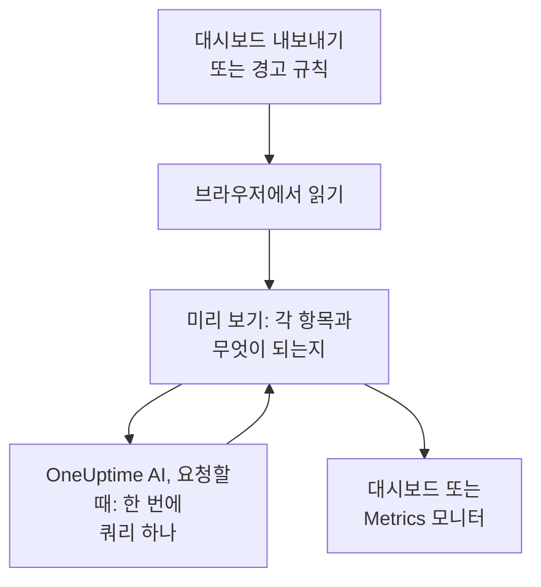

# Grafana 및 Datadog에서 가져오기

Grafana나 Datadog에서 만든 대시보드, 또는 Prometheus, Grafana, Datadog용으로 작성한 경고 규칙을 OneUptime으로 가져옵니다. 파일을 붙여넣거나 업로드하고, 각 패널과 각 규칙이 무엇이 되는지 확인한 다음에야 대시보드나 모니터를 만듭니다.

:::cards
- [대시보드 가져오기](#대시보드-가져오기): Grafana 대시보드의 JSON 모델 또는 Datadog 대시보드의 내보내기 파일.
- [경고 규칙 가져오기](#경고-규칙-가져오기): Prometheus 규칙 파일, Grafana 경고 규칙, Datadog 모니터.
- [각 항목이 변환되는 방식](#각-항목이-변환되는-방식): 정확하게, 대략적으로, 또는 변환되지 않음과 그 이유.
- [OneUptime AI로 쿼리 변환하기](#oneuptime-ai로-쿼리-변환하기): 어떤 규칙으로도 변환되지 않는 쿼리를 위해.
:::

## 가져오기가 진행되는 방식

OneUptime은 브라우저에서 파일을 읽고 패널, 위젯, 변수, 규칙을 하나씩 따로 변환합니다. 미리 보기는 그 모두를 각각 무엇이 되는지와 함께 보여 줍니다. 만들기를 선택하기 전에는 아무것도 만들어지지 않으며, 만들 때는 대시보드와 모니터 양식이 만드는 것처럼 사용자 자신의 권한으로 만들어집니다.

## 시작하기 전에

- 가져온 위젯과 모니터는 이 프로젝트 자체의 메트릭을 PromQL로 읽습니다. Prometheus remote write, OpenTelemetry 또는 Datadog Agent로 보내면 그곳에서 쓰던 이름이 그대로 유지됩니다.
- 대시보드를 가져오려면 대시보드를 만들 수 있는 역할이, 경고 규칙을 가져오려면 모니터를 만들 수 있는 역할이 필요합니다.
- 파일은 최대 10 MB이며, 그 안의 패널이나 규칙은 최대 500개까지 읽습니다.

## 대시보드 가져오기

:::steps
### 대시보드 가져오기 열기

**제품 → 대시보드** 를 열고 **추가 옵션 → Import from Grafana or Datadog** 을 선택합니다.

### 대시보드 붙여넣기

Grafana에서는 대시보드 설정에서 JSON 모델을 복사합니다. Datadog에서는 대시보드의 JSON을 내보냅니다. 그것을 붙여넣거나 **Upload a File** 을 선택한 다음 **미리 보기** 를 선택합니다.

### 대시보드 만들기

각 패널과 각 변수가 무엇이 되는지 확인하고, 대시보드에 이름을 붙인 뒤 **대시보드 만들기** 를 선택합니다. 새 대시보드가 열립니다.
:::

Grafana의 PromQL은 작성된 그대로 유지됩니다. OneUptime은 `$__interval`, `$__rate_interval`, `$__range` 를 Grafana와 같은 방식으로 채우며, All로 둔 변수는 모든 값과 일치합니다. Datadog 쿼리는 Datadog Agent가 보낸 메트릭에 대한 PromQL이 됩니다. `avg:system.cpu.user{host:web-1}` 은 `system_cpu_user{host="web-1"}` 을 읽습니다.

## 경고 규칙 가져오기

:::steps
### 경고 가져오기 열기

**제품 → 모니터** 를 열고 **추가 옵션 → Import Alerts** 를 선택합니다.

### 규칙 붙여넣기

Prometheus 규칙 파일이나 PrometheusRule 리소스, Grafana의 경고 규칙 내보내기, 또는 JSON으로 내보낸 Datadog 모니터를 붙여넣은 다음 **미리 보기** 를 선택합니다.

### 모니터 만들기

원하지 않는 규칙의 선택을 해제하고, **When a rule fires** 에서 발생한 규칙이 무엇을 열지 고른 다음 **모니터 생성** 을 선택합니다.
:::

각 규칙은 PromQL 쿼리 하나, 규칙의 조건과 그 시간 창을 가진 Metrics 모니터가 됩니다. 임계값을 넘는 시리즈마다 경고나 인시던트를 열고, 시리즈가 회복되면 해결합니다. 제목과 설명은 규칙의 요약이나 메시지에서 가져오며, 시리즈의 레이블이 채워집니다.

## 각 항목이 변환되는 방식

| 상태 | 의미 |
| --- | --- |
| **Converted exactly** | 같은 데이터를 읽고 같은 방식으로 보여 줍니다. |
| **Converted approximately** | 만들어지며, 메모에 무엇이 다른지 나옵니다. |
| **Not converted** | 아무것도 만들어지지 않으며, 메모에 이유가 나옵니다. |

레코딩 규칙, 로그에 대한 경고 규칙, 로그·트레이스·이벤트를 읽는 Datadog 위젯, 그리고 Datadog의 이상 탐지·이상값·예측 모니터는 변환되지 않습니다.

## OneUptime AI로 쿼리 변환하기

어떤 규칙으로도 변환되지 않는 쿼리에는 **Convert with OneUptime AI** 가 표시되며, 프로젝트에서 AI가 켜져 있어야 합니다. 그 쿼리와 대시보드 변수 이름만 프로젝트의 [LLM 공급자](/docs/ai/llm-provider)에게 전송됩니다. 답은 다른 쿼리처럼 검증된 뒤 표시되며, 사용하려면 **Use This Query** 를 선택합니다. 대시보드나 모니터를 만들기 전에는 아무것도 만들어지지 않습니다.

## 다음 단계

:::cards
- [대시보드 위젯](/docs/dashboards/widgets): 가져온 위젯이 보여 주는 내용을 바꿉니다.
- [대시보드 변수 및 필터](/docs/dashboards/variables): 가져오기로 만들어진 변수.
- [메트릭 모니터](/docs/monitor/metrics-monitor): 가져오기로 만들어진 모니터.
- [PromQL](/docs/telemetry/promql): 가져온 위젯과 모니터가 읽는 언어.
:::
