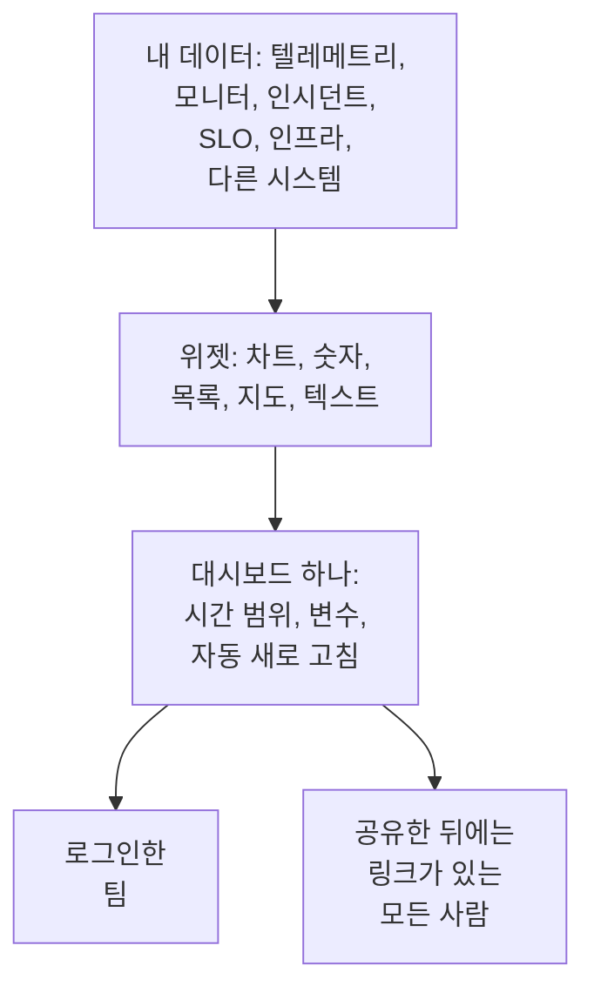

# 대시보드 개요

대시보드는 직접 배치한 위젯으로 이루어진 한 페이지입니다. 메트릭, 로그, 트레이스의 차트, 인시던트, 경고, 모니터 목록, SLO와 인프라, 심지어 OneUptime 밖에 있는 시스템의 데이터까지 담을 수 있습니다. 온콜 화면, 팀의 아침 점검, 고객용 페이지 등으로 만들고, 프로젝트 멤버나 링크가 있는 누구와도 공유할 수 있습니다.

:::cards
- [대시보드의 작동 방식](#대시보드의-작동-방식): 데이터가 어디서 오고, 누가 보는지.
- [대시보드 찾기](#대시보드-찾기): 대시보드 목록과 각 대시보드의 페이지.
- [첫 대시보드 만들기](#첫-대시보드-만들기): 템플릿에서 공유 페이지까지 다섯 단계.
- [예시: 온콜 대시보드](#예시-온콜-대시보드): 모든 서비스에 쓸 수 있는 한 페이지.
:::

## 대시보드의 작동 방식

각 위젯은 대시보드의 시간 범위 안에서, 변수로 필터링한 데이터를 하나의 소스에서 읽습니다. 대시보드를 여는 모든 사람은 같은 위젯을 봅니다. 팀은 로그인해서, 방문자는 공유한 뒤의 공개 링크로 봅니다.

| 용어 | 의미 |
| --- | --- |
| 대시보드 | 한 페이지: 이름, 위젯 그리드, 시간 범위, 변수, 자동 새로 고침 설정. |
| 위젯 | 그리드의 타일 하나: 차트, 숫자, 목록, 지도, 시계 또는 텍스트 블록. |
| 변수 | 툴바의 선택기로, 지원하는 모든 위젯을 서비스, 호스트, 고객 하나로 좁힙니다. |
| 시간 범위 | 모든 차트와 숫자가 읽는 구간. 대시보드는 기본값으로 열리며, 편집하는 사람이 다른 기간을 정하지 않으면 최근 한 시간입니다. 보는 사람마다 직접 고를 수 있습니다. |
| 자동 새로 고침 | 위젯이 데이터를 다시 읽는 빈도: 꺼짐, 또는 5초마다부터 15분마다까지. |
| 보기와 편집 | 대시보드는 읽기용으로 열립니다. 편집은 변경 사항을 저장하거나 버리면서 끝나는 별도의 단계입니다. |

## 대시보드가 유용한 경우

- **"모두 괜찮은가?"를 확인하는 페이지.** 온콜 엔지니어, 팀 스탠드업, 벽에 건 화면에 좋습니다.
- **연관 관계 파악**: CPU 급증, 지연 시간 증가, 열린 인시던트가 나란히 있으면 한 페이지에서 바로 보이지만, 세 페이지에 흩어져 있으면 놓치기 쉽습니다.
- **조사**: 자주 다시 여는 차트를 나란히 두고, 급증 구간을 드래그하면 그 순간의 모든 위젯을 읽을 수 있습니다.
- **팀 밖과 공유**: 고객이나 파트너를 위한 성능 페이지로, 필요하면 비밀번호나 IP 허용 목록으로 보호할 수 있습니다.

## 대시보드 찾기

**제품 → 대시보드**를 엽니다. **대시보드** 목록에는 프로젝트의 대시보드가 설명, 레이블, 소유자와 함께 표시됩니다. 이름이나 설명으로 검색하고, **소유자** 및 **레이블** 필터로 목록을 좁히거나, 여러 대시보드를 선택해 레이블이나 소유자를 바꾸고, 보관하거나 JSON으로 내보낼 수 있습니다.

목록의 사이드 메뉴에는 모든 대시보드를 관리하는 페이지가 있습니다.

| 페이지 | 하는 일 |
| --- | --- |
| **대시보드** | 프로젝트의 대시보드. 새로 만들거나 **JSON 가져오기**로 대시보드를 가져옵니다. |
| **대시보드 → 재생 목록** | NOC 벽면 화면 같은 화면에 [대시보드를 차례로 보여 줍니다](/docs/dashboards/playlists). |
| **설정 → 소유자 규칙** | 새 대시보드에 소유자를 자동으로 추가합니다. |
| **설정 → 레이블 규칙** | 새 대시보드에 레이블을 자동으로 추가합니다. |
| **설정 → 데이터 소스** | Prometheus, SQL 데이터베이스, ClickHouse, Loki, Elasticsearch 또는 REST API를 연결합니다. |
| **고급 → 보관됨** | 보관한 대시보드. 여기서 보관을 취소합니다. |

대시보드를 열면 그 대시보드의 사이드 메뉴에 다음 페이지가 있습니다. **기본**을 제외한 모든 섹션은 접힌 상태로 시작하며, 제목을 클릭하면 펼쳐집니다.

| 페이지 | 하는 일 |
| --- | --- |
| **대시보드** | 대시보드 자체. 읽거나, **⋯** 메뉴에서 편집합니다. |
| **개요** | 이름, 설명, 레이블. |
| **공유 설정** | 볼 수 있는 사람, 공개 링크, 추가 설정에 있는 IP 허용 목록. |
| **소유자** | 대시보드를 소유한 사용자와 팀. |
| **브랜딩** | 공개 대시보드의 페이지 제목, 설명, 로고, 테마, 파비콘. |
| **사용자 정의 도메인** | 공개 대시보드를 자체 도메인에서 호스팅합니다. |
| **설정** | 대시보드를 복제, 내보내기, 보관합니다. |
| **감사 로그** | 대시보드에 대한 모든 변경 사항과 변경한 사람. |
| **삭제** | 대시보드를 영구히 삭제합니다. |

## 첫 대시보드 만들기

:::steps
1. **만들기** — 템플릿이나 **처음부터 시작**을 고릅니다. 템플릿은 이름을 채우고 위젯과 함께 열리며, 처음부터 시작한 대시보드는 아무것도 없이 열리고 캔버스에 **위젯 추가**가 있습니다.
2. **위젯 추가하기** — 카탈로그에서 위젯을 고르고, 설정에서 무엇을 읽을지 정한 다음, 끌어서 배치하고 크기를 조정합니다.
3. **필요하면 변수 추가하기** — 예를 들어 `service` 변수를 쓰면 대시보드 하나로 어떤 서비스든 보여 줄 수 있습니다.
4. **저장** — **변경 사항 저장**을 클릭합니다. 그렇게 하기 전까지는 편집 중에 바꾼 내용이 유지되지 않습니다.
5. **(선택) 공개 공유** — 대시보드에서 **⋯ → 공유**를 고르고 볼 수 있는 사람을 정합니다. 링크가 있는 모든 사람, 또는 링크와 비밀번호가 있는 모든 사람입니다.
:::

[대시보드 작성](/docs/dashboards/authoring)에서 각 단계를 자세히 설명합니다.

## 예시: 온콜 대시보드

목표는 checkout 서비스의 지연 시간, 오류율, 열린 인시던트, 최신 로그를 담은 한 페이지를 만들고, 다른 모든 서비스에도 쓸 수 있게 하는 것입니다.

1. **대시보드 만들기**를 클릭하고 **처음부터 시작**을 고른 뒤 이름을 "Checkout 온콜"로 지정합니다.
2. **위젯 추가**를 클릭하고, 요청 지연 시간 메트릭을 P95로 집계한 **차트**를 추가합니다.
3. 그 옆에 오류율의 **값**을 추가하고, 경고 임계값을 1, 심각 임계값을 5로 설정합니다.
4. 그 아래에 해결되지 않은 인시던트로 필터링한 **인시던트 목록**과, 서비스 로그의 **로그 스트림**을 추가합니다.
5. **변수**를 열고, 소스가 Telemetry Attribute이고 속성 키가 `service.name`인 `service`라는 변수를 추가한 다음 기본값을 `checkout`으로 지정합니다.
6. **변경 사항 저장**을 클릭합니다. 툴바의 `service` 선택기에서 `payments`를 고르면 차트, 값, 로그 스트림이 payments 서비스로 바뀌고, 인시던트 목록은 계속 해결되지 않은 모든 인시던트를 보여 줍니다.

## 대시보드와 OneUptime의 나머지 기능

- **모니터와 텔레메트리**가 데이터의 출처입니다. 보내는 모든 메트릭, 로그, 트레이스를 위젯에 올릴 수 있습니다.
- **인시던트와 경고**는 **인시던트 목록** 및 **경고 목록** 위젯에 나타납니다. 대시보드는 보여 주기만 하고, 처리는 각자의 페이지에서 합니다.
- **상태 페이지**는 서비스가 정상인지 고객에게 알립니다. 대시보드는 서비스가 어떻게 동작하는지 자세히 보여 줍니다. 둘은 나란히 함께 쓰입니다.
- **워크플로**는 일어난 일에 대응합니다. 대시보드는 그것을 읽는 곳입니다.

## 다음 단계

:::cards
- [대시보드 작성](/docs/dashboards/authoring): 대시보드를 만들고 편집한 뒤 변경 사항을 저장합니다.
- [대시보드 위젯](/docs/dashboards/widgets): 모든 위젯과 어떤 것을 고를지.
- [대시보드 변수 및 필터](/docs/dashboards/variables): 서비스, 호스트, 고객마다 대시보드 하나.
- [공유 및 공개 대시보드](/docs/dashboards/sharing): 공개 링크, 비밀번호, IP 허용 목록, 사용자 정의 도메인.
:::
