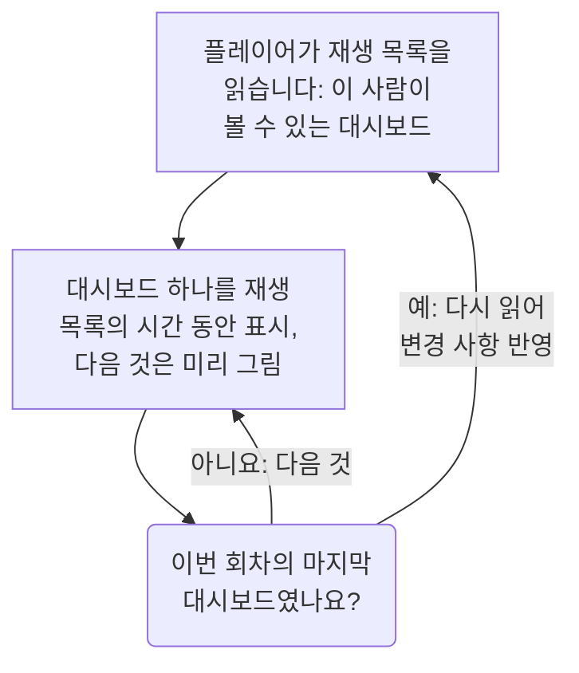

# 대시보드 재생 목록

재생 목록은 NOC 벽면 화면이나 팀의 TV처럼 아무도 조작하지 않는 화면에 여러 대시보드를 차례로 보여 줍니다. 각 대시보드를 고른 시간만큼 보여 주고, 누군가 일시 중지할 때까지 계속 반복합니다. 재생 목록을 한 번 만들고, 화면에서 플레이어를 열어 두기만 하면 됩니다.

:::cards
- [재생 목록이 재생되는 방식](#재생-목록이-재생되는-방식): 순서, 차례, 그리고 각 대시보드가 보여 주는 내용.
- [재생 목록 만들기](#재생-목록-만들기): 이름, 순서대로 놓은 대시보드, 그리고 각각을 보여 주는 시간.
- [화면에서 재생하기](#화면에서-재생하기): 플레이어의 막대, 버튼, 키.
- [누가 무엇을 보는지](#누가-무엇을-보는지): 권한, 그리고 사용자가 읽을 수 없는 대시보드.
:::

## 재생 목록이 재생되는 방식

플레이어는 재생 목록의 첫 번째 대시보드를 보여 주고, 시간이 다 되면 다음 대시보드를 보여 주며, 마지막 대시보드 다음에는 처음으로 돌아갑니다. 각 대시보드는 편집자가 저장한 그대로 열립니다. 플레이어 주소에 무엇이 적혀 있든 대시보드 자체의 기본 시간 범위, 자동 새로 고침, 변수로 표시됩니다. 대시보드 하나가 화면에 있는 동안 플레이어는 다음 대시보드를 보이지 않는 곳에서 미리 그려 두므로, 두 대시보드 사이에 화면이 비는 일이 없습니다.

재생 목록은 대시보드를 가리킬 뿐 복사하지 않습니다. 편집자가 대시보드에 저장한 변경 사항은 그 대시보드의 다음 차례에 화면에 나타납니다. 플레이어는 회차마다 재생 목록을 다시 읽으므로, 추가하거나 옮기거나 제거한 대시보드는 화면을 새로 고치지 않아도 한 회차 안에 반영됩니다. 다시 읽기에 실패하면 화면은 가지고 있는 회차를 한 번 더 재생합니다.

## 재생 목록 만들기

:::steps
### 재생 목록 열기
**제품 → 대시보드**를 열고, 사이드 메뉴에서 **재생 목록**을 엽니다. 목록에는 각 재생 목록의 대시보드 수와 각각을 보여 주는 시간이 표시되고, 모든 행에 **재생**이 있습니다.

### 이름 붙이기
**재생 목록 만들기**를 클릭하고, 어디에서 재생하는지 알 수 있는 **이름**을 붙입니다. 예를 들면 "NOC 월"입니다.

### 대시보드 추가하기
**대시보드**에서 화면에 보여 줄 순서대로 **대시보드 추가**에서 하나씩 고릅니다. 대시보드 행의 버튼으로 위나 아래로 옮기거나 제거할 수 있습니다. 보관된 대시보드는 목록에 나오지 않습니다.

### 각각을 보여 줄 시간 고르기
**각 대시보드 표시 시간**은 1분으로 시작합니다. 15초부터 1시간까지 시간을 고릅니다. **재생 목록 만들기**를 클릭합니다.
:::

재생 목록 페이지에는 대시보드가 순서대로 나열되고, 각각을 보여 주는 시간과 **플레이어 링크**가 표시됩니다. **재생 목록 편집**으로 이름, 대시보드, 그 순서, 시간을 바꿀 수 있습니다. 페이지 아래쪽의 **대시보드 재생 목록 삭제**는 재생 목록을 삭제하지만 대시보드는 삭제하지 않습니다.

API와 Terraform에서 재생 목록은 `name`, 보여 주는 순서대로 놓인 `[{"dashboardId": "<id>"}]` 같은 목록인 `dashboards`(최대 100개), 그리고 10부터 86400(하루)까지의 정수 초인 `intervalInSeconds`로 이루어집니다. 이 범위를 벗어난 값은 무엇이 잘못되었는지와 함께 거부됩니다.

## 화면에서 재생하기

재생 목록의 행이나 페이지에서 **재생**을 클릭합니다. 플레이어는 OneUptime의 나머지 부분 위로 브라우저 창을 가득 채웁니다. **전체 화면**은 화면 전체를 채웁니다. 화면을 따로 시작하려면 그 화면에서 **플레이어 링크**를 열고 북마크해 둡니다. 이 링크를 열면 플레이어가 바로 열립니다.

플레이어의 막대에는 화면에 있는 대시보드, 재생 목록, 회차 안의 위치("2 / 5"), 다음에 올 대시보드가 표시됩니다. 대시보드의 차례 동안 막대 아래의 선이 채워집니다. 막대의 버튼으로 이전 대시보드로 가거나, 일시 중지 또는 재생하거나, 다음 대시보드로 갑니다. 컴퓨터에서는 다음 키로도 같은 일을 할 수 있습니다.

| 키 | 하는 일 |
| --- | --- |
| `Space` | **일시 중지 또는 재생**. 일시 중지하면 대시보드가 화면에 남고 막대에 **일시 중지됨**이 표시됩니다. |
| `Right Arrow` | **다음 대시보드**. |
| `Left Arrow` | **이전 대시보드**. |
| `F` | **전체 화면** 또는 해제. |
| `Esc` | **플레이어 나가기**: 재생 목록 페이지로 돌아갑니다. 전체 화면에서는 첫 번째 `Esc`가 전체 화면만 해제합니다. |
| `?` | **키보드 단축키 보기**. |

다음이나 이전으로 이동한 대시보드는 한 차례 시간을 온전히 받습니다. 페르시아어처럼 오른쪽에서 왼쪽으로 읽는 페이지에서는 화살표가 서로 바뀌어 `Left Arrow`가 다음 대시보드로 갑니다. 재생하는 동안, 브라우저가 허용하는 경우 플레이어는 화면이 절전 모드로 들어가지 않게 합니다.

## 누가 무엇을 보는지

재생 목록에는 자체 권한이 있으며, 대시보드의 권한처럼 팀을 통해 받습니다.

| 작업 | 필요한 것 |
| --- | --- |
| 재생 목록 보기 및 재생 | `ReadDashboardPlaylist` 또는 프로젝트 역할: Project Owner, Project Admin, Project Member, Viewer 또는 Settings 역할 |
| 재생 목록 만들기 | `CreateDashboardPlaylist`, Project Owner 또는 Project Admin |
| 재생 목록 변경: 이름, 대시보드, 시간 | `EditDashboardPlaylist`, Project Owner 또는 Project Admin |
| 재생 목록 삭제 | `DeleteDashboardPlaylist`, Project Owner 또는 Project Admin |

재생 목록은 누구에게도 그 사람이 읽을 수 없는 대시보드를 보여 주지 않습니다. 플레이어는 화면에 로그인한 사람이 읽을 수 있고 보관되지 않은 대시보드만 재생하고, 나머지는 건너뜁니다. 삭제된 대시보드, 보관된 대시보드, 권한 때문에 볼 수 없는 대시보드가 여기에 해당합니다. 재생 목록 페이지에는 각각을 건너뛰는 이유가 표시됩니다. 재생 목록을 저장해도 편집자 자신이 볼 수 없는 대시보드는 그대로 남으므로, 다른 사람이 넣어 둔 것이 사라지지 않습니다.

| 플레이어가 찾은 것 | 표시 |
| --- | --- |
| 보여 줄 수 있는 대시보드 | 차례로 하나씩. |
| 보여 줄 수 있는 대시보드가 없음 | **아직 표시할 내용이 없습니다**. 매분 다시 확인합니다. |
| 재생 목록이 삭제되었거나 그 사람이 읽을 수 없음 | **재생 목록을 찾을 수 없습니다**. |
| 읽기에 실패함 | **이 재생 목록을 불러올 수 없습니다**. 매분 다시 시도하며, **다시 시도**를 누르면 바로 다시 시도합니다. |

> [!NOTE]
> 플레이어는 OneUptime에 로그인한 사람을 위한 것입니다. 화면에서 재생 목록을 계속 재생하려면, 그 화면에서 재생 목록과 그 대시보드를 읽을 수 있는 계정(예: Viewer 역할의 팀 멤버)으로 로그인합니다.

## 다음 단계

:::cards
- [대시보드 작성](/docs/dashboards/authoring): 재생 목록이 보여 줄 대시보드를 만듭니다.
- [대시보드 변수 및 필터](/docs/dashboards/variables): 각 대시보드가 열릴 때의 저장된 선택.
- [공유 및 공개 대시보드](/docs/dashboards/sharing): 로그인하지 않는 사람에게 대시보드 하나를 보여 줍니다.
- [대시보드 설정 및 권한](/docs/dashboards/configuration): 소유자, 레이블, 대시보드를 읽을 수 있는 사람.
:::
