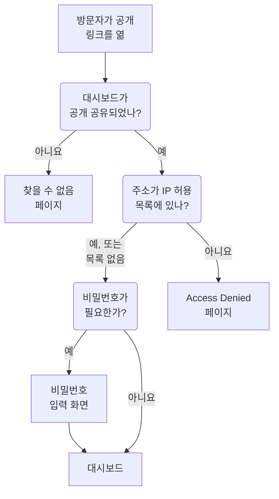

# 공유 및 공개 대시보드

기본적으로 대시보드는 프로젝트 안에서만 볼 수 있습니다. 프로젝트에 로그인하는 사람만 볼 수 있다는 뜻입니다. 공개 링크로 공유하거나, 그 링크를 비밀번호로 보호하거나, 특정 IP 주소로 제한하거나, 자체 도메인에서 호스팅할 수도 있습니다. 이 페이지에서는 이 네 가지를 모두 다룹니다.

:::cards
- [대시보드를 볼 수 있는 사람](#대시보드를-볼-수-있는-사람): 세 가지 중 하나를 고르며, 각각 필요한 요금제가 있습니다.
- [비밀번호로 공유하기](#비밀번호로-공유하기): 봐야 할 사람에게 링크를, 이어서 비밀번호를 공유합니다.
- [IP 허용 목록](#ip-허용-목록): 공개 링크를 사무실이나 VPN에서만 열 수 있게 합니다.
- [사용자 정의 도메인](#사용자-정의-도메인): 무료 인증서와 함께 자체 도메인에서 대시보드를 제공합니다.
:::

## 방문자가 거치는 과정

대시보드의 공개 링크를 연 방문자는 다음 검사를 차례로 거칩니다. OneUptime에 로그인하는 프로젝트 멤버는 여기서 무엇을 고르든 제품 안에서 대시보드를 봅니다.



## 대시보드를 볼 수 있는 사람

대시보드를 열고 **⋯ → 공유**를 고르거나, 대시보드의 사이드 메뉴에서 **공유 설정**을 엽니다. **이 대시보드를 볼 수 있는 사람** 카드는 하나를 고르는 선택지입니다.

- **이 프로젝트의 멤버만** (기본값): 멤버는 OneUptime에 로그인하면 대시보드를 봅니다. 공개 링크는 없습니다. 공개 주소에는 대시보드가 없는 주소와 같은 찾을 수 없음 페이지가 표시되고, 이름을 포함해 대시보드에 관한 것은 아무것도 표시되지 않습니다.
- **링크가 있는 모든 사람**: 대시보드가 공개됩니다. 링크가 있는 사람은 누구나 로그인하지 않고 볼 수 있습니다.
- **링크와 비밀번호가 있는 모든 사람**: 방문자는 링크를 연 다음, 내가 공유한 비밀번호 하나를 입력합니다. 누구에게도 계정이 필요 없습니다.

선택지를 고르면 방문자에게 무엇이 바뀌는지 알려 주는 확인을 거친 뒤 바로 적용됩니다. 대시보드에 비밀번호가 없을 때 **링크와 비밀번호가 있는 모든 사람**을 고르면 같은 대화 상자에서 비밀번호를 묻습니다. 그 선택이 유지되는 동안에는 **비밀번호 변경**으로 비밀번호를 바꿀 수 있습니다. 대시보드가 공개되어 있는 동안에는 방문자가 대시보드를 여는 주소가 선택지 아래에 있습니다. 사용자 정의 도메인이 먼저, 그다음 공개 링크가 나오며, 각각에 **링크 복사**가 있습니다. 아직 사용할 수 없는 사용자 정의 도메인에는 **준비 중** 표시와 그 이유가 나옵니다.

프로젝트 안에서 누가 무엇을 볼지는 소유자와 레이블로 제어합니다. [대시보드 설정 및 권한](/docs/dashboards/configuration)을 참고하세요. 대시보드를 볼 수는 있지만 편집할 수 없는 사람은 선택지를 보고 공개 링크를 복사할 수 있지만, 선택을 바꿀 수는 없습니다.

OneUptime Cloud에서 대시보드를 공유하려면 **Growth** 요금제가 필요합니다. 하위 요금제에서는 두 공개 선택지에 필요한 요금제가 표시되며 고를 수 없습니다. 대시보드를 다시 비공개로 하는 것(**이 프로젝트의 멤버만**)은 모든 요금제에서 되므로, 체험 기간이 끝났을 때나 하위 요금제로 바꾼 뒤 공개된 채 남은 대시보드도 언제든 공유를 멈출 수 있습니다. 대화 상자에는 다시 공유하려면 **Growth**가 필요하다고 표시됩니다. **링크가 있는 모든 사람**과 **링크와 비밀번호가 있는 모든 사람** 사이의 전환과 비밀번호 변경은 모든 요금제에서 됩니다. API나 Terraform으로 만든 대시보드에도 같은 요금제가 적용됩니다. 공개로 만들려면 **Growth**가, IP 허용 목록과 함께 만들려면 **Scale**이 필요합니다.

선택은 세 개의 열에 저장되며, API와 Terraform은 이전처럼 이 열을 읽고 씁니다. `isPublicDashboard`, `enableMasterPassword`, `masterPassword`입니다. 공개 링크는 공개 대시보드에만 있으며, `enableMasterPassword`가 켜져 있으면 방문자에게 비밀번호를 묻습니다. `enableMasterPassword`가 켜져 있지만 비밀번호가 설정되지 않은 공개 대시보드는 공개 링크로 아무도 들어올 수 없습니다. **공유 설정** 페이지는 이를 **링크와 비밀번호가 있는 모든 사람**으로 표시하고, 아직 아무도 링크를 열 수 없다고 알려 주며, **비밀번호 설정**을 제시합니다. **이 프로젝트의 멤버만**을 고르면 `enableMasterPassword`도 꺼지고 비밀번호는 유지되므로, 다시 비밀번호로 공유할 때 재사용할 수 있습니다.

## 공개 대시보드

공개 대시보드는 다음과 같습니다.

- 항상 읽기용으로 열립니다. 방문자는 편집할 수 없고, 편집 컨트롤도 보지 못합니다.
- 추가한 변수를 포함합니다. 방문자는 팀과 같은 선택기에서 고르고, 시간 범위를 바꾸고, 확대하고, 자동 새로 고침을 켜고, 전체 화면으로 볼 수 있습니다. 대시보드의 기본 기간과 기본 자동 새로 고침으로 열리며, 방문자의 브라우저가 각자 고른 설정을 기억합니다.
- 방문자도 팀처럼 열 머리글을 클릭해 [목록과 표를 정렬](/docs/dashboards/widgets#목록과-표-정렬)할 수 있습니다. 정렬은 방문자마다 브라우저가 기억하며, OneUptime이 목록 전체를 직접 정렬합니다. 정렬에 쓰는 것은 언제나 위젯 자체의 열 중 하나입니다.
- 대시보드의 **브랜딩** 페이지에서 설정한 브랜딩(페이지 제목, 설명, 로고, 테마, 파비콘)을 사용합니다.
- 툴바의 해 또는 달 버튼으로 방문자마다 밝은 대시보드와 어두운 대시보드를 전환할 수 있습니다. 방법은 [테마](#테마)에서 설명합니다.

대시보드를 공유하는 것은 웹 페이지를 게시하는 것처럼 다루세요. 대시보드의 모든 위젯을 링크가 있는 누구나 읽을 수 있게 됩니다. 공유하기 전에 캔버스에 무엇이 있는지 확인하세요.

각 위젯은 자신이 그리는 것만, 그리고 대상으로 지정된 리소스에 대해서만 게시합니다. 예를 들어 SLO 위젯은 그 SLO의 주요 숫자를 게시하지만 정의는 절대 게시하지 않습니다. [SLO](/docs/dashboards/widgets#slo)를 참고하세요. 외부 **Data Source** 위젯은 예외입니다. 설정이 곧 쿼리이므로, 렌더링되지 않고 공개 대시보드에서 완전히 빠집니다. 그 밖에도 몇몇 위젯은 로그인한 세션 없이는 표시할 수 없으며, 그 자리에 그렇게 알립니다. 목록은 [공개 대시보드에서](/docs/dashboards/widgets#공개-대시보드에서)에 있습니다.

## 비밀번호로 공유하기

**링크와 비밀번호가 있는 모든 사람**을 고르고 대화 상자에 비밀번호를 입력합니다. 방문자에게는 대시보드가 나타나기 전에 비밀번호 입력 화면이 보입니다. 입력 화면에는 대시보드의 이름, 페이지 제목, 파비콘만 대시보드의 테마로 표시되고 그 밖에는 아무것도 표시되지 않습니다. 설명, 로고, 위젯은 비밀번호를 입력한 뒤에 나타납니다. 비밀번호는 해시로 저장되므로 아무도 다시 읽을 수 없습니다. 새 비밀번호는 바로 적용되며, 이전 비밀번호를 입력한 사람은 최대 7일 동안 계속 대시보드를 볼 수 있습니다.

비밀번호는 다음과 같은 경우에 쓰세요.

- 파트너나 고객과 공유하고 싶지만, URL이 유출되어도 쓸모없게 하고 싶은 경우.
- 대시보드가 "반공개"인 경우. 모든 보는 사람을 팀 멤버로 초대하고 싶지는 않지만, 인터넷에 공개할 만큼 열려 있지도 않은 경우입니다.

더 엄격하게 관리하려면(보는 사람별 계정, 누가 무엇을 봤는지에 대한 감사 기록) 대시보드를 **이 프로젝트의 멤버만**으로 두고, 보는 사람을 읽기 전용 팀 멤버로 초대하세요.

## IP 허용 목록

**공유 설정** 페이지의 **추가 설정** 아래에 있는 **IP 허용 목록** 섹션(`ipWhitelist` 열)은 공개 링크를 나열한 IP 주소나 IPv4 범위로 제한합니다. 한 줄에 하나씩, 예를 들어 `203.0.113.7`이나 `10.0.0.0/8`처럼 씁니다. 비밀번호 여부와 관계없이 적용되며, 로그인하는 프로젝트 멤버에게는 영향을 주지 않습니다. 비워 두면 모든 주소를 허용합니다. 선택과는 별도로 따로 저장되며, OneUptime Cloud에서 바꾸려면 **Scale** 요금제가 필요합니다. 비우는 것은 모든 요금제에서 됩니다. 목록이 적용되는 동안에는 접힌 **추가 설정** 머리글에 **IP 허용 목록**과 항목 수가 표시됩니다. 자체 호스팅에서 변경은 Enterprise Edition에 포함됩니다. Community Edition에서는 이미 설정된 목록이 계속 적용되며 제거만 할 수 있습니다.

다음과 같은 경우에 쓰세요.

- 대시보드를 사무실이나 VPN에서만 접근할 수 있게 하고 싶은 경우.
- 공급업체 포털을 그 업체의 알려진 IP에서만 접근할 수 있게 하고 싶은 경우.
- 비밀번호에 더해 보호를 한 겹 더하고 싶은 경우.

다른 IP에서 온 요청은 대시보드에 관해 아무것도 보여 주지 않는 **Access Denied** 페이지로 거부됩니다. 이름도, 브랜딩도, 비밀번호 입력 화면도 보이지 않습니다. IP 주소도 IPv4 범위도 아닌 줄은 서버가 건너뛰게 되므로 저장할 때 거부됩니다.

## 사용자 정의 도메인

처음에는 공개 대시보드가 OneUptime 자체 주소의 공개 링크에서 제공됩니다. `dashboard.acme.com` 같은 자체 하위 도메인에서 호스팅하려면, 대시보드의 사이드 메뉴에서 **브랜딩 → 사용자 정의 도메인**을 엽니다. 상태 페이지의 **사용자 정의 도메인** 페이지와 똑같이 작동합니다.

카드의 제목은 **사용자 정의 도메인**이며 할 일을 알려 줍니다. 각 도메인의 CNAME 레코드가 설치의 대시보드용 CNAME 레코드를 가리키게 하면, OneUptime이 도메인의 SSL 인증서를 발급하고 갱신해 줍니다. 테이블에는 **도메인**과 **상태** 두 열이 있습니다.

대시보드를 자체 도메인에 올리는 데는 세 단계가 있으며, 내가 할 일은 처음 두 단계뿐입니다.

1. **도메인 추가**: 하위 도메인과, 확인된 도메인 중 하나.
2. **CNAME 레코드 추가**: DNS 공급자에서 추가합니다. 도메인을 추가하면 바로 레코드가 담긴 **DNS 설정** 대화 상자가 열립니다.
3. **무료 SSL 인증서는 자동으로 발급됩니다**: 레코드가 발견되면 바로 발급됩니다. 누를 버튼은 없습니다.

확인이 끝나면 대시보드는 사용자 정의 도메인과 원래 URL 모두에서 접근할 수 있습니다.

### 도메인 추가

**대시보드 도메인 만들기**를 클릭합니다. 대화 상자는 한 페이지입니다.

- **서브도메인**: 레이블 부분만 입력하며, 자리 표시자는 `dashboard (leave blank for root)`입니다. 전체 호스트 이름이 아니라 `dashboard`만 입력하세요. 루트(apex) 도메인을 쓰려면 비워 두거나 `@`를 입력합니다.
- **도메인**: **프로젝트 설정 → 고급 → 도메인**에서 확인된 도메인입니다. 그곳에서 TXT 레코드로 도메인 소유를 증명합니다. 확인하지 않은 도메인은 거부될 것이므로 목록에 나오지 않습니다. 필드 옆의 **도메인 추가** 링크는 그 페이지를 새 탭에서 엽니다.
- **추가 필드**: 접혀 있습니다. 접혀 있는 동안에는 도메인이 쓸 인증서가 머리글에 표시됩니다. "이 도메인의 무료 SSL 인증서를 발급하고 자동으로 갱신합니다." 직접 준비한 인증서를 쓸 때만 펼치세요(아래 참고).

**대시보드 도메인 만들기**를 클릭합니다. 대화 상자가 닫히고 새 도메인의 **DNS 설정**이 열립니다. 도메인의 전체 이름은 추가할 때 고정되므로, **편집**으로는 인증서만 바꿀 수 있습니다. 다른 하위 도메인을 쓰려면 그 도메인을 추가하고 이전 도메인을 삭제하세요.

### DNS 설정과 지금 확인

**DNS 설정** 대화 상자는 DNS 공급자에서 추가할 레코드를 한 줄에 필드 하나씩, 각각 복사 버튼과 함께 보여 줍니다. **유형**은 `CNAME`, **이름**은 추가한 전체 도메인, **값**은 설치의 대시보드용 CNAME 레코드입니다. 하위 도메인이 없는 루트 도메인이라면 대화 상자에 메모가 추가됩니다. 많은 DNS 공급자가 그곳에 CNAME 레코드를 허용하지 않으므로, 대신 공급자의 ALIAS, ANAME, CNAME 평탄화 레코드를 같은 값으로 쓰세요.

OneUptime은 확인되지 않은 모든 도메인을 15분마다 검사하며, 검사에서 레코드를 찾으면 내가 돌아오든 말든 같은 검사 안에서 그 도메인의 무료 Let's Encrypt 인증서를 주문합니다. 바로 확인하려면 **지금 확인**을 클릭하세요.

- **레코드를 아직 찾지 못한 경우.** 대화 상자가 열린 채로 남아 어떤 레코드를 찾았는지 알려 줍니다. 새 DNS 레코드가 나타나기까지는 시간이 걸릴 수 있습니다. 나중에 **지금 확인**을 다시 클릭하거나, 15분마다의 검사에 맡기세요.
- **레코드를 찾은 경우.** 대화 상자에 "CNAME 레코드가 인증되었습니다."와 인증서에 다음으로 일어날 일이 표시됩니다. 무료 인증서는 그 순간 주문되며, 보통 15분 이내에 적용됩니다.

도메인이 확인되고 인증서가 갖춰질 때까지, 그 행에는 같은 대화 상자를 여는 **DNS 설정** 동작이 있습니다. 인증서 주문이 계속 실패하거나 인증서가 만료된 확인된 도메인에서는, 그곳의 **지금 확인**이 다시 주문하고 마지막 주문이 실패한 이유를 보여 줍니다. 주문은 도메인당 15분에 최대 한 번이며, 그사이에도 OneUptime은 스스로 계속 재시도하면서 연속으로 실패할 때마다 조금씩 더 기다립니다. 갱신은 인증서가 만료되기 훨씬 전에 자동으로 이루어지며, DNS 검사가 실패해도 아직 유효한 인증서가 제거되는 일은 없습니다.

### 상태 열 읽기

**상태** 열은 각 도메인이 HTTPS로 가는 길의 어디쯤에 있는지를, 상태 페이지와 같은 여덟 가지 상태 중 하나로 보여 줍니다. 주문이 실패했다면 그 이유가 아래 줄에 있습니다.

| 상태 열에 표시되는 내용 | 의미 |
| --- | --- |
| DNS 대기 중: CNAME 레코드를 추가하세요. | CNAME 레코드를 아직 찾지 못했습니다. **DNS 설정**을 열어 레코드를 확인하고, DNS 공급자에서 추가한 다음, **지금 확인**을 클릭하거나 15분마다의 검사를 기다리세요. |
| 무료 인증서를 발급하는 중입니다. 보통 15분 이내에 완료됩니다. | 레코드가 확인되었고, 인증서를 주문하거나 기록하는 중입니다. 할 일은 없습니다. |
| 아직 무료 인증서를 발급하지 못했습니다. 계속 시도하고 있습니다. | 레코드는 확인되었지만, 아래 줄의 이유로 인증서 주문이 실패했습니다. 원인을 고친 다음 **DNS 설정**을 열고 **지금 확인**을 클릭하면 바로 다시 주문합니다. |
| 인증서가 만료되었습니다. 계속 갱신을 시도하고 있습니다. | 갱신이 실패해 도메인의 인증서가 만료되었습니다. **DNS 설정**을 열고 **지금 확인**을 클릭하면 바로 갱신하고 이유를 볼 수 있습니다. |
| 인증서가 발급되었으며 자동으로 갱신됩니다. | 완료입니다. 도메인이 HTTPS로 인증서를 제공하며, OneUptime이 갱신합니다. |
| 인증서가 발급되었지만 갱신에 실패했습니다. 계속 시도하고 있습니다. | 도메인은 아직 유효한 인증서를 제공하지만, 아래 줄의 이유로 마지막 갱신이 실패했습니다. OneUptime은 인증서가 만료되기 훨씬 전에 다시 시도합니다. |
| 업로드한 인증서를 사용 중입니다. | 레코드가 확인되었고, 업로드한 인증서로 도메인이 제공됩니다. |
| 확인되었습니다. 자체 프록시의 HTTPS를 사용 중입니다. | Let's Encrypt 계정 키가 없는 자체 호스팅 설치에서 레코드가 인증되었고 도메인을 사용할 수 있습니다. 인증서를 업로드하지 않는 한 HTTPS는 자체 프록시가 맡습니다. |

주문이 실패하는 흔한 원인은 `letsencrypt.org`를 허용하지 않는 도메인의 CAA 레코드, 그리고 자체 호스팅 설치에서 Let's Encrypt가 80번 포트로 서버에 닿을 수 없는 경우입니다.

### 직접 준비한 인증서와 재발급

직접 준비한 인증서를 쓰려면, 도메인을 추가할 때 **추가 필드**를 펼치고 **사용자 지정 인증서 업로드**를 켠 다음, **인증서**와 그 **인증서 개인 키**를 붙여 넣습니다. OneUptime은 Let's Encrypt 인증서를 주문하는 대신 15분 이내에 그 인증서를 제공하며, 도메인에 있던 Let's Encrypt 인증서를 대신합니다. 업로드한 인증서의 갱신은 직접 해야 합니다. 도메인을 편집하고 새 인증서를 붙여 넣으세요. 도메인에 이전에 무료 인증서가 있었다면, 내 인증서를 쓰는 동안에도 OneUptime이 그것을 계속 갱신하므로 바로 되돌릴 수 있습니다.

도메인에 무료 인증서가 주문되고 나면, 그 행에 **Reissue SSL**이 표시됩니다. 자동 갱신 전에 새 인증서가 필요할 때 Let's Encrypt에 완전히 새로운 인증서를 요청합니다. 각 도메인은 24시간에 한 번 재발급할 수 있습니다.

자체 호스팅 설치에서는 환경 변수 `DASHBOARD_CNAME_RECORD`(Helm 차트에서는 `dashboard.cnameRecord`)로 대시보드 사용자 정의 도메인을 켭니다. 이것이 CNAME 레코드가 가리키는 대상입니다. 이 변수가 없으면 카드와 **DNS 설정** 대화 상자에 레코드 대신 "Custom Domains not enabled for this OneUptime installation"이 표시되고, OneUptime은 대시보드의 도메인을 확인하거나 인증서를 주문하지 않습니다. Let's Encrypt 계정 키(`LETS_ENCRYPT_ACCOUNT_KEY`, Helm 차트에서는 `letsEncrypt.accountKey`)가 없는 설치는 인증서를 주문하지 않습니다. 대시보드 도메인은 레코드가 확인되는 즉시 사용할 수 있으며, 자체 프록시의 HTTPS나 업로드한 인증서로 제공됩니다.

### 확인하고 재발급할 수 있는 사람

**지금 확인**, 도메인 인증서 주문, **Reissue SSL**은 도메인을 바꾸므로 도메인을 편집할 권한이 필요합니다. **Edit Dashboard Domain** 또는 그것을 포함하는 역할(Project Owner, Project Admin, Project Member, Settings Admin, Settings Member)입니다.

도메인을 읽기만 할 수 있는 사람(예: Viewer나 Settings Viewer)도 **상태** 열과 **DNS 설정**에서 추가할 레코드는 봅니다. 그런 사람에게 **지금 확인**과 **Reissue SSL**은 잠겨 있으며, 필요한 권한을 알려 줍니다. 어느 경우든 OneUptime은 스스로 모든 도메인을 계속 확인하고 인증서를 주문합니다.

API 키도 마찬가지입니다. 대시보드 도메인을 읽기만 할 수 있는 키는 `/dashboard-domain`에서 `verify-cname`, `order-ssl`, `reissue-ssl`을 호출할 수 없습니다. 필요하다면 **Read Dashboard Domain**과 **Edit Dashboard Domain**을 부여하세요.

도메인은 한 번에 프로젝트의 대시보드 하나에만 속합니다. 같은 내용을 여러 대상에게 제공한다면 대시보드 하나에 사용자 정의 도메인을 여러 개 연결할 수 있습니다. 자사 브랜드의 고객용 대시보드, 공동 브랜드의 파트너 대시보드, 자체 URL이 있는 공개 상태 페이지 등입니다.

## 브랜딩

대시보드의 **브랜딩** 페이지에서 다음을 설정할 수 있습니다.

- **페이지 제목** — 브라우저 탭과 페이지 맨 위에 표시되는 내용.
- **페이지 설명** — 검색 엔진과 소셜 미리 보기에 쓰이는 설명.
- **로고** — 공개 대시보드의 머리글에 표시되는 이미지.
- **테마** — 라이트, 다크 또는 각 방문자의 기기 설정에 따름. [테마](#테마)를 참고하세요.
- **파비콘** — 브라우저 탭의 작은 아이콘.

로고와 파비콘은 대시보드 자체의 프로젝트에 업로드한 파일이며, 대시보드, API, Terraform, 워크플로 어디서 저장하든 저장할 때마다 이를 확인합니다. 다른 프로젝트에 업로드한 파일은 더 이상 존재하지 않는 파일과 같은 문구로 거부됩니다. "The logo's file could not be found. Upload the logo again." 또는 "The favicon's file could not be found. Upload the favicon again."입니다. 공개 대시보드는 자신의 프로젝트에 있는 이미지만 보여 줍니다.

페이지 제목과 설명은 팀을 위한 대시보드 툴바 맨 앞에도, 이름과 설명 대신 표시됩니다. 로고, 테마, 파비콘은 공개 대시보드에만 적용됩니다.

방문자는 대시보드를 볼 수 있게 된 뒤에야 브랜딩을 봅니다. 비밀번호로 공유한 대시보드는 비밀번호를 입력하기 전에는 페이지 제목, 파비콘, 테마만 보여 주며, 검색 엔진과 링크 미리 보기는 페이지 제목은 보지만 페이지 설명은 보지 못합니다. IP 허용 목록이 있는 대시보드는 목록에 있는 주소에만 브랜딩을 보여 주며, 검색 엔진과 링크 미리 보기는 아무것도 보지 못합니다.

### 테마

로고 바로 아래에 있는 **테마** 카드는 방문자에게 공개 대시보드가 어떻게 보일지 정합니다. 세 가지 선택지 중 하나를 고르면 바로 저장됩니다. **편집** 버튼은 없습니다.

| 선택지 | 방문자에게 보이는 것 |
| ------ | ----------------- |
| **라이트** | 기기 설정과 상관없이 밝은 대시보드입니다. 이 설정이 생기기 전에 만든 대시보드는 **라이트**이므로 늘 보이던 그대로 보입니다. |
| **다크** | 기기 설정과 상관없이 어두운 대시보드입니다. |
| **방문자의 기기 설정에 맞춤** | 기기 설정에 따라 밝거나 어두우며, 대시보드가 열려 있는 동안에도 기기를 따라 바뀝니다. |

어느 것을 고르든, 대시보드 툴바의 해 또는 달 버튼으로 방문자마다 밝은 대시보드나 어두운 대시보드로 전환하거나 설정한 테마로 되돌릴 수 있으며, 브라우저는 그 주소의 모든 공개 대시보드에 대해 그 선택을 기억합니다. 어두운 대시보드에서는 로고가 밝은 배경 위에 놓이므로 흰 페이지용으로 만든 로고도 잘 보입니다.

이제부터 만드는 대시보드는 **방문자의 기기 설정에 맞춤**으로 시작합니다. API와 Terraform에서 필드는 `theme`이며, 값은 `Light`, `Dark`, `System`(**방문자의 기기 설정에 맞춤**) 중 하나를 정확히 이대로 씁니다. 다른 값은 거부됩니다. `theme`을 지정하지 않은 Terraform 구성은 `Light`를 받으므로, 이 설정 이전에 작성된 구성이 관리하는 대시보드에 변경을 계획하는 일은 없습니다.

테마는 대시보드의 HTML에 들어 있으므로 대시보드는 처음부터 그 테마로 그려집니다. 어두운 대시보드가 로드되는 동안 하얗게 번쩍이지 않고, 비밀번호 입력 화면도 그 테마로 그려집니다. 모든 위젯이 테마를 따르며, HTML 위젯은 자체 코드로 어두운 테마의 스타일을 지정할 수 있습니다. 자세한 내용은 [HTML](/docs/dashboards/widgets#html)을 참고하세요. **Access Denied** 페이지와 찾을 수 없음 페이지는 대시보드에 관해 아무것도 보여 주지 않으므로 방문자를 따릅니다. 방문자 자신의 선택을, 선택이 없으면 기기를 따릅니다.

## 임베드

공개 대시보드는 공개 링크나 사용자 정의 도메인 중 하나를 써서 iframe으로 내 사이트에 임베드할 수 있습니다.

```html title="embed.html"
<iframe
  src="https://dashboard.acme.com"
  width="100%"
  height="800"
  frameborder="0"
></iframe>
```

대시보드를 비밀번호로 공유했다면, 방문자는 iframe 안에서 비밀번호 입력 화면을 보게 됩니다.

임베드한 대시보드를 사이트의 모습에 맞추려면 `https://dashboard.acme.com/?theme=dark`처럼 주소에 `?theme=light` 또는 `?theme=dark`를 추가하세요. 그러면 대시보드 자체의 테마나 방문자의 선택과 상관없이, 그 주소를 여는 모든 사람에게 대시보드가 그 테마로 그려지고 툴바에는 테마 버튼이 없습니다. `?theme=system`은 각 방문자의 기기를 따릅니다. 테마는 비밀번호 입력 화면을 거쳐도 유지됩니다.

## 링크 보내기

공개 링크는 저장된 기본값으로 대시보드를 엽니다. 특정 값으로 열리는 링크를 보내려면, 방문자가 값을 고를 때 주소 표시줄이 하는 것처럼 `?var-<name>=<value>` 형식으로 변수를 링크에 추가하세요. 여러 값은 쉼표로 구분합니다. 시간 범위나 자동 새로 고침을 정해서 열려면 같은 방식으로 `range`와 `refresh`를 추가하세요. `?range=1d&refresh=1m`은 벽면 스크린에 맞게 최근 하루를 1분마다 새로 고치며 엽니다. `range`에는 `5m`, `15m`, `30m`, `1h`, `2h`, `3h`, `1d`, `2d`, `7d`, `14d`, `1mo`, `3mo` 중 하나를, `refresh`에는 `off`, `5s`, `10s`, `30s`, `1m`, `5m`, `15m` 중 하나를 씁니다. 이 값들은 대시보드의 기본값과 방문자가 직접 고른 설정보다 우선하지만, 방문자는 여전히 바꿀 수 있습니다. 대시보드를 특정 테마로 열려면 [임베드](#임베드)에서 설명하는 것처럼 `theme=light`, `theme=dark`, `theme=system` 중 하나를 추가하세요.

## 다음 단계

:::cards
- [대시보드 설정 및 권한](/docs/dashboards/configuration): 소유자, 레이블, 그리고 공유를 바꿀 수 있는 사람.
- [대시보드 변수 및 필터](/docs/dashboards/variables): 방문자가 쓰는 선택기와, 선택을 유지하는 링크.
- [대시보드 위젯](/docs/dashboards/widgets): 각 위젯이 공개 대시보드에 게시하는 내용.
- [상태 페이지 개요](/docs/status-pages/index): 서비스가 정상인지 고객에게 알립니다.
:::
