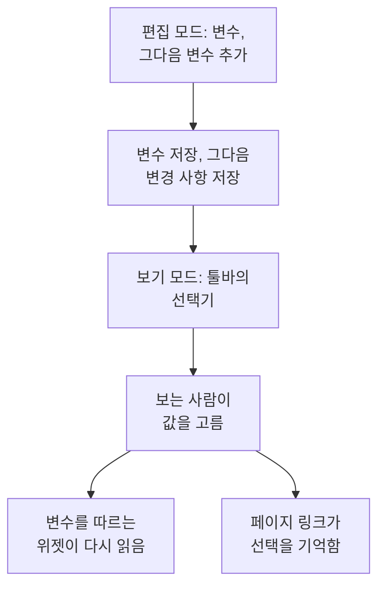

# 대시보드 변수 및 필터

변수는 대시보드 툴바의 선택기입니다. `service` 변수를 추가하면 같은 차트로 `checkout`, `payments`, `search`를 보여 줄 수 있습니다. 거의 똑같은 대시보드를 세 개 만드는 대신, 보는 사람이 툴바에서 고릅니다.

:::cards
- [변수 추가](#변수-추가): 이름을 붙이고, 값의 출처를 고르고, 저장합니다.
- [변수 소스](#변수-소스): Telemetry Attribute, Project Labels, Custom List, Text Input.
- [위젯이 변수를 쓰는 방식](#위젯이-변수를-쓰는-방식): 어떤 위젯이 어떤 변수를 따르는지.
- [선택을 유지하는 링크](#선택을-유지하는-링크): 같은 서비스로 열리는 링크를 보냅니다.
:::

## 변수의 작동 방식

변수는 대시보드를 편집하면서 정의하며, 대시보드와 함께 저장됩니다. 보기 모드에서 각 변수는 툴바의 선택기입니다. 보는 사람이 값을 고르면, 그 변수를 따르는 모든 위젯이 데이터를 다시 읽고, 페이지의 링크가 선택을 기억합니다.



## 변수 추가

:::steps
### 변수 대화 상자 열기

대시보드를 열고 **⋯ → 대시보드 편집**을 고른 다음, 툴바의 **변수**를 클릭합니다. **대시보드 변수** 대화 상자에 대시보드의 변수가 나열되고, 툴바의 버튼에 그 개수가 표시됩니다.

### 하나 추가하기

**변수 추가**를 클릭합니다. 새 변수는 텔레메트리 속성을 읽습니다. 필요하면 다른 **소스**를 고르세요.

### 내용 입력

위젯과 링크가 쓰는 **이름**을 지정합니다(예: `service`). 영문자, 숫자, 밑줄을 쓸 수 있고, 영문자나 밑줄로 시작해야 하며, 대시보드의 다른 이름과 겹치지 않아야 합니다. 원하면 툴바에 표시할 **레이블**과 처음 선택될 **기본값**을 지정하고, 보는 사람이 여러 값을 고를 수 있게 하려면 **다중 선택 허용**을 선택합니다.

### 저장하기

**변수 저장**을 클릭한 다음 툴바의 **변경 사항 저장**을 클릭합니다. 대시보드가 보기 모드로 돌아오면 변수의 선택기가 툴바에 나타납니다.
:::

나중에 변수를 바꾸거나 없애려면 대화 상자를 다시 열어 필드를 바꾸거나, 옆의 휴지통을 클릭합니다.

## 변수 소스

**소스**는 변수의 값이 어디서 오는지, 그리고 어떤 위젯이 그 변수를 따르는지를 정합니다.

| 소스 | 값의 출처 | 다중 선택 |
| --- | --- | --- |
| Telemetry Attribute | 메트릭에 있는 속성 키 하나의 값(예: `service.name`) | 예 |
| Project Labels | 허용한 프로젝트 레이블(1개부터 1,000개까지) | 예 |
| Custom List | 쉼표로 구분해 입력한 값(예: `prod, staging`) | 예 |
| Text Input | 보는 사람이 입력한 내용 | 아니요 |

### Telemetry Attribute

**속성 키**를 지정합니다(예: `service.name`, `host.name`, `k8s.namespace.name`). 필드는 텔레메트리에 들어 있는 키를 제안합니다. 선택기는 최근 하루 동안의 메트릭에서 읽은 그 키의 값을 최대 100개 보여 주므로, 새 서비스는 대시보드를 편집하지 않아도 선택기에 나타납니다.

별도의 목록이 필요 없기 때문에 가장 많이 쓰는 소스입니다. 값은 이미 보내고 있는 것 그대로입니다.

### Project Labels

기존 프로젝트 레이블을 골라 대시보드 드롭다운으로 제공합니다. 예를 들어 `UNIT`이라는 변수를 만들고 소스를 **프로젝트 레이블**로 지정한 다음, 레이블 `0660`과 `0661`을 고릅니다.

대시보드는 고른 레이블의 ID와 표시 이름을 저장합니다. 필터링에는 ID를 쓰므로 프로젝트 레이블의 이름을 바꿔도 연결이 끊기지 않습니다. 표시 이름은 대시보드와 함께 저장되므로, 이름을 바꾼 레이블의 표시 이름을 갱신하려면 변수 편집기에서 그 레이블을 다시 선택하세요. 공개 대시보드도 저장된 같은 선택지를 보여 줍니다.

**모니터 목록** 위젯에서 **필터 → 레이블 변수**를 열고 `UNIT`을 선택합니다. 이제 `0660`을 고르면 그 레이블이 있는 모니터가 표시됩니다. 다른 위젯은 변수를 명시적으로 지원하고 연결하지 않는 한 영향을 받지 않습니다. **SLO 목록**에도 같은 **레이블 변수** 설정이 있습니다.

위젯의 고정 필터는 계속 적용됩니다. 예를 들어 고정 레이블 `network`가 있고 `UNIT`이 `0660`이면, 모니터는 두 레이블을 모두 가져야 합니다. 여러 단위를 고르면 그중 하나와 일치하면 됩니다. **전체**를 고르면 변수 조건만 빠지고, 레이블, 상태, 모니터 유형의 고정 필터는 유지됩니다.

변수가 없거나 설정된 선택지 밖의 값을 고르면 오류가 표시됩니다. 일치하는 모니터가 없는 레이블을 고르면 빈 목록이 표시됩니다. 연결이 더 이상 필요 없으면 위젯에서 명시적으로 해제하세요.

### Custom List 및 Text Input

Custom List는 쉼표로 구분해 입력한 값을 제공합니다. Text Input은 IP 주소나 요청 ID처럼 보는 사람이 아무 값이나 입력하게 합니다. 둘 다 그 자체로는 위젯을 필터링하지 않습니다. 값은 `{{name}}`을 쓴 곳에 들어갑니다(아래 참고).

예전 대시보드의 Query 변수는 그대로 유지되며 툴바에 텍스트 상자를 보여 줍니다. OneUptime은 더 이상 쿼리에서 값을 불러오지 않습니다.

## 다중 선택과 기본값

**다중 선택 허용**을 선택하면 보는 사람이 값을 하나 이상 고르고, 위젯은 그중 어느 것과든 일치하는 것을 보여 줍니다. 빈 선택은 **전체**를 뜻하며, 다중 선택 변수는 항상 **전체**에서 시작하므로 그 **기본값**은 회색으로 비활성화됩니다.

단일 선택 변수는 **기본값**에서 시작하고, 기본값이 없으면 **전체**에서 시작합니다. **전체**는 변수의 필터를 없애므로 위젯이 모든 것을 보여 줍니다.

다중 선택은 대시보드를 떠나지 않고 "checkout과 payments를 함께" 비교할 때 쓰세요. 평균의 평균처럼 값끼리 숫자를 더할 수 없는 경우에는 피하세요.

## 위젯이 변수를 쓰는 방식

소스마다 위젯에 닿는 방식이 다릅니다.

- **텔레메트리 속성** 변수는 위젯에서 아무것도 설정하지 않아도 필터링합니다. 모든 메트릭 차트, 값, 게이지, 테이블, 그리고 **로그 차트**, **로그 스트림**, **트레이스 차트**, **트레이스 표**, 그리고 리소스에 그 속성이 있는 인프라 목록(호스트 목록의 `host.name`, Kubernetes 목록의 `k8s.namespace.name` 등)입니다. 그 속성이 없는 메트릭의 차트는 값이 선택되어 있는 동안 데이터를 보여 주지 않습니다. 다시 보려면 **전체**를 고르세요. **트레이스 목록**과 인시던트 및 경고 목록은 따르지 않습니다.
- **프로젝트 레이블** 변수는 **레이블 변수**에서 그 변수를 지정한 **모니터 목록**이나 **SLO 목록**을 필터링합니다.
- **모든 변수**는 텍스트에 `{{name}}`으로 쓸 수 있습니다. [HTML 위젯](/docs/dashboards/widgets#html), [외부 데이터 소스](/docs/dashboards/data-sources)의 쿼리, **모니터 목록**이나 **SLO 목록**의 제목에 쓸 수 있습니다. `{{UNIT}} NETWORK` 같은 제목은 `0660 NETWORK`, `0660, 0661 NETWORK`, `All NETWORK`로 표시됩니다. 제목은 표시되는 텍스트만 정합니다. 모니터 쿼리를 필터링하려면 **레이블 변수**를 설정하세요.

[SLO 위젯](/docs/dashboards/widgets#slo)은 `sloName` 키의 Telemetry Attribute 변수를 따를 수 있어서, 보는 사람이 표시할 SLO를 고를 수 있습니다.

## 선택을 유지하는 링크

페이지의 링크는 각 변수의 선택을 `?var-<name>=<value>` 형식으로 담으며, 여러 값은 쉼표로 구분합니다. 따라서 복사한 링크는 명시적인 **전체**까지 포함해 같은 선택으로 열립니다. 다음과 같은 링크는 payments 서비스로 열립니다.

```text title="A dashboard link with a variable"
https://oneuptime.com/dashboard/<project-id>/dashboards/<dashboard-id>?var-service=payments
```

링크에는 고른 시간 범위와 자동 새로 고침도 `range`와 `refresh`로 담기므로, 받는 사람도 같은 화면을 봅니다. 값 목록은 [링크 보내기](/docs/dashboards/sharing#링크-보내기)에 있습니다.

## 예시: 서비스마다 대시보드 하나

서비스 대시보드에는 보통 다음이 있습니다.

1. `service` 변수. 소스는 Telemetry Attribute, 속성 키는 `service.name`, 기본값은 가장 바쁜 서비스입니다. 차트가 한 번에 서비스 하나를 보여 주도록 다중 선택은 끈 채로 둡니다.
2. `namespace` 변수. 소스는 Telemetry Attribute, 속성 키는 `k8s.namespace.name`이며, 네임스페이스를 비교할 수 있도록 다중 선택을 켭니다.
3. `environment` 변수. 소스는 Custom List, 값은 `prod, staging`이며, 데이터 소스 쿼리에서 `{{environment}}`로 씁니다.
4. 그 속성을 읽는 위젯. 서비스 메트릭의 차트와 값, 로그 스트림, Kubernetes 파드 목록입니다.

결과는 맨 위에 선택기 세 개가 있는, 서비스마다 쓸 수 있는 대시보드 하나입니다.

## 다음 단계

:::cards
- [대시보드 위젯](/docs/dashboards/widgets): 어떤 위젯이 어떤 변수를 따르는지.
- [외부 데이터 소스](/docs/dashboards/data-sources): PromQL이나 SQL 쿼리에 변수를 넣습니다.
- [공유 및 공개 대시보드](/docs/dashboards/sharing): 공개 대시보드의 변수.
- [대시보드 작성](/docs/dashboards/authoring): 편집 모드, 저장, 시간 범위.
:::
