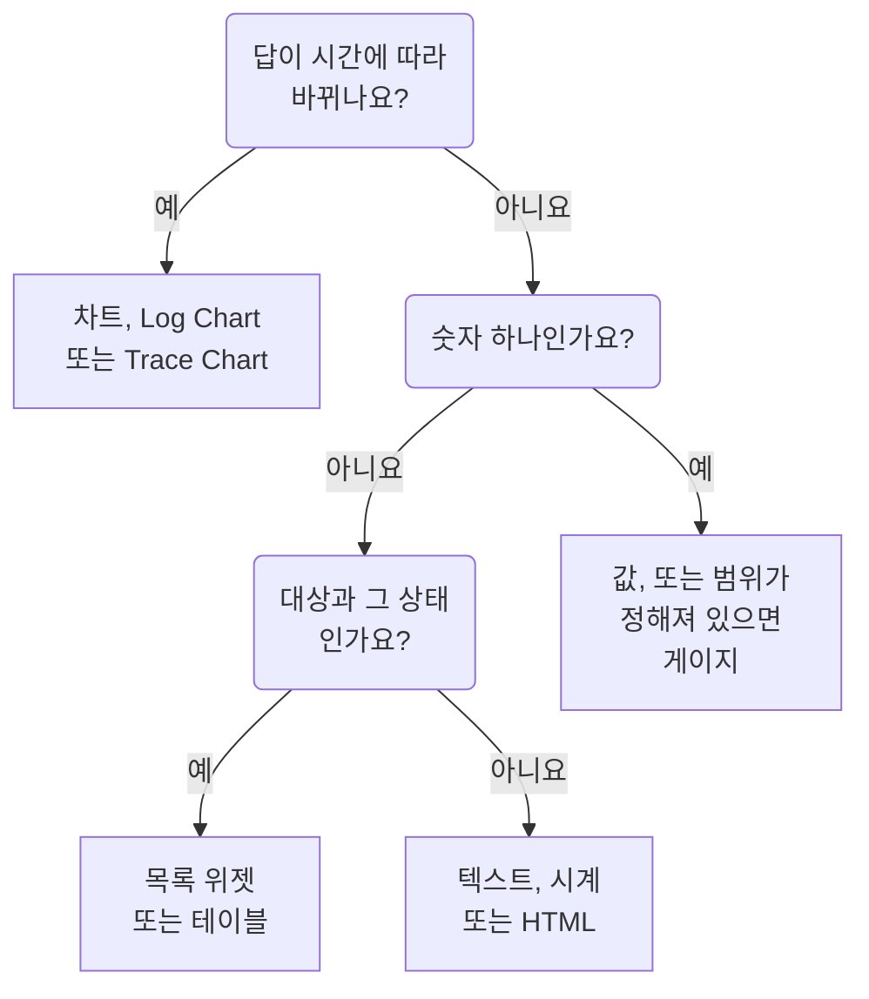

# 대시보드 위젯

위젯은 대시보드의 타일 하나입니다. 이 페이지에서는 **위젯 추가** 카탈로그의 모든 위젯이 무엇을 보여 주는지, 어떤 설정이 중요한지를 카탈로그의 그룹별로 설명합니다. 위젯을 그리드에 배치하고 저장하는 방법은 [대시보드 작성](/docs/dashboards/authoring)을 참고하세요.

:::cards
- [어떤 위젯을 써야 하나요?](#어떤-위젯을-써야-하나요): 타일이 답하는 질문으로 고릅니다.
- [차트와 숫자](#차트와-숫자): 메트릭 쿼리로 만드는 차트, 값, 게이지, 테이블.
- [로그, 트레이스, 보안](#로그-트레이스-보안): 볼륨 차트, 실시간 스트림, 목록.
- [목록과 표 정렬](#목록과-표-정렬): 열로 정렬하고, 모두가 보는 순서를 정합니다.
- [위젯을 표시할 수 없을 때](#위젯을-표시할-수-없을-때): 고장 난 위젯이 보여 주는 것과 고치는 방법.
:::

## 어떤 위젯을 써야 하나요?

타일이 답해야 할 질문에서 시작하세요.

| 질문 | 위젯 |
| --- | --- |
| 메트릭이 시간에 따라 어떻게 변했나요? | **차트** |
| 어떤 심각도의 로그가 시간에 따라 얼마나 쌓였나요? | **로그 차트** |
| 요청은 얼마나 빠르고, 시간에 따라 얼마나 실패하나요? | **트레이스 차트** |
| 지금 이 순간의 숫자 하나는? | **값**, 범위가 정해져 있다면 **게이지** |
| 어떤 호스트, 서비스, 엔드포인트가 눈에 띄나요? | **테이블** 또는 **트레이스 표** |
| 지금 무슨 일이 일어나고 있나요? | **로그 스트림**, **트레이스 목록**, **인시던트 목록** 또는 **경고 목록** |
| 모든 사이트가 정상인가요? | **모니터 목록** |
| 약속한 신뢰성을 지키고 있나요? | **SLO** 또는 **SLO 목록** |
| 클러스터와 호스트는 어떤 상태인가요? | 인프라 그룹의 위젯 |
| 네트워크는 세계 어디에 있고, 무엇이 다운되었나요? | **네트워크 지도** |
| 제목, 메모, 다른 사무실의 시각은? | **텍스트** 또는 **시계** |
| OneUptime 밖에 보관된 데이터는? | 외부 데이터 소스 그룹의 위젯 |
| 어떤 위젯으로도 안 되는 것은? | **HTML**, 다른 위젯으로는 안 된다는 것을 확인한 뒤에 |



대부분의 대시보드는 몇 가지를 섞어 씁니다. 맨 위에 차트, 그 옆에 값 한두 개, 텍스트 제목, 그 아래에 목록 한두 개를 두는 식입니다.

## 차트와 숫자

이 네 위젯은 메트릭 탐색기와 같은 방식으로 만든 메트릭 쿼리를 읽습니다. 메트릭과 집계를 고르고, 속성 필터를 추가하고, 속성으로 그룹화하면 값마다 계열이 하나씩 생깁니다.

### 차트

대시보드 시간 범위에 걸친 하나 이상의 메트릭 쿼리의 시계열입니다. **Chart Type**으로 선, 막대, 영역, 누적 영역, 원형 차트를 그립니다. **Additional Queries**는 같은 축에 다른 메트릭을 겹치고, **Formulas**는 `+`, `-`, `*`, `/`, `%`, `^`와 괄호로 그것들을 조합합니다(예: `(1 - a) * 100`). 각 쿼리의 표시 설정에서 범례와 단위, 색, 경고선과 심각선, 그리고 증가하기만 하는 카운터를 위한 초당 비율을 추가합니다.

선의 모양이 상황을 말해 줄 때 쓰세요. 지연 시간, 오류, 처리량, 큐 깊이 등입니다.

### 값

스파크라인이 있는 큰 숫자 하나입니다. 시간 범위 전체에 걸친 쿼리 값으로, 합계나 개수면 합계, 최댓값이면 가장 높은 값, 최솟값이면 가장 낮은 값, 그 밖에는 평균입니다. 화살표는 같은 방식으로 구한 범위의 후반부를 전반부와 비교하며, **Trend Direction**에 따라 색이 정해집니다. 값이 높을수록 좋은지 나쁜지, 또는 메트릭 이름으로 판단합니다. 화살표를 가리키면 두 절반의 값을, 스파크라인을 가리키면 각 지점의 값과 시간을 볼 수 있습니다. 값이 **Warning Threshold**에 이르면 배경이 노란색으로, **Critical Threshold**에 이르면 빨간색으로 바뀝니다.

숫자 하나가 질문에 답할 때 쓰세요. 오류율, P95 지연 시간, 오늘 처리한 요청 수 등입니다.

### 게이지

최솟값과 최댓값 사이의 다이얼로, 따로 정하지 않으면 0과 100입니다. **Warning Threshold**부터 노란 영역, **Critical Threshold**부터 빨간 영역이 됩니다.

값이 정해진 범위 안에 있을 때 쓰세요. CPU나 디스크 사용률(퍼센트), 큐의 용량 등입니다.

### 테이블

메트릭 값을 행으로 보여 줍니다. **Group By Attributes**를 쓰면 값마다 한 행이 됩니다(예: `host.name`마다 한 행). 쓰지 않으면 각 행은 시간 구간입니다. **Metrics & Columns**로 열을 정합니다. 메트릭과 그에 대한 수식(예: 퍼센트로 나타낸 가용성)입니다. 그룹화할 때는 **Reduce across time**이 각 행의 계열을 값 하나로 줄입니다. 마지막 값, 평균, 합계, 최솟값, 최댓값 중 하나입니다.

열에서 **임계값으로 색상 표시**를 켜면 그 열의 값에 색상이 표시됩니다. **경고 임계값**에 도달한 값은 삼각형과 함께 호박색으로, **심각 임계값**에 도달한 값은 원과 함께 빨간색 굵은 글꼴로 표시됩니다. 백분율 열은 80과 90에서 시작합니다. 남은 디스크 공간처럼 낮은 값이 문제인 열에서는 **방향**에서 **낮을수록 나쁨**을 고르세요.

임계값은 테이블에 표시되는 숫자로 판단하므로, `system.cpu.utilization`처럼 1에 대한 비율로 보내는 사용률 메트릭은 백분율로 표시되고 비교됩니다. **임계값 색상**에서 **배경 색상**을 고르면 숫자 대신 셀 전체에 색이 칠해집니다.

추세가 아니라 내역을 볼 때 쓰세요. 가장 시끄러운 호스트, 서비스별 오류, 엔드포인트별 요청 등입니다.

## 텍스트, 시계, HTML

이 위젯들은 데이터 소스가 필요 없습니다.

### 텍스트

제목, 메모, 런북 링크를 위한 한 줄 또는 한 덩어리의 텍스트입니다. **Markdown**을 켜면 제목, 링크, 목록, 코드, 테이블을 그립니다. 끄면 입력한 그대로 표시되며, 원하면 굵게, 기울임꼴, 밑줄로 꾸밀 수 있습니다.

### 시계

어떤 시간대의 현재 시각이든 숫자나 아날로그 시계판으로 보여 주며, "시드니 사무실" 같은 레이블을 붙일 수 있습니다. 시간대를 지정하지 않으면 보는 사람 각자의 시간대를 보여 줍니다. 사무실마다 하나씩 추가하면 누가 깨어 있는지 알 수 있습니다.

### HTML

직접 작성한 HTML, CSS, JavaScript를 위젯으로 그립니다. 설정은 HTML 본문, 선택 사항인 스타일시트, 선택 사항인 스크립트, 권한 스위치 세 개입니다.

기본 제공 위젯으로는 안 되는 것이 필요할 때 쓰세요. 서드파티 배지 임베드, 내부 API에서 가져온 테이블, 사용자 지정 범례, 내 도구로 가는 스타일 링크 모음 등입니다.

#### 할 수 있는 것과 없는 것

위젯은 독립적으로 격리된 오리진의 샌드박스 프레임 안에서 렌더링됩니다. 그 프레임 안에서 코드는 거의 무엇이든 할 수 있습니다. DOM을 만들고, 타이머를 돌리고, 어떤 URL에서든 데이터를 가져오고, canvas에 그릴 수 있습니다.

할 수 없는 것은 주변의 OneUptime 페이지에 닿는 것입니다. 대시보드의 DOM, 쿠키, 로컬 저장소, API 세션에 접근할 수 없고, 브라우저 탭을 다른 곳으로 이동시킬 수도 없습니다. 대시보드가 비공개든 공개 공유든 마찬가지입니다.

무언가를 붙여 넣기 전에 알아 둘 점이 두 가지 있습니다.

- 위젯에서 보내는 `fetch`는 불투명 오리진에서 보내는 교차 출처 요청이므로, 호출하는 서버가 CORS로 허용해야 합니다. 여기서 OneUptime API를 호출하는 것은 지원되지 않습니다.
- 위젯은 처음에 투명합니다. 카드를 채우게 하려면 CSS에서 `body`에 배경을 지정하세요. 어두운 테마에서는 텍스트가 밝은 색으로 시작하고 `<html>` 요소에 `dark` 클래스가 붙습니다. 어두운 테마에만 스타일을 적용하려면 CSS 규칙을 `html.dark`로 시작하세요.

#### 대시보드 변수 사용

HTML, CSS, JavaScript 어디에든 `{{variableName}}`을 쓰면, 위젯이 렌더링되기 전에 그 변수의 현재 값으로 바뀝니다. 새 값을 고르면 위젯이 다시 렌더링됩니다. 존재하지 않는 변수를 가리키는 자리 표시자는 그대로 남습니다.

스크립트는 같은 값과 대시보드의 시간 범위를 `window.ONEUPTIME`으로 받습니다.

```javascript title="window.ONEUPTIME"
window.ONEUPTIME.variables.environment; // current value, or "" if unset
window.ONEUPTIME.startDate; // ISO 8601 string, start of the dashboard's time range
window.ONEUPTIME.endDate; // ISO 8601 string, end of it
```

위젯은 대시보드가 새로 고쳐질 때마다 다시 로드되므로, 데이터를 직접 가져오는 위젯도 새로 고침 간격을 따라갑니다.

#### 권한

**Run JavaScript**(기본값 켜짐)는 스크립트를 실행합니다. 끄면 마크업과 스타일만 렌더링하며, 이때 스크립트는 단순히 차단되는 것이 아니라 위젯에서 완전히 빠집니다.

**Open links in a new tab**(기본값 켜짐)은 링크와 `window.open`이 브라우저 탭을 열 수 있게 합니다. 링크는 항상 새 탭에서 열리며, 위젯이 대시보드 자체를 이동시킬 수는 없습니다.

**Allow forms to submit**(기본값 꺼짐)은 위젯 안의 `<form>`을 제출할 수 있게 합니다.

이 위젯이 무엇을 실행할지는 대시보드를 편집할 수 있는 사람이 정하고, 대시보드를 보는 모든 사람이 그것을 실행합니다. 공개 대시보드에서는 익명 방문자도 포함됩니다. HTML 위젯이 있는 대시보드의 편집 권한은, 배포하는 다른 코드에 대한 접근 권한처럼 다루세요.

## 로그, 트레이스, 보안

| 위젯 | 보여 주는 것 | 중요한 설정 |
| --- | --- | --- |
| **로그 차트** | 시간에 따른 로그 양. 심각도마다 계열 하나로, 막대, 선, 영역으로 그립니다. | 심각도, 본문에 포함된 텍스트, 속성 필터. |
| **로그 스트림** | 필터와 일치하는 최신 로그 줄. | 심각도, 본문에 포함된 텍스트, `@service.name:checkout` 같은 속성 필터, 행 수. |
| **트레이스 차트** | 시간에 따른 요청 수, 오류 수, 응답 시간(평균, 최솟값, 최댓값, P50부터 P99까지). | 메트릭, 집계할 스팬, 계열을 나눌 속성. |
| **트레이스 목록** | 최신 트레이스와 그 소요 시간, 상태. | 상태, 행 수. |
| **트레이스 표** | 요청 수 기준 상위 스팬 이름, 상태, 속성 값과, 그 응답 시간의 중앙값, 평균, 최솟값, 최댓값. | 행을 묶을 기준과 집계할 스팬. |
| **보안 이벤트** | 최신 보안 이벤트와 그 심각도, 이벤트 클래스, 호스트. | 심각도, 이벤트 클래스, 메시지에 포함된 텍스트. |
| **보안 이벤트 흐름** | 보안 이벤트가 출처에서 이벤트 클래스를 거쳐 심각도로 이어지는 흐름. | 심각도, 이벤트 수. |

트레이스 위젯은 트레이스 탐색기처럼 루트 스팬만 셉니다. 설정에서 하위 스팬을 포함한 경우는 예외입니다. 흔한 구성은 맨 위에 지연 시간 차트를 두고 그 아래에 느린 트레이스 목록을 두는 것입니다.

## 인시던트, 경고, 모니터

| 위젯 | 보여 주는 것 | 필터 |
| --- | --- | --- |
| **인시던트 목록** | 인시던트와 그 상태, 심각도. | 미해결, 확인됨, 해결됨. 심각도, 상태, 모니터, 레이블. |
| **경고 목록** | 경고와 그 상태, 심각도. | 미해결, 확인됨, 해결됨. 심각도, 상태, 모니터, 레이블. |
| **모니터 목록** | 모니터와 그 현재 상태. | 정상 여부, 상태, 모니터 유형, 레이블, 또는 보는 사람이 툴바에서 고르는 **레이블 변수**. |

대부분의 목록 위젯처럼 이 세 위젯은 테이블 대신 상태별로 색칠한 셀의 벌집 모양을 그릴 수 있습니다. **보기 모드**에서 고르세요. 대시보드의 시간 범위와 상관없이 현재 상태를 보여 줍니다.

## 서비스 수준 목표

### SLO

서비스 수준 목표 하나를 숫자 하나 또는 시간에 따른 선으로 그립니다.

**설정**: 어떤 SLO인지(또는 대시보드 변수에서 고른 SLO), 세 숫자 중 어느 것인지(SLI, Error Budget Remaining, Burn Rate), Tile 또는 차트 표시, 그리고 선택 사항인 제목.

- **Tile**은 현재 숫자와, 해당하는 경우 두 번째 줄을 보여 줍니다. SLI 아래에는 목표, 오류 예산 아래에는 남은 시간(분)입니다. 상태 표시가 전체에 색을 입힙니다.
- **차트**는 같은 숫자를 대시보드의 시간 범위에 걸쳐 그리며, SLI 계열에 목표를 점선으로 표시합니다. 기록은 평가 워커가 몇 분마다 쓰므로, 새로 만든 SLO는 처음 평가될 때까지 차트가 비어 있습니다.

대시보드가 "지금 무슨 일이 일어나고 있나?"보다 "약속한 것을 지키고 있나?"에 답할 때 쓰세요.

SLO 위젯은 [공개 대시보드](/docs/dashboards/sharing)에서 작동합니다. 게시되는 것은 SLO의 주요 숫자(이름, 목표, 현재 SLI, 남은 오류 예산, 소진율, 상태)이며, 위젯이 그중 무엇을 그리든 상관없습니다. 정의는 비공개로 유지됩니다. 지켜보는 모니터, 레이블, 설명, 쿼리, 평가 일정은 공개 방문자에게 절대 전송되지 않습니다. Tile 위젯은 그 현재 숫자만 게시하고, 차트 위젯은 그리는 계열 하나의 기록도 게시하지만 그 밖에는 아무것도 게시하지 않습니다.

### SLO List

모든 SLO를 상태, SLI, 오류 예산, 소진율과 함께, 남은 예산이 적은 순서로 보여 줍니다. 상태나 레이블, 또는 보는 사람이 툴바에서 고르는 **레이블 변수**로 필터링하세요. [SLO 메트릭 및 대시보드](/docs/slo/metrics)에서 두 SLO 위젯이 쓰이는 모습을 볼 수 있습니다.

## 인프라

이 위젯들은 에이전트나 수집기가 OneUptime에 보고하는 리소스를 나열합니다. 필터에서 클러스터, 호스트, 네임스페이스로 좁히고, 목록이나 벌집 모양으로 보여 주세요.

| 그룹 | 위젯 | 데이터를 보내는 곳 |
| --- | --- | --- |
| **호스트** | 연결 상태, OS, CPU, 메모리가 있는 **호스트** | `host.name`을 보내는 모든 OpenTelemetry 수집기 |
| **Kubernetes** | **파드**, **노드**, **네임스페이스**, **배포**, **StatefulSets**, **DaemonSets**, **작업**, **CronJobs** | [Kubernetes 에이전트](/docs/monitor/kubernetes-agent) |
| **Docker** | **호스트**, **컨테이너**, **이미지**, **네트워크**, **볼륨** | Docker 에이전트 |
| **Docker Swarm** | **노드**, **서비스** | Docker Swarm 에이전트 |
| **Podman** | **호스트**, **컨테이너**, **이미지**, **네트워크**, **볼륨** | Podman 에이전트 |
| **Proxmox** | **노드**, **게스트** | Proxmox 에이전트 |
| **VMware** | **호스트**, **가상 머신** | VMware 에이전트 또는 연결한 vCenter |
| **Ceph** | 상태별로 색칠한 벽으로 보여 주는 **OSD**와 **풀** | Ceph 에이전트 |
| **스토리지 어레이** | **볼륨**과, 상태별로 색칠한 벽으로 보여 주는 **하드웨어** | Storage Array 에이전트 |

인프라의 상태와, 그 위에서 돌아가는 워크로드의 텔레메트리를 한 페이지에 함께 보고 싶을 때 쓰세요.

### Network Map

네트워크 사이트를 세계 지도에 그립니다. 각 사이트는 자신의 위도와 경도에 고정되고, 모아서 집계한 모니터 상태로 색이 정해집니다. 가까운 사이트들은 안에 개수가 적힌 마커 하나를 공유하며, 사이트 하나만 나타내는 마커를 클릭하면 그 사이트가 열립니다.

지도는 그린 사이트에 맞춰 스스로 영역을 잡습니다. 한 나라 안의 네트워크라면 그 나라가 화면을 채우고, 여러 대륙에 퍼져 있다면 세계 전체로 열립니다. 확대나 이동 컨트롤은 없습니다. 대시보드 타일은 한 장의 그림이며, 계층을 따라가는 곳은 Network 아래의 Network Map 페이지입니다.

지도 위에는 다운된 사이트 수가 표시됩니다. 초록 점 이백 개 사이의 두 픽셀짜리 빨간 점은 대시보드를 보는 거리에서는 아무도 읽을 수 없기 때문입니다. 아래에는 지도가 보여 주지 않는 것을 알려 주는 커버리지 줄이 있습니다. 좌표가 없는 사이트와, 행 수 한도에 도달했는지 여부입니다.

**설정**: 제목, 지도 또는 목록 보기, 그릴 최대 사이트 수, 사이트 이름 표시 여부, 사이트 유형과 상태별 필터. 지도가 너무 복잡해져 읽을 수 없게 되면 사이트 이름은 자동으로 숨겨지며, 도구 설명은 계속 모든 마커의 이름을 보여 줍니다.

사이트는 좌표가 있어야 나타납니다. 사이트에 위도와 경도를 추가하면(또는 CSV에서 가져오면) 지도에 고정됩니다.

## 외부 데이터 소스

외부 데이터 소스 그룹은 OneUptime이 소유하지 않은 시스템(Prometheus, PostgreSQL, MySQL, SQL Server, ClickHouse, Loki, Elasticsearch 또는 모든 REST API)의 데이터로 **차트**, **값**, **게이지**, **테이블**을 그립니다. 시스템을 한 번 연결한 다음, 각 위젯의 쿼리를 그 시스템의 언어로 작성합니다. 방법은 [외부 데이터 소스](/docs/dashboards/data-sources)에서 설명합니다.

## 목록과 표 정렬

열 머리글을 클릭하면 목록이나 표를 그 열로 정렬합니다. 첫 번째 클릭은 아래 표에 적힌 대로 정렬하고, 다음 클릭은 반대 방향으로, 그다음 클릭은 위젯을 원래 순서로 되돌립니다. 위젯이 이미 그 열로 정렬되어 있으면 클릭할 때 순서가 뒤집힙니다. 행을 정렬한 열에는 화살표가 표시됩니다.

| 열 | 첫 번째 클릭 | 다음 클릭 |
| --- | --- | --- |
| 상태 또는 심각도 | 나쁜 순 | 좋은 순 |
| 시간 | 최신순 | 오래된순 |
| 숫자 | 높은 순 | 낮은 순 |
| 텍스트 | A→Z | Z→A |

무엇이 나쁜지는 프로젝트 자체의 순서를 따릅니다. 모니터 상태는 우선순위로, 인시던트나 알림의 심각도와 상태는 프로젝트에서 정한 순서로 정하며, 중단되었거나 준비되지 않았거나 전원이 꺼진 리소스는 정상 리소스보다 앞에 옵니다. Pod의 단계는 Failed, Unknown, Pending, Running과 Succeeded 순으로 정렬됩니다. SLO의 SLI와 오류 예산, Proxmox 게스트의 VMID는 낮은 순으로 정렬됩니다.

화면에 보이는 행만이 아니라 목록 전체를 정렬합니다. 25개 행을 보여 주는 목록을 나쁜 순으로 정렬하면 전체에서 가장 나쁜 25개가 보입니다. 값이 같은 행은 위젯의 원래 순서를 유지합니다. 보안 이벤트의 메시지처럼 목록 전체를 정렬할 수 없는 열은 정렬되지 않습니다.

### 나만의 정렬

정렬은 나만의 것입니다. 브라우저가 그 대시보드의 그 위젯에 대해 기억하므로 새로 고침이나 벽면 스크린 재부팅 후에도 유지되며, 다른 사람에게는 보이지 않습니다. 위젯을 원래 순서로 되돌리는 클릭은 내 정렬을 잊고, 이후 위젯은 원래 순서를 따릅니다. 나중에 편집자가 그 순서를 바꾸어도 마찬가지입니다.

### 모두가 보는 순서

위젯이 모두에게 열리는 순서를 정하려면 위젯을 편집해 **정렬**에서 순서를 고르거나 **Live Preview**에서 열 머리글을 클릭한 다음 **변경 사항 저장**을 클릭합니다. 새 순서는 바로 보입니다. 위젯을 직접 정렬한 뷰어는 자신의 정렬을 유지합니다.

대시보드 템플릿은 호스트, 노드, Pod, Swarm 서비스, 네트워크 장치 목록을 나쁜 순으로 엽니다.

API와 Terraform에서는 순서가 위젯의 `arguments.sort`입니다. 열과 방향으로, 예를 들어 `status:desc`처럼 씁니다. 목록 위젯은 자신에게 없는 열을 거부하며, 오류에는 사용할 수 있는 정렬이 나열됩니다.

## 공개 대시보드에서

[공개 대시보드](/docs/dashboards/sharing)는 대부분의 위젯을 방문자에게 그려 주며, 각 위젯은 설정된 내용만 보여 줍니다. 몇몇 위젯은 로그인한 세션 없이는 표시할 수 없습니다.

- **로그 차트**, **트레이스 차트**, **트레이스 표**, **보안 이벤트**, **보안 이벤트 흐름**은 그 자리에 공개 대시보드에서는 사용할 수 없다고 표시합니다.
- 외부 데이터 소스 위젯은 설정이 곧 쿼리이므로 공개 대시보드에서 완전히 빠집니다.

## 위젯을 표시할 수 없을 때

그릴 수 없는 위젯은 그 자리에 **이 위젯을 표시할 수 없습니다**를 표시하고, 대시보드의 나머지는 계속 작동합니다. OneUptime에 그 유형의 위젯이 없을 때(제거되었거나, API로 대시보드를 작성할 때 철자가 틀렸거나, 더 새로운 버전에서 추가된 경우) 또는 위젯이 그려지는 중에 실패할 때(예를 들어 저장된 설정이 불완전한 경우) 이렇게 됩니다.

대시보드를 편집할 수 있다면 그 위젯의 **위젯 편집**을 클릭합니다. 대시보드가 편집 모드로 바뀌고 그 위젯의 설정이 열립니다. 설정을 고치거나 **위젯 삭제**를 클릭한 다음 **변경 사항 저장**을 클릭하세요. 그려지는 중에 실패한 위젯에는 **다시 시도**도 있으며, 다음 자동 새로 고침이나 시간 범위를 바꿀 때 다시 그려집니다.

공개 대시보드의 방문자에게는 위젯을 표시할 수 없었다는 사실만 알려 줍니다.

## 다음 단계

:::cards
- [대시보드 변수 및 필터](/docs/dashboards/variables): 보는 사람이 위젯의 대상을 서비스, 호스트, 고객으로 바꿀 수 있게 합니다.
- [외부 데이터 소스](/docs/dashboards/data-sources): Prometheus, SQL, Loki 등을 내 데이터 옆에 차트로 그립니다.
- [대시보드 작성](/docs/dashboards/authoring): 위젯을 추가하고, 배치하고, 저장합니다.
- [공유 및 공개 대시보드](/docs/dashboards/sharing): 팀 밖으로 대시보드를 공유합니다.
:::
