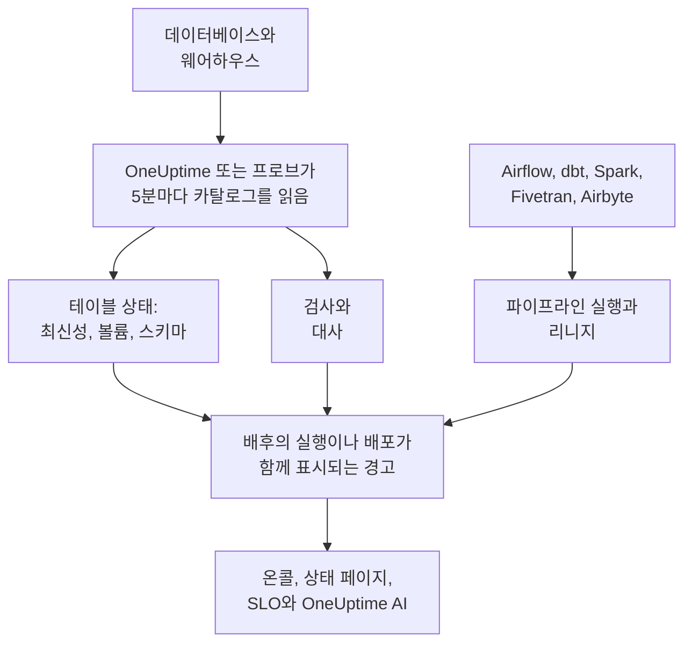

# 데이터 옵저버빌리티

데이터 옵저버빌리티는 PostgreSQL, MySQL, SQL Server, Oracle, MongoDB, Redshift, Snowflake, BigQuery, ClickHouse, Databricks, Athena에 있는, 회사가 의존하는 테이블을 지켜보다가 데이터가 늦거나, 빠지거나, 틀리거나, 깨지면 그 데이터를 쓰는 사람들이 알아차리기 전에 알려 줍니다. 각 테이블의 리듬을 스스로 학습하고, 각 데이터베이스의 카탈로그를 읽어 어떤 값도 밖으로 나가지 않게 하며, 모든 데이터 문제를 그 배후의 파이프라인 실행, 배포 또는 업스트림 테이블과 연결합니다.

다음 네 가지 질문에 답합니다.

:::cards
- [데이터가 최신인가요?](/docs/data-observability/table-health): 모든 테이블의 마지막 변경, 행 수, 크기, 열을 5분마다 읽고, 테이블이 늦어지거나 줄어들거나 형태가 바뀌면 경고합니다.
- [데이터가 올바른가요?](/docs/data-observability/checks): 테이블에 담긴 내용에 대한 검사, 테이블과 그 복사본 사이의 대사, 그리고 dbt의 테스트로, 실패하면 경고합니다.
- [데이터는 어디서 오고, 무엇에 쓰이나요?](/docs/data-observability/lineage-and-pipelines): 파이프라인, dbt, Fivetran, Airbyte, 뷰, 그리고 데이터베이스 자체의 쿼리 기록에서 얻는 리니지로, 문제 하나에는 경고 하나만 열립니다.
- [데이터를 쓰는 사람들이 믿을 수 있나요?](/docs/data-observability/data-products): 최신성 SLA가 있는 데이터 제품으로, 상태 페이지에 표시되고 SLO로 추적되며 "data as of" 배지가 붙습니다.
:::

## 작동 방식

1. 읽기 전용 로그인으로 **데이터베이스를 연결합니다**. 데이터 보안이 이미 알고 있는 데이터베이스는 아무것도 하지 않아도 감시되며, Google Cloud 연결이 찾은 모든 BigQuery 데이터 세트도 마찬가지입니다. 사설 네트워크에 있는 데이터베이스는 그곳에서 실행하는 프로브가 읽습니다.
2. **5분마다** OneUptime이 각 데이터베이스의 카탈로그와 통계를 읽습니다. 모든 테이블과 뷰, 그 열, 행 수, 크기, 그리고 마지막으로 바뀐 시점입니다. 어떤 테이블도 스캔하지 않으며, MongoDB에서는 최신 문서의 필드 이름만 읽습니다. 버킷의 경로도 같은 방식으로 감시할 수 있습니다.
3. **각 테이블의 리듬을 학습합니다**. 평소에 얼마나 자주 바뀌는지입니다. 리듬을 놓친 테이블은 지연된 것으로 판단하며, 행이 줄거나 열이 바뀐 테이블도 그렇다고 알려 줍니다.
4. **권장 경고** 는 이들 각각을 원하는 것만 골라 추가하는 모니터로 만들어 주며, 추가한 검사는 테이블에 담긴 내용을 읽습니다.
5. **리니지** 는 어떤 테이블이 어떤 테이블에 데이터를 공급하는지 알려 줍니다. 그래서 소스가 먼저 깨진 테이블의 경고는 그 소스의 결과로 처리되어, 경고가 열 개가 아니라 하나만 열립니다.

## 다른 점

- **OneUptime의 나머지 기능과 하나로 이어집니다.** 데이터 경고는 평범한 경고입니다. 온콜로 호출하고, 인시던트를 열고, 상태 페이지에 표시되며, SLO에 반영됩니다. 트레이스에서 테이블에 쓰는 것으로 보이는 서비스와 그 배포가 모든 테이블 경고 옆에 표시됩니다.
- **테이블마다 설정할 것이 없습니다.** 리듬, 일정, 평소 실행 시간은 각 테이블과 파이프라인이 실제로 하는 일에서 학습하며, 데이터베이스에 권장된 모니터는 나중에 만들어지는 테이블까지 포함해 그 안의 모든 테이블을 다룹니다.
- **원인 하나에 경고 하나.** 업스트림 테이블, 파이프라인 또는 데이터베이스에 이미 열린 경고가 있으면, 새 경고는 그 결과로서 그 경고에 합류하고 처음부터 인지된 상태가 되므로, 깨진 적재 하나는 한 번만 호출합니다.
- **모든 경고가 스스로를 설명합니다.** 가능성 높은 원인의 순위를 매기고, 테이블에 의존하는 대상과 소유자를 알려 주며, 경고에 대해 말한 내용에서 학습합니다. 하나를 **문제 아님** 으로 표시하면 같은 일은 다음에 조용히 지나갑니다.
- **OneUptime AI가 데이터를 압니다.** 데이터 경고 조사는 테이블에 쓰는 주체, 실행, 업스트림 테이블에서 시작하고, AI에게 질문, Slack, Microsoft Teams, AI 에이전트에서 테이블이 최신인지 물어볼 수 있으며, 검사를 문장 하나로 작성할 수 있습니다. [OneUptime AI와 API](/docs/data-observability/ai-and-api)를 참고하세요.

## 시작하기 전에

- **설정할 수 있는 역할.** Project Owner, Project Admin, Telemetry Admin은 데이터베이스를 연결합니다. 데이터 자산을 편집할 수 있는 사람은 누구나 검사, 대사, 데이터 제품을 추가하며, Viewer는 찾은 내용을 읽습니다. [권한 레퍼런스](/docs/permissions/reference)를 참고하세요.
- **각 데이터베이스의 읽기 전용 로그인.** [데이터베이스 연결](/docs/data-observability/connect)에 각 엔진에 필요한 최소한의 권한이 나와 있습니다. OneUptime은 트레이스, 클라우드 계정, Database Monitoring이 이미 알고 있는 데이터베이스를 제안합니다.

## 빠른 시작

:::steps
### 데이터베이스 연결하기

**데이터 관측 가능성** 을 열고 **데이터베이스** 로 이동해 **데이터베이스 연결** 를 선택합니다. 엔진을 고르고, 읽기 전용 연결 문자열이나 프로브가 연결 문자열을 읽어 오는 환경 변수의 이름을 입력합니다. [데이터베이스 연결](/docs/data-observability/connect)에서 엔진별 로그인을 보여 줍니다.

### 테이블 확인하기

5분 안에 테이블이 **테이블** 아래에 나타나며, 각각의 행 수, 크기, 마지막으로 바뀐 시점이 표시됩니다. 테이블이 두 번 바뀌면 최신성을 알 수 있습니다. 리듬을 지키는 동안은 **최신**, 리듬을 놓치면 **지연됨** 입니다.

### 권장 경고 추가하기

**데이터베이스** 에서 해당 데이터베이스의 **권장 알림** 를 선택하고 원하는 것을 추가합니다. 늦어진 테이블, 행 수가 급격히 줄거나 비정상적으로 적은 테이블, 열이 바뀐 테이블, 그리고 보고를 멈춘 데이터베이스입니다. 각각은 평범한 모니터이므로 온콜, 소유자, 유지 관리 기간, 상태 페이지가 다른 모니터와 똑같이 작동합니다.
:::

## 비용

OneUptime Cloud에서는 프로젝트의 처음 100개 테이블이 무료입니다. 그 이후에는 테이블당 월 $1이고, 1,000개를 넘는 테이블은 $0.25입니다. 뷰는 무료이며, 감시를 중단한 데이터베이스의 테이블도 무료입니다. 알림이 있는 검사는 활성 모니터로 청구됩니다. **데이터베이스** 및 **개요** 에서 프로젝트가 감시하는 테이블 수와 비용을 볼 수 있고, [요금](https://oneuptime.com/pricing)에 계산기가 있습니다.

자체 호스팅 OneUptime은 테이블 비용을 내지 않습니다.

## 다음 단계

:::cards
- [데이터베이스 연결](/docs/data-observability/connect): 엔진별 최소 권한 로그인과 사설 네트워크용 프로브.
- [테이블 상태](/docs/data-observability/table-health): 최신성, 볼륨, 스키마 변경, 사용되지 않는 테이블, 그리고 모든 테이블이 기록하는 메트릭.
- [검사 및 대사](/docs/data-observability/checks): 테이블 값에 대한 규칙, 테이블과 그 복사본의 비교, 그리고 dbt의 테스트.
- [리니지와 파이프라인](/docs/data-observability/lineage-and-pipelines): OpenLineage, dbt, Fivetran, Airbyte, 그리고 원인 하나에 경고 하나.
- [데이터 제품](/docs/data-observability/data-products): 데이터를 쓰는 사람들을 위한 최신성 SLA를 상태 페이지에 표시하고 SLO로 추적합니다.
- [OneUptime AI와 API](/docs/data-observability/ai-and-api): 조사, 문장으로 만드는 검사, AI 에이전트를 위한 최신성, 그리고 모든 엔드포인트.
:::
