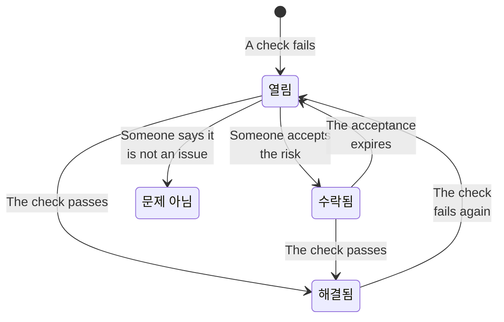

# 데이터 보안 검사 및 이슈

데이터 보안은 모든 저장소에 대해 아홉 개 그룹으로 나뉜 32가지 검사를 실행합니다. 검사는 저장소 하나에 대해 알려진 것(어떻게 구성되어 있는지, 그 안에서 무엇이 발견되었는지, 누가 접근할 수 있는지, 어디에 있는지)을 읽고 통과, 실패, 판단 불가 중 하나로 답합니다. 실패한 검사는 그 저장소에 이슈를 하나 열고, 검사를 통과하면 이슈는 저절로 닫힙니다. 이 페이지에서는 모든 검사, 이슈의 심각도와 위험 점수를 산정하는 방식, 그리고 이슈가 생애 동안 거치는 과정을 설명합니다.

:::cards
- [검사가 판단하는 방식](#검사가-판단하는-방식): 통과, 실패 또는 판단 불가, 그리고 실패가 얼마나 심각한지.
- [모든 검사](#모든-검사): 32가지 전부와 각각이 검사하는 내용, 해결 방법.
- [위험 점수](#위험-점수): 같은 심각도 안에서 이슈를 정렬하는 방식.
- [이슈가 거치는 과정](#이슈가-거치는-과정): 열림, 해결됨, 수락됨, 문제 아님.
- [여기서 수정](#여기서-수정): 클릭 한 번으로 공개 버킷을 차단하거나 스냅샷 공유를 중단합니다.
:::

## 검사가 판단하는 방식

각 검사는 저장소에 관한 사실을 읽고 다음 네 가지 중 하나로 답합니다.

| 답 | 의미 | 이슈에 일어나는 일 |
| --- | --- | --- |
| 통과 | 검사에서 잘못된 것을 찾지 못했습니다. | 열려 있거나 수락된 이슈가 해결됩니다. |
| 실패 | 검사에서 문제를 찾았으며, 본 것을 한 문장으로 말합니다. 이것이 이슈의 증거가 됩니다. | 이슈가 열리거나, 이미 열린 이슈가 최신 상태로 갱신됩니다. |
| 판단 불가 | 사실을 읽을 수 없었습니다. 역할에 없는 권한이나 실패한 호출 때문입니다. | 아무것도 바뀌지 않습니다. OneUptime이 확인할 수 없었을 때 문제가 해결되었다고 결론 내려서는 안 되므로, 열린 이슈는 열린 채로 남습니다. |
| 해당 없음 | 저장소의 종류에 그런 설정이 없습니다. | 열린 이슈가 해결됩니다. |

### 심각도는 데이터를 따릅니다

같은 문제라도 데이터가 민감할수록 더 중요합니다. 모든 검사는 민감도 수준마다 심각도를 정하며, 이슈는 저장소의 민감도에 해당하는 심각도를 받습니다. 카드 번호가 담긴 공개 버킷은 심각이고, 웹사이트 이미지가 담긴 공개 버킷은 낮음일 뿐입니다. 대시(—)는 이슈가 전혀 없다는 뜻입니다. 저장소의 민감도는 발견 사항에서 나오므로([민감한 데이터 유형](/docs/data-security/data-types#민감도) 참고), 콘텐츠 샘플이 있어야 심각도가 정확해집니다.

몇몇 검사는 대신 본 것으로 심각도를 정합니다. **시크릿이 저장되어 있음** 은 어느 저장소에서든 높음이고, 공개되어 있거나 다른 계정과 공유된 저장소에서는 심각입니다.

## 모든 검사

심각도는 제한, 기밀, 내부, 공개 데이터의 순서로 표시됩니다. 각 이슈의 페이지에는 해당 저장소를 위한 전체 수정 방법(콘솔 단계, CLI 명령, 그리고 적합한 경우 Terraform)이 저장소의 이름과 지역이 채워진 상태로 표시됩니다.

### 노출

| 검사 | 대상 | 검사 내용 | 심각도 | 해결 방법 |
| --- | --- | --- | --- | --- |
| 인터넷의 누구나 읽을 수 있음 (`public-read`) | 객체 스토리지, 웨어하우스, 검색 | 저장소의 정책, ACL 또는 IAM 바인딩이 로그인하지 않은 누구에게나 데이터 읽기를 허용합니다. | 심각 / 심각 / 높음 / 낮음 | 익명 보안 주체나 인증된 모든 보안 주체에 대한 권한 부여를 모두 제거하세요. 공개해야 하는 파일은 다른 것을 담지 않고 **의도적 공개** 로 표시된 저장소에 두어야 합니다. |
| 인터넷의 누구나 변경할 수 있음 (`public-write`) | 객체 스토리지, 웨어하우스, 검색 | 저장소의 정책, ACL 또는 IAM 바인딩이 누구에게나 데이터 쓰기나 삭제를 허용합니다. | 심각 / 심각 / 심각 / 높음 | 익명 보안 주체나 인증된 모든 보안 주체에 대한 쓰기 또는 삭제 권한 부여를 모두 제거하세요. |
| 공개 액세스가 차단되어 있지 않음 (`public-access-not-blocked`) | AWS S3 Bucket | 버킷이나 그 계정에 S3 공개 액세스 차단이 완전히 켜져 있지 않아, 정책 하나만 바꿔도 공개될 수 있습니다. | 높음 / 보통 / 낮음 / — | 버킷의 공개 액세스 차단 설정 네 가지를 모두 켜세요. |
| 데이터베이스가 인터넷에서 오는 연결을 수락함 (`internet-reachable`) | 데이터베이스, 웨어하우스, 검색, 캐시 | 데이터베이스에 공개 엔드포인트가 있거나 공개 네트워크 액세스가 켜져 있습니다. | 높음 / 높음 / 보통 / 낮음 | 공개 엔드포인트를 끄고, 사설 네트워크나 배스천을 통해 데이터베이스에 접근하세요. |
| 방화벽이 모든 주소를 허용함 (`open-to-all-addresses`) | 데이터베이스, 웨어하우스, 검색, 캐시 | 방화벽 규칙이나 승인된 네트워크가 0.0.0.0/0 또는 전체 주소 범위를 허용합니다. | 심각 / 심각 / 높음 / 보통 | 모든 것을 허용하는 규칙을 접근이 필요한 주소나 네트워크로 바꾸세요. |
| 누구나 스냅샷을 복원할 수 있음 (`snapshot-public`) | 데이터베이스, 스냅샷 | 데이터베이스 스냅샷이 공개적으로 공유되어, 어떤 클라우드 계정이든 전체 복사본을 복원할 수 있습니다. | 심각 / 심각 / 심각 / 높음 | 스냅샷을 비공개로 설정하세요. |
| 스냅샷이 다른 계정과 공유됨 (`snapshot-shared-externally`) | 데이터베이스, 스냅샷 | 데이터베이스 스냅샷이 연결된 계정 밖의 계정과 공유되어 있습니다. | 높음 / 높음 / 보통 / 낮음 | 스냅샷을 가져서는 안 되는 계정과의 공유를 중단하세요. |
| 조직 외부의 계정이 접근할 수 있음 (`shared-with-external-accounts`) | 텔레메트리를 제외한 모든 저장소 | 저장소의 정책이 OneUptime에 연결되지 않은 계정, 테넌트 또는 프로젝트에 접근을 허용합니다. | 높음 / 높음 / 보통 / 낮음 | 외부 보안 주체를 하나씩 검토하고, 접근이 필요 없는 보안 주체를 제거하세요. |

### 암호화

| 검사 | 대상 | 검사 내용 | 심각도 | 해결 방법 |
| --- | --- | --- | --- | --- |
| 데이터가 저장 시 암호화되지 않음 (`not-encrypted-at-rest`) | 텔레메트리를 제외한 모든 저장소 | 스토리지 암호화가 꺼져 있습니다. | 높음 / 보통 / 낮음 / — | 저장 데이터 암호화를 켜세요. RDS 인스턴스는 그 자리에서 암호화할 수 없으므로, 스냅샷의 암호화된 복사본을 복원하세요. |
| 제한 데이터가 자체 키로 보호되지 않음 (`no-customer-managed-key`) | 텔레메트리를 제외한 모든 저장소 | 저장소에 제한 데이터가 있지만 고객 관리형 키가 아니라 공급자의 기본 키로 암호화되어 있습니다. | 보통 / — / — / — | 키 서비스에서 직접 관리하는 키로 저장소를 암호화하세요. |
| 암호화되지 않은 연결이 허용됨 (`encryption-in-transit-not-enforced`) | 텔레메트리를 제외한 모든 저장소 | 저장소가 TLS를 사용하지 않는 연결을 수락합니다. | 높음 / 보통 / 낮음 / — | 모든 연결에 TLS를 요구하세요. S3에서는 `aws:SecureTransport` 가 false인 모든 요청을 거부하세요. |
| 1.2보다 오래된 TLS를 수락함 (`weak-tls`) | 텔레메트리를 제외한 모든 저장소 | 최소 TLS 버전이 1.0 또는 1.1입니다. | 보통 / 보통 / 낮음 / — | 최소 TLS 버전을 1.2 이상으로 설정하세요. |

### 복구

| 검사 | 대상 | 검사 내용 | 심각도 | 해결 방법 |
| --- | --- | --- | --- | --- |
| 백업이 없거나 7일 미만으로 보관함 (`no-backups`) | 데이터베이스, 웨어하우스 | 자동 백업이 꺼져 있거나 7일 미만으로 보관됩니다. | 높음 / 보통 / 낮음 / — | 자동 백업을 켜고 최소 7일 동안 보관하세요. |
| 특정 시점 복구가 꺼져 있음 (`no-point-in-time-recovery`) | AWS DynamoDB Table, Azure Cosmos DB Account | 테이블이나 데이터베이스를 실수 이전 시점으로 복원할 수 없습니다. | 보통 / 낮음 / — / — | 특정 시점 복구를 켜세요. |
| 한 번에 삭제될 수 있음 (`deletion-protection-off`) | 데이터베이스, 웨어하우스 | 삭제 방지가 꺼져 있습니다. | 보통 / 낮음 / — / — | 삭제 방지를 켜세요. |
| 삭제되거나 덮어쓴 파일을 복구할 수 없음 (`deleted-data-not-recoverable`) | 객체 스토리지 | 버전 관리와 일시 삭제가 모두 꺼져 있습니다. | 보통 / 낮음 / — / — | 버전 관리나 일시 삭제를 켜세요. |

### 가시성

| 검사 | 대상 | 검사 내용 | 심각도 | 해결 방법 |
| --- | --- | --- | --- | --- |
| 누가 읽었는지 아무도 알 수 없음 (`access-not-logged`) | 텔레메트리를 제외한 모든 저장소 | 저장소 읽기가 로깅되지 않습니다. 액세스 로그도, 데이터 액세스 감사 로그도 없습니다. | 높음 / 보통 / 낮음 / — | 읽기에 대한 액세스 로깅이나 감사 로깅을 켜세요. S3 서버 액세스 로그 또는 CloudTrail 데이터 이벤트, Azure StorageRead 진단 로그, Cloud Storage Data Access 감사 로그입니다. |

### 접근

| 검사 | 대상 | 검사 내용 | 심각도 | 해결 방법 |
| --- | --- | --- | --- | --- |
| 계정 키가 있으면 누구나 모든 것을 읽을 수 있음 (`shared-key-access`) | Azure Storage Account | 스토리지 계정이 공유 키 액세스를 허용하여 Microsoft Entra ID를 우회하며, 사람별 감사 기록이 남지 않습니다. | 보통 / 낮음 / — / — | 애플리케이션을 Microsoft Entra ID로 옮긴 다음, 스토리지 계정 키 액세스를 끄세요. |
| 객체가 자체 액세스 규칙을 가질 수 있음 (`object-acls-enabled`) | AWS S3 Bucket, Google Cloud Storage Bucket | 객체 ACL이 켜져 있어, 버킷은 비공개로 보여도 객체 하나를 공개로 만들 수 있습니다. | 낮음 / 낮음 / — / — | S3에서는 Object Ownership을 Bucket owner enforced로 설정하세요. Cloud Storage에서는 균일한 버킷 수준 액세스를 켜세요. |
| 25개가 넘는 ID가 제한 데이터를 읽을 수 있음 (`many-readers`) | 텔레메트리를 제외한 모든 저장소 | 대부분의 팀이 검토할 수 있는 것보다 많은 ID가 저장소에 대한 읽기 권한을 가지고 있습니다. | 보통 / — / — / — | 저장소의 **접근 가능한 대상** 페이지를 열고, 사용하지 않거나 필요 이상으로 넓은 접근 권한을 제거하세요. |

### 데이터 위생

| 검사 | 대상 | 검사 내용 | 심각도 | 해결 방법 |
| --- | --- | --- | --- | --- |
| 시크릿이 저장되어 있음 (`secrets-stored`) | 텔레메트리를 제외한 모든 저장소 | 저장소의 데이터에서 비밀번호, API 키, 토큰 또는 개인 키가 발견되었습니다. | 높음 / 높음 / 높음 / 높음 | 발견된 모든 시크릿을 유출된 것으로 보고 교체하세요. 시크릿은 시크릿 관리자로 옮기고 저장소에서 삭제하세요. |
| 카드 보안 코드가 저장되어 있음 (`card-security-codes-stored`) | 텔레메트리를 제외한 모든 저장소 | CVV 또는 CVC 코드가 발견되었습니다. PCI DSS는 결제 승인 후에는 암호화 여부와 관계없이 이를 보관하는 것을 금지합니다. | 심각 / 심각 / 심각 / 심각 | 이를 기록하는 코드를 멈추고, 저장된 보안 코드를 삭제한 뒤, 백업에 남은 것이 없는지 확인하세요. |
| 카드 번호가 읽을 수 있는 형태로 저장되어 있음 (`card-numbers-readable`) | 텔레메트리를 제외한 모든 저장소 | 전체 카드 번호가 읽을 수 있는 형태로 발견되었습니다. PCI DSS는 카드 번호가 어디에 저장되든 읽을 수 없는 형태여야 한다고 요구합니다. | 높음 / 높음 / 높음 / 높음 | 결제 대행사를 통해 카드 번호를 토큰화하거나 필드 수준에서 암호화하고, 읽을 수 있는 복사본을 삭제하세요. |
| 비밀번호가 평문으로 저장되어 있음 (`plaintext-passwords`) | 텔레메트리를 제외한 모든 저장소 | 비밀번호 필드에 비밀번호 해시(bcrypt, argon2, scrypt 또는 PBKDF2)가 아닌 값이 들어 있습니다. | 심각 / 심각 / 심각 / 심각 | bcrypt, scrypt 또는 argon2로 비밀번호를 해시하고, 저장된 비밀번호를 마이그레이션한 뒤, 모든 계정이 비밀번호를 재설정하도록 하세요. |
| 프로덕션 데이터가 비프로덕션 저장소에 복사됨 (`production-data-in-non-production`) | 텔레메트리를 제외한 모든 저장소 | 프로덕션 저장소에서 발견된 값이 개발, 테스트 또는 스테이징 저장소인 이 저장소에서도 발견되었습니다. | 높음 / 보통 / — / — | 복사본을 마스킹된 데이터나 합성 데이터로 바꾸고, 비프로덕션 저장소에서 실제 데이터를 삭제하세요. |
| 90일 동안 아무도 사용하지 않은 민감한 데이터 (`stale-sensitive-data`) | 텔레메트리를 제외한 모든 저장소 | 저장소에 민감한 데이터가 있고 90일 동안 읽기나 쓰기가 없었습니다. | 보통 / 낮음 / — / — | 데이터가 더 이상 필요하지 않은지 확인한 다음, 보존 기한을 정해 보관하거나 삭제하세요. |
| 이 민감한 저장소의 소유자가 없음 (`no-owner`) | 모든 저장소 | 저장소에 민감한 데이터가 있지만 소유자가 없습니다. | 보통 / 낮음 / — / — | 저장소의 **소유자** 페이지에서 소유자를 추가하거나, 저장소의 태그와 일치하는 소유자 규칙을 추가하세요. |

### 텔레메트리

| 검사 | 대상 | 검사 내용 | 심각도 | 해결 방법 |
| --- | --- | --- | --- | --- |
| 민감한 데이터가 텔레메트리에 유입됨 (`sensitive-data-in-telemetry`) | 텔레메트리 | 로그, 트레이스, 예외, 리플레이 또는 AI 대화에 어떤 정리 규칙으로도 마스킹되지 않는 민감한 데이터가 담겨 있습니다. | 높음 / 보통 / 낮음 / — | 각 발견 사항에서 **정리** 를 눌러 수집 시점에 데이터를 마스킹한 다음, 그 데이터를 기록하는 코드를 수정하세요. |
| 시크릿이 텔레메트리에 유입됨 (`secrets-in-telemetry`) | 텔레메트리 | 로그, 트레이스, 예외 또는 AI 대화에 비밀번호, API 키 또는 토큰이 나타납니다. | 심각 / 심각 / 심각 / 심각 | 먼저 시크릿을 교체한 다음, **정리** 를 누르고 그 시크릿을 기록하는 코드를 수정하세요. |

### 데이터 상주

| 검사 | 대상 | 검사 내용 | 심각도 | 해결 방법 |
| --- | --- | --- | --- | --- |
| 데이터가 허용된 지역 밖에 저장되어 있음 (`residency-violation`) | 텔레메트리를 제외한 모든 저장소 | 저장소의 지역이나 데이터가 복제되는 지역이 데이터 상주 규칙을 위반합니다. | 높음 / 높음 / 보통 / — | 데이터를 허용된 지역으로 옮기거나, 다른 지역으로의 복사를 중단하세요. 이전이 합법적이라면 이슈를 수락하고 그 이유를 기록하세요. |

### AI

| 검사 | 대상 | 검사 내용 | 심각도 | 해결 방법 |
| --- | --- | --- | --- | --- |
| 민감한 데이터가 AI 공급자에게 전송되고 있음 (`sensitive-data-to-ai`) | AI 대화 | OneUptime에 기록된 AI 대화가 민감한 데이터를 모델 공급자에게 전달합니다. | 심각 / 높음 / 낮음 / — | 프롬프트를 보내기 전에 민감한 값을 가리거나, 이런 호출을 직접 호스팅하는 모델로 보내세요. |
| AI에 사용되는 저장소에 제한 데이터가 있음 (`sensitive-data-in-ai-store`) | 텔레메트리를 제외한 모든 저장소 | AI 학습 데이터나 검색 데이터로 태그된 저장소에 제한 데이터가 있습니다. | 높음 / 보통 / — / — | 모델 학습이나 그라운딩에 사용되기 전에 제한 데이터를 제거하거나 마스킹하세요. |

## 위험 점수

심각도는 이슈가 얼마나 나쁜지 나타냅니다. 0에서 100까지인 위험 점수는 같은 문제를 더 나쁘게 만드는 요인으로 같은 심각도의 이슈를 정렬합니다.

```text
risk = severity + 10 × exposure + 6 × volume + 5 × activity + 4 × production, at most 100
```

| 요인 | 점수 |
| --- | --- |
| 심각도 | 심각 75, 높음 50, 보통 25, 낮음 0 |
| 노출 | 공개 10, 다른 계정 8, 인터넷에서 접근 가능 6, 알 수 없음 3, 비공개 0 |
| 양 | 저장소의 추정 민감 레코드 수에 따라 로그 척도로 최대 6: 레코드 10개는 1, 1,000개는 3, 백만 개는 5, 천만 개 이상은 6 |
| 활동 | 지난 한 주 동안 보안 운영에서 저장소에 대한 탐지가 있었으면 5 |
| 프로덕션 | 프로덕션 저장소이면 4 |

추가 요인은 최대 25점을 더하므로, 이슈의 점수가 더 낮은 심각도의 이슈보다 낮아지는 일은 없습니다. 제한 데이터 레코드가 백만 개 있는 공개 프로덕션 버킷의 심각 이슈는 75 + 10 + 5 + 4 = 94점입니다. 각 이슈에는 점수를 더한 요인이 그 점수와 함께 나열되며, 저장소에는 가장 심각한 열린 이슈의 점수가 표시됩니다.

저장소의 환경(프로덕션, 스테이징, 개발, 테스트 또는 알 수 없음)은 태그(`env`, `environment`, `stage`, `tier` 등)에서 정해지며, 태그가 없으면 `prod`, `staging`, `dev`, `qa` 같은 이름 속 단어에서 정해집니다. 둘 다 알려 주지 않으면 저장소에서 직접 설정하세요.

## 이슈가 거치는 과정



OneUptime은 검사가 실행되면서 이슈를 열고, 갱신하고, 해결합니다. 사람이 이슈에 대해 하는 일은 그다음에 무슨 일이 일어날지 정하는 것입니다.

| 상태 | 이 상태가 되는 경우 | 이후에 일어나는 일 |
| --- | --- | --- |
| **열림** | 지금 저장소에서 검사가 실패합니다. | 검사를 통과할 때까지 개요, 저장소 요약, 규정 준수에 집계됩니다. |
| **해결됨** | 이후 실행에서 검사를 통과했거나, 더 이상 해당하지 않거나, 검사가 꺼졌거나, 저장소가 보관 처리되었습니다. 사람이 **해결됨으로 표시** 를 선택할 수도 있으며, 그러면 저장소가 즉시 다시 검사됩니다. | 검사가 다시 실패하면 이슈가 다시 열리며, 이슈는 다시 열린 횟수를 셉니다. |
| **수락됨** | 사람이 **위험 수락** 을 선택하고, **사유** 와 함께 최대 일 년 뒤까지의 날짜를 **수락 기한** 에 입력했습니다. | 그 날짜까지 닫힌 상태로 유지되며, 그때도 검사가 실패하면 다시 열립니다. 이유가 여전히 유효하면 그때 다시 수락하세요. |
| **문제 아님** | 사람이 **문제 아님** 을 선택했습니다. 발견 사항이 잘못되었다는 뜻입니다. | 검사가 실패하는 동안에도 닫힌 상태로 유지됩니다. **다시 열기** 를 누르면 열림으로 돌아갑니다. |

Security Member, Security Admin, Project Admin, Project Owner는 이슈의 상태를 변경하고, 이슈를 사람이나 팀에 **할당** 할 수 있습니다. 모든 변경은 이슈의 **타임라인** 에 기록됩니다. 이슈가 열린 시각, 각 심각도 변경, 각 상태 변경과 변경한 사람, 요청된 재검사, 그리고 통합이 한 일입니다.

다시 열린 이슈는 기록을 유지합니다. 수락된 위험은 매일 다시 확인되므로, 아무것도 스캔되지 않았더라도 제때 만료됩니다.

## 여기서 수정

공개 버킷이나 공유된 스냅샷에 관한 열린 이슈는 이슈 페이지에서 바로 수정할 수 있습니다. 콘솔 단계 위의 **여기서 수정** 은 이슈를 해결하는 변경을 제공합니다.

| 이슈 | 저장소 | 버튼 | 변경하는 것 |
| --- | --- | --- | --- |
| `public-read`, `public-write` 또는 `public-access-not-blocked` | S3 버킷, Azure 스토리지 계정 또는 Cloud Storage 버킷 | **공개 액세스 차단** | 버킷의 공개 액세스 차단 설정 네 가지를 켜거나, 스토리지 계정의 익명 Blob 액세스를 끄거나, 버킷의 공개 액세스 방지를 적용합니다 |
| `snapshot-public` 또는 `snapshot-shared-externally` | RDS 스냅샷, RDS 데이터베이스, 또는 Aurora나 DocumentDB 클러스터 | **공유 취소** | 스냅샷, 또는 데이터베이스의 공유된 각 수동 스냅샷에 대해 모든 사람 및 연결한 계정 밖의 계정과의 공유를 중단합니다 |

먼저 무엇이 바뀌고 무엇이 작동을 멈추는지 알려 주며 확인을 요청합니다. 저장소가 공유되는 방식만 바꾸고 데이터는 절대 바꾸지 않으며, 이미 닫혀 있는 것은 아무것도 바꾸지 않습니다. **의도적 공개** 로 표시된 저장소는 절대 차단되지 않습니다.

이 기능은 저장소의 클라우드 연결을 통해 동작하므로, 연결에서 **데이터 보안 대응** 을 켜고 설정 명령을 다시 실행해야 합니다([데이터 보안 설정하기](/docs/data-security/setup#데이터-보안이-노출을-차단하도록-허용하기) 참고). 그 전까지는 패널에 무엇을 켜야 하는지 표시됩니다. 변경 직후 저장소가 다시 검사되며, 검사를 통과하면 이슈는 저절로 해결됩니다. 이슈의 **타임라인** 과 저장소의 **타임라인** 에 무엇을 했고 누가 했는지 표시됩니다.

## 검사 설정

**데이터 보안 → 설정 → 점검** 에는 모든 검사가 그룹별로, 각 검사가 찾는 것과 민감도별로 실패에 매겨지는 심각도와 함께 나열됩니다. 각 검사는 프로젝트에 맞게 조정할 수 있으며, 각 변경은 즉시 저장됩니다.

- **스위치** 는 검사가 작업 방식에 맞지 않을 때 검사를 끕니다. 그 검사의 열린 이슈와 수락된 이슈는 해결되며, 검사가 더 이상 실행되지 않는다고 표시됩니다.
- **심각도** 는 기본값인 **민감도별** 이거나, 저장소에 무엇이 담겨 있든 그 검사의 모든 실패가 받는 하나의 심각도입니다.

한 저장소에서만 검사를 조용히 하려면 그 저장소의 이슈에서 위험을 수락하거나, 이슈를 문제 아님으로 표시하세요. 중요하지 않은 문제가 아니라 잘못된 발견 사항이라면 대신 그 발견 사항을 민감하지 않음으로 표시하세요([민감한 데이터 유형](/docs/data-security/data-types#민감하지-않음과-항상-민감하지-않음) 참고).

저장소의 **지금 검사** 는 구성을 다시 읽고 검사를 실행합니다. **지금 스캔** 은 콘텐츠를 샘플링하며, 스캔이 끝나면 검사가 실행됩니다.

## 다음 단계

:::cards
- [데이터 보안 통합](/docs/data-security/integrations): 이슈가 열릴 때의 보안 케이스, 경고, 소유자 이메일.
- [데이터 흐름, 접근 및 상주](/docs/data-security/flows-access-residency): 여러 검사가 읽는 접근 권한, 복사본, 지역.
- [데이터 보안 규정 준수](/docs/data-security/compliance): 각 검사가 증거가 되는 프레임워크 요구 사항.
:::
