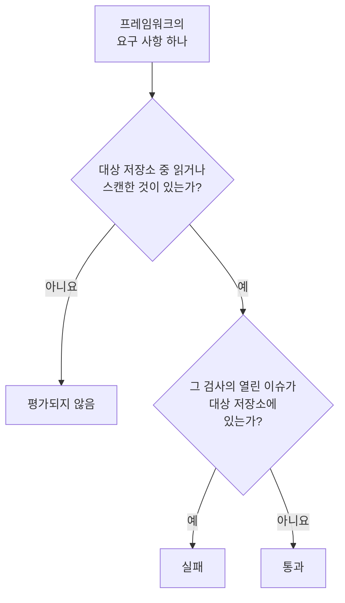

# 데이터 보안 규정 준수

데이터 보안은 스캔에서 찾은 것으로 아홉 개 프레임워크의 점수를 매깁니다. 각 프레임워크는 그 규칙이 다루는 저장소를 대상으로 하며(GDPR은 개인 데이터가 있는 저장소, PCI DSS는 카드 데이터가 발견된 저장소, SOC 2는 모든 저장소), 각 요구 사항은 그 증거가 되는 검사에 따라 충족되거나 실패합니다. **데이터 보안 → 규정 준수** 에는 각 프레임워크의 점수, 대상 저장소 수, 그리고 모든 요구 사항과 그 요구 사항을 실패시키는 열린 이슈 수가 표시됩니다. 점수는 인증서가 아니라 감사를 위한 증거입니다. OneUptime이 읽는 저장소에 대해 볼 수 있는 것을 알려 줄 뿐입니다.

:::cards
- [프레임워크](#프레임워크): 아홉 개 프레임워크와 각각이 대상으로 하는 저장소.
- [프레임워크의 점수 산정 방식](#프레임워크의-점수-산정-방식): 통과, 실패, 평가되지 않은 요구 사항.
- [요구 사항과 검사](#요구-사항과-검사): 모든 요구 사항과 그 증거가 되는 검사.
- [처리 활동 기록](#처리-활동-기록): 저장소를 바탕으로 작성되는 GDPR 제30조 기록.
:::

## 프레임워크

| 프레임워크 | 정식 명칭 | 대상 저장소 |
| --- | --- | --- |
| GDPR | EU 일반 개인정보 보호 규정 | 개인 데이터가 있는 저장소. |
| CCPA | CPRA로 개정된 캘리포니아 소비자 개인정보 보호법 | 개인 정보가 있는 저장소. |
| HIPAA | HIPAA 보안 규칙 | 건강 데이터가 있는 저장소. |
| PCI DSS | PCI DSS v4.0 | 카드 번호가 발견된 저장소. |
| SOC 2 | SOC 2 신뢰 서비스 기준 | 모든 데이터 저장소. |
| ISO 27001 | ISO/IEC 27001:2022 | 모든 데이터 저장소. |
| NIST CSF | NIST 사이버보안 프레임워크 2.0 | 모든 데이터 저장소. |
| LGPD | 브라질 일반 개인정보 보호법 | 브라질에 있는 사람의 개인 데이터가 있는 저장소. |
| DPDP | 2023년 인도 디지털 개인정보 보호법 | 인도에 있는 사람의 개인 데이터가 있는 저장소. |

## 프레임워크가 대상으로 하는 저장소

저장소가 어떤 프레임워크의 대상인지는 그 안에서 발견된 데이터로 정해지므로, 스캔이 더 많은 것을 찾으면 바뀝니다.

- **SOC 2, ISO 27001, NIST CSF** 는 보안 프레임워크입니다. 무엇이 들어 있든 모든 저장소를 대상으로 합니다.
- **GDPR, CCPA, HIPAA, PCI DSS** 는 자신이 보호하는 데이터 유형이 있는 저장소를 대상으로 합니다. 개인 데이터가 있으면 GDPR과 CCPA가, 건강 데이터가 있으면 HIPAA도, 카드 번호, 카드 보안 코드, 카드 만료일이 있으면 PCI DSS가 대상이 됩니다. 시크릿이나 비즈니스 문서만 있는 저장소는 어느 것의 대상도 아닙니다.
- **LGPD와 DPDP** 는 각 국가의 고유한 법입니다. 브라질 CPF나 인도 Aadhaar 번호처럼 그 국가에 속한 데이터 유형으로 판단해, 브라질이나 인도에 있는 사람의 개인 데이터가 있는 저장소를 대상으로 합니다.

[민감한 데이터 유형](/docs/data-security/data-types#기본-제공-데이터-유형)에는 모든 데이터 유형이 그 국가와 함께 나열되어 있습니다.

## 프레임워크의 점수 산정 방식

- 요구 사항에 매핑된 검사의 열린 이슈가 프레임워크의 대상 저장소에 하나도 없으면 **요구 사항은 통과하고**, 하나라도 있으면 **실패합니다**.
- 대상 저장소 중 구성을 읽었거나 콘텐츠를 스캔한 저장소가 하나도 없는 동안에는 **평가되지 않습니다**.
- **두 가지 요구 사항은 데이터 보안 자체로 충족됩니다**: GDPR 제30조(처리 활동 기록)와 ISO 27001 A.5.12(정보 분류)입니다. 이 둘은 모든 대상 저장소를 읽거나 스캔하면 통과하고, 그렇지 않은 저장소가 하나라도 있는 동안에는 실패합니다.
- **점수** 는 프레임워크의 평가된 요구 사항 중 통과한 것의 비율을 정수 백분율로 나타낸 것입니다. 평가된 것이 없는 프레임워크에는 점수가 없습니다.

열린 이슈만 셉니다. 위험이 수락된 이슈나 문제 아님으로 표시된 이슈는 요구 사항을 실패시키지 않으므로, 수락된 위험은 감사에서 이슈를 통해 확인할 수 있는 결정이 됩니다. 누가, 왜, 언제까지 수락했는지가 남습니다.

## 요구 사항과 검사

### GDPR

| 요구 사항 | 요구 내용 | 검사 |
| --- | --- | --- |
| 제5조(1)(c) | 데이터 최소화 | `production-data-in-non-production`, `stale-sensitive-data`, `sensitive-data-in-telemetry`, `sensitive-data-to-ai`, `sensitive-data-in-ai-store` |
| 제5조(1)(e) | 저장 제한 | `stale-sensitive-data` |
| 제25조 | 설계 및 기본 설정에 의한 데이터 보호 | `production-data-in-non-production`, `stale-sensitive-data`, `sensitive-data-in-telemetry`, `sensitive-data-to-ai`, `sensitive-data-in-ai-store` |
| 제28조 | 처리자 | `sensitive-data-to-ai` |
| 제30조 | 처리 활동 기록 | 데이터 보안 자체로 충족 |
| 제32조 | 처리의 보안 | `public-read`, `public-write`, `public-access-not-blocked`, `internet-reachable`, `open-to-all-addresses`, `snapshot-public`, `snapshot-shared-externally`, `shared-with-external-accounts`, `not-encrypted-at-rest`, `no-customer-managed-key`, `encryption-in-transit-not-enforced`, `weak-tls`, `no-backups`, `no-point-in-time-recovery`, `deletion-protection-off`, `deleted-data-not-recoverable`, `access-not-logged`, `shared-key-access`, `object-acls-enabled`, `many-readers`, `secrets-stored`, `plaintext-passwords`, `secrets-in-telemetry` |
| 제44-49조 | 제삼국으로의 이전 | `residency-violation` |

### CCPA

| 요구 사항 | 요구 내용 | 검사 |
| --- | --- | --- |
| 1798.100(c) | 필요한 범위로 제한된 수집 | `production-data-in-non-production`, `stale-sensitive-data`, `sensitive-data-in-telemetry`, `sensitive-data-to-ai`, `sensitive-data-in-ai-store` |
| 1798.150 | 합리적인 보안 절차 | `public-read`, `public-write`, `public-access-not-blocked`, `internet-reachable`, `open-to-all-addresses`, `snapshot-public`, `snapshot-shared-externally`, `shared-with-external-accounts`, `shared-key-access`, `object-acls-enabled`, `many-readers` |

### HIPAA

| 요구 사항 | 요구 내용 | 검사 |
| --- | --- | --- |
| 164.308(a)(7) | 비상 계획 | `no-backups`, `no-point-in-time-recovery`, `deletion-protection-off`, `deleted-data-not-recoverable` |
| 164.312(a)(1) | 접근 통제 | `public-read`, `public-write`, `public-access-not-blocked`, `internet-reachable`, `open-to-all-addresses`, `snapshot-public`, `snapshot-shared-externally`, `shared-with-external-accounts`, `shared-key-access`, `object-acls-enabled`, `many-readers` |
| 164.312(a)(2)(iv) | 암호화 및 복호화 | `not-encrypted-at-rest`, `no-customer-managed-key` |
| 164.312(b) | 감사 통제 | `access-not-logged` |
| 164.312(e)(1) | 전송 보안 | `encryption-in-transit-not-enforced`, `weak-tls` |

### PCI DSS

| 요구 사항 | 요구 내용 | 검사 |
| --- | --- | --- |
| 3.3.1 | 민감한 인증 데이터를 승인 후에 보관하지 않음 | `card-security-codes-stored` |
| 3.4.1 | 카드 번호는 표시될 때 마스킹됨 | `card-numbers-readable`, `sensitive-data-in-telemetry` |
| 3.5.1 | 카드 번호는 어디에 저장되든 읽을 수 없음 | `not-encrypted-at-rest`, `no-customer-managed-key`, `card-numbers-readable` |
| 4.2.1 | 강력한 암호화로 전송 중인 카드 데이터를 보호 | `encryption-in-transit-not-enforced`, `weak-tls` |
| 7.2 | 필요에 따라 접근 권한을 정의하고 부여 | `public-read`, `public-write`, `public-access-not-blocked`, `internet-reachable`, `open-to-all-addresses`, `snapshot-public`, `snapshot-shared-externally`, `shared-with-external-accounts`, `shared-key-access`, `object-acls-enabled`, `many-readers` |
| 8.3.2 | 인증 요소는 저장될 때 읽을 수 없음 | `plaintext-passwords` |
| 10.2 | 감사 로그가 카드 데이터에 대한 접근을 기록 | `access-not-logged` |

### SOC 2

| 요구 사항 | 요구 내용 | 검사 |
| --- | --- | --- |
| A1.2 | 백업 및 복구 | `no-backups`, `no-point-in-time-recovery`, `deletion-protection-off`, `deleted-data-not-recoverable` |
| CC6.1 | 논리적 접근 보안 | `public-read`, `public-write`, `public-access-not-blocked`, `internet-reachable`, `open-to-all-addresses`, `snapshot-public`, `snapshot-shared-externally`, `shared-with-external-accounts`, `not-encrypted-at-rest`, `no-customer-managed-key`, `shared-key-access`, `object-acls-enabled`, `many-readers`, `secrets-stored`, `plaintext-passwords`, `secrets-in-telemetry` |
| CC6.7 | 정보 전송 | `encryption-in-transit-not-enforced`, `weak-tls` |
| CC7.2 | 시스템 구성 요소 모니터링 | `access-not-logged` |

### ISO 27001

| 요구 사항 | 요구 내용 | 검사 |
| --- | --- | --- |
| A.5.9 | 정보 및 기타 관련 자산의 목록 | `no-owner` |
| A.5.12 | 정보 분류 | 데이터 보안 자체로 충족 |
| A.5.15 | 접근 통제 | `public-read`, `public-write`, `public-access-not-blocked`, `internet-reachable`, `open-to-all-addresses`, `snapshot-public`, `snapshot-shared-externally`, `shared-with-external-accounts`, `shared-key-access`, `object-acls-enabled`, `many-readers` |
| A.5.34 | 개인정보 보호 및 PII 보호 | `production-data-in-non-production`, `stale-sensitive-data`, `sensitive-data-in-telemetry`, `sensitive-data-to-ai`, `sensitive-data-in-ai-store` |
| A.8.11 | 데이터 마스킹 | `production-data-in-non-production`, `stale-sensitive-data`, `sensitive-data-in-telemetry`, `sensitive-data-to-ai`, `sensitive-data-in-ai-store` |
| A.8.12 | 데이터 유출 방지 | `secrets-stored`, `secrets-in-telemetry` |
| A.8.13 | 정보 백업 | `no-backups`, `no-point-in-time-recovery`, `deletion-protection-off`, `deleted-data-not-recoverable` |
| A.8.15 | 로깅 | `access-not-logged` |
| A.8.24 | 암호화 사용 | `not-encrypted-at-rest`, `no-customer-managed-key`, `encryption-in-transit-not-enforced`, `weak-tls`, `plaintext-passwords` |

### NIST CSF

| 요구 사항 | 요구 내용 | 검사 |
| --- | --- | --- |
| ID.AM-07 | 데이터와 메타데이터의 목록을 유지 | `no-owner` |
| PR.AA-05 | 접근 권한을 관리 | `public-read`, `public-write`, `public-access-not-blocked`, `internet-reachable`, `open-to-all-addresses`, `snapshot-public`, `snapshot-shared-externally`, `shared-with-external-accounts`, `shared-key-access`, `object-acls-enabled`, `many-readers` |
| PR.DS-01 | 저장된 데이터를 보호 | `not-encrypted-at-rest`, `no-customer-managed-key`, `secrets-stored`, `secrets-in-telemetry` |
| PR.DS-02 | 전송 중인 데이터를 보호 | `encryption-in-transit-not-enforced`, `weak-tls` |
| PR.DS-11 | 데이터 백업을 보관하고 테스트 | `no-backups`, `no-point-in-time-recovery`, `deletion-protection-off`, `deleted-data-not-recoverable` |
| DE.CM-09 | 데이터와 그 사용을 모니터링 | `access-not-logged` |

### LGPD

| 요구 사항 | 요구 내용 | 검사 |
| --- | --- | --- |
| 제6조 | 필요성 및 목적 제한 | `production-data-in-non-production`, `stale-sensitive-data`, `sensitive-data-in-telemetry`, `sensitive-data-to-ai`, `sensitive-data-in-ai-store` |
| 제33조 | 데이터의 국제 이전 | `residency-violation` |
| 제46조 | 보안 조치 | `public-read`, `public-write`, `public-access-not-blocked`, `internet-reachable`, `open-to-all-addresses`, `snapshot-public`, `snapshot-shared-externally`, `shared-with-external-accounts`, `not-encrypted-at-rest`, `no-customer-managed-key`, `shared-key-access`, `object-acls-enabled`, `many-readers` |

### DPDP

| 요구 사항 | 요구 내용 | 검사 |
| --- | --- | --- |
| 제8조(5) | 합리적인 보안 보호 조치 | `public-read`, `public-write`, `public-access-not-blocked`, `internet-reachable`, `open-to-all-addresses`, `snapshot-public`, `snapshot-shared-externally`, `shared-with-external-accounts`, `not-encrypted-at-rest`, `no-customer-managed-key`, `shared-key-access`, `object-acls-enabled`, `many-readers` |
| 제8조(7) | 목적 달성 시 삭제 | `production-data-in-non-production`, `stale-sensitive-data`, `sensitive-data-in-telemetry`, `sensitive-data-to-ai`, `sensitive-data-in-ai-store` |
| 제16조 | 인도 밖으로의 이전 | `residency-violation` |

## 처리 활동 기록

GDPR 제30조는 처리 활동의 기록을 보관하도록 요구합니다. 데이터 보안은 그중 개인 데이터가 어디에 보관되는지에 관한 부분을 작성합니다. 개인 데이터가 있는 저장소마다 한 행입니다.

| 열 | 출처 |
| --- | --- |
| 저장소, 종류, 공급자, 지역 | Discovery |
| 환경 | 저장소의 태그나 이름, 또는 직접 설정한 값 |
| 민감도, 범주, 데이터 유형 | 스캔이 찾은 것, 또는 직접 설정한 민감도 |
| 소유자 | 저장소의 소유자: 사람과 소유 팀의 구성원 |
| 목적 | 저장소의 **목적** 에 작성한 내용: 개인 데이터를 가지고 있는 이유 |
| 보존 | 저장소의 **보존** 에 작성한 내용: 데이터를 보관하는 기간 |
| 프레임워크 | 데이터 유형에 따라 대상이 되는 프레임워크 |

각 저장소의 **설정** 에서 **목적** 과 **보존** 을 채우세요. 이 두 가지는 어떤 스캔으로도 알 수 없습니다. 기록과 점수는 데이터 저장소를 읽을 수 있는 사람이라면 누구나 데이터 보안 API의 `/data-security/record-of-processing` 와 `/data-security/compliance` 에서도 받을 수 있습니다([데이터 보안 통합](/docs/data-security/integrations#api-terraform-및-mcp) 참고).

## 다음 단계

:::cards
- [데이터 보안 검사 및 이슈](/docs/data-security/checks-and-issues): 모든 요구 사항의 근거가 되는 검사와 해결 방법.
- [데이터 흐름, 접근 및 상주](/docs/data-security/flows-access-residency): GDPR, LGPD, DPDP의 데이터 이전을 위한 데이터 상주 규칙.
- [민감한 데이터 유형](/docs/data-security/data-types): 저장소를 프레임워크의 대상에 포함시키는 데이터 유형.
:::
