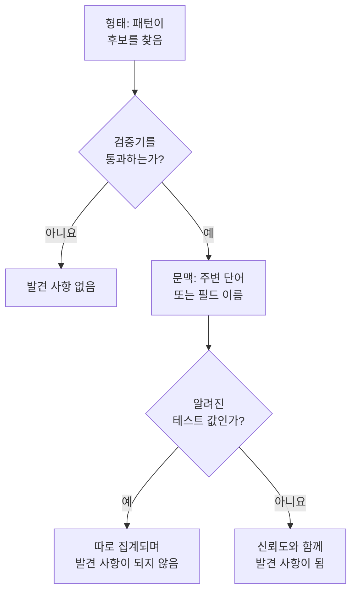

# 민감한 데이터 유형

데이터 보안은 143가지 민감한 데이터를 알고 있습니다. 카드 번호, 은행 계좌, 43개국의 국가 신분증 번호, 건강 식별자, API 키와 토큰, 그리고 특수 범주의 개인 데이터입니다. 각 데이터 유형에는 범주와 민감도가 있고, 한 국가에 속하는 경우에는 그 국가도 있습니다. 이 페이지에서는 값을 찾는 방식을 설명하고 모든 데이터 유형을 나열하므로, 무언가가 발견된 이유를 이해하고 어떻게 대응할지 결정할 수 있습니다.

:::cards
- [값을 찾는 방식](#값을-찾는-방식): 형태, 검증기, 문맥, 테스트 값, 신뢰도.
- [필드와 열](#필드와-열): 열이나 속성 전체를 판단하는 방식.
- [모든 데이터 유형](#기본-제공-데이터-유형): 143가지 전부를 범주별로.
- [직접 만드는 데이터 유형](#직접-만드는-데이터-유형): 직원 ID, 보험 증권 번호, 그리고 테스트 상자.
:::

## 값을 찾는 방식

로그 줄, CSV 셀, 데이터베이스 행, 객체의 처음 몇 바이트 등 무엇을 스캔하든 모든 스캔은 같은 단계를 거칩니다.

1. **형태.** 각 데이터 유형에는 후보를 찾는 패턴이 있습니다. 열여섯 자리 숫자, `AKIA` 와 열여섯 글자, 단어와 `@` 와 도메인 같은 것입니다. 패턴은 더 긴 토큰 안에서는 절대 일치하지 않으므로, 더 긴 숫자열 안에서는 카드 번호를 찾지 않습니다.
2. **검증기.** 후보는 유형 자체의 규칙을 통과해야 합니다. 체크섬(카드는 Luhn, IBAN은 mod 97, Aadhaar 번호는 Verhoeff, 대부분의 국가 신분증 번호는 검사 숫자), 실제 날짜, 알려진 접두사, 시크릿이라면 충분한 무작위성입니다. 통과하지 못한 후보는 전혀 발견 사항이 되지 않습니다. `000000000` 과 `123456789` 같은 자리 표시 값은 모든 숫자 유형에서 실패합니다.
3. **문맥.** 후보 주변의 단어(기본적으로 앞쪽 최대 64자, 뒤쪽 최대 32자)가 그것이 무엇인지 말해 주면 신뢰도가 한 단계 올라가며, 이름이 그 유형을 가리키는 필드도 마찬가지입니다. 주문 번호나 운송장 번호처럼 다른 것이라고 말해 주는 단어는 신뢰도를 한 단계 낮춥니다. 여권 번호나 은행 계좌처럼 체크섬이 없고 흔한 형태의 번호는 그것을 가리키는 단어 옆에 있을 때만 집계됩니다.
4. **알려진 테스트 값.** 공개된 테스트 카드 번호(예: Stripe의 `4242 4242 4242 4242`), 예시 IBAN, `example.com` 과 기타 예약된 도메인의 주소, 문서용 IP 주소, 정부 문서에 실린 샘플 ID, `sk_test_` 같은 테스트 모드 키, 자리 표시 키는 따로 집계됩니다. 이 값들은 절대 발견 사항이 되지 않으므로, 이런 값으로 가득한 저장소는 유출이 아니라 테스트 환경으로 읽힙니다.
5. **신뢰도.** 남은 것은 발견 사항이 되며, 신뢰도는 증거가 허용하는 만큼입니다.

| 신뢰도 | 의미 |
| --- | --- |
| **높음** | 값이 검증기를 통과했고, 주변의 단어나 값이 들어 있는 필드가 그것이 무엇인지 말해 줍니다. 필드의 경우에는 값 대부분이 그 유형입니다. |
| **보통** | 값이 검증기를 통과했지만 주변에 이를 확인해 주는 것이 없거나, 필드의 이름이 담긴 내용을 말해 주고 일부 값이 이와 일치합니다. |
| **낮음** | 형태는 일치하지만 이를 확인해 주는 것이 없습니다. |

신뢰도가 높음과 보통인 발견 사항만 집계됩니다. 이들은 저장소를 민감하게 만들고 이슈를 열 수 있습니다. 신뢰도가 낮음인 발견 사항은 사람이 판단하도록 저장소에 접힌 채로 나열됩니다.

두 데이터 유형이 같은 문자를 차지하려 하면 더 확실한 발견 사항이 이깁니다. 신뢰도가 더 높은 쪽, 그다음은 자체 규칙이 더 많은 것을 증명하는 탐지기, 그다음은 더 긴 일치입니다.

긴 값은 4 KB씩 겹치는 64 KB 크기의 창 단위로 읽으므로, 값이 어디에 있든 온전히 찾아내며, 값 하나에서 최대 4 MB까지 읽습니다.

## 필드와 열

열, JSON 필드, 로그 속성은 전체로 판단합니다. 이름은 데이터 유형을 암시하고, 샘플링한 값은 데이터 유형을 증명합니다. 그 유형을 담은 값의 비율이 발견 사항의 신뢰도를 정합니다.

| 그 유형을 담은 값 | 신뢰도 |
| --- | --- |
| 60% 이상 | 높음 |
| 25% 이상 | 필드의 이름이 그 유형을 가리키면 높음, 그렇지 않으면 보통 |
| 그보다 적음 | 필드의 이름이 그 유형을 가리키면 보통, 그렇지 않으면 낮음: 다른 것을 담은 열에 이메일이 몇 개 있는 경우 |

값의 평균 길이가 80자를 넘는 필드는 메모, 메시지, 설명 같은 자유 텍스트로 보며, 한 가지 유형만 담을 것으로 기대하지 않습니다. 이런 필드의 발견 사항은 각 일치가 스스로 얻은 신뢰도를 유지하며, 자유 텍스트에서 발견되었다고 표시됩니다. 필드 하나에서 값을 최대 1,000개까지, 각 값은 최대 16 KB까지 분류합니다.

필드의 이름은 단어로 나뉩니다. `customerEmail`, `customer_email`, `customer-email` 은 모두 "customer email"입니다. 유형의 이름 힌트는 그 단어들이 그 순서대로 나란히 나타날 때 일치합니다. "date of birth"는 `customer_date_of_birth` 와 일치하지만 `birth_city` 와는 일치하지 않습니다. 점으로 구분된 경로에서는 마지막 부분만 필드 자체의 이름이며, 마지막 부분이 `number`, `id`, `value` 같은 일반적인 단어라면 그 앞부분도 함께 봅니다. `customer.address.city` 는 도로명 주소가 아니고, `card.number` 는 여전히 카드 번호입니다.

어떤 데이터 유형은 값만으로는 알아볼 수 없습니다. 어떤 패턴도 사람 이름과 거리 이름을, 종교와 다른 단어를 구분하지 못합니다. 이런 유형은 필드에 값이 있을 때 필드의 이름만으로 찾습니다. 사람 이름, 사용자 이름, 성별, 국적, 건강 정보, 인종 또는 민족 출신, 종교적 신념, 성적 지향, 정치적 견해, 노동조합 가입 여부, 생체 인식 데이터, 유전 데이터, 범죄 기록입니다. 이때 이름, 사용자 이름, 성별, 국적은 값의 60% 이상이 그렇게 보이면 높음이고, 그렇지 않으면 보통입니다.

이름이 비밀번호를 담고 있다고 말하는 필드(`password`, `passwordHash`, `pwd` 이며 `password_changed_at` 은 아님)에는 해시가 들어 있어야 합니다. bcrypt, argon2, scrypt, PBKDF2 또는 저장소가 사용할 만한 다른 방식입니다. 빈 값, `********` 같은 자리 표시 값, 암호화된 값은 제외합니다. 나머지 중 해시가 아닌 값이 해시인 값보다 많으면, 그 필드는 어떤 패턴으로도 볼 수 없는 비밀번호 자체를 담고 있는 것이며, 저장소는 [비밀번호가 평문으로 저장되어 있음](/docs/data-security/checks-and-issues#데이터-위생) 검사에 실패합니다.

## 민감도

| 민감도 | 의미 |
| --- | --- |
| **제한** | 유출되면 피해가 따릅니다. 시크릿, 카드 번호, 건강 기록, 정부 발급 ID. |
| **기밀** | 개인 데이터, 그리고 기밀로 표시된 문서. |
| **내부** | 외부인을 위한 것이 아닌 비즈니스 자체의 데이터. |
| **Public** | 민감한 것이 발견되지 않았습니다. |

저장소의 민감도는 그 안에서 보통 이상의 신뢰도로 발견된 가장 민감한 데이터 유형의 민감도와 같습니다. 테스트 값과 민감하지 않음으로 표시된 발견 사항은 전혀 집계되지 않으며, 아무것도 발견되지 않은 저장소는 공개입니다. 저장소를 발견 사항이 말하는 것보다 더 민감하게 또는 덜 민감하게 다루려면 저장소의 **설정** 에서 민감도를 직접 설정하세요. 그러면 검사는 그 값을 사용합니다.

## 범주

| 범주 | 다루는 것 | 개인 데이터 |
| --- | --- | --- |
| 시크릿 및 자격 증명 | 다른 시스템을 여는 비밀번호, API 키, 토큰, 개인 키. | 아니요 |
| 금융 | 카드 번호, 은행 계좌, IBAN, 암호화폐 지갑. | 예 |
| 건강 | 의료 기록 번호, 건강 식별자, 진단, 처방. | 예 |
| 정부 발급 ID | 국가 신분 번호, 세금 번호, 여권 번호, 사회 보장 번호. | 예 |
| 특수 범주 | GDPR 제9조가 가장 강하게 보호하는 것: 민족, 종교, 성적 지향, 정치, 노동조합 가입, 생체 인식 데이터와 유전 데이터. | 예 |
| 연락처 및 신원 | 누구인지와 연락 방법: 이메일, 전화, 주소, 생년월일, IP 주소. | 예 |
| 비즈니스 기밀 | 기밀, 내부 전용 또는 특권으로 표시된 문서. | 아니요 |

개인 데이터는 GDPR, CCPA, LGPD, DPDP가 정의하는 의미의, 사람에 관한 데이터입니다. 시크릿과 비즈니스 문서만 담은 저장소는 개인정보 보호 프레임워크의 범위 밖에 있지만, 보안 프레임워크의 범위 밖에 있는 일은 절대 없습니다([데이터 보안 규정 준수](/docs/data-security/compliance) 참고).

## 기본 제공 데이터 유형

한 국가에 속하는 데이터 유형은 그 국가를 ISO 3166-1 코드로 나타냅니다. 데이터 상주 규칙과 특정 국가에 묶인 프레임워크가 이 값을 읽습니다([데이터 상주](/docs/data-security/flows-access-residency#데이터-상주-규칙) 참고). ID는 API와 발견 사항이 그 유형을 부르는 이름입니다.

### 연락처 및 신원

| 데이터 유형 | ID | 설명 | 민감도 | 국가 |
| --- | --- | --- | --- | --- |
| 이메일 주소 | `email-address` | 사람의 이메일 주소. | 기밀 | — |
| 전화번호 | `phone-number` | 국제 또는 국내 형식의 전화번호. | 기밀 | — |
| 사람 이름 | `person-name` | 사람의 이름, 성 또는 전체 이름. 필드의 이름으로 찾습니다. | 기밀 | — |
| 도로명 주소 | `postal-address` | 번지, 도로 이름, 도로 유형으로 이루어진 도로명 주소. | 기밀 | — |
| 우편번호 | `postal-code` | 우편번호. 그 자체만으로도 누군가 사는 곳을 좁힙니다. | 내부 | — |
| 생년월일 | `date-of-birth` | 누군가의 생일이라고 알려 주는 단어 옆에 있는 날짜. | 기밀 | — |
| IP 주소 | `ip-address` | GDPR이 개인 데이터로 취급하는 공인 IPv4 또는 IPv6 주소. | 기밀 | — |
| MAC 주소 | `mac-address` | 기기를 식별하는 네트워크 카드의 하드웨어 주소. | 기밀 | — |
| 광고 ID | `advertising-id` | 기기 하나를 추적하는 모바일 광고 ID(IDFA, GAID, AAID). | 기밀 | — |
| 정밀 위치 | `geolocation` | 건물을 찾을 수 있을 만큼 정밀한 위도와 경도. | 기밀 | — |
| 사용자 이름 | `username` | 사람의 로그인 이름 또는 계정 이름. 필드의 이름으로 찾습니다. | 기밀 | — |
| 성별 | `gender` | 사람의 사회적 성별 또는 생물학적 성별. 필드의 이름으로 찾습니다. | 기밀 | — |
| 국적 | `nationality` | 사람의 국적 또는 시민권. 필드의 이름으로 찾습니다. | 기밀 | — |
| 차량 식별 번호 | `vehicle-identification-number` | 유효한 검사 숫자가 있는 17자리 VIN. | 기밀 | — |

### 정부 발급 ID

| 데이터 유형 | ID | 설명 | 민감도 | 국가 |
| --- | --- | --- | --- | --- |
| 미국 사회 보장 번호 | `us-ssn` | 미국의 사회 보장 번호. | 제한 | US |
| 미국 납세자 ID(ITIN) | `us-itin` | 미국의 개인 납세자 식별 번호. | 제한 | US |
| 미국 고용주 ID(EIN) | `us-ein` | 그렇다고 알려 주는 단어 옆에 있는 미국 고용주 식별 번호. | 기밀 | US |
| 미국 여권 번호 | `us-passport` | 그렇다고 알려 주는 단어 옆에 있는 미국 여권 번호. | 제한 | US |
| 미국 운전면허 번호 | `us-drivers-license` | 그렇다고 알려 주는 단어 옆에 있는 미국 운전면허 번호. | 제한 | US |
| 영국 국민보험 번호 | `uk-nino` | 영국의 국민보험 번호. | 제한 | GB |
| 영국 여권 번호 | `uk-passport` | 그렇다고 알려 주는 단어 옆에 있는 영국 여권 번호. | 제한 | GB |
| 영국 운전면허 번호 | `uk-driving-licence` | 16자리 영국 운전면허 번호. | 제한 | GB |
| 캐나다 사회 보험 번호 | `ca-sin` | 유효한 검사 숫자가 있는 캐나다 사회 보험 번호. | 제한 | CA |
| 멕시코 CURP | `mx-curp` | 멕시코의 Clave Única de Registro de Población. | 제한 | MX |
| 멕시코 RFC | `mx-rfc` | 멕시코의 Registro Federal de Contribuyentes 세금 ID. | 제한 | MX |
| 브라질 CPF | `br-cpf` | 브라질의 Cadastro de Pessoas Físicas 번호. | 제한 | BR |
| 브라질 CNPJ | `br-cnpj` | 브라질의 회사 등록 번호(CNPJ). | 기밀 | BR |
| 아르헨티나 CUIT / CUIL | `ar-cuit` | 아르헨티나의 납세 또는 노동 식별 코드. | 제한 | AR |
| 칠레 RUT | `cl-rut` | 유효한 검사 숫자가 있는 칠레의 Rol Único Tributario. | 제한 | CL |
| 스페인 DNI | `es-dni` | 검사 문자가 있는 스페인 국가 신분증 번호. | 제한 | ES |
| 스페인 NIE | `es-nie` | 검사 문자가 있는 스페인 외국인 식별 번호. | 제한 | ES |
| 포르투갈 NIF | `pt-nif` | 포르투갈의 납세자 식별 번호. | 제한 | PT |
| 프랑스 사회 보장 번호(NIR) | `fr-nir` | 두 자리 키가 있는 프랑스 INSEE 번호. | 제한 | FR |
| 독일 세금 ID | `de-tax-id` | 독일의 Steuerliche Identifikationsnummer. | 제한 | DE |
| 이탈리아 codice fiscale | `it-codice-fiscale` | 유효한 검사 문자가 있는 이탈리아 납세 코드. | 제한 | IT |
| 네덜란드 BSN | `nl-bsn` | eleven test를 통과하는 네덜란드 시민 서비스 번호. | 제한 | NL |
| 벨기에 국가 번호 | `be-national-number` | 벨기에의 국가 등록 번호. | 제한 | BE |
| 폴란드 PESEL | `pl-pesel` | 폴란드의 국가 식별 번호. | 제한 | PL |
| 스웨덴 개인 식별 번호 | `se-personnummer` | 유효한 검사 숫자가 있는 스웨덴 personnummer. | 제한 | SE |
| 노르웨이 국가 식별 번호 | `no-fodselsnummer` | 두 검사 숫자가 모두 있는 노르웨이 fødselsnummer. | 제한 | NO |
| 덴마크 CPR 번호 | `dk-cpr` | 그렇다고 알려 주는 단어 옆에 있는 덴마크 시민 등록 번호. | 제한 | DK |
| 핀란드 개인 식별 코드 | `fi-hetu` | 검사 문자가 있는 핀란드 henkilötunnus. | 제한 | FI |
| 아일랜드 PPS 번호 | `ie-ppsn` | 아일랜드의 개인 공공 서비스 번호. | 제한 | IE |
| 스위스 AHV 번호 | `ch-ahv` | 스위스의 사회 보장 번호(AHV / AVS). | 제한 | CH |
| 루마니아 CNP | `ro-cnp` | 루마니아의 개인 숫자 코드. | 제한 | RO |
| 불가리아 EGN | `bg-egn` | 불가리아의 통일 시민 번호. | 제한 | BG |
| 크로아티아 OIB | `hr-oib` | 크로아티아의 개인 식별 번호. | 제한 | HR |
| 그리스 AMKA | `gr-amka` | 그리스의 사회 보장 번호. | 제한 | GR |
| 튀르키예 신원 번호 | `tr-tckn` | 튀르키예의 T.C. Kimlik 번호. | 제한 | TR |
| 이스라엘 신원 번호 | `il-teudat-zehut` | 이스라엘의 Teudat Zehut 번호. | 제한 | IL |
| 남아프리카 공화국 ID 번호 | `za-id` | 유효한 날짜와 검사 숫자가 있는 남아프리카 공화국 신원 번호. | 제한 | ZA |
| UAE 에미레이트 ID | `ae-emirates-id` | 아랍에미리트 신분증 번호. | 제한 | AE |
| 사우디아라비아 국가 ID | `sa-national-id` | 사우디아라비아의 국가 ID 또는 iqama 번호. | 제한 | SA |
| 인도 Aadhaar 번호 | `in-aadhaar` | Verhoeff 검사를 통과하는 12자리 Aadhaar 번호. | 제한 | IN |
| 인도 PAN | `in-pan` | 인도의 영구 계정 번호. | 제한 | IN |
| 중국 주민 신분 번호 | `cn-resident-id` | 18자리 중국 주민 신분증 번호. | 제한 | CN |
| 일본 마이넘버 | `jp-my-number` | 유효한 검사 숫자가 있는 일본 개인 번호. | 제한 | JP |
| 대한민국 주민등록번호 | `kr-rrn` | 한국의 주민등록번호. | 제한 | KR |
| 싱가포르 NRIC / FIN | `sg-nric` | 싱가포르 신분증 번호 또는 외국인 식별 번호. | 제한 | SG |
| 홍콩 신분증 번호 | `hk-hkid` | 검사 숫자가 있는 홍콩 신분증 번호. | 제한 | HK |
| 대만 국가 ID | `tw-national-id` | 대만의 국가 식별 번호. | 제한 | TW |
| 태국 국가 ID | `th-national-id` | 태국의 시민 식별 번호. | 제한 | TH |
| 말레이시아 MyKad 번호 | `my-mykad` | 말레이시아의 신분증 번호. | 제한 | MY |
| 인도네시아 NIK | `id-nik` | 인도네시아의 주민 식별 번호. | 제한 | ID |
| 호주 세금 파일 번호 | `au-tfn` | 유효한 검사를 통과하는 호주 세금 파일 번호. | 제한 | AU |
| 뉴질랜드 IRD 번호 | `nz-ird` | 유효한 검사 숫자가 있는 뉴질랜드 국세청 번호. | 제한 | NZ |
| 러시아 SNILS | `ru-snils` | 검사 번호가 있는 러시아 보험 계정 번호. | 제한 | RU |
| 러시아 INN | `ru-inn` | 러시아의 납세자 식별 번호. | 제한 | RU |
| 여권 번호 | `passport-number` | 그렇다고 알려 주는 단어 옆에 있는, 어느 국가의 것이든 여권 번호. | 제한 | — |

### 금융

| 데이터 유형 | ID | 설명 | 민감도 | 국가 |
| --- | --- | --- | --- | --- |
| 카드 번호 | `credit-card-number` | Luhn 검사를 통과하고 카드 브랜드에 속하는 결제 카드 번호. | 제한 | — |
| 카드 보안 코드 | `card-verification-code` | PCI DSS가 결제 승인 후 보관을 금지하는 CVV 또는 CVC. | 제한 | — |
| 카드 유효 기간 | `card-expiration-date` | 그렇다고 알려 주는 단어 옆에 있는 카드 유효 기간. | 기밀 | — |
| IBAN | `iban` | mod-97 검사를 통과하는 국제 은행 계좌 번호. | 제한 | — |
| 은행 계좌 번호 | `bank-account-number` | 그렇다고 알려 주는 단어 옆에 있는 은행 계좌 번호. | 제한 | — |
| SWIFT / BIC 코드 | `swift-bic` | 그렇다고 알려 주는 단어 옆에 있는 은행의 SWIFT 또는 BIC 코드. | 내부 | — |
| 미국 은행 라우팅 번호 | `us-bank-routing-number` | 그렇다고 알려 주는 단어 옆에 있는, 유효한 체크섬을 가진 ABA 라우팅 번호. | 내부 | US |
| 영국 sort code | `uk-sort-code` | 그렇다고 알려 주는 단어 옆에 있는 영국 은행의 sort code. | 내부 | GB |
| 인도 IFSC | `in-ifsc` | 은행 지점을 나타내는 인도 금융 시스템 코드. | 내부 | IN |
| 호주 BSB | `au-bsb` | 그렇다고 알려 주는 단어 옆에 있는 호주 은행-주-지점 번호. | 내부 | AU |
| 비트코인 주소 | `bitcoin-address` | 유효한 체크섬이 있는 비트코인 주소. | 기밀 | — |
| 이더리움 주소 | `ethereum-address` | 그렇다고 알려 주는 단어 옆에 있는 이더리움 주소. | 기밀 | — |

### 건강

| 데이터 유형 | ID | 설명 | 민감도 | 국가 |
| --- | --- | --- | --- | --- |
| 영국 NHS 번호 | `uk-nhs-number` | 유효한 검사 숫자가 있는 영국 국민 보건 서비스 번호. | 제한 | GB |
| 미국 Medicare 수혜자 ID | `us-medicare-mbi` | 미국의 Medicare 수혜자 식별자. | 제한 | US |
| 호주 Medicare 번호 | `au-medicare-number` | 유효한 검사 숫자가 있는 호주 Medicare 카드 번호. | 제한 | AU |
| 독일 건강 보험 번호 | `de-health-insurance-number` | 유효한 검사 숫자가 있는 독일 Krankenversichertennummer. | 제한 | DE |
| 의료 기록 번호 | `medical-record-number` | 그렇다고 알려 주는 단어 옆에 있는 환자의 의료 기록 번호. | 제한 | — |
| 건강 보험 가입자 ID | `health-plan-id` | 그렇다고 알려 주는 단어 옆에 있는 건강 보험 가입자 번호 또는 증권 번호. | 제한 | — |
| 진단 코드(ICD-10) | `diagnosis-code` | 그렇다고 알려 주는 단어 옆에 있는 ICD-10 진단 코드. | 제한 | — |
| 의약품 코드(NDC) | `drug-code` | 그렇다고 알려 주는 단어 옆에 있는 미국 국가 의약품 코드. | 기밀 | — |
| 미국 DEA 번호 | `us-dea-number` | 유효한 검사 숫자가 있는, 처방자의 미국 마약단속국 번호. | 기밀 | US |
| 미국 의료 제공자 ID(NPI) | `us-npi` | 국가 의료 제공자 식별자. 환자가 아니라 의료 제공자를 나타냅니다. | 내부 | US |
| 건강 정보 | `health-information` | 진단, 질환, 복용 약 및 기타 건강 관련 세부 정보. 필드의 이름으로 찾습니다. | 제한 | — |

### 시크릿 및 자격 증명

| 데이터 유형 | ID | 설명 | 민감도 | 국가 |
| --- | --- | --- | --- | --- |
| AWS 액세스 키 ID | `aws-access-key-id` | AWS 액세스 키의 공개된 절반. 시크릿과 함께 AWS 요청에 서명합니다. | 제한 | — |
| AWS 비밀 액세스 키 | `aws-secret-access-key` | 그렇다고 알려 주는 단어 옆에 있는 AWS 액세스 키의 비밀 절반. | 제한 | — |
| Google API 키 | `google-api-key` | Google Cloud 또는 Maps API 키. | 제한 | — |
| Google 서비스 계정 키 | `google-service-account-key` | 개인 키가 들어 있는 Google Cloud 서비스 계정 키 파일. | 제한 | — |
| Google OAuth 클라이언트 시크릿 | `google-oauth-client-secret` | Google OAuth 클라이언트 시크릿. | 제한 | — |
| Azure 스토리지 계정 키 | `azure-storage-account-key` | Azure 스토리지 계정 키 또는 이 키를 담은 연결 문자열. | 제한 | — |
| Azure SAS 토큰 | `azure-sas-token` | 로그인 없이 액세스를 부여하는 Azure 공유 액세스 서명. | 제한 | — |
| Azure 클라이언트 시크릿 | `azure-client-secret` | Microsoft Entra ID 애플리케이션 클라이언트 시크릿. | 제한 | — |
| GitHub 토큰 | `github-token` | GitHub 개인 액세스, OAuth, 앱 또는 세분화된 토큰. | 제한 | — |
| GitLab 토큰 | `gitlab-token` | GitLab 개인 액세스 토큰. | 제한 | — |
| Slack 토큰 | `slack-token` | Slack 봇, 사용자 또는 앱 토큰. | 제한 | — |
| Slack 웹훅 URL | `slack-webhook-url` | 누구든 채널에 게시할 수 있게 하는 Slack 수신 웹훅. | 제한 | — |
| Stripe 비밀 키 | `stripe-secret-key` | 돈을 옮길 수 있는 Stripe 라이브 비밀 키 또는 제한된 키. | 제한 | — |
| Twilio API 키 | `twilio-api-key` | 시크릿이 함께 있는 Twilio API 키 SID. | 제한 | — |
| SendGrid API 키 | `sendgrid-api-key` | SendGrid API 키. | 제한 | — |
| Mailgun API 키 | `mailgun-api-key` | Mailgun API 키. | 제한 | — |
| Mailchimp API 키 | `mailchimp-api-key` | Mailchimp API 키. | 제한 | — |
| OpenAI API 키 | `openai-api-key` | 계정의 크레딧을 쓰는 OpenAI API 키. | 제한 | — |
| Anthropic API 키 | `anthropic-api-key` | Anthropic API 키. | 제한 | — |
| Hugging Face 토큰 | `huggingface-token` | Hugging Face 토큰. | 제한 | — |
| npm 토큰 | `npm-token` | 패키지를 게시할 수 있는 npm 액세스 토큰. | 제한 | — |
| PyPI 토큰 | `pypi-token` | PyPI 업로드 토큰. | 제한 | — |
| Docker Hub 토큰 | `docker-hub-token` | Docker Hub 개인 액세스 토큰. | 제한 | — |
| Shopify 토큰 | `shopify-token` | Shopify 액세스 토큰 또는 앱 토큰. | 제한 | — |
| Square 토큰 | `square-token` | Square 액세스 토큰 또는 시크릿. | 제한 | — |
| Braintree 액세스 토큰 | `braintree-access-token` | Braintree 프로덕션 액세스 토큰. | 제한 | — |
| DigitalOcean 토큰 | `digitalocean-token` | DigitalOcean 개인 액세스 토큰. | 제한 | — |
| New Relic API 키 | `new-relic-api-key` | New Relic 사용자 API 키. | 제한 | — |
| Datadog API 키 | `datadog-api-key` | 그렇다고 알려 주는 단어 옆에 있는 Datadog API 키 또는 애플리케이션 키. | 제한 | — |
| HashiCorp Vault 토큰 | `vault-token` | HashiCorp Vault 서비스 토큰. | 제한 | — |
| Terraform Cloud 토큰 | `terraform-cloud-token` | Terraform Cloud 또는 Enterprise API 토큰. | 제한 | — |
| Atlassian API 토큰 | `atlassian-api-token` | Atlassian API 토큰. | 제한 | — |
| Linear API 키 | `linear-api-key` | Linear API 키. | 제한 | — |
| JSON 웹 토큰 | `json-web-token` | 서명된 JWT. 흔히 세션 토큰이나 액세스 토큰입니다. | 제한 | — |
| 개인 키 | `private-key` | PEM, OpenSSH 또는 PGP 개인 키 블록. | 제한 | — |
| URL 속 비밀번호 | `password-in-url` | 데이터베이스 연결 문자열처럼 사용자 이름과 비밀번호를 담은 URL. | 제한 | — |
| 연결 문자열 속 비밀번호 | `connection-string-password` | 연결 문자열 안의 Password= 또는 Pwd= 값. | 제한 | — |
| Authorization 헤더 | `authorization-header` | HTTP Authorization 헤더에서 복사된 Basic 또는 Bearer 자격 증명. | 제한 | — |
| 비밀번호 또는 시크릿 | `generic-secret` | 비밀번호, 시크릿, API 키 또는 토큰에 할당된 값 중 실제 값이라고 볼 만큼 무작위해 보이는 값. | 제한 | — |
| 비트코인 개인 키 | `bitcoin-private-key` | 유효한 체크섬이 있는, 지갑 가져오기 형식의 비트코인 개인 키. | 제한 | — |

### 특수 범주

| 데이터 유형 | ID | 설명 | 민감도 | 국가 |
| --- | --- | --- | --- | --- |
| 인종 또는 민족 출신 | `racial-or-ethnic-origin` | 인종 또는 민족. 필드의 이름으로 찾습니다. | 제한 | — |
| 종교적 신념 | `religious-belief` | 종교 또는 신념. 필드의 이름으로 찾습니다. | 제한 | — |
| 성적 지향 | `sexual-orientation` | 성적 지향. 필드의 이름으로 찾습니다. | 제한 | — |
| 정치적 견해 | `political-opinion` | 정치적 견해 또는 정당 가입 여부. 필드의 이름으로 찾습니다. | 제한 | — |
| 노동조합 가입 여부 | `trade-union-membership` | 노동조합 가입 여부. 필드의 이름으로 찾습니다. | 제한 | — |
| 생체 인식 데이터 | `biometric-data` | 지문, 얼굴 템플릿, 성문 및 기타 생체 인식 정보. 필드의 이름으로 찾습니다. | 제한 | — |
| 유전 데이터 | `genetic-data` | DNA와 유전체 데이터. 필드의 이름으로 찾습니다. | 제한 | — |
| 범죄 기록 | `criminal-record` | 형사 유죄 판결과 범죄(GDPR 제10조). 필드의 이름으로 찾습니다. | 제한 | — |

### 비즈니스 기밀

| 데이터 유형 | ID | 설명 | 민감도 | 국가 |
| --- | --- | --- | --- | --- |
| 법적 특권 문서 | `privileged-document` | 변호사-의뢰인 특권 또는 법적 특권이 있다고 표시된 문서. | 제한 | — |
| 기밀 표시 문서 | `confidential-document` | 기밀, 극비 또는 영업 비밀로 표시된 문서. | 기밀 | — |
| 내부용 표시 문서 | `internal-document` | 내부용 또는 배포 금지로 표시된 문서. | 내부 | — |

## 직접 만드는 데이터 유형

회사에만 있는 것을 위한 데이터 유형을 추가하세요. 직원 ID, 보험 증권 번호, 프로젝트 코드 같은 것입니다. **데이터 보안 → 설정 → 데이터 유형** 으로 이동해 **내 데이터 유형** 아래에 추가합니다. 다음 스캔부터 기본 제공 데이터 유형과 똑같이 버킷, 데이터베이스, 텔레메트리에서 스캔됩니다.

:::steps
### 무엇인지 정하기

**이름**(예: 직원 ID), **카테고리**, **민감도** 를 지정합니다. 민감도는 이 유형을 담은 저장소가 얼마나 민감한지입니다. **설명** 은 이 유형의 발견 사항을 읽는 사람에게 이것이 무엇인지 알려 줍니다.

### 찾는 방법 정하기

**패턴** 을 입력합니다. `EMP-\d{6}` 처럼 값 하나에 대한 JavaScript 정규식입니다. 이 유형을 담는 **필드 이름**(예: `employee id`)과, 값 근처에 있으면 이 유형임을 확인해 주는 **키워드** 를 추가합니다. 필드 이름만으로 유형을 찾으려면 패턴을 비워 두세요.

### 테스트하기

데이터 유형이 무엇을 찾는지 보려면 **테스트** 에 샘플 텍스트를 붙여 넣으세요. 브라우저에서 스캐너 자체의 코드로 텍스트를 검사하므로 텍스트는 OneUptime으로 절대 전송되지 않으며, 처음 64 KB만 테스트합니다.
:::

**추가 필드** 에서 **대소문자 무시** 는 글자의 대소문자와 관계없이 패턴을 일치시키고, **키워드 필요** 는 값 근처에 키워드가 있거나 필드의 이름이 이 유형이라고 말할 때만 값을 집계하며, **체크섬** 은 값이 검사를 통과하도록 요구합니다. **없음**, **Luhn**(카드 번호에 붙는 검사 숫자), **Mod97**(IBAN의 검사 숫자), **Verhoeff**(Aadhaar 번호의 검사 숫자) 중에서 고릅니다.

패턴은 저장할 때 검사합니다. 컴파일되어야 하고, 빈 텍스트와 일치하지 않아야 하며, 텍스트 길이에 비례하는 시간 안에 실행되어야 합니다. 패턴은 절대 역추적하지 않는 매처로 실행되므로, 어떻게 작성하든 스캔을 붙잡아 둘 수 없습니다. 유형 하나에는 키워드를 최대 50개, 필드 이름을 최대 50개까지 둘 수 있습니다.

직접 만든 유형의 값은 체크섬을 통과하면 그 자체로는 보통, 근처에 키워드가 있으면 높음이고, 체크섬이 없으면 그 자체로는 낮음, 키워드가 있으면 보통입니다. 열에서는 모든 유형과 마찬가지로 일치하는 값의 비율이 결정합니다.

## 민감하지 않음과 항상 민감하지 않음

스캔은 보이는 것과 다른 무언가를 찾을 수 있습니다. Luhn 검사를 통과하는 주문 번호 열이나, 모든 로그 줄에 있는 회사의 지원 주소 같은 것입니다. OneUptime에 그렇다고 알려 주면 집계를 멈춥니다.

- **발견 사항을 민감하지 않음으로 표시합니다.** 저장소의 **내용** 페이지에서 발견 사항의 **민감하지 않음으로 표시** 를 선택하고 이유를 적습니다. 그 발견 사항은 더 이상 저장소의 민감도나 검사에 반영되지 않으며, 저장소는 즉시 다시 검사됩니다. 발견 사항은 표시와 이유와 함께 저장소에 남으므로, 다음 사람이 무엇이 결정되었는지 볼 수 있습니다.
- **값을 항상 민감하지 않음에 추가합니다.** 데이터 보안의 설정에서 하며, `support@yourcompany.com` 처럼 어디에서도 발견 사항이 되지 않는 값에 사용합니다. 값은 스캐너가 정규화한 뒤 대소문자를 무시하고 비교합니다.
- **기본 제공 데이터 유형을 끕니다.** **데이터 보안 → 설정 → 데이터 유형** 의 **기본 제공 데이터 유형** 아래에서 모든 데이터 유형에 스위치가 있으며, 스위치를 바꾸는 즉시 저장됩니다. 프로젝트의 어떤 스캔도 꺼진 유형은 찾지 않습니다.

## 다음 단계

:::cards
- [데이터 보안 검사 및 이슈](/docs/data-security/checks-and-issues): 저장소의 민감도가 이슈에 미치는 영향.
- [텔레메트리의 민감한 데이터](/docs/data-security/telemetry): 로그, 트레이스, 프롬프트에서 찾은 데이터 유형.
- [데이터 보안 규정 준수](/docs/data-security/compliance): 각 데이터 유형이 범위에 포함시키는 프레임워크.
:::
