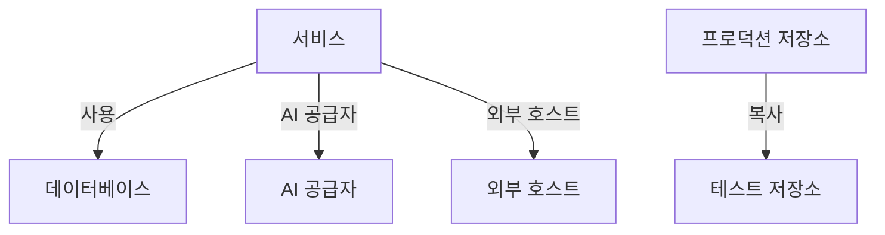

# 데이터 흐름, 접근 및 상주

저장소에 무엇이 있는지 아는 것은 절반일 뿐입니다. 데이터 보안은 그 데이터가 어디로 가는지(어떤 서비스가 저장소를 사용하는지, 데이터가 어떤 AI 공급자와 외부 호스트에 도달하는지, 어디에 복사되었는지), 각 저장소에 누가 접근할 수 있는지, 그리고 데이터가 허용된 지역에 있는지도 파악합니다. 이 모든 것은 OneUptime이 이미 가진 증거에서 나옵니다. 트레이스, 클라우드 자체의 접근 설정, 그리고 스캔이 찾은 것의 지문입니다.

:::cards
- [데이터 흐름](#데이터-흐름): 서비스, AI 공급자, 외부 호스트, 복사본.
- [저장소에 접근할 수 있는 대상](#저장소에-접근할-수-있는-대상): 클라우드가 보고하는 모든 권한 부여와 저장소의 노출 정도.
- [데이터 상주 규칙](#데이터-상주-규칙): 각 종류의 데이터가 있을 수 있는 지역.
:::

## 데이터 흐름

| 흐름 | 의미 | 출처 |
| --- | --- | --- |
| **사용** | 서비스가 저장소와 통신합니다. | OneUptime이 십 분마다 서비스의 클라이언트 스팬으로 파악하는 서비스 맵. 서비스 맵의 각 데이터베이스는 이름, 주소 또는 엔드포인트로 저장소와 연결되므로, 다른 어떤 소스에도 없는 데이터베이스는 별도의 저장소가 됩니다. |
| **AI 공급자** | 서비스가 AI 공급자에게 데이터를 보냅니다. | 지난 7일간 서비스의 트레이스에 있는 AI 호출. 호출이 도달하는 공급자의 이름이 나와 있습니다. |
| **외부 호스트** | 서비스가 시스템 밖의 호스트를 호출합니다. | 서비스 맵의 원격 서비스. 호출되는 주소로 구분합니다. |
| **복사** | 한 저장소가 다른 저장소의 값을 가지고 있습니다. | 각 스캔이 찾은 값의 지문. 한 데이터 유형에 대한 두 저장소의 지문이 절반 이상 겹치면 두 저장소는 데이터를 공유합니다. |

흐름은 소스가 가진 데이터 유형과 그 민감도를 함께 나릅니다. 흐름은 데이터로 가는 경로가 있다는 것만이 아니라 데이터가 실제로 있다는 것을 스캔이 증명했을 때 확인됩니다. 복사는 항상 확인된 흐름이며, AI 공급자 흐름은 서비스의 AI 대화에 기밀 또는 제한 데이터가 있을 때 확인됩니다. 30일 동안 다시 보이지 않은 흐름은 삭제됩니다.

두 가지 검사가 흐름을 읽습니다. [프로덕션 데이터가 비프로덕션 저장소에 복사됨](/docs/data-security/checks-and-issues#데이터-위생) 검사는 복사의 대상 저장소에서 실패합니다. 두 저장소 중 하나만 프로덕션이면 복사는 프로덕션 저장소에서 시작된 것으로 보고, 그렇지 않으면 OneUptime이 먼저 찾은 저장소에서 시작된 것으로 봅니다. [민감한 데이터가 AI 공급자로 전송되고 있음](/docs/data-security/checks-and-issues#ai) 검사는 서비스의 AI 대화에 민감한 데이터가 있으면 그 AI 대화에서 실패하고, 대화가 도달한 공급자를 알려 줍니다.

### 지문이 비공개로 유지되는 방식

복사는 어느 저장소의 값도 보지 않고 찾아냅니다. 스캔은 높은 신뢰도로 찾은 각 데이터 유형에 대해, 읽은 값을 MinHash로 스케치합니다. 슬롯은 128개이고, 각 슬롯은 값들에 대한 해시 함수 하나의 최솟값이며, 그중 하위 16비트만 보관합니다. 두 스케치는 두 값 집합이 겹치는 만큼 슬롯이 일치하므로, 스케치를 비교하면 한 저장소의 값이 다른 저장소에 얼마나 있는지 추정할 수 있습니다.

- **값은 프로젝트 고유의 키로 해시됩니다** (HMAC-SHA256). 따라서 키가 없는 사람은 알려진 값을 스케치에 대조해 볼 수 없으며, 두 프로젝트의 스케치는 절대 비교할 수 없습니다.
- **각 최솟값에서 16비트만 스캔 밖으로 나갑니다.** 스케치에서는 어떤 값도, 값의 해시도 다시 읽어 낼 수 없습니다.
- **스케치는 필드가 아니라 데이터 유형에 관한 것입니다.** 저장소에는 높은 신뢰도로 발견된 데이터 유형마다 스케치가 하나씩 있으며, 그 이상은 없습니다.

## 저장소에 접근할 수 있는 대상

구성 읽기는 각 클라우드 자체의 접근 설정(버킷 정책과 ACL, Azure 역할 할당, Google Cloud IAM 바인딩, 스냅샷 공유)을 저장소에 접근할 수 있는 대상의 목록 하나로 만들어, 저장소의 **접근 가능한 대상** 페이지에 보여 줍니다.

| 열 | 의미 |
| --- | --- |
| **보안 주체** | 접근 권한이 있는 대상을 클라우드가 부르는 이름 그대로 표시: `*`, 계정 ID, ARN, 이메일, 서비스 계정. |
| **보안 주체 유형** | Public, 계정, 역할, 사용자, 그룹, 서비스 주체, 서비스 계정 또는 서비스. |
| **접근 수준** | 읽기, 쓰기 또는 관리자. |
| **부여 경로** | 접근 권한을 부여하는 것: 버킷 정책, ACL, 역할 할당, IAM 바인딩 또는 스냅샷 공유. |
| **외부** | 보안 주체가 OneUptime에 연결된 계정, 구독, 프로젝트 밖에 있습니다. |
| **공개** | 보안 주체가 인터넷상의 누구나입니다. |

목록은 구성을 읽을 때마다 다시 읽으며, 클라우드가 더 이상 보고하지 않는 권한 부여는 제거됩니다. [25개가 넘는 ID가 제한 데이터를 읽을 수 있음](/docs/data-security/checks-and-issues#접근) 검사는 이 목록에서 읽기 권한이 있는 대상을 셉니다. 저장소를 사용하는 서비스는 그 저장소의 **사용** 흐름입니다.

읽은 내용을 바탕으로 모든 저장소에 노출 수준이 정해집니다.

| 노출 | 의미 |
| --- | --- |
| **공개** | 인터넷의 누구나 읽을 수 있습니다. |
| **다른 계정** | 연결된 계정 밖의 계정이 접근할 수 있습니다. |
| **인터넷에서 접근 가능** | 네트워크 엔드포인트가 인터넷에서 오는 연결을 받아들입니다. |
| **비공개** | 자신의 계정과 네트워크에서만 접근할 수 있습니다. |
| **알 수 없음** | OneUptime이 판단할 수 있을 만큼 구성을 충분히 읽지 못했습니다. |

공개가 공유보다, 공유가 접근 가능보다 우선합니다. 다른 계정과도 공유된 공개 버킷은 Public입니다. 노출은 이슈의 [위험 점수](/docs/data-security/checks-and-issues#위험-점수)에 더해집니다.

## 데이터 상주 규칙

데이터 상주 규칙은 어떤 종류의 데이터가 어디에 있을 수 있는지 정합니다. **데이터 보안 → 설정 → 데이터 상주 규칙** 에서 추가하세요.

| 필드 | 하는 일 |
| --- | --- |
| **이름** | 규칙이 무엇인지. 예: EU 개인 데이터는 EU에 보관. |
| **허용된 지역** | 데이터를 저장하고 복사할 수 있는 지역. 클라우드가 부르는 이름 그대로 씁니다. 지역이 하나도 없는 규칙은 아무것도 검사하지 않습니다. |
| **데이터 범주** | 규칙이 다루는 데이터 범주. 비워 두면 모든 종류의 개인 데이터를 다룹니다. |
| **사람에 관한 데이터가 있는 곳** | 이 국가에 있는 사람에 관한 데이터만. `DE` 나 `IN` 같은 ISO 3166-1 코드로 씁니다. 비워 두면 어디에 있는 사람이든 그 사람에 관한 데이터를 다룹니다. |
| **설명** | 규칙의 목적. 예: EU 고객의 데이터는 EU에만 저장합니다. |
| **활성화됨** | 저장소를 이 규칙으로 검사할지 여부. |

저장소가 규칙이 다루는 데이터를 가지고 있고, 저장소 자체의 지역이나 데이터가 복사되는 지역이 허용된 지역 중 어느 것과도 일치하지 않으면 그 저장소는 규칙을 위반합니다. 복사본이란 저장소의 데이터가 복제되는 지역으로, S3 복제, 스토리지 계정의 지역 중복 복사본, 데이터베이스의 복제본이 해당합니다. 그러면 저장소는 [데이터가 허용된 지역 밖에 저장됨](/docs/data-security/checks-and-issues#데이터-상주) 검사에 실패하며, 위반한 지역과 규칙이 함께 표시됩니다.

### 지역과 와일드카드

허용된 지역의 `*` 는 임의의 문자를 뜻하며, 대문자와 소문자는 같게 취급하고, 패턴은 지역 전체와 일치해야 합니다.

| 허용된 지역 | 일치 | 불일치 |
| --- | --- | --- |
| `eu-*` (AWS) | `eu-west-1`, `eu-central-1` | `us-east-1`, `us-eu-1` |
| `europe-*` (Google Cloud) | `europe-west1`, `europe-north1` | `us-central1` |
| `westeurope` (Azure) | `westeurope` | `northeurope` |

사용하는 클라우드마다 패턴을 하나씩 나열하세요. `eu-*`, `europe-*`, `westeurope`, `northeurope` 를 함께 쓰면 세 클라우드 모두에서 데이터를 유럽에 둡니다.

### 저장소에 누구의 데이터가 있는지

OneUptime은 저장소에 누구의 데이터가 있는지를 데이터 자체에서 읽어 냅니다. 한 국가에 속한 데이터 유형은 그 사람들이 그 국가에 있다는 것을 알려 줍니다. 독일 세금 ID는 `DE`, 인도 Aadhaar 번호는 `IN`, 영국 NHS 번호는 `GB` 를 뜻합니다. 저장소는 그 국가들을 정보 주체 국가로 나열하며, 일부 국가의 사람으로 한정된 규칙은 그 사람들의 데이터가 있는 저장소만 다룹니다. [민감한 데이터 유형](/docs/data-security/data-types#기본-제공-데이터-유형)에는 국가가 있는 모든 데이터 유형의 국가가 나와 있습니다.

## 다음 단계

:::cards
- [데이터 보안 검사 및 이슈](/docs/data-security/checks-and-issues): 이 흐름, 권한 부여, 규칙을 읽는 모든 검사.
- [데이터 보안 규정 준수](/docs/data-security/compliance): 데이터 상주와 접근이 GDPR, LGPD, DPDP에 어떻게 반영되는지.
- [토폴로지](/docs/telemetry/topology): 흐름의 출처인 서비스 맵.
:::
