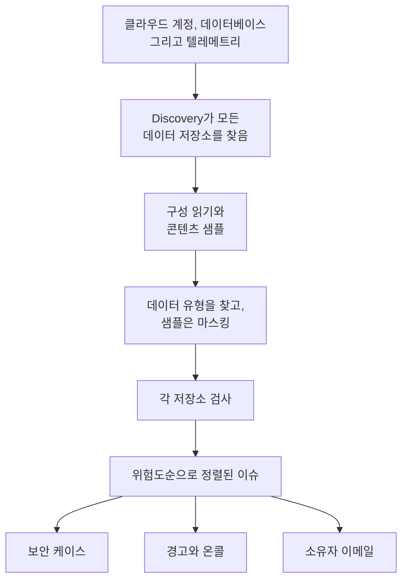

# 데이터 보안

데이터 보안은 회사가 보관하는 민감한 데이터를 클라우드 버킷, 데이터베이스와 웨어하우스, 그리고 OneUptime으로 보내는 텔레메트리에서 찾아내고, 그 데이터를 보관하는 방식에 무엇이 잘못되었는지 알려 줍니다. 저장소를 스스로 찾고, 각 저장소가 어떻게 설정되어 있는지 읽고, 담긴 내용을 샘플링하며, 문제마다 이슈를 열어 위험도순으로 정렬합니다.

다음 네 가지 질문에 답합니다.

:::cards
- [민감한 데이터는 어디에 있나요?](/docs/data-security/data-types): 카드 번호와 국가 신분증 번호부터 API 키까지, 버킷, 테이블, 텔레메트리에서 찾아내는 143가지 데이터 유형.
- [노출되어 있나요?](/docs/data-security/checks-and-issues): 각 저장소에 대한 32가지 검사: 공개 액세스, 암호화, 백업, 로깅, 시크릿, 복사본.
- [누가 접근할 수 있고, 데이터는 어디로 가나요?](/docs/data-security/flows-access-residency): 각 저장소를 누가 읽을 수 있는지, 어떤 서비스가 사용하는지, 그 데이터가 어떤 AI 공급자와 호스트에 도달하는지.
- [규칙을 지키고 있나요?](/docs/data-security/compliance): 데이터 상주 규칙, 그리고 스캔에서 찾은 내용으로 점수를 매기는 아홉 가지 프레임워크.
:::

## 작동 방식

1. **Discovery** 는 OneUptime이 이미 알고 있는 저장소를 찾습니다. 클라우드 인벤토리, Database 제품이 모니터링하는 데이터베이스, 서비스 맵에서 서비스가 통신하는 데이터베이스, 그리고 각 서비스의 텔레메트리입니다. 어떤 소스에도 나열되지 않은 저장소만 직접 추가하면 됩니다.
2. **구성 읽기** 는 각 클라우드에 모든 저장소가 어떻게 설정되어 있는지 묻습니다. 누가 접근할 수 있는지, 어떻게 암호화되고 백업되고 로깅되는지입니다. 설정만 읽고 데이터는 절대 읽지 않습니다.
3. **콘텐츠 샘플** 은 허용한 곳에서 저장소에 담긴 내용을 조금 읽습니다. 버킷에서는 종류별로 객체 몇 개, 각 테이블에서는 행 일부, 각 서비스의 텔레메트리에서는 최신 레코드를 읽습니다.
4. **분류** 는 샘플에서 민감한 값을 찾아내고, 개수와 마스킹된 샘플만 보관하며 값 자체는 절대 보관하지 않습니다.
5. **점검** 은 각 저장소에 무엇이 잘못되었는지, 그리고 저장소에 담긴 데이터에 그것이 얼마나 심각한지 판단합니다. 실패한 검사마다 이슈가 하나 열리고, 검사를 통과하면 이슈는 저절로 닫힙니다.

## 다른 점

- **텔레메트리도 데이터 저장소입니다.** 각 서비스의 로그, 트레이스, 예외, 세션 리플레이, AI 대화는 버킷처럼 매시간 검사됩니다. 로그 줄에 있는 이메일 주소는 발견 사항이 되고, **정리** 는 그때부터 수집 시점에 그 값을 마스킹합니다. [텔레메트리의 민감한 데이터](/docs/data-security/telemetry)를 참고하세요.
- **데이터 흐름은 실제 트래픽에서 나옵니다.** 서비스 맵은 어떤 서비스가 어떤 데이터베이스를 사용하는지 알려 주고, AI 호출은 자신이 도달하는 공급자를 밝히며, 프로덕션 데이터의 복사본은 핑거프린트를 비교해 찾아냅니다. [데이터 흐름, 접근 및 상주](/docs/data-security/flows-access-residency)를 참고하세요.
- **증거는 항상 마스킹됩니다.** 발견 사항은 개수와 최대 세 개의 마스킹된 샘플(예: `j***@e******.com`)만 보관하며, 샘플은 무엇이든 스캐너 밖으로 나가기 전에 스캐너 안에서 마스킹됩니다. 샘플을 끄면 개수만 보관합니다.
- **스캐너는 오픈 소스입니다.** 모든 데이터 유형의 패턴, 체크섬, 문맥 단어, 테스트 값이 OneUptime의 소스 코드에 있으므로, 무엇이 발견 사항을 만드는지 정확히 읽어 볼 수 있습니다. 같은 코드가 OneUptime의 워커, 프로브, 그리고 **테스트** 상자에서 실행됩니다.
- **OneUptime의 나머지 기능과 함께 작동합니다.** 심각 이슈는 저장소에 대한 보안 케이스를 열므로, [보안 운영](/docs/telemetry/security-cases)에서 다른 위협처럼 처리합니다. 온콜 담당자를 호출하는 경고를 생성할 수 있고, 저장소의 소유자에게 이메일을 보냅니다. [데이터 보안 통합](/docs/data-security/integrations)을 참고하세요.
- **OneUptime AI가 수정을 돕습니다.** **AI로 설명** 은 저장소 소유자에게 무엇이 잘못되었고 소유자의 클라우드에서 어떻게 고치는지 알려 주고, **AI로 수정** 은 인프라 코드에 풀 리퀘스트를 엽니다.

## 시작하기 전에

- **설정할 수 있는 역할.** Project Owner, Project Admin, Security Admin은 데이터 보안의 설정을 변경합니다. Security Member는 이슈를 처리하고 저장소를 스캔하며, Security Viewer는 찾은 내용을 읽습니다. 다른 역할은 팀에 해당 권한이 주어지지 않는 한 아무것도 볼 수 없습니다. 어떤 버킷에 카드 번호가 있는지는 바로 공격자가 알고 싶어 하는 정보이기 때문입니다. [역할](/docs/permissions/reference#역할)을 참고하세요.
- **읽을 클라우드 계정 또는 데이터베이스.** 데이터 보안은 [클라우드 연결](/docs/telemetry/cloud-accounts)을 통해 클라우드 계정을 읽고, 직접 운영하는 데이터베이스는 읽기 전용 연결 문자열로 읽습니다. 텔레메트리는 아무것도 필요하지 않으며, 매시간 스캔됩니다.

## 빠른 시작

:::steps
### 클라우드 계정 연결하기

**클라우드 → 연결** 로 이동해 클라우드를 고릅니다. 계정이 이미 연결되어 있다면 대신 그 연결의 **편집** 을 선택합니다. [클라우드 계정 연결](/docs/telemetry/cloud-accounts)에서 클라우드별로 차례대로 안내합니다.

### 데이터 보안 수준 선택하기

**추가 필드** 에서 모든 저장소가 어떻게 설정되어 있는지 검사하려면 **데이터 보안** 을 **구성만** 으로, 그 안의 민감한 데이터까지 찾으려면 **구성 및 콘텐츠 샘플** 로 설정합니다. 양식에 표시되는 명령은 선택에 따라 바뀝니다. 양식의 안내대로 클라우드의 셸에서 실행하세요. [데이터 보안 설정하기](/docs/data-security/setup)에는 각 수준이 부여하는 권한이 정확히 나와 있고, [클라우드 계정 연결](/docs/telemetry/cloud-accounts#데이터-보안)에는 각 수준의 명령이 나와 있습니다.

### 이슈 검토하기

**데이터 보안** 을 엽니다. 저장소는 Discovery가 15분마다 찾는 대로 **데이터 저장소** 아래에 나타나고, 연결의 구성은 한 시간 안에 읽힙니다. 이슈는 읽기나 스캔이 끝나는 즉시 각자의 위험 점수와 함께 **이슈** 아래에 열리며, **개요** 에는 위험도가 가장 높은 다섯 개가 표시됩니다. 각 이슈에는 무엇이 잘못되었는지, 왜 중요한지, 어떻게 고치는지가 클라우드에 맞는 명령과 함께 나옵니다.
:::

## 데이터 저장소로 간주되는 것

| 위치 | 저장소 | 콘텐츠 샘플 |
| --- | --- | --- |
| AWS | AWS S3 Bucket, AWS RDS Instance, AWS Aurora Cluster, AWS RDS Snapshot, AWS DynamoDB Table, AWS Redshift Cluster, AWS DocumentDB Cluster, AWS OpenSearch Domain, AWS ElastiCache Cluster, AWS EFS File System | AWS S3 Bucket |
| Azure | Azure Storage Account, Azure SQL Database, Azure Cosmos DB Account, Azure PostgreSQL Server, Azure MySQL Server | Azure Storage Account |
| Google Cloud | Google Cloud Storage Bucket, Google Cloud SQL Instance, Google BigQuery Dataset, Google Firestore Database, Google Spanner Instance, Google Bigtable Instance | Google Cloud Storage Bucket, Google BigQuery Dataset |
| 직접 운영하는 데이터베이스 | PostgreSQL, MySQL, MongoDB, SQL Server, Oracle, Redis, Elasticsearch | PostgreSQL, MySQL |
| OneUptime | 로그, 트레이스, 예외, 세션 리플레이, AI 대화 | 로그, 트레이스, 예외, 세션 리플레이, AI 대화 |

모든 저장소는 그 종류에 해당하는 검사를 받습니다. 콘텐츠를 샘플링할 수 없는 저장소도 검사합니다. 공개 버킷이나 암호화되지 않은 데이터베이스는 무엇을 담고 있든 문제이기 때문입니다.

소스에 더 이상 나열되지 않는 저장소는 기록과 함께 보관 처리되고 열린 이슈가 해결되며, 데이터 보안 메뉴 맨 끝의 **보관된 저장소** 에 남습니다. 소스에 다시 나열되면 저절로 돌아오고, 검사가 여전히 실패하는 이슈는 다시 열립니다.

저장소의 **타임라인** 에는 저장소에 일어난 일과 그 일을 한 사람이 표시됩니다. 언제 발견되거나 추가되었는지, 설정과 소유자의 각 변경, 언제 보관 처리되거나 돌아왔는지, 그리고 이슈나 플레이북에서 차단한 각 노출입니다.

## 실행 주기

| 작업 | 시점 |
| --- | --- |
| 새 저장소 찾기 | 15분마다 |
| 클라우드 연결의 구성 읽기 | 하루에 한 번, 그리고 CloudTrail이 AWS 저장소의 접근, 암호화, 백업 또는 공유에 대한 변경을 기록한 뒤 한 시간 안에 |
| 저장소의 콘텐츠 샘플링 | 24시간마다, 또는 **스캔 주기(시간)** 에 설정한 주기마다 |
| 각 서비스의 텔레메트리 샘플링 | 매시간, 지난 한 시간 분량 |
| 모든 저장소 다시 검사 | 모든 읽기와 스캔 뒤, 검사가 의존하는 항목을 변경한 뒤, 그리고 하루에 한 번 |

저장소의 **지금 스캔** 은 콘텐츠를 즉시 샘플링하고, **지금 검사** 는 구성을 다시 읽습니다.

## 다음 단계

:::cards
- [데이터 보안 설정하기](/docs/data-security/setup): 세 가지 수준, 각 수준이 부여하는 권한, 그리고 직접 운영하는 데이터베이스 스캔.
- [민감한 데이터 유형](/docs/data-security/data-types): 값을 찾는 방식과 데이터 보안이 아는 모든 데이터 유형.
- [데이터 보안 검사 및 이슈](/docs/data-security/checks-and-issues): 모든 검사, 위험 점수, 그리고 이슈가 거치는 과정.
- [데이터 보안 통합](/docs/data-security/integrations): 보안 케이스, 경고, 소유자, 워크플로, OneUptime AI.
:::
