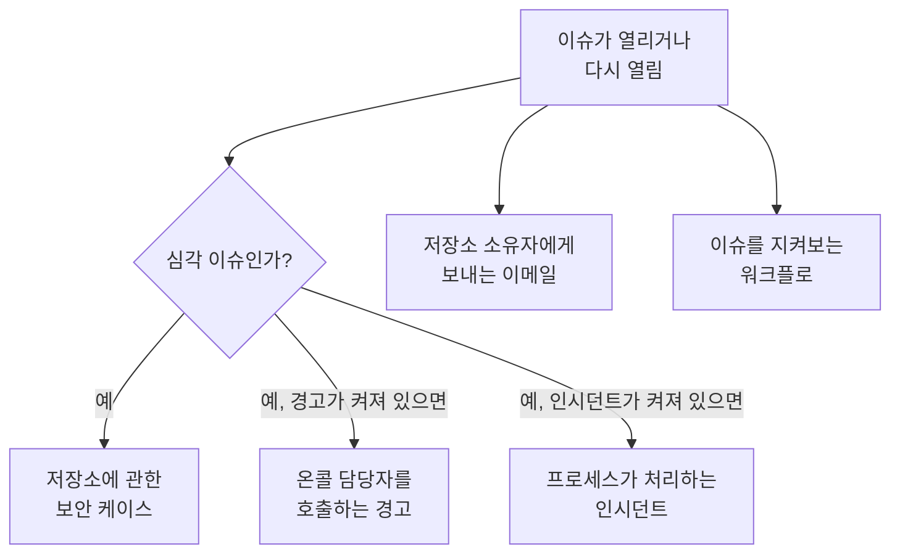

# 데이터 보안 통합

데이터 보안은 자체 호출 시스템이나 보안 대기열을 따로 두지 않습니다. 찾은 것을 이미 그런 일을 하는 OneUptime의 다른 부분에 넘깁니다. 심각 이슈는 보안 케이스가 되고, 온콜 담당자를 호출하거나 인시던트를 선언할 수 있으며, 모든 새 이슈는 저장소 소유자에게 이메일로 전달됩니다. 워크플로, OneUptime AI, API, Terraform, MCP 서버는 데이터 보안이 보관하는 모든 것에 접근할 수 있습니다.

:::cards
- [보안 운영](#보안-운영): 심각 이슈가 있는 모든 저장소에 대한 보안 케이스.
- [경고 및 온콜](#경고-및-온콜): 심각 이슈가 열리면 온콜 담당자를 호출합니다.
- [인시던트](#인시던트): 인시던트 프로세스로 처리해야 할 침해에 대해 인시던트를 선언합니다.
- [소유자](#소유자): 직접 또는 규칙으로 정하는 각 저장소의 소유자와, 소유자가 받는 이메일.
- [OneUptime AI](#oneuptime-ai): 이슈를 설명하거나, 이슈를 해결하는 풀 리퀘스트를 열거나, AI에게 질문 기능으로 데이터에 대해 물어봅니다.
- [노출 차단하기](#노출-차단하기): 이슈나 플레이북에서 공개 액세스를 차단하거나 공유를 중지합니다.
:::

## 작동 방식

이들은 각각 평가가 이슈를 열거나 다시 열 때 실행됩니다. 모두 최선 노력 방식입니다. 이슈는 이미 열려 있고 타임라인에 기록되어 있으므로, 실패한 통합은 로그에 남기고 건너뛸 뿐 두 번째 케이스나 두 번째 호출로 이어지도록 재시도하지 않습니다. 각 통합이 한 일은 이슈의 **타임라인** 에 기록되며, 이슈의 페이지에는 그 이슈로 시작된 케이스, 경고, 인시던트로 가는 링크가 있습니다.

| 설정 | 기본값 | 하는 일 |
| --- | --- | --- |
| **보안 케이스 열기** | 켜짐 | 심각 이슈가 저장소별로 묶인 보안 케이스를 엽니다. |
| **경고 생성** | 꺼짐 | 심각 이슈가 경고를 생성하고, 그 경고가 온콜 담당자를 호출합니다. |
| **알림 심각도** | 비어 있음 | 그 경고의 심각도. 비어 있으면 프로젝트에서 가장 심각한 심각도입니다. |
| **인시던트 선언** | 꺼짐 | 심각 이슈가 인시던트를 선언하고, 그 인시던트는 인시던트 프로세스가 처리합니다. |
| **인시던트 심각도** | 비어 있음 | 그 인시던트의 심각도. 비어 있으면 프로젝트에서 가장 심각한 심각도입니다. |
| **소유자에게 알림** | 켜짐 | 모든 새 이슈가 저장소 소유자에게 이메일로 전달됩니다. |

## 보안 운영

모든 저장소는 보안 운영에서 **데이터 저장소** 유형의 별도 엔티티입니다. **보안 케이스 열기** 가 켜져 있으면 심각 이슈는 저장소에 관한 탐지로 보안 운영에 전달됩니다.

- 소스는 **데이터 보안** 이고, 규칙 이름은 `Data Security: public-read` 처럼 검사의 이름을 따릅니다.
- 탐지는 심각 등급이므로, 이 탐지가 여는 케이스는 프로젝트의 심각 우선순위로 열립니다.
- 저장소별로 묶입니다. 같은 저장소의 두 번째 심각 이슈는 다른 케이스를 열지 않고 그 저장소에 관한 열린 케이스에 합류합니다.

그다음부터 케이스는 다른 케이스와 똑같이 처리됩니다. 할당되고, 노트가 추가되고, 닫히며, 프로젝트의 플레이북이 대응합니다. 저장소의 탐지는 다른 엔티티와 마찬가지로 [엔티티 위험](/docs/telemetry/security-entity-risk)에서 저장소의 위험에 반영됩니다. [보안 케이스 및 플레이북](/docs/telemetry/security-cases)을 참고하세요.

## 경고 및 온콜

**경고 생성** 이 켜져 있으면 심각 이슈는 "Data Security:" 뒤에 이슈의 제목과 저장소가 붙은 이름의 경고를 생성합니다. 경고는 다른 경고와 마찬가지로 자체 규칙에 따라 온콜 담당자를 호출합니다([경고](/docs/alerts/index) 및 [온콜](/docs/on-call/index) 참고). 이슈가 아무리 자주 평가되어도 한 이슈에 열린 경고는 한 번에 최대 하나입니다. **알림 심각도** 는 경고의 심각도를 정하며, 비워 두면 프로젝트에서 가장 심각한 심각도가 됩니다.

경고는 이슈와 함께 끝납니다. 이슈가 더 이상 열려 있지 않게 되면(검사를 통과하거나, 사람이 해결됨으로 표시하거나, 위험을 수락하거나, 문제가 아니라고 하면) 경고가 해결되고, 이슈의 **타임라인** 에 그 사실이 표시됩니다. 다시 열린 이슈는 새 경고를 생성합니다.

대부분의 팀은 데이터 보안 발견 사항을 먼저 보안 케이스에서 보고 싶어 하므로 경고는 기본적으로 꺼져 있습니다. 카드 번호가 든 공개 버킷 때문에 누군가를 깨워야 한다면 경고를 켜세요.

## 인시던트

**인시던트 선언** 이 켜져 있으면 심각 이슈는 경고와 같은 방식으로 이름이 붙은 인시던트를 선언합니다. 온콜, 워크스페이스 채널, 상태 페이지, 포스트모템을 포함한 인시던트 프로세스로 처리해야 할 침해를 위한 것입니다([인시던트](/docs/incidents/index) 참고). 한 이슈에 열린 인시던트는 한 번에 최대 하나입니다. **인시던트 심각도** 는 인시던트의 심각도를 정하며, 비워 두면 프로젝트에서 가장 심각한 심각도가 됩니다.

데이터 보안은 이슈가 해결된 뒤에도 인시던트를 절대 해결하지 않습니다. 인시던트에는 상태 페이지와 포스트모템이 딸려 있을 수 있으므로, 인시던트를 처리하는 사람이 닫습니다. 보안 케이스는 인시던트로 이어지는 또 다른 경로입니다. 케이스의 **인시던트 선언** 은 그 케이스에 연결된 인시던트를 엽니다([인시던트 선언하기](/docs/telemetry/security-cases#인시던트-선언하기) 참고).

## 소유자

저장소의 소유자는 저장소의 **소유자** 페이지에 있는 사람과 팀입니다. 이슈는 소유자를 위한 것입니다. 소유자가 이메일을 받으며, 소유자가 없는 민감한 저장소에서는 **이 민감한 저장소의 소유자가 없음** 검사가 실패합니다.

**소유자에게 알림** 이 켜져 있으면, 저장소에 이슈를 여는 평가마다 소유자(저장소를 소유한 사람과 소유 팀의 구성원, 최대 50명)에게 이메일을 한 통 보내며, 제목에는 "Data Security: 2 new issues on orders-db"처럼 저장소의 새 이슈 수가 들어갑니다. 이메일에는 각 새 이슈의 심각도와 제목, 저장소의 민감도가 나열되고 저장소로 가는 링크가 있습니다. 샘플은 절대 담지 않습니다.

### 소유자 규칙과 레이블 규칙

규칙은 저장소가 발견될 때 소유자와 레이블을 대신 설정합니다.

| 규칙 | 위치 | 하는 일 |
| --- | --- | --- |
| **소유자 규칙** | **데이터 보안 → 규칙 → 소유자 규칙** | 일치하는 모든 저장소에 소유자 사용자와 팀을 추가 |
| **레이블 규칙** | **데이터 보안 → 규칙 → 레이블 규칙** | 일치하는 모든 저장소에 레이블을 추가 |

규칙은 레이블, 이름이나 설명의 패턴, 또는 **클라우드 태그 패턴** 으로 저장소와 일치합니다. 이는 저장소의 각 클라우드 태그에 대조하는 패턴이며, 태그는 `key=value` 로 씁니다. `^team=payments$` 는 `team=payments` 태그가 붙은 모든 저장소와, `^env=` 는 `env` 태그가 있는 모든 저장소와 일치합니다. 새 저장소는 발견되는 즉시 프로젝트의 규칙을 적용받으며, 소유자 규칙의 **소유자에게 알림** 은 그 규칙이 추가하는 소유자에게 알릴지를 정합니다. [레이블 및 소유자 규칙](/docs/configuration/label-and-owner-rules)에는 모든 규칙이 일치하는 방식과 규칙이 실행되는 시점이 나와 있습니다.

## 워크플로

**데이터 저장소** 와 **데이터 보안 이슈** 는 워크플로 트리거이며, 각각 **생성 시**, **업데이트 시**, **생성 또는 업데이트 시**, **삭제 시** 가 있습니다. **트리거 추가** 패널의 **OneUptime 리소스** 아래에서 고르세요.

- **데이터 보안 이슈 → 생성 시** 는 이슈가 처음 열릴 때 실행됩니다. **If / Else** 블록에서 심각도를 읽고, 심각 이슈를 채널에 게시하거나 트래커에 티켓을 여세요.
- **데이터 보안 이슈 → 업데이트 시** 는 **감시할 필드** 를 상태로 설정하면 이슈가 해결되거나, 수락되거나, 다시 열릴 때 실행됩니다.
- **데이터 저장소 → 생성 시** 는 Discovery가 저장소를 찾을 때 실행됩니다. 예를 들어 새 버킷이 생길 때마다 팀에 알리는 데 쓸 수 있습니다.

각 트리거가 넘겨주는 필드는 [워크플로 트리거](/docs/workflows/triggers)를 참고하세요.

## OneUptime AI

이슈의 두 가지 동작은 OneUptime AI에 도움을 요청합니다. 둘 다 OneUptime AI에 이슈의 제목과 심각도, 저장소의 이름, 종류, 지역, 클라우드 ID, 민감도와 데이터 유형, 증거, 검사가 중요한 이유, 저장소의 클라우드에 맞는 해결 방법을 보내며, 발견 사항의 샘플은 절대 보내지 않습니다. 둘 다 프로젝트의 OneUptime AI 스위치와 한도에 따라 실행됩니다.

- **AI로 설명** 은 저장소 소유자를 위해 무엇이 잘못되었는지, 무슨 일이 일어날 수 있는지, 소유자의 클라우드에서 해결하는 정확한 단계를 작성합니다. 설명은 이슈의 **타임라인** 에 보관됩니다. 데이터 보안을 읽을 수 있는 사람이면 누구나 요청할 수 있습니다.
- **AI로 수정** 은 OneUptime AI에 인프라 코드(Terraform, CloudFormation, Bicep 등)에서 검사를 통과시키는 가장 작은 변경으로 이슈를 해결하고 풀 리퀘스트를 열도록 요청합니다. 저장소의 인프라 코드가 있는 리포지토리가 **코드** 에 연결되어 있어야 하며, 프로젝트에 리포지토리가 여러 개 있으면 **저장소** 에서 고르세요. 풀 리퀘스트는 **코드** 아래에 나타납니다([코드](/docs/ai/ai-agent) 참고). Security Member 이상이 요청할 수 있습니다.

### AI에게 질문

**AI에게 질문** 은 데이터 보안도 읽습니다. 어느 데이터 보안 페이지에서든 어떤 저장소에 카드 번호가 있는지, 무엇부터 고쳐야 하는지, 어떤 역할이 유출되면 어떤 저장소에 접근할 수 있는지 물어보세요. 저장소나 이슈의 페이지에서는 그 레코드를 먼저 읽습니다. 사용자 본인의 권한으로 실행되는 세 가지 읽기 도구로 답합니다.

| 도구 | 읽는 것 |
| --- | --- |
| `query_data_stores` | 민감도, 데이터 유형, 노출, 공급자 또는 이름으로 찾은 저장소(위험이 큰 순서), 또는 어디에서 무엇이 발견되었는지, 누가 접근할 수 있는지, 열린 이슈와 함께 보는 저장소 하나 |
| `query_data_security_issues` | 상태, 심각도, 저장소 또는 검사로 찾은 이슈(위험이 큰 순서), 또는 증거와 클라우드에 맞는 해결 방법과 함께 보는 이슈 하나 |
| `query_data_store_access` | 저장소에 접근할 수 있는 대상, 또는 보안 주체 하나가 접근할 수 있는 모든 저장소 |

이 도구들은 데이터 유형, 위치, 개수를 읽으며, 마스킹 여부와 관계없이 발견 사항의 샘플은 절대 읽지 않습니다. AI에게 질문은 데이터 보안에서 아무것도 바꾸지 않습니다.

## 노출 차단하기

두 가지 변경으로 클라우드 저장소의 노출을 차단하며, 각각 **데이터 보안 대응** 이 켜진 저장소의 클라우드 연결을 통해 이루어집니다([데이터 보안 설정하기](/docs/data-security/setup#데이터-보안이-노출을-차단하도록-허용하기) 참고).

- **공개 액세스 차단**: S3 버킷, Azure 스토리지 계정 또는 Cloud Storage 버킷에 적용됩니다.
- **공유 취소**: RDS 스냅샷, 또는 RDS 데이터베이스, Aurora 클러스터, DocumentDB 클러스터의 공유된 수동 스냅샷에 적용됩니다.

사람은 그 변경으로 해결되는 열린 이슈에서 **여기서 수정** 으로 실행합니다([데이터 보안 검사 및 이슈](/docs/data-security/checks-and-issues#여기서-수정) 참고). 보안 운영 플레이북은 이를 **봉쇄** 범주의 단계인 **데이터 저장소에 대한 공개 액세스 차단** 과 **데이터 저장소 공유 취소** 로 실행합니다. 케이스가 다루는 모든 데이터 저장소에 대해 최대 10개까지 실행되며, 각 단계는 **승인 필요** 가 켜진 상태로 시작합니다. **의도적 공개** 로 표시된 저장소는 절대 차단되지 않습니다. 어느 쪽이든 저장소의 피드에 무엇을 했는지 남고 저장소를 즉시 다시 검사하므로, 변경이 적용되면 이슈가 해결됩니다.

## API, Terraform 및 MCP

데이터 보안이 보관하는 모든 것은 OneUptime API의 레코드이며, 대시보드와 같은 권한으로 읽습니다([API 레퍼런스](/docs/api-reference/api-reference) 참고).

| 레코드 | API 경로 |
| --- | --- |
| 데이터 저장소, 그 타임라인과 발견 사항, 접근할 수 있는 대상 | `/data-store`, `/data-store-feed`, `/data-store-finding`, `/data-store-access` |
| 이슈, 그 타임라인, 데이터 흐름 | `/data-security-issue`, `/data-security-issue-feed`, `/data-security-flow` |
| 스캔 | `/data-security-scan` |
| 사용자 지정 데이터 유형, 검사 설정, 데이터 상주 규칙 | `/data-security-custom-data-type`, `/data-security-check-setting`, `/data-security-residency-rule` |
| 프로젝트의 설정 | `/data-security-setting` |
| 소유자, 소유자 규칙, 레이블 규칙 | `/data-store-owner-user`, `/data-store-owner-team`, `/data-store-owner-rule`, `/data-store-label-rule` |

일부 응답은 저장되지 않고 요청할 때 계산됩니다. 모두 `POST` 입니다.

| 경로 | 하는 일 |
| --- | --- |
| `/data-security/overview` | 개요의 수치: 민감도와 범주별 저장소, 심각도별 열린 이슈, 위험이 가장 큰 이슈, 최근 30일간의 이슈 |
| `/data-security/compliance` | 모든 프레임워크의 점수와 요구 사항 |
| `/data-security/record-of-processing` | GDPR 처리 활동 기록. 개인 데이터가 있는 저장소마다 한 행 |
| `/data-store/<id>/scan-now` | **지금 스캔**: 저장소의 콘텐츠를 지금 샘플링 |
| `/data-store/<id>/check-now` | **지금 검사**: 저장소의 구성을 다시 읽고 검사를 실행 |
| `/data-store-finding/<id>/scrub` | 텔레메트리 발견 사항의 **정리** |
| `/data-security-issue/<id>/explain` | 이슈의 **AI로 설명** |
| `/data-security-issue/<id>/fix-with-ai` | 이슈의 **AI로 수정** |
| `/data-store/<id>/response-actions` | 저장소가 지금 취할 수 있는 대응 작업과, 취할 수 없는 경우 그 이유 |
| `/data-store/<id>/respond` | 실행한 이슈와 함께, 저장소에 대한 **공개 액세스 차단** 또는 **공유 취소** |

[Terraform 프로바이더](/docs/terraform/index)에는 직접 만드는 레코드의 종류마다 리소스가 있으며(직접 추가하는 데이터 저장소, 사용자 지정 데이터 유형, 검사 설정, 데이터 상주 규칙, 소유자 규칙과 레이블 규칙), 리소스 이름은 `oneuptime_residency_rule` 처럼 레코드의 이름을 따릅니다.

[MCP 서버](/docs/ai/mcp-server)에는 다음 데이터 보안 레코드에 대한 생성, 조회, 목록, 업데이트, 삭제, 개수 도구가 있습니다: Data Store, Data Store Finding, Data Store Access Entry, Data Flow, Data Security Issue, Data Security Scan, Custom Data Type, Check Setting, Residency Rule, Data Security Setting. 그러면 AI 어시스턴트가 사용자의 권한으로 어떤 저장소에 카드 번호가 있는지, 버킷에 무엇이 열려 있는지 물어볼 수 있습니다.

## 다음 단계

:::cards
- [보안 케이스 및 플레이북 (SOAR)](/docs/telemetry/security-cases): 데이터 보안이 여는 케이스를 처리합니다.
- [레이블 및 소유자 규칙](/docs/configuration/label-and-owner-rules): 규칙이 일치하는 방식과 실행되는 시점.
- [워크플로 트리거](/docs/workflows/triggers): 이슈가 열리거나 저장소가 발견될 때 워크플로를 실행합니다.
- [데이터 보안 검사 및 이슈](/docs/data-security/checks-and-issues): 모든 이슈의 의미와 해결 방법.
:::
