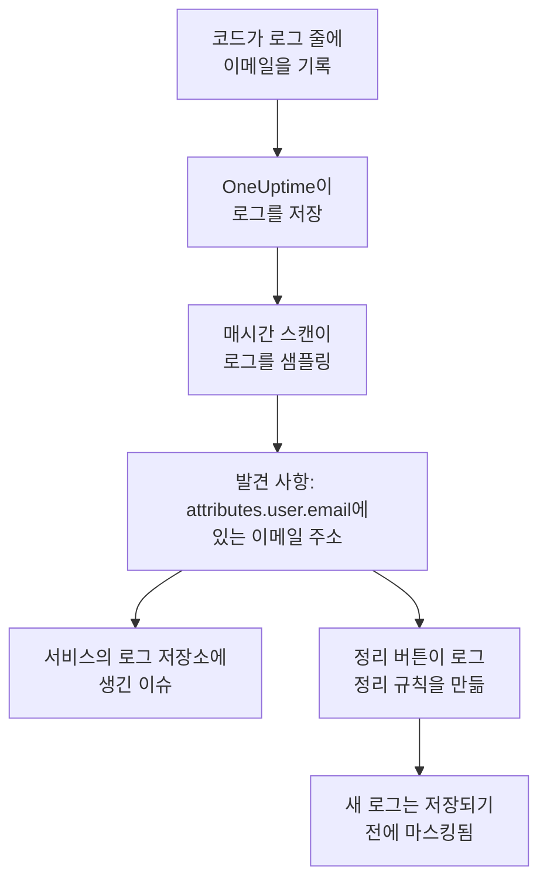

# 텔레메트리의 민감한 데이터

텔레메트리에는 코드가 기록하는 것은 무엇이든 담깁니다. 로그 줄의 이메일 주소, 스팬 속성의 카드 번호, 스택 트레이스의 토큰, 프롬프트 속 고객의 질문, 메트릭 레이블 속 사용자의 IP 주소 같은 것입니다. 데이터 보안은 각 서비스의 로그, 트레이스, 메트릭, 예외, AI 대화와 각 RUM 애플리케이션의 세션을 각각 별도의 데이터 저장소로 다룹니다. 매시간 이를 샘플링해 버킷에서와 마찬가지로 그 안의 민감한 데이터를 찾으며, **정리** 를 누르면 발견 사항이 그때부터 수집 시점에 그 데이터를 마스킹하는 규칙이 됩니다.

따로 설정할 것은 없습니다. 프로젝트 설정에서 **텔레메트리 스캔** 이 꺼져 있지 않는 한, 각 서비스의 텔레메트리는 매시간 스캔됩니다. 한 서비스의 로그, 트레이스 또는 다른 신호를 제외하려면 해당 저장소의 **설정** 에서 **콘텐츠 스캔** 을 끄세요. 다음 스캔부터 그 내용은 전혀 읽지 않습니다.

:::cards
- [읽는 대상](#읽는-대상): 각 신호의 속성, 본문, 메시지, 프롬프트.
- [스캔의 샘플링 방식](#스캔의-샘플링-방식): 매시간 읽는 각 서비스의 최신 레코드.
- [정리](#정리): 클릭 한 번으로 발견 사항을 수집 시점에 마스킹합니다.
- [이 메트릭 삭제](#이-메트릭-삭제): 이름에 민감한 데이터가 포함된 메트릭의 저장을 멈춥니다.
- [정리된 것으로 보는 경우](#정리된-것으로-보는-경우): 정리 규칙이 이미 발견 사항에 적용되는 경우.
:::

## 작동 방식

정리 규칙이 적용되는 발견 사항은 정리됨으로 표시됩니다. 그 데이터 중 남아 있는 것은 보존 기간이 끝나기를 기다리는 오래된 데이터일 뿐, 아직 흘러나오고 있는 유출이 아닙니다. 두 가지 텔레메트리 검사는 어떤 규칙도 적용되지 않는 것만 세므로, 모든 발견 사항이 정리되면 그 이슈는 해결됩니다([텔레메트리 검사](/docs/data-security/checks-and-issues#텔레메트리) 참고).

## 읽는 대상

| 저장소 | 읽는 대상 | 발견 사항이 가리키는 위치 |
| --- | --- | --- |
| 로그 | 모든 속성과 본문 | `attributes.<key>`, `body` |
| 트레이스 | 모든 스팬 속성과 모든 스팬 이벤트의 속성 | `attributes.<key>`, `events.<event>.<key>` |
| 예외 | 메시지, 스택 트레이스, 속성 | `message`, `stackTrace`, `attributes.<key>` |
| AI 대화 | GenAI 규약이 정한 키 아래에 있는 모든 AI 호출의 프롬프트와 답변, 그리고 그 밖의 모든 속성 | 값이 들어 있는 키(예: `gen_ai.input.messages` 또는 `gen_ai.prompt[].content`) |
| 세션 리플레이 | RUM 애플리케이션의 스팬과 로그의 속성, 세션의 속성, `identify()` 가 사용자에게 부여한 특성, 그리고 전달받은 사용자 참조 | `spans.attributes.<key>`, `logs.attributes.<key>`, `sessions.attributes.<key>`, `sessions.identifiedUserTraits.<key>`, `sessions.identifiedUserLabel` |
| 메트릭 | 데이터 포인트의 모든 속성(리소스의 속성 포함)과 메트릭의 이름 | `attributes.<key>`, `attributes.resource.<key>`, `name` |

번호가 붙은 키는 하나의 위치로 합쳐집니다. `gen_ai.prompt.3.content` 는 `gen_ai.prompt[].content` 가 되므로, 채팅의 메시지 스무 개는 발견 사항 스무 개가 아니라 하나입니다. OneUptime이 직접 추가하는 속성(`oneuptime.` 으로 시작)은 읽지 않습니다.

### 메트릭

메트릭의 속성은 그 시리즈의 레이블입니다. 레이블은 한 시리즈의 모든 데이터 포인트에서 같으므로, 1분에 포인트를 천 개씩 기록하는 메트릭도 값은 세 개뿐일 수 있고, 사용자의 이메일을 흘리는 레이블은 포인트가 아니라 시리즈를 하나 늘립니다. 그래서 메트릭은 포인트가 아니라 시리즈를 기준으로 샘플링합니다.

- **시리즈마다 포인트 하나.** 각 메트릭은 지난 한 시간 동안 기록한 가장 최근의 1분을 읽습니다. 그 1분의 시리즈 중 최대 100개에서 시리즈마다 데이터 포인트 하나씩을 읽으며, 메트릭을 얼마나 자주 보내든 마찬가지이므로 바쁜 시리즈가 조용한 시리즈를 밀어내는 일이 없습니다. 값은 그 값을 되풀이하는 시리즈가 몇 개든 한 번만 분류되므로, 발견 사항은 그 위치의 서로 다른 값을 셉니다.
- **새 메트릭 먼저, 나머지는 차례로.** 서비스가 어떤 메트릭을 기록했는지, 그리고 각 메트릭이 지난 하루 동안 언제 처음 기록했는지는 메트릭 테이블이 유지하는 분 단위 롤업에서 가져오며, 포인트에서는 절대 가져오지 않습니다. 각 스캔은 서비스에서 가장 바쁜 메트릭, 즉 시리즈가 많을 가능성이 가장 큰 메트릭을 읽습니다. 그다음에는 새 유출이 대개 새 코드에서 생기므로 지난 2시간 안에 기록을 시작한 메트릭을 읽고, 이어서 그 밖의 메트릭 중 다음 것들을 지난 스캔이 멈춘 곳부터 정해진 순서대로 읽습니다. 새 메트릭은 그 자리의 절반까지만 차지하므로, 그 밖의 메트릭은 항상 자기 자리를 지킵니다.
- **모든 메트릭을 정해진 시간 안에.** 스캔은 서비스마다 읽기를 10개씩 배정하며, 프로젝트의 서비스가 10개를 넘으면 그보다 적게 배정합니다. 메트릭이 적어서 서비스가 쓰지 않은 읽기는 아직 차례를 기다리는 메트릭이 있는 서비스에 하나씩 돌아가므로, 낭비되는 읽기가 없고 어떤 서비스도 제 몫보다 적게 받지 않습니다. 서비스의 가장 바쁜 메트릭 5개가 읽기 5개를 쓰고, 나머지 읽기는 다른 메트릭을 차례로 읽습니다. 메트릭이 M개이고 차례 읽기를 r개 받는 서비스에서는 각 메트릭을 적어도 M ÷ r시간(올림)마다 한 번 읽습니다. 메트릭이 300개인 서비스가 자기 몫 5개만 받으면 60시간이고, 메트릭이 300개인 다른 서비스 두 개와 프로젝트를 함께 쓰면 각각 28개나 29개를 받으므로 11시간입니다. 매시간 새 메트릭을 계속 시작하는 동안에는 최대 그 두 배입니다.
- **메트릭마다 고유한 범위.** 메트릭은 함께 읽히며, 각 메트릭은 테이블 기본 키에서 자신의 범위로 읽힙니다. 사용자마다 이메일로 레이블을 붙인 메트릭처럼 가장 최근의 1분에 포인트가 16,384개를 넘는 메트릭은 따로 읽으며, 그 읽기는 처음 포인트들에서 멈추므로 다른 메트릭보다 비용이 더 들지 않습니다.

발견 사항은 `attributes.user.email` 같은 속성을 가리키며, 메트릭 이름에 있는 데이터라면 `name` 을 가리킵니다. 발견 사항의 레코드는 그 데이터가 발견된 데이터 포인트입니다. 각 레코드는 해당 메트릭과 마스킹된 속성 값을 보여 주며, **메트릭** 에서 그 메트릭을 그 속성으로 그룹화해 엽니다. 메트릭 이름에 민감한 데이터가 있으면 이름도 마스킹되며, 레코드는 대신 서비스의 메트릭을 엽니다.

### 리플레이의 녹화를 읽지 않는 이유

세션 리플레이의 녹화에는 사람들이 본 페이지의 텍스트가 담겨 있습니다. 녹화를 보려면 별도의 권한이 필요한데, 녹화에서 읽어 낸 발견 사항은 데이터 보안을 읽을 수 있는 모든 사람에게 마스킹된 페이지 텍스트를 보여 주게 됩니다. 그래서 리플레이는 속성만 읽습니다. 즉 녹화 옆에 있는 스팬, 로그, 세션 세부 정보입니다. 레코더는 브라우저에서 녹화하는 내용을 이미 마스킹하며, 로그 정리 규칙도 녹화에 적용됩니다([세션 리플레이](/docs/telemetry/session-replay) 참고).

### AI 대화

AI 호출의 프롬프트에는 사람이 보낸 최신 메시지 이전의 채팅 전체가 담기므로, AI 호출의 각 값은 최대 16,384자까지 읽습니다. AI 대화에 민감한 데이터가 있으면 두 가지가 더 따라옵니다. 호출을 받은 AI 공급자가 그 데이터의 흐름이 되고, 저장소에서 [민감한 데이터가 AI 공급자로 전송되고 있음](/docs/data-security/checks-and-issues#ai) 검사가 실패합니다.

[회사 AI 도구](/docs/telemetry/ai-company-tools)의 대화는 제외됩니다. 이 대화는 프로젝트 소유자와 프로젝트 관리자만 읽을 수 있는데, 발견 사항은 데이터 보안을 읽는 모든 사람이 보는 곳에 남습니다. 그래서 그런 서비스의 스팬은 절대 읽지 않으며, 그 AI 대화는 읽지 않음으로 보고됩니다.

## 스캔의 샘플링 방식

매시간 각 신호에서 지난 한 시간 동안의 최신 레코드를 읽고, 다른 저장소와 마찬가지로 필드별로 분류합니다([필드와 열](/docs/data-security/data-types#필드와-열) 참고).

| 한도 | 값 |
| --- | --- |
| 각 서비스와 신호의 레코드 | **텔레메트리 샘플 크기**, 기본값 500, 최대 1,000 |
| 신호당 읽는 서비스 또는 RUM 애플리케이션 | 가장 바쁜 200개 |
| 한 번의 읽기에 포함되는 레코드 | 5,000개(서비스끼리 나눠 씀), AI 호출은 500개 |
| 로그 본문, 예외 메시지 또는 스택 트레이스의 문자 수 | 8,192 |
| 속성 값의 문자 수 | 4,096 |
| AI 호출 값의 문자 수 | 16,384 |
| 레코드 하나의 속성 수 | 128개, AI 호출은 64개 |
| 스팬 하나의 이벤트 수와 이벤트 하나의 속성 수 | 16개와 32개 |
| 저장소 하나의 위치 수 | 500개 |
| 한 번의 스캔에서 읽는 메트릭 | 100개(서비스끼리 나눠 쓰며 서비스마다 최소 1개), 서비스마다 10개(절반은 가장 바쁜 메트릭, 절반은 새 메트릭과 그 밖의 메트릭을 차례로), 서비스가 쓰지 않은 읽기는 다른 서비스에 차례로 돌아감 |
| 새 메트릭 | 지난 24시간 중 첫 포인트가 지난 2시간 안에 들어온 메트릭 |
| 메트릭 하나의 시리즈 | 가장 최근 1분의 시리즈마다 데이터 포인트 하나, 최대 100개 |

모든 값은 데이터베이스 안에서 잘리므로 긴 값은 데이터베이스 밖으로 나가지 않으며, 각 읽기는 30초가 지나면 멈춥니다. 실패한 읽기는 해당 저장소의 경고가 되며, 스캔은 다음 읽기로 넘어갑니다.

무언가를 제외하려면 저장소의 **스캔 제외 항목** 에 추가하세요. 전체 이름으로 지정한 위치(`attributes.http.url`), 한 위치 아래의 모든 것(`attributes.http`), 또는 접두사 없이 지정한 속성 키(`http.url`)를 추가할 수 있습니다.

## 정리

발견 사항에서 **정리** 를 누르면 그 위치의 그 데이터 유형을 그때부터 숨기는 규칙을 만들거나, 이미 그렇게 하고 있는 활성화된 규칙을 가리킵니다.

:::steps
### 발견 사항 열기

이슈를 엽니다(**발견된 위치** 에 이슈 뒤의 각 발견 사항이 나열됩니다). 또는 **데이터 보안 > 텔레메트리 내** 를 엽니다. 여기서는 **레코드 보기** 가 발견 사항이 발견된 레코드를 목록 옆에 엽니다.

### 정리 누르기

**정리** 를 클릭합니다. OneUptime은 발견 사항이 있는 레코드 부분을 대상으로, 로그와 RUM 애플리케이션의 로그에는 로그 정리 규칙을, 스팬, 예외, AI 호출에는 트레이스 정리 규칙을 만들고, 메트릭의 속성에는 메트릭 파이프라인 규칙을 만듭니다.

### 코드도 고치기

규칙은 새 데이터를 저장하기 전에 마스킹합니다. 이미 저장된 데이터는 보존 기간이 끝날 때까지 남으므로, 그 데이터를 기록하는 코드를 고치세요. 발견 사항에 서비스와 속성이 나와 있습니다.
:::

규칙의 이름은 "Data Security: Email address in attributes.user.email"처럼 숨기는 대상을 따서 붙으며, 다른 정리 규칙과 함께 나열됩니다([드롭 필터 및 정리 규칙](/docs/telemetry/drop-filters-and-scrub-rules#민감한-데이터-스크럽) 참고). 규칙은 다음 중 하나입니다.

| 발견 사항 | 정리가 만드는 규칙 |
| --- | --- |
| 이메일 주소, 카드 번호, 미국 사회 보장 번호, 전화번호 또는 IP 주소 | 해당 유형의 기본 제공 패턴. 카드 번호, 사회 보장 번호, 전화번호는 마스킹되고, 나머지는 완전히 가려집니다. |
| `password` 나 `token` 처럼 민감해 보이는 키 아래의 값 | 그런 모든 속성의 값 전체를 가리는 **민감한 속성 키** 규칙 |
| 패턴으로 찾을 수 있는 그 밖의 모든 데이터 유형 | 데이터 유형 자체의 패턴으로 만든 **사용자 지정 정규식** 규칙. 그 형태의 모든 값을 가립니다 |
| 메트릭 속성에 있는 모든 데이터 유형 | 서비스에 대한 **속성 가리기** 메트릭 파이프라인 규칙. 속성 값 중 그 데이터 유형의 형태인 값을 `[REDACTED]` 로 바꾸며, 그 데이터 유형을 찾는 패턴이 없으면 속성의 모든 값을 바꿉니다 |

일부 발견 사항은 규칙으로 정리할 수 없으며, **정리** 가 그 이유를 알려 줍니다. 메트릭의 속성은 규칙이 그 속성의 모든 값을 숨길 수 있으므로 언제나 정리할 수 있습니다.

- 사람 이름처럼 필드 이름만으로 찾는 데이터 유형: 어떤 패턴으로도 찾을 수 없습니다. 속성 이름을 민감한 키 규칙이 숨기는 키로 바꾸거나, 보내지 마세요.
- 라우팅 번호처럼 주변 단어로만 다른 값과 구별되는 데이터 유형: 규칙이 그 데이터 유형보다 훨씬 많은 것을 숨기게 됩니다.
- 문서 등급 표시: 그 단어를 숨긴다고 문서가 숨겨지지는 않습니다.
- 직접 만든 데이터 유형: 그 패턴으로 사용자 지정 정리 규칙을 직접 추가하세요.
- 세션 자체의 세부 정보(`sessions.*`): 세션 리플레이 수집에서는 정리 규칙이 실행되지 않습니다.
- 메트릭의 이름(`name`): 메트릭을 만드는 코드가 이름을 정하며, 파이프라인 규칙은 메트릭의 이름을 통째로 바꾸는 것만 할 수 있습니다. 메트릭의 이름을 바꾸고, 이름에서 달라지는 부분은 대신 속성으로 보내세요. 그때까지는 **이 메트릭 삭제** 로 해당 메트릭의 저장을 멈출 수 있습니다.

**정리** 는 사용자 본인으로서, 본인의 권한으로 규칙을 만듭니다. 프로젝트 소유자와 프로젝트 관리자가 누를 수 있고, 로그 정리 규칙을 만들 수 있는 팀도 누를 수 있습니다. 스팬, 예외, AI 호출의 경우에는 트레이스 정리 규칙을 만들 수 있는 팀이어야 하며, 메트릭의 경우에는 메트릭 파이프라인 규칙을 만들 수 있는 팀이어야 합니다.

## 이 메트릭 삭제

메트릭 이름에서 데이터를 빼낼 수 있는 규칙은 없으므로, 메트릭의 이름을 정하는 코드를 고칠 때까지 데이터가 계속 들어옵니다. 메트릭 이름에 있는 발견 사항에서 **이 메트릭 삭제** 를 사용하면 이름에 그 데이터가 포함된 메트릭의 저장을 멈춥니다. 그 대가로 해당 데이터를 잃기 때문에, 사용자가 요청할 때만 실행됩니다.

- **한 서비스의 메트릭.** 발견 사항의 서비스에 대해 **삭제** 메트릭 파이프라인 규칙을 만듭니다. 이름에 그 데이터 유형이 포함된 메트릭의 새 데이터 포인트는 저장되기 전에 모두 삭제됩니다. 필터는 **정리** 가 그 유형에 쓰는 패턴이므로, 사람 이름처럼 어떤 패턴으로도 찾을 수 없는 유형은 삭제할 수 없으며, 대화 상자가 그 이유를 알려 줍니다.
- **실행 전에 알려 줍니다.** 대화 상자는 그 데이터 포인트가 영구히 사라진다는 것, 지난 하루 동안 기록된 서비스의 메트릭 중 이런 이름을 가진 메트릭이 몇 개인지, 무엇이 그 메트릭을 읽어서 새 데이터를 받지 못하게 되는지, 이미 저장된 데이터는 보존 기간이 끝날 때까지 남는다는 것, 그리고 되돌리는 방법을 알려 줍니다. 이해했다고 체크하기 전에는 아무것도 삭제되지 않습니다.
- **그 메트릭을 읽는 것과 그에 일어나는 일.** 대화 상자는 각 모니터, 그 메트릭을 읽는 위젯과 함께 각 대시보드, 서비스의 각 메트릭 SLO, 그리고 그 메트릭을 읽는 각 메트릭 기록 규칙을 하나하나 링크로 알려 줍니다. 모니터는 그 값으로 더 이상 경고할 수 없고, 위젯에는 새 데이터가 표시되지 않으며, SLO는 그 메트릭의 새 이벤트를 세지 않고, 기록 규칙의 출력 메트릭에도 더 이상 포함되지 않습니다. 각 기록 규칙 아래에는 그 규칙의 출력 메트릭을 읽는 것과, 다시 그것들의 출력 메트릭을 읽는 것도 체인을 따라 출력 메트릭 세 단계까지 알려 줍니다. 위젯의 링크는 그 대시보드를 해당 위젯 위치에서 엽니다. 볼 수 없는 것은 개수만 알려 주고 이름은 알려 주지 않습니다.
- **본인으로서, 기록에 남깁니다.** 규칙은 메트릭 파이프라인 규칙을 만들 수 있는 본인의 권한으로 만들어집니다. 프로젝트 소유자와 프로젝트 관리자가 만들 수 있고, 메트릭 파이프라인 규칙을 만들 수 있는 팀도 만들 수 있습니다. 누가 만들었는지는 감사 로그에 기록됩니다.
- **규칙을 삭제하면 되돌릴 수 있습니다.** 규칙에는 "Data Security: drop metrics named with Email address"처럼 삭제하는 대상을 딴 이름이 붙고, **메트릭 → 설정 → 파이프라인 규칙** 에서 다른 메트릭 파이프라인 규칙과 함께 표시됩니다. 규칙을 삭제하거나 끄면 그때부터 해당 메트릭이 다시 저장됩니다. 그사이에 삭제된 데이터는 돌아오지 않습니다.

그러면 발견 사항은 **삭제됨** 으로 표시되고 정리된 것으로 셉니다. 그 데이터는 더 이상 저장되지 않습니다.

## 정리된 것으로 보는 경우

발견 사항은 수집 시 활성화된 규칙이 그 위에서 실행되고, 그 규칙이 해당 데이터 유형을 찾아낼 때만 정리됨으로 표시됩니다.

- **알맞은 레코드.** 로그 규칙은 로그와 RUM 애플리케이션의 로그에 적용됩니다. 트레이스 규칙은 스팬, 예외, AI 호출에 적용됩니다. 예외는 해당 스팬의 예외 이벤트를 복사한 것이므로, 이벤트를 정리하는 규칙이 예외도 정리합니다.
- **알맞은 부분.** 규칙의 **정리할 필드** 에 발견 사항이 있는 레코드 부분이 포함되어 있거나, 규칙이 이 필드를 기본값으로 둡니다.
- **그 유형을 찾는 패턴.** 기본 제공 **패턴 유형** 은 자신의 데이터 유형을 찾습니다. **이메일 주소** 는 이메일 주소를, **신용 카드 번호** 는 카드 번호를, **SSN (사회 보장 번호)** 는 미국 사회 보장 번호를, **전화번호** 는 전화번호를, **IP 주소** 는 IP 주소를 찾습니다. **민감한 속성 키** 는 값이 무엇이든 민감해 보이는 키 아래의 모든 값에 적용됩니다.
- **직접 만든 사용자 지정 패턴은 절대 인정되지 않습니다.** **사용자 지정 정규식** 은 **정리** 가 그 유형에 대해 만드는 패턴과 정확히 같을 때만 발견 사항에 적용됩니다. 발견 사항에는 어떤 패턴도 시험해 볼 수 없는 마스킹된 샘플만 남으므로, OneUptime은 사용자의 패턴이 데이터를 숨긴다는 것을 증명할 수 없습니다. 그리고 잘못 정리됨으로 표시된 발견 사항은 아무도 들여다보지 않는 유출이 됩니다.
- **메트릭의 속성.** 그 속성 키에 대한 **속성 가리기** 또는 **속성 제거** 메트릭 파이프라인 규칙은, 발견 사항의 서비스용이든 프로젝트 전체용이든, 필터가 없거나 **정리** 가 만드는 필터와 정확히 같은 필터가 있을 때 발견 사항에 적용됩니다. 직접 작성한 필터는 같은 이유로 절대 인정되지 않습니다.
- **메트릭의 이름.** 발견 사항의 서비스용이든 프로젝트 전체용이든 **삭제** 메트릭 파이프라인 규칙은 **이 메트릭 삭제** 가 만드는 필터와 정확히 같은 필터가 있거나 필터가 전혀 없을 때 발견 사항에 적용됩니다. 필터가 없으면 그 규칙은 서비스의 메트릭을 하나도 저장하지 않습니다. 필터가 없는 그런 규칙은 그 메트릭들의 모든 발견 사항에 적용됩니다.

꺼져 있거나 아무것도 정리하지 않는 규칙은 절대 인정되지 않습니다. 적용 여부는 스캔이 끝날 때마다 다시 계산되므로, 직접 추가하거나 제거한 규칙은 한 시간 안에 정리됨 표시에 반영됩니다.

## 다음 단계

:::cards
- [드롭 필터 및 정리 규칙](/docs/telemetry/drop-filters-and-scrub-rules): 모든 정리 규칙 옵션과 직접 작성하는 규칙.
- [데이터 보안 검사 및 이슈](/docs/data-security/checks-and-issues): 두 가지 텔레메트리 검사와 AI 검사.
- [데이터 흐름, 접근 및 상주](/docs/data-security/flows-access-residency): 서비스가 데이터를 보내는 AI 공급자와 호스트.
:::
