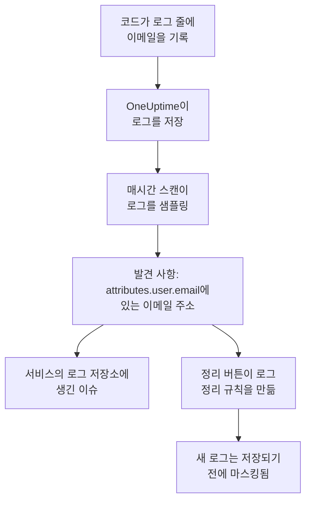

# 텔레메트리의 민감한 데이터

텔레메트리에는 코드가 기록하는 것은 무엇이든 담깁니다. 로그 줄의 이메일 주소, 스팬 속성의 카드 번호, 스택 트레이스의 토큰, 프롬프트 속 고객의 질문 같은 것입니다. 데이터 보안은 각 서비스의 로그, 트레이스, 예외, AI 대화와 각 RUM 애플리케이션의 세션을 각각 별도의 데이터 저장소로 다룹니다. 매시간 이를 샘플링해 버킷에서와 마찬가지로 그 안의 민감한 데이터를 찾으며, **정리** 를 누르면 발견 사항이 그때부터 수집 시점에 그 데이터를 마스킹하는 정리 규칙이 됩니다.

따로 설정할 것은 없습니다. 프로젝트 설정에서 **텔레메트리 스캔** 이 꺼져 있지 않는 한, 각 서비스의 텔레메트리는 매시간 스캔됩니다.

:::cards
- [읽는 대상](#읽는-대상): 각 신호의 속성, 본문, 메시지, 프롬프트.
- [스캔의 샘플링 방식](#스캔의-샘플링-방식): 매시간 읽는 각 서비스의 최신 레코드.
- [정리](#정리): 클릭 한 번으로 발견 사항을 수집 시점에 마스킹합니다.
- [정리된 것으로 보는 경우](#정리된-것으로-보는-경우): 정리 규칙이 이미 발견 사항에 적용되는 경우.
:::

## 작동 방식

정리 규칙이 적용되는 발견 사항은 정리됨으로 표시됩니다. 그 데이터 중 남아 있는 것은 보존 기간이 끝나기를 기다리는 오래된 데이터일 뿐, 아직 흘러나오고 있는 유출이 아닙니다. 두 가지 텔레메트리 검사는 어떤 규칙도 적용되지 않는 것만 세므로, 모든 발견 사항이 정리되면 그 이슈는 해결됩니다([텔레메트리 검사](/docs/data-security/checks-and-issues#텔레메트리) 참고).

## 읽는 대상

| 저장소 | 읽는 대상 | 발견 사항이 가리키는 위치 |
| --- | --- | --- |
| 로그 | 모든 속성과 본문 | `attributes.<key>`, `body` |
| 트레이스 | 모든 스팬 속성과 모든 스팬 이벤트의 속성 | `attributes.<key>`, `events.<event>.<key>` |
| 예외 | 메시지, 스택 트레이스, 속성 | `message`, `stackTrace`, `attributes.<key>` |
| AI 대화 | GenAI 규약이 정한 키 아래에 있는 모든 AI 호출의 프롬프트와 답변, 그리고 그 밖의 모든 속성 | 값이 들어 있는 키(예: `gen_ai.input.messages` 또는 `gen_ai.prompt[].content`) |
| 세션 리플레이 | RUM 애플리케이션의 스팬과 로그의 속성, 세션의 속성, `identify()` 가 사용자에게 부여한 특성, 그리고 전달받은 사용자 참조 | `spans.attributes.<key>`, `logs.attributes.<key>`, `sessions.attributes.<key>`, `sessions.identifiedUserTraits.<key>`, `sessions.identifiedUserLabel` |

번호가 붙은 키는 하나의 위치로 합쳐집니다. `gen_ai.prompt.3.content` 는 `gen_ai.prompt[].content` 가 되므로, 채팅의 메시지 스무 개는 발견 사항 스무 개가 아니라 하나입니다. OneUptime이 직접 추가하는 속성(`oneuptime.` 으로 시작)은 읽지 않습니다.

### 리플레이의 녹화를 읽지 않는 이유

세션 리플레이의 녹화에는 사람들이 본 페이지의 텍스트가 담겨 있습니다. 녹화를 보려면 별도의 권한이 필요한데, 녹화에서 읽어 낸 발견 사항은 데이터 보안을 읽을 수 있는 모든 사람에게 마스킹된 페이지 텍스트를 보여 주게 됩니다. 그래서 리플레이는 속성만 읽습니다. 즉 녹화 옆에 있는 스팬, 로그, 세션 세부 정보입니다. 레코더는 브라우저에서 녹화하는 내용을 이미 마스킹하며, 로그 정리 규칙도 녹화에 적용됩니다([세션 리플레이](/docs/telemetry/session-replay) 참고).

### AI 대화

AI 호출의 프롬프트에는 사람이 보낸 최신 메시지 이전의 채팅 전체가 담기므로, AI 호출의 각 값은 최대 16,384자까지 읽습니다. AI 대화에 민감한 데이터가 있으면 두 가지가 더 따라옵니다. 호출을 받은 AI 공급자가 그 데이터의 흐름이 되고, 저장소에서 [민감한 데이터가 AI 공급자로 전송되고 있음](/docs/data-security/checks-and-issues#ai) 검사가 실패합니다.

[회사 AI 도구](/docs/telemetry/ai-company-tools)의 대화는 제외됩니다. 이 대화는 Project Owner와 Project Admin만 읽을 수 있는데, 발견 사항은 데이터 보안을 읽는 모든 사람이 보는 곳에 남습니다. 그래서 그런 서비스의 스팬은 절대 읽지 않으며, 그 AI 대화는 읽지 않음으로 보고됩니다.

## 스캔의 샘플링 방식

매시간 각 신호에서 지난 한 시간 동안의 최신 레코드를 읽고, 다른 저장소와 마찬가지로 필드별로 분류합니다([필드와 열](/docs/data-security/data-types#필드와-열) 참고).

| 한도 | 값 |
| --- | --- |
| 각 서비스와 신호의 레코드 | **텔레메트리 샘플 크기**, 기본값 500, 최대 1,000 |
| 신호당 읽는 서비스 또는 RUM 애플리케이션 | 가장 바쁜 200개 |
| 한 번의 읽기에 포함되는 레코드 | 5,000개(서비스끼리 나눠 씀), AI 호출은 500개 |
| 로그 본문, 예외 메시지 또는 스택 트레이스의 문자 수 | 8,192 |
| 속성 값의 문자 수 | 4,096 |
| AI 호출 값의 문자 수 | 16,384 |
| 레코드 하나의 속성 수 | 128개, AI 호출은 64개 |
| 스팬 하나의 이벤트 수와 이벤트 하나의 속성 수 | 16개와 32개 |
| 저장소 하나의 위치 수 | 500개 |

모든 값은 데이터베이스 안에서 잘리므로 긴 값은 데이터베이스 밖으로 나가지 않으며, 각 읽기는 30초가 지나면 멈춥니다. 실패한 읽기는 해당 저장소의 경고가 되며, 스캔은 다음 읽기로 넘어갑니다.

무언가를 제외하려면 저장소의 **스캔 제외 항목** 에 추가하세요. 전체 이름으로 지정한 위치(`attributes.http.url`), 한 위치 아래의 모든 것(`attributes.http`), 또는 접두사 없이 지정한 속성 키(`http.url`)를 추가할 수 있습니다.

## 정리

발견 사항에서 **정리** 를 누르면 그 위치의 그 데이터 유형을 그때부터 숨기는 정리 규칙을 만들거나, 이미 그렇게 하고 있는 활성화된 규칙을 가리킵니다.

:::steps
### 발견 사항 열기

텔레메트리 저장소(예: 서비스의 **로그**)와 발견 사항을 엽니다.

### 정리 누르기

**정리** 를 클릭합니다. OneUptime은 발견 사항이 있는 레코드 부분을 대상으로, 로그와 RUM 애플리케이션의 로그에는 로그 정리 규칙을, 스팬, 예외, AI 호출에는 트레이스 정리 규칙을 만듭니다.

### 코드도 고치기

규칙은 새 데이터를 저장하기 전에 마스킹합니다. 이미 저장된 데이터는 보존 기간이 끝날 때까지 남으므로, 그 데이터를 기록하는 코드를 고치세요. 발견 사항에 서비스와 속성이 나와 있습니다.
:::

규칙의 이름은 "Data Security: Email address in attributes.user.email"처럼 숨기는 대상을 따서 붙으며, 다른 정리 규칙과 함께 나열됩니다([드롭 필터 및 정리 규칙](/docs/telemetry/drop-filters-and-scrub-rules#민감한-데이터-스크럽) 참고). 규칙은 다음 중 하나입니다.

| 발견 사항 | 정리가 만드는 규칙 |
| --- | --- |
| 이메일 주소, 카드 번호, 미국 사회 보장 번호, 전화번호 또는 IP 주소 | 해당 유형의 기본 제공 패턴. 카드 번호, 사회 보장 번호, 전화번호는 마스킹되고, 나머지는 완전히 가려집니다. |
| `password` 나 `token` 처럼 민감해 보이는 키 아래의 값 | 그런 모든 속성의 값 전체를 가리는 **Sensitive Attribute Keys** 규칙 |
| 패턴으로 찾을 수 있는 그 밖의 모든 데이터 유형 | 데이터 유형 자체의 패턴으로 만든 **사용자 지정 정규식** 규칙. 그 형태의 모든 값을 가립니다 |

일부 발견 사항은 규칙으로 정리할 수 없으며, **정리** 가 그 이유를 알려 줍니다.

- 사람 이름처럼 필드 이름만으로 찾는 데이터 유형: 어떤 패턴으로도 찾을 수 없습니다. 속성 이름을 민감한 키 규칙이 숨기는 키로 바꾸거나, 보내지 마세요.
- 라우팅 번호처럼 주변 단어로만 다른 값과 구별되는 데이터 유형: 규칙이 그 데이터 유형보다 훨씬 많은 것을 숨기게 됩니다.
- 문서 등급 표시: 그 단어를 숨긴다고 문서가 숨겨지지는 않습니다.
- 직접 만든 데이터 유형: 그 패턴으로 사용자 지정 정리 규칙을 직접 추가하세요.
- 세션 자체의 세부 정보(`sessions.*`): 세션 리플레이 수집에서는 정리 규칙이 실행되지 않습니다.

**정리** 는 사용자 본인으로서, 본인의 권한으로 규칙을 만듭니다. Project Owner와 Project Admin이 누를 수 있고, 로그 정리 규칙을 만들 수 있는 팀도 누를 수 있습니다. 스팬, 예외, AI 호출의 경우에는 트레이스 정리 규칙을 만들 수 있는 팀이어야 합니다.

## 정리된 것으로 보는 경우

발견 사항은 수집 시 활성화된 규칙이 그 위에서 실행되고, 그 규칙이 해당 데이터 유형을 찾아낼 때만 정리됨으로 표시됩니다.

- **알맞은 레코드.** 로그 규칙은 로그와 RUM 애플리케이션의 로그에 적용됩니다. 트레이스 규칙은 스팬, 예외, AI 호출에 적용됩니다. 예외는 해당 스팬의 예외 이벤트를 복사한 것이므로, 이벤트를 정리하는 규칙이 예외도 정리합니다.
- **알맞은 부분.** 규칙의 **정리할 필드** 에 발견 사항이 있는 레코드 부분이 포함되어 있거나, 규칙이 이 필드를 기본값으로 둡니다.
- **그 유형을 찾는 패턴.** 기본 제공 **패턴 유형** 은 자신의 데이터 유형을 찾습니다. **이메일 주소** 는 이메일 주소를, **신용 카드 번호** 는 카드 번호를, **SSN (사회 보장 번호)** 는 미국 사회 보장 번호를, **전화번호** 는 전화번호를, **IP 주소** 는 IP 주소를 찾습니다. **Sensitive Attribute Keys** 는 값이 무엇이든 민감해 보이는 키 아래의 모든 값에 적용됩니다.
- **직접 만든 사용자 지정 패턴은 절대 인정되지 않습니다.** **사용자 지정 정규식** 은 **정리** 가 그 유형에 대해 만드는 패턴과 정확히 같을 때만 발견 사항에 적용됩니다. 발견 사항에는 어떤 패턴도 시험해 볼 수 없는 마스킹된 샘플만 남으므로, OneUptime은 사용자의 패턴이 데이터를 숨긴다는 것을 증명할 수 없습니다. 그리고 잘못 정리됨으로 표시된 발견 사항은 아무도 들여다보지 않는 유출이 됩니다.

꺼져 있거나 아무것도 정리하지 않는 규칙은 절대 인정되지 않습니다. 적용 여부는 스캔이 끝날 때마다 다시 계산되므로, 직접 추가하거나 제거한 규칙은 한 시간 안에 정리됨 표시에 반영됩니다.

## 다음 단계

:::cards
- [드롭 필터 및 정리 규칙](/docs/telemetry/drop-filters-and-scrub-rules): 모든 정리 규칙 옵션과 직접 작성하는 규칙.
- [데이터 보안 검사 및 이슈](/docs/data-security/checks-and-issues): 두 가지 텔레메트리 검사와 AI 검사.
- [데이터 흐름, 접근 및 상주](/docs/data-security/flows-access-residency): 서비스가 데이터를 보내는 AI 공급자와 호스트.
:::
