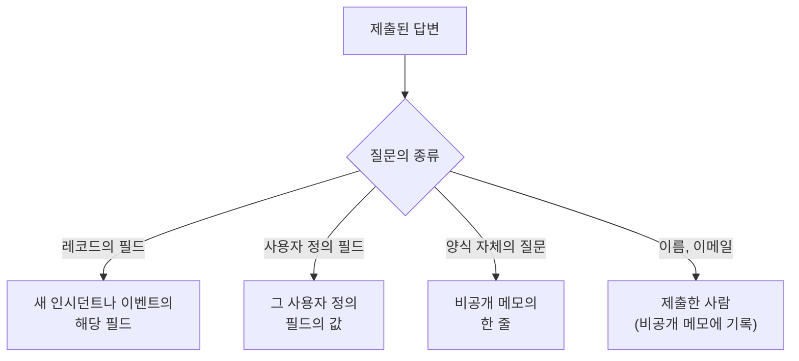

# 양식 만들기

양식의 **만들기** 페이지에서는 양식이 무엇을 묻는지와 그 페이지가 어떻게 보이는지를 정합니다. 질문은 왼쪽에 공개 페이지에 표시되는 순서대로 있고, 오른쪽의 **질문 추가** 에는 추가할 수 있는 모든 것이 나열됩니다. 질문 위에는 양식의 [브랜딩](#브랜딩) (로고와 파비콘) 이 접힌 채로 있습니다. 사람들이 양식을 시작할 수 있는 이름 있는 답변 세트 (각각 자신의 경우에 맞게 질문을 필수, 선택, 숨김으로 만들 수도 있음) 는 양식의 **템플릿** 페이지에 있습니다. [템플릿](#템플릿) 을 참조하세요.

:::cards
- [빌더](#빌더): 질문을 추가, 편집, 이동, 저장합니다.
- [추가할 수 있는 것](#추가할-수-있는-것): 자체 질문, 레코드의 필드, 사용자 정의 필드, 제출자.
- [숨겨진 질문](#숨겨진-질문): 제출하는 사람이 아니라 템플릿이 답합니다.
- [템플릿](#템플릿): 팀이 자주 보고하는 각 경우를 위한 하나의 양식과 하나의 링크.
:::

## 각 답변이 가는 곳

모든 답변은 양식의 **제출 내역** 페이지에 제출 내용과 함께 보관됩니다. 양식이 묻지 않거나 비어 있는 필드는 양식의 [제출 시 설정](/docs/forms/on-submit) 에서 채워집니다.

## 빌더

:::steps
### 질문 추가하기

**질문 추가** 에서 추가할 것을 고릅니다. 새 질문은 선택한 질문 뒤 (또는 끝) 에 삽입되고 선택된 상태가 됩니다.

### 그 자리에서 편집하기

카드를 선택해 편집합니다. 질문, 도움말 텍스트, 답변 유형과 옵션, 필수인지 숨김인지, 그리고 복제와 삭제 버튼이 있습니다. **완료** 으로 닫습니다.

### 제자리에 두기

카드의 핸들을 끌어 이동하거나, 선택한 카드에서 **위로 이동** 과 **아래로 이동** 을 사용합니다. 휴대폰이나 키보드에서도 사용할 수 있습니다.

### 양식 저장하기

**변경 사항 저장** 는 모든 변경을 한 번에 저장합니다. 저장하기 전까지 빌더에는 **저장되지 않은 변경 사항** 가 표시되고 **변경 사항 취소** 가 제공되며, 페이지를 떠나기 전에 브라우저가 확인합니다.
:::

- **양식 머리글** 에는 공개 페이지와 같은 모양으로 양식의 이름과 설명이 표시됩니다. **이름 및 설명 편집** 으로 변경합니다.
- **질문** 은 카드입니다. 각 카드에는 사람들이 보게 될 모습 그대로 질문이 표시되고, 무엇에 연결되었는지 알려 주는 배지가 붙습니다. **인시던트 · 심각도**, **사용자 정의 필드 · Region**, **제출자 · 이메일**, 또는 양식 자체의 질문이면 답변 유형입니다. 빨간 별표는 필수 질문을, **숨김** 배지는 [숨겨진](#숨겨진-질문) 질문을 나타냅니다.
- **한도.** 양식에는 질문을 최대 50개까지 둘 수 있습니다. 양식을 읽을 수는 있지만 편집할 수 없는 사람에게는 빌더가 읽기 전용으로 표시됩니다.

## 브랜딩

질문 위에 접혀 있는 **브랜딩** 은 양식 페이지의 모양입니다. 페이지 상단의 양식 이름 위에 로고가, 양식이 열려 있는 동안 브라우저 탭에 파비콘이 표시됩니다. 직접 업로드하기 전까지 양식은 OneUptime 로고와 파비콘을 표시합니다.

접힌 상태에서 이 섹션에는 **로고** 와 **파비콘** (양식에 자체 이미지가 있으면 설정됨으로 표시) 이 나열되고, 아직 적용 중인 OneUptime 의 것이 무엇인지 알려 줍니다. 펼치면 둘 다 페이지에 표시되는 그대로 볼 수 있습니다. 로고는 페이지 상단에 놓인 모습으로, 파비콘은 양식 이름 (탭의 제목) 옆의 브라우저 탭에 표시됩니다.

**브랜딩 편집** 으로 하나의 대화 상자에서 둘 다 변경합니다.

| 필드 | 설명 |
| --- | --- |
| **로고** | 양식 페이지 상단, 이름 위에 OneUptime 로고 대신 표시됩니다. 512 KB 이하의 PNG, JPEG, GIF, WebP, SVG 이미지입니다. 제거하면 OneUptime 로고로 돌아갑니다. |
| **Logo Alt Text** | 화면 읽기 프로그램이 읽어 주는 로고의 내용으로, 보통 조직의 이름입니다. 로고가 있으면 묻습니다. 비워 두면 화면 읽기 프로그램이 로고를 건너뛰며, 어차피 그 뒤에 양식 이름이 이어집니다. 로고를 제거하면 이 값도 지워집니다. |
| **파비콘** | 양식이 열려 있는 동안 브라우저 탭에 표시되는 아이콘으로, OneUptime 파비콘 대신 표시됩니다. 128 KB 이하의 PNG, JPEG, GIF, WebP, SVG, ICO 이미지이며, 정사각형 PNG, SVG, ICO 가 가장 좋습니다. 제거하면 OneUptime 파비콘으로 돌아갑니다. |

로고는 대체하는 OneUptime 로고의 높이를 유지하며, 가로로 긴 로고는 페이지 너비에 맞춰집니다. 모든 이미지는 저장할 때 (대시보드, API, Terraform, 워크플로 어디에서든) 확인됩니다. 양식 자체의 프로젝트에 업로드된 것이어야 하고, 위의 유형 중 하나여야 하며, 한도를 넘지 않아야 합니다. 이 이미지들 중 하나가 아닌 로고는 "The logo must be a PNG, JPEG, GIF, WebP or SVG image." 로, 너무 큰 로고는 "The logo must be 512 KB or smaller." 로, 업로드가 사라졌거나 다른 프로젝트에서 업로드된 로고는 "The logo's file could not be found. Upload the logo again." 로 거부됩니다. 파비콘도 같은 방식으로 "The favicon must be a PNG, JPEG, GIF, WebP, SVG or ICO image.", "The favicon must be 128 KB or smaller.", "The favicon's file could not be found. Upload the favicon again." 로 거부됩니다.

**미리 보기** 는 페이지와 같은 방식으로 로고를 표시합니다. 양식을 읽을 수는 있지만 편집할 수 없는 사람은 **브랜딩 편집** 없이 브랜딩을 봅니다. 로고와 파비콘은 양식 안에서만 양식 페이지에 전달됩니다. [공유 및 보안](/docs/forms/sharing-and-security#양식을-보호하는-것) 을 참조하세요.

## 추가할 수 있는 것

**질문 추가** 에는 네 그룹이 있습니다. 양식 자체의 **질문**, 양식이 만드는 것의 **인시던트 필드** 또는 **예정된 유지 관리 필드**, **사용자 정의 필드**, **제출자** 입니다.

### 양식 자체의 질문

| 답변 유형 | 제출자가 입력하는 것 |
| --- | --- |
| **짧은 답변** | 한 줄의 텍스트. |
| **단락** | 여러 줄의 텍스트. |
| **서식 있는 텍스트** | 서식과 링크가 있는 텍스트. |
| **숫자** | 숫자. |
| **드롭다운** | 목록에서 하나 선택. |
| **다중 선택** | 목록에서 원하는 만큼 선택. |
| **체크박스** | 확인 등을 위해 체크하는 상자. |
| **날짜** | 날짜. |
| **날짜 및 시간** | 날짜와 시간. |

드롭다운이나 다중 선택은 지정한 **옵션** 를 1개에서 100개까지 나열하며, 각 옵션에 선택적으로 색을 줄 수 있습니다 (옵션 옆의 버튼으로 이름 있는 색 세트가 열리고, **사용자 지정 색상** 로 정확한 코드를 지정합니다). 질문을 **드롭다운** 과 **다중 선택** 사이에서 바꿔도 옵션은 유지됩니다. 이 유형이 된 질문은 이름을 바꿀 수 있는 옵션 두 개로 시작하고, 이 유형이 아니게 된 질문은 옵션을 잃습니다. **복제** 는 양식 자체의 질문을 바로 아래에 복사합니다.

이 질문들에 대한 답변은 제출 내용과 함께 보관되며, 양식이 만드는 것의 비공개 메모에 나열됩니다. 어떤 필드도 채우지 않습니다. 필드를 채우려면 다음 두 그룹에서 필드 자체를 추가하세요.

### 양식이 만드는 것의 필드

제출자가 답할 수 있는 인시던트나 예정된 유지 관리 이벤트의 필드입니다. 답변이 필드의 값이 됩니다.

| 인시던트 필드 | 답변 내용 |
| --- | --- |
| **제목** | 최대 500자의 한 줄. |
| **설명** | 최대 20,000자의 서식 있는 텍스트. |
| **심각도** | 인시던트 심각도 중 하나. |
| **모니터** | 제공한 모니터 중 아무것 (인시던트의 영향을 받은 모니터). |
| **레이블** | 제공한 레이블 중 아무것. |
| **영향 시작 시간** | 날짜와 시간. 제출자가 기억하는, 문제가 시작된 시점입니다. |

| 예정된 유지 관리 필드 | 답변 내용 |
| --- | --- |
| **제목** | 최대 100자의 한 줄. |
| **설명** | 최대 20,000자의 서식 있는 텍스트. |
| **시작** | 날짜와 시간. 항상 묻고 항상 필수입니다. |
| **종료** | **시작** 이후의 날짜와 시간. 항상 묻고 필수입니다. |
| **모니터** | 제공한 모니터 중 아무것. |
| **상태 페이지** | 제공한 상태 페이지 중 아무것. |
| **레이블** | 제공한 레이블 중 아무것. |

각 필드는 한 번만 물을 수 있으며, 목록에는 이미 양식에 있는 필드가 **추가됨** 로 표시됩니다. 양식이 묻지 않거나 비어 있는 필드는 양식의 [제출 시 설정](/docs/forms/on-submit) 에서 채워집니다.

**제공되는 선택지.** 공개 페이지가 낯선 사람에게 프로젝트 전체를 보여 주면 안 되므로, 레코드를 골라 답하는 필드는 직접 고른 것만 제공합니다. **모니터**, **레이블**, **상태 페이지** 는 제공한 선택지만 정확히 나열하며, 하나 이상 제공하기 전까지는 묻지 않습니다. 심각도는 비밀이 아니므로, **심각도** 는 좁히지 않는 한 모든 인시던트 심각도를 제공합니다. 제공된 선택지 밖의 답변은 거부됩니다.

### 사용자 정의 필드

인시던트 사용자 정의 필드 (유지 관리 양식에서는 예정된 유지 관리 사용자 정의 필드) 는 각각 답변이 필드의 값이 되는 질문입니다. 질문은 사용자 정의 필드에서 유형과 옵션을 가져오며, 처음에는 그 이름이 질문, 그 설명이 도움말 텍스트가 됩니다. 둘 다 변경할 수 있습니다.

양식은 **생성 시 표시** 설정과 관계없이 양식에 추가한 사용자 정의 필드만 묻습니다. 양식이 묻는 모든 필드는 링크가 있는 누구에게나 이름, 설명, 옵션을 보여 줍니다. 사용자 정의 필드가 삭제되면 그 질문은 양식에 남지만 더 이상 묻지 않으며, 카드에 그렇게 표시됩니다. 질문을 삭제하세요. 같은 이름으로 다시 만든 필드는 새 필드이므로 다시 추가하세요.

모니터 사용자 정의 필드에서 값을 복사하는 사용자 정의 필드는 카드에 그렇게 표시됩니다. 인시던트나 이벤트의 모니터가 그 필드의 값에 대해 일치하면, 그 값이 제출자의 답변을 대체합니다.

### 제출자

**이름** 과 **이메일** 은 누가 제출하는지 묻습니다. 이 값은 제출 내용과 함께 보관되고 비공개 메모에 기록되어 팀이 후속 조치를 할 수 있으며, 인시던트나 이벤트 자체에는 절대 표시되지 않습니다. OneUptime 은 제출자에게 이메일을 보내지 않습니다. 익명 제출을 받으려면 이 질문을 빼거나 선택으로 만드세요.

이메일은 `ada@example.com` 같은 하나의 일반 주소여야 합니다. 꺾쇠괄호 안에 주소가 든 이름이나 주소 목록은 안 됩니다. 이름과 이메일은 각각 최대 100자입니다.

## 새 양식의 질문

새 양식은 만들자마자 작동하도록, 거의 항상 물어야 하는 질문으로 시작합니다. 필수인 **제목**, **설명**, 유지 관리 양식이라면 **시작** 과 **종료**, 그리고 필수인 **이름** 과 **이메일** 입니다. 문구는 대시보드의 언어로 표시됩니다. 원하는 대로 변경, 숨김, 제거할 수 있지만, 유지 관리 이벤트의 시작과 끝은 예외입니다. 이것이 없으면 이벤트를 예약할 수 없습니다. 자체 질문으로 모든 것을 말할 수 있다면, 아무도 입력하지 않아야 할 상자를 남기는 대신 **설명** 을 숨기세요. [숨겨진 질문](#숨겨진-질문) 을 참조하세요.

## 필수 질문

**필수** 는 답변 없이 양식을 제출할 수 없다는 뜻입니다. 공백, 탭, 줄 바꿈만 있는 답변은 답변 없음으로 간주되며, 필수 **체크박스** 는 체크해야 합니다. 서버는 양식이 제출될 때 모든 필수 질문을 다시 확인하므로, 페이지 없이 보낸 요청에도 같은 조건이 적용됩니다.

필수가 아닌 질문은 비워 둘 수 있습니다. 그러면 그 필드는 양식이 묻지 않은 것처럼 제출 시 설정에서 채워집니다.

## 숨겨진 질문

카드에서 **숨김** 을 켜면 질문이 더 이상 양식에 표시되지 않습니다. 아무에게도 묻지 않으므로 필수가 되지 않으며, 제출로 답할 수도 없습니다. 요청에서 그 질문의 값을 읽지도 않습니다. 제출이 시작된 [템플릿](#템플릿) 만 답하며, 제출자가 템플릿 없이 시작했거나 그 질문을 비워 두는 템플릿에서 시작했다면 답이 없는 상태로 남습니다. 템플릿은 자신의 경우를 위해 숨겨진 질문을 굳이 물을 수도 있습니다. [템플릿이 각 질문을 묻는 방식](#템플릿이-각-질문을-묻는-방식) 을 참조하세요.

답을 정하는 것이 제출자가 아니라 팀이라면 질문을 숨기세요.

- **인시던트의 설명**. 추가한 질문으로 모든 것을 말할 수 있을 때입니다. 숨기면 더 이상 거기에 입력하라고 권하지 않습니다. 각 템플릿에 그 경우에 보내는 표준 텍스트를 주거나, 설명 없이 인시던트가 시작되게 하세요.
- **워크플로나 규칙이 읽는 사용자 정의 필드**. 예를 들어 알림 유형으로, 각 템플릿이 설정합니다.
- 답변이 비공개 메모에서 팀에게만 필요한 **양식 자체의 질문**.

숨겨진 질문은 위치, 레이블, 설정을 유지하므로 언제든 다시 표시할 수 있습니다. 양식의 대상을 만드는 데 꼭 필요한 필드 (유지 관리 이벤트의 **시작** 과 **종료** ) 는 숨길 수 없습니다. 숨겨진 질문의 답변은 입력된 답변과 똑같이 확인되고 저장되며, 제출 내용과 함께 보관됩니다.

## 템플릿

양식의 **템플릿** 페이지에는 사람들이 양식을 시작할 수 있는 이름 있는 답변 세트가 있습니다. **애플리케이션 장애**, **계획된 유지 관리**, **서비스 복원됨** 처럼 팀이 자주 보고하는 경우마다 하나씩 두면, 하나의 양식과 하나의 링크로 모두 처리할 수 있습니다.

:::steps
### 템플릿 추가하기

**템플릿 추가** 을 클릭합니다. 편집기는 두 부분으로 되어 있습니다. **질문** 에는 양식의 모든 질문과 이 템플릿이 그 질문을 묻는 방식이 나열됩니다. [템플릿이 각 질문을 묻는 방식](#템플릿이-각-질문을-묻는-방식) 을 참조하세요. **답변** 에는 숨겨진 질문을 포함해 필수인 것 없이 질문이 다시 나열됩니다. 템플릿이 답해야 할 것을 채우고, 나머지는 제출하는 사람에게 맡기세요. 템플릿이 묻지 않는 질문에 대한 답변은 그 아래에 그렇게 표시되며, 그대로 사용됩니다.

### 기본값 고르기

**기본값** 는 양식이 열릴 때의 템플릿으로 만듭니다. 기본값이 될 수 있는 템플릿은 하나뿐이며, 유일한 템플릿이 기본값인 양식은 그저 미리 채워진 양식입니다.

### 링크 공유하기

**링크 복사** 는 템플릿 전용 링크를 복사하며, 이 링크는 템플릿으로 채워진 양식을 엽니다. [공유 및 보안](/docs/forms/sharing-and-security#템플릿마다의-링크) 을 참조하세요.
:::

각 템플릿에는 채우는 내용과 자기 방식으로 묻는 질문 (예: **예정된 유지 관리 날짜 · 숨김** ) 이 나열되며, **편집**, **복제** (바로 뒤에 **애플리케이션 장애 2** 같은 이름으로 복사본을 만듦), 양식에 나열되는 순서를 위한 **위로 이동** 과 **아래로 이동**, 그리고 **삭제** 가 있습니다.

공개 페이지에서 템플릿이 있는 양식은 질문 위의 **템플릿에서 시작** 아래에 템플릿을 나열합니다. 하나를 고르면 양식이 채워지고 그 템플릿이 묻는 방식으로 질문이 표시됩니다. 제출자는 제출 전에 어떤 답변이든 바꿀 수 있으며, 다른 템플릿을 고르면 그 템플릿에서 양식을 다시 시작합니다. 페이지는 링크가 지정한 템플릿으로, 없으면 기본값으로, 그것도 없으면 템플릿 없이 열립니다. **미리 보기** 도 템플릿을 나열하고 기본값으로 열립니다.

> [!IMPORTANT]
> 링크를 연 모든 사람은 각 템플릿의 이름과, 템플릿이 묻는 질문에 대한 그 답변을 볼 수 있습니다. 페이지는 그렇게 스스로 채워집니다. 템플릿이 묻지 않는 질문에 대한 템플릿의 답변은 서버를 벗어나지 않으므로, 내부 정보는 숨겨진 질문에 두세요.

템플릿을 저장하면 모든 템플릿의 모든 답변이 그 질문과 대조됩니다 (질문이 제공하는 옵션, 양식이 제공하는 레코드, 맞는 텍스트). 템플릿이 자기 방식으로 묻는 각 질문도 마찬가지이며, 대시보드, API, Terraform 어디에서 왔든 문제가 있으면 템플릿과 문제를 알려 주는 메시지와 함께 저장이 거부됩니다. 템플릿 이름은 최대 100자이고 양식 안에서 고유해야 하며, 양식에는 템플릿을 최대 50개까지 둘 수 있습니다. 나중에 질문을 바꾸면, 삭제했거나 더 이상 맞지 않는 질문에 대한 템플릿의 답변은 그냥 사용되지 않으며, 그 템플릿을 다음에 저장할 때 버려집니다. 그 때문에 다른 템플릿의 저장이 거부되는 일은 없습니다. 템플릿이 이미 가지고 있던 내용은 다시 확인하지 않기 때문입니다.

### 템플릿이 각 질문을 묻는 방식

경우가 다르면 필요한 질문도 다릅니다. 장애에는 영향을 받은 애플리케이션이 필요하고 유지 관리 시간대는 필요 없지만, 계획된 유지 관리에는 시간대가 필요합니다. 경우마다 양식을 만드는 대신, 각 템플릿이 양식의 질문을 자기 방식으로 묻게 하세요. 템플릿의 **질문** 에서 각 질문은 다음 중 하나를 가집니다.

| 설정 | 누군가 템플릿에서 시작할 때 |
| --- | --- |
| **양식 기본값** | 질문은 양식이 묻는 방식대로 묻습니다. 빌더의 카드가 말하는 대로 필수, 선택, 숨김 중 하나입니다. 선택기는 **양식 기본값(숨김)** 처럼 어느 것인지 표시하며, 카드를 바꾸면 따라갑니다. |
| **필수** | 질문을 묻고, 답변 없이는 양식을 제출할 수 없습니다. |
| **선택 사항** | 질문을 묻고, 비워 둘 수 있습니다. |
| **숨김** | 질문을 묻지 않습니다. 템플릿 자체의 답변이 있으면, 양식이 숨기는 질문처럼 그것이 답변이 됩니다. |

이렇게 하나의 인시던트 양식으로 두 경우를 모두 처리할 수 있습니다.

| 질문 | 애플리케이션 장애 | 계획된 유지 관리 |
| --- | --- | --- |
| 애플리케이션 이름 | 필수 | 필수 |
| 영향을 받은 시설 | 필수 | 선택 사항 |
| 예정된 유지 관리 날짜 | 숨김 | 필수 |

모든 질문은 **양식 기본값** 으로 시작하며, 나중에 양식에 추가하는 질문도 모든 템플릿에서 마찬가지입니다. 유지 관리 이벤트의 **시작** 과 **종료** 은 항상 묻고 항상 필수이며, 어떤 템플릿도 바꿀 수 없습니다. 템플릿은 다른 모든 질문을 숨기고 직접 답할 수 있습니다. 그러면 그 링크는 **제출** 버튼 하나만 있는 양식이 되어, **서비스 복원됨** 같은 경우에 편리합니다.

페이지는 제출자가 고른 템플릿을 따릅니다. 다른 템플릿을 고르면 그 템플릿의 질문으로 양식을 다시 그리며, **미리 보기** 도 마찬가지입니다. 서버는 무엇이 보냈든 각 제출을 그 제출이 지정한 템플릿이 묻는 질문과 대조합니다. 템플릿이 필수로 하는 질문에는 답해야 하고, 템플릿이 숨기는 질문은 요청에서 읽지 않으며 템플릿 자체의 답변이 사용됩니다. 템플릿을 지정하지 않은 제출이나 그 후 삭제된 템플릿을 지정한 제출은 양식 자체의 설정과 대조됩니다. 양식이 숨기는 질문은 템플릿이 그것을 물을 때만 공개 페이지에 표시됩니다.

## 빌더가 질문에 플래그를 붙일 때

문제가 있는 카드는 무엇이 문제인지 호박색으로 알려 줍니다.

| 카드 표시 | 문제 |
| --- | --- |
| **이 사용자 정의 필드가 삭제되어 질문이 표시되지 않습니다. 질문을 삭제하세요.** | 공개 페이지에서 그 질문이 빠집니다. |
| **제공할 항목을 하나 이상 선택하세요. 그렇지 않으면 질문이 표시되지 않습니다.** | 레코드를 골라 답하는 필드가 아무것도 제공하지 않습니다. 제공할 모니터, 레이블, 상태 페이지를 고르세요. |
| **옵션을 하나 이상 추가하세요.** | 드롭다운이나 다중 선택에 고를 것이 없습니다. |
| **질문을 입력하세요.** | 질문에 텍스트가 없습니다. |

질문에 마지막 세 가지 중 하나가 있으면 양식을 저장할 수 없습니다. **변경 사항 저장** 가 어느 질문에 무엇이 문제인지 알려 주며, 미리 보기에서는 그런 질문이 빠집니다. 저장할 때 질문 전체도 확인하며, 예를 들어 두 질문이 같은 필드를 요구하거나 유지 관리 양식이 유지 관리의 시작과 끝을 묻지 않으면, 질문이 빌더, API, Terraform, 워크플로 어디에서 왔든 문제를 알려 주는 메시지와 함께 거부됩니다.

## 미리 보기

**미리 보기** 는 사람들이 링크에서 보는 그대로 양식을 엽니다. 같은 로고, 질문, 입력란, 옵션, 확인, 템플릿 목록이 있고, 선택한 템플릿이 묻는 질문만 표시되며, 직접 채워 볼 수 있습니다. 거기서 입력한 것은 제출되지 않습니다. **제출** 은 답변을 확인만 하고, **다시 작성** 은 처음부터 다시 시작합니다. 미리 보기는 저장 여부와 관계없이 빌더에 있는 그대로 질문을 표시하며, 플래그가 붙은 질문을 뺄 때는 그렇다고 알려 줍니다.

## 제출자가 보는 것

공개 페이지에는 양식의 로고 (직접 업로드하기 전까지는 OneUptime 로고), 양식의 이름과 설명, 템플릿이 있으면 그 목록, 양식이 묻는 질문 (선택한 템플릿이 묻는 방식대로, 템플릿을 고르지 않았으면 숨기지 않은 질문), 그리고 **제출** 이 표시되며, 브라우저 탭에는 양식의 이름과 파비콘이 표시됩니다. OneUptime 이 제출자의 언어를 지원하면 그 언어 (그 브라우저에서 OneUptime 에 마지막으로 고른 언어, 없으면 브라우저가 요청하는 언어) 로, 지원하지 않으면 영어로 표시됩니다. 질문, 옵션, 도움말 텍스트는 작성한 그대로 표시됩니다.

제출 후 페이지에는 "감사합니다. 응답이 제출되었습니다." 가 표시되고 만들어진 것의 번호 ("참조 번호는 INC-42입니다.") 가 나오며, **공유** 페이지에서 감사 메시지를 작성했다면 그 뒤에 이어집니다. **다른 응답 제출** 은 빈 양식을 엽니다. 제출자는 이메일을 받지 않으며, 인시던트나 이벤트로 돌아갈 방법도 없습니다.

## 크기 한도

| 답변 | 한도 |
| --- | --- |
| 인시던트의 **제목** | 500자 (양 끝의 공백은 세지 않음). |
| 유지 관리 이벤트의 **제목** | 100자. |
| **설명** | 20,000자. |
| 그 밖의 텍스트 답변 | 10,000자. |
| 다중 선택 답변 | 선택 100개. |
| **이름**, **이메일** | 각각 100자. |

한도를 넘거나, 필수 답변이 빠졌거나, 질문에 맞지 않는 답변을 준 제출은 무엇이 문제인지 알려 주는 메시지와 함께 거부되며 아무것도 만들어지지 않습니다. 양식이 묻지 않는 질문에 대한 답변은 무시됩니다.

## 다음 단계

:::cards
- [제출로 만들어지는 항목](/docs/forms/on-submit): 답변과 제출 시 설정이 인시던트나 유지 관리 이벤트가 되는 과정.
- [공유 및 보안](/docs/forms/sharing-and-security): 링크 공유, 템플릿마다의 링크, 그리고 그것들을 보호하는 것.
- [인시던트 설정 및 자동화](/docs/incidents/settings): 인시던트 사용자 정의 필드와 템플릿.
:::
