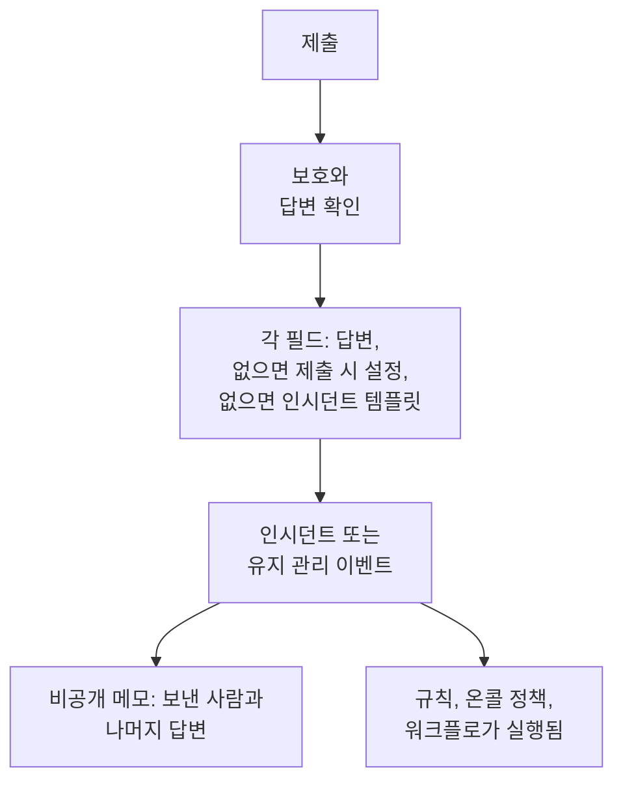

# 제출로 만들어지는 항목

양식을 통한 각 제출은 프로젝트에 레코드를 하나 만듭니다. **인시던트** 또는 **예정된 유지 관리 이벤트** 입니다. 양식의 **제출 시** 페이지에는 그중 무엇인지와, 새 레코드의 각 필드가 어떻게 채워지는지 (답변, 기본값, 항상 적용되는 설정, 인시던트 템플릿 중 무엇에서 오는지) 가 표시됩니다. **설정 편집** 로 기본값과 항상 적용되는 것을 변경합니다.

:::cards
- [제출이 인시던트가 되는 과정](#제출이-인시던트가-되는-과정): 새 인시던트의 각 필드와 그 값이 어디서 오는지.
- [제출이 예정된 유지 관리 이벤트가 되는 과정](#제출이-예정된-유지-관리-이벤트가-되는-과정): 유지 관리 요청의 경우도 같습니다.
- [제출 시 설정](#제출-시-설정): 기본값, 항상 첨부하는 것, 소유자, 게시.
- [비공개 메모](#비공개-메모): 누가 보냈는지와, 어떤 필드에도 들어가지 않는 답변.
:::

## 제출하면 일어나는 일

확인을 통과하지 못한 제출은 아무것도 만들지 않습니다. [양식을 보호하는 것](/docs/forms/sharing-and-security#양식을-보호하는-것) 을 참조하세요.

## 각 제출이 만드는 것

**제출할 때마다 만들어지는 항목** 카드에는 양식을 만들 때 고른 것이 담겨 있습니다.

- **인시던트** — 각 제출이 인시던트를 선언하므로, 온콜 팀이 바로 알림을 받습니다. 문제 보고에 사용합니다.
- **예정된 유지 관리** — 각 제출이 유지 관리 이벤트를 예약합니다. 변경 및 유지 관리 요청에 사용합니다.

다른 쪽을 고르면 양식도 함께 바뀌므로 확인을 요청합니다.

- 제목, 설명, 모니터, 레이블은 계속 연결됩니다. 두 종류의 레코드 모두에 있기 때문입니다.
- 그 밖의 연결된 질문 (심각도, 상태 페이지 선택, 이전 종류의 사용자 정의 필드) 은 같은 문구의 양식 자체의 질문이 되며, 그 답변은 비공개 메모에 나열됩니다.
- 인시던트와 이벤트의 설정이 다르므로 제출 시 설정은 처음부터 다시 시작합니다.
- 이제 유지 관리 이벤트를 만드는 양식은 유지 관리의 시작과 끝을 묻습니다.

질문은 변경과 함께 바로 저장됩니다. **만들기** 페이지에서 확인하세요.

## 제출이 인시던트가 되는 과정

카드에는 새 인시던트의 각 필드와 그 값이 어디서 오는지가 나열됩니다.

| 필드 | 값의 출처 |
| --- | --- |
| **제목** | **제목** 질문에 대한 답변. 양식이 묻지 않거나 비어 있으면 **기본 제목**, 그것도 없으면 양식의 이름. |
| **설명** | **설명** 질문에 대한 답변. 묻지 않거나 비어 있으면, 양식에 템플릿이 있는 경우 인시던트 템플릿의 설명. |
| **심각도** | 양식이 묻는 경우 제출자의 선택. 그렇지 않으면 양식의 **심각도** 설정, 그것도 없으면 인시던트 템플릿의 심각도. |
| **모니터** | 제출자가 고른 모니터와, 설정이 항상 첨부하는 모니터. 둘 다 없으면 인시던트 템플릿의 것. |
| **레이블** | 제출자가 고른 레이블과, 설정이 항상 추가하는 레이블. 둘 다 없으면 인시던트 템플릿의 것. |
| **영향 시작 시간** | 양식이 묻는 경우 **영향 시작 시간** 에 대한 답변. |
| **인시던트 템플릿** | 양식의 **인시던트 템플릿** 설정. 답변과 설정이 정하지 않은 모든 것을 채웁니다. |
| **온콜 정책** | 설정이 지정한 정책으로, 양식이 선언하는 모든 인시던트에 대해 실행됩니다. 없으면 인시던트 템플릿의 것. |
| **소유자** | 설정이 지정한 사람과 팀, 그리고 템플릿의 소유자. 모든 인시던트에 대해 알림을 받습니다. |
| **사용자 정의 필드** | 각 사용자 정의 필드 질문에 대한 답변. 단, 필드가 모니터 사용자 정의 필드에서 값을 복사하고 인시던트의 모니터에 그 값이 있으면 제외됩니다. 나머지는 템플릿이 채웁니다. |
| **상태 페이지** | 팀의 누군가가 게시하기 전까지 상태 페이지에 표시되지 않으며, 구독자에게도 알리지 않습니다. |
| **기타 답변** | 제출한 사람과 함께 인시던트의 비공개 메모에 나열됩니다. |

> [!IMPORTANT]
> **심각도가 없으면 인시던트도 없습니다.** 인시던트에는 심각도가 필요합니다. 양식이 심각도를 묻지 않고, 설정도 지정하지 않으며 (또는 지정한 것이 삭제되었으며), 템플릿도 설정하지 않으면, **심각도** 행에 경고가 표시되고 모든 제출이 "이 양식에는 심각도가 없어 인시던트를 만들 수 없습니다. 양식을 공유한 팀에 알려 주세요." 로 거부됩니다. **설정 편집** 에서 심각도를 고르거나, 심각도를 설정하는 템플릿을 고르세요.

### 인시던트 템플릿

설정에서 **인시던트 템플릿** 을 고르면, 양식이 선언하는 모든 인시던트는 서버가 어디서든 템플릿을 적용하는 것과 같은 방식으로 그 템플릿에서 선언됩니다. [템플릿이 적용되는 방식](/docs/incidents/settings#템플릿이-적용되는-방식) 을 참조하세요. 답변과 양식의 설정이 우선하며, 템플릿이 나머지를 모두 채웁니다. 초기 상태, 설명, 심각도, 영향을 받는 리소스, 온콜 정책, 소유자, 레이블, 사용자 정의 필드 값, 모니터 상태 변경입니다.

> [!WARNING]
> **모니터에 주의하세요.** 양식을 통해 모니터에 인시던트를 선언하면, 그 모니터에 직접 인시던트를 선언한 것과 똑같은 영향이 모니터에 미칩니다. 인시던트가 해결될 때까지 모니터의 활성 모니터링이 일시 중지되며, 템플릿의 **모니터 상태를 다음으로 변경** 는 모니터의 상태를 즉시 변경합니다. 인시던트 자체가 숨겨져 있어도 모니터를 나열하는 모든 상태 페이지에서 변경됩니다. 양식이라면 링크가 있는 누구나 이것을 할 수 있습니다. 모든 제출이 모니터를 일시 중지해야 할 때만 양식으로 모니터를 첨부하세요.

### 인시던트의 모습

양식을 통해 선언된 인시던트는 일반 인시던트이지만, 몇 가지 자체 설정이 있습니다.

- **상태 페이지에서 숨겨짐.** **상태 페이지에 표시** 가 꺼져 있고, **상태 페이지 구독자에게 알림** 도 꺼져 있습니다. 대응자가 게시하기 전까지 인시던트에 관한 어떤 것도 상태 페이지나 구독자에게 전달되지 않습니다. 예외는 앞에서 말한 템플릿의 모니터 상태 변경입니다.
- **선언한 사람 없음.** 제출자는 OneUptime 사용자가 아니므로, 인시던트를 선언한 사용자로 기록되는 사람이 없습니다.
- **소유자가 알림을 받음.** 설정과 템플릿이 지정한 소유자는 인시던트의 Slack 과 Microsoft Teams 채널이 생기는 즉시 추가되어 알림을 받습니다. 인시던트의 **인시던트 생성됨** 알림은 그들이 소유자가 될 때까지 기다리므로, 프로젝트의 소유자가 아니라 그들에게 갑니다.
- **비공개 메모가 제출을 기록함** — [비공개 메모](#비공개-메모) 를 참조하세요.

새 인시던트에 대해 실행되는 모든 것이 이 인시던트에도 실행됩니다. 개인 정보, 소유자, 레이블, 온콜, 런북 규칙, 온콜 정책, **On Create Incident** 워크플로입니다. 온콜 규칙은 다른 인시던트와 마찬가지로 양식의 인시던트와 일치하며, 제출자가 쓴 제목과 설명으로도 일치합니다.

:::steps
#### 제출자가 쓴 내용 읽기

제목과 설명은 인시던트가 게시되면 상태 페이지에 표시됩니다.

#### 인시던트 게시하기

인시던트의 **설정** 페이지에서 **상태 페이지에 표시** 를 켭니다.

#### 필요하면 구독자에게 알리기

인시던트는 **상태 페이지 구독자에게 알림** 가 꺼진 상태로 선언되었으므로, 게시해도 "인시던트 생성" 알림은 보내지 않습니다. 구독자에게 알리려면 **상태 페이지 구독자에게 알림** 를 체크하고 공개 메모를 게시하세요. [공개 노트 게시하기](/docs/incidents/notes-owners-and-feed#공개-노트-게시하기) 를 참조하세요.
:::

## 제출이 예정된 유지 관리 이벤트가 되는 과정

| 필드 | 값의 출처 |
| --- | --- |
| **제목** | **제목** 질문에 대한 답변. 양식이 묻지 않거나 비어 있으면 **기본 제목**, 그것도 없으면 양식의 이름. |
| **설명** | **설명** 질문에 대한 답변. |
| **시작**, **종료** | **시작** 과 **종료** 에 대한 답변. 모든 유지 관리 양식이 묻고 필수로 합니다. 끝은 시작보다 뒤여야 합니다. |
| **모니터** | 제출자가 고른 모니터와, 설정이 항상 첨부하는 모니터. |
| **상태 페이지** | 제출자가 고른 상태 페이지와, 설정이 지정한 상태 페이지. |
| **레이블** | 제출자가 고른 레이블과, 설정이 항상 추가하는 레이블. |
| **소유자** | 설정이 지정한 사람과 팀. 양식이 예약하는 모든 이벤트의 소유자가 됩니다. |
| **상태 페이지에 표시** | 설정에서 켜지 않으면 **아니오**. |
| **구독자에게 알림** | 설정에서 켜지 않으면 **아니오**. |
| **사용자 정의 필드** | 각 사용자 정의 필드 질문에 대한 답변. 단, 필드가 모니터 사용자 정의 필드에서 값을 복사하고 이벤트의 모니터에 그 값이 있으면 제외됩니다. |
| **기타 답변** | 제출한 사람과 함께 이벤트의 비공개 메모에 나열됩니다. |

이벤트는 프로젝트의 **Scheduled** 상태에서 시작해 다른 이벤트처럼 진행됩니다. 시작하면 진행 중이 되고, 끝나면 종료됩니다.

제출은 누군가의 요청이며, 요청은 게시 전에 검토됩니다. 그래서 변경하지 않는 한, 팀의 누군가가 표시하기 전까지 이벤트는 상태 페이지에 나타나지 않으며, 생성, 시작, 종료될 때 구독자에게 알리지도 않습니다. 설정의 **게시** 단계에 있는 **상태 페이지에 표시** 와 **구독자에게 알림** 로 양식이 예약하는 모든 이벤트에 대해 이것을 바꿀 수 있습니다. 링크가 있는 모든 사람을 신뢰할 때만 켜세요.

## 제출 시 설정

**설정 편집** 는 설정을 단계별로 엽니다. **다음** 로 넘어가며, **변경 사항 저장** 는 마지막 단계에 있습니다. 모든 단계가 이미 채워져 있으므로, 양식 옆의 단계 목록에서 마지막 단계를 포함해 어떤 단계든 열 수 있습니다. 해당 단계에서 설정을 바꾼 다음, 마지막 단계를 열고 저장하세요.

| 단계 | 인시던트 양식 | 유지 관리 양식 |
| --- | --- | --- |
| **기본값** | **기본 제목**, **심각도**, **인시던트 템플릿** | **기본 제목** |
| **항상 연결** | **모니터**, **레이블**, **온콜 정책** | **모니터**, **상태 페이지**, **레이블** |
| **소유자** | **소유자** | **소유자** |
| **게시** | — | **상태 페이지에 표시**, **구독자에게 알림** |

**소유자** 는 사람과 팀을 위한 하나의 선택기입니다. **소유자 추가** 는 둘 다 담긴 하나의 검색 목록을 열며, 고른 항목은 각각 제거할 수 있는 칩으로 표시됩니다. 설정이 지정하는 모든 것은 양식의 프로젝트에 속해야 하며, 소유자는 그 프로젝트의 멤버여야 합니다. 선택한 뒤 삭제된 레코드는 제출이 만들어질 때 건너뛰며, 나머지는 그대로 적용됩니다.

## 비공개 메모

각 제출은 만든 것에 비공개 메모를 남깁니다.

> Submitted through the form **Report a Problem** by Ada Lovelace (<ada@example.com>).
>
> **Which office are you in?**\
> Berlin

메모에는 양식과 제출자가 적히며 (양식이 누구인지 묻지 않았다면 "Submitted anonymously through the form **Report a Problem**."), 제출이 양식의 템플릿 중 하나에서 시작되었다면 어떤 템플릿인지 적히고 ("Started from the template **Application Outage**."), 이어서 양식 자체의 질문에 대한 답변이 양식의 순서대로 각 질문 아래에 나열됩니다. 연결된 질문에 대한 답변 (제목, 심각도, 사용자 정의 필드) 은 이미 레코드에 있습니다. 비공개이므로 메모는 상태 페이지에 전달되지 않지만, 다른 메모처럼 레코드의 Slack 과 Microsoft Teams 채널에 게시됩니다.

주소는 바로 그 주소로 쓰는 링크입니다. 대시보드, Slack, 소유자에게 보내는 이메일 모두에서 그렇습니다.

## 숨겨진 질문과 템플릿

[숨겨진 질문](/docs/forms/building#숨겨진-질문) 은 제출이 시작된 [템플릿](/docs/forms/building#템플릿) 에서 답을 얻으며, 요청에서 얻는 일은 없습니다. 그 답변은 입력된 답변이 가는 곳과 똑같은 곳으로 갑니다. 숨겨진 **설명** 은 인시던트의 설명이 되고, 숨겨진 사용자 정의 필드는 그 값이 되며, 숨겨진 양식 자체의 질문은 비공개 메모의 한 줄이 됩니다. 템플릿 없이 시작한 제출은 숨겨진 질문을 답이 없는 상태로 두며, 그 필드는 비어 있는 다른 질문과 마찬가지로 제출 시 설정에서 채워집니다. 누군가 양식을 열어 둔 사이에 템플릿이 삭제되어도 그 사람의 제출은 멈추지 않습니다. 템플릿의 숨겨진 답변 없이, 그 사람이 답한 대로 만들어집니다.

템플릿은 양식의 질문을 [자기 방식으로](/docs/forms/building#템플릿이-각-질문을-묻는-방식) 물을 수 있으며, 서버는 제출을 그 제출이 지정한 템플릿이 묻는 방식의 질문과 대조합니다. 템플릿이 숨기는 질문은 양식이 묻더라도 숨겨진 질문처럼 템플릿에서 답을 얻습니다. 템플릿이 묻는 질문은 양식이 숨기더라도 요청에서 읽습니다. 템플릿이 필수로 하는 질문에는 답해야 하며, 그렇지 않으면 제출이 거부되고 아무것도 만들어지지 않습니다.

템플릿이 페이지에서 채운 답변은 제출하는 순간 제출자의 답변이 됩니다. 서버는 템플릿의 내용과 관계없이, 페이지가 묻는 질문에 대해 요청이 보내는 답변을 사용합니다.

## 제출자가 쓰는 텍스트

제출은 텍스트가 스스로 동작할 수 있는 곳 (Slack 과 Microsoft Teams 채널, 모든 대응자의 브라우저, 소유자의 이메일) 으로 바로 가며, 아무도 미리 읽지 않습니다. 그래서 레코드를 만들기 전에 다음과 같이 처리합니다.

| 제출자가 쓰는 것 | 저장되는 것 |
| --- | --- |
| 제목, 설명, 모든 텍스트 답변 안의 \<!channel\>, \<!here\>, \<@U0123ABC\> 같은 멘션 | **멘션은 아무에게도 알리지 않습니다.** Slack 이 멘션으로 읽는 모든 것에는 여는 괄호 뒤에 보이지 않는 문자가 들어갑니다. 어디서나 똑같이 읽히지만, 어떤 채팅 도구도 반응하지 않습니다. |
| 설명이나 **서식 있는 텍스트** 답변 안의 이미지 | **이미지는 링크가 됩니다.** 모든 이미지는 같은 주소로 가는 링크가 되므로, 대응자가 클릭하기 전까지 제출자가 고른 곳에서 아무것도 불러오지 않습니다. |
| 언어가 `mermaid` 인 코드 블록 (표기와 무관) | **다이어그램은 코드가 됩니다.** 일반 코드로 저장되므로, 다이어그램을 그리는 대신 텍스트를 보여 줍니다. |
| 제목 안의 이미지 구문이나 다이어그램 블록 | **제목은 일반 텍스트입니다.** 이것들에도 보이지 않는 문자가 들어가므로, 제목이 어디에 쓰이든 (에피소드, 채팅 메시지, 메모 템플릿) 아무것도 불러오지 않고 아무것도 그리지 않습니다. 보이지 않는 문자도 제목 한도에 포함됩니다. |

그 밖의 모든 것 (링크, 나머지 Markdown, 드롭다운 선택, 숫자, 날짜, 체크한 체크박스) 은 제출자가 입력한 대로 저장되며, 제출에는 제출자의 이름과 이메일이 입력된 그대로 보관됩니다.

## 다음 단계

:::cards
- [양식 만들기](/docs/forms/building): 이 필드를 채우는 질문, 숨겨진 질문, 템플릿.
- [인시던트 설정 및 자동화](/docs/incidents/settings): 인시던트 템플릿과 사용자 정의 필드.
- [인시던트 메모, 소유자 및 피드](/docs/incidents/notes-owners-and-feed): 비공개 메모, 공개 메모, 소유자.
- [공유 및 보안](/docs/forms/sharing-and-security): 누가 얼마나 자주 제출할 수 있는지.
:::
