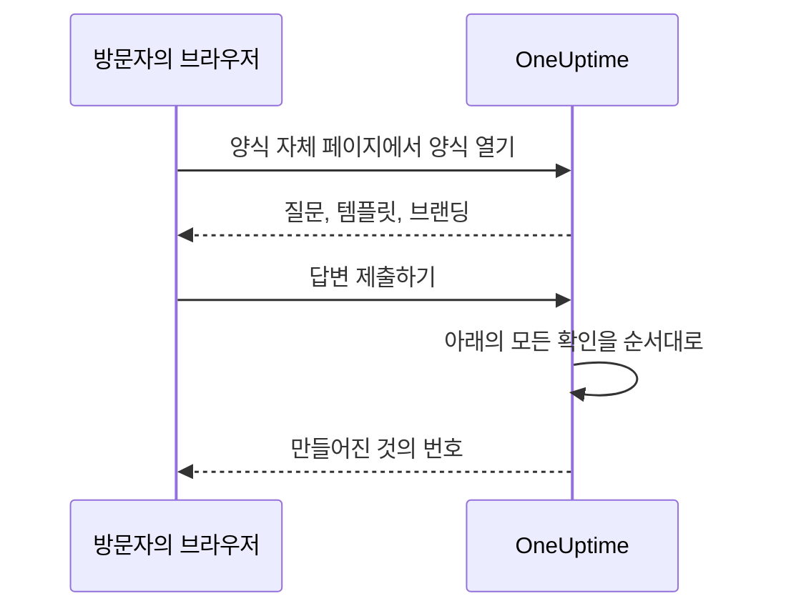

# 공유 및 보안

양식은 링크가 있는 누구에게나 열려 있으며, 각 제출로 온콜 팀을 호출하거나 캘린더에 유지 관리 시간대를 넣을 수 있습니다. 이 페이지에서는 양식의 **공유** 페이지 (링크, 양식 끄기, 제출 후 메시지, IP 허용 목록) 와 요청이 거쳐 가는 그 밖의 모든 확인을 다룹니다.

:::cards
- [링크 공유하기](#링크-공유하기): 복사하고, 열고, 너무 멀리 퍼지면 재설정합니다.
- [템플릿마다의 링크](#템플릿마다의-링크): 경우마다 북마크 하나, 그 뒤에는 양식 하나.
- [양식을 보호하는 것](#양식을-보호하는-것): 요청이 거치는 모든 확인을 순서대로 설명합니다.
- [문제 해결](#문제-해결): 양식 페이지의 각 메시지가 무엇을 뜻하는지와 대처 방법.
:::

## 공유 페이지

| 카드 | 내용 |
| --- | --- |
| **상태** | **제출 받기** — 양식의 링크가 작동하는지 여부. |
| **공유 링크** | **링크 복사**, **양식 열기**, **링크 재설정** 가 있는 링크. |
| **제출 후** | 제출 후 양식이 만든 것의 번호 아래에 표시되는 **감사 메시지**. |
| **접근** | **IP 허용 목록**. |

## 링크 공유하기

**공유 링크** 카드에는 `https://oneuptime.com/accounts/form/<share-key>` 같은 양식의 링크가 표시됩니다.

- **링크 복사** 로 복사합니다.
- **양식 열기** 은 사람들이 보는 그대로 양식을 새 탭에서 엽니다.
- **링크 재설정** 는 확인 후 양식에 새 링크를 줍니다. 이전 링크는 즉시 작동을 멈추고 사용할 수 없다는 메시지를 표시하므로, 링크를 공유한 모든 사람에게 새 링크가 필요합니다. 링크가 필요 이상으로 퍼졌을 때 사용하세요.

링크가 있는 사람은 누구나 OneUptime 계정 없이, 로그인하지 않고도 양식을 열고 제출할 수 있습니다. 로그인해 있어도 달라지는 것은 없습니다. OneUptime 은 양식에 입력된 이름과 이메일로만 누가 제출했는지 압니다. 그러니 링크를 온콜 팀의 전화번호처럼 다루세요. 사용해야 할 사람이 찾을 수 있는 곳 (인트라넷 페이지, 지원 런북, 채팅에 고정된 메시지) 에 공유하고, 누구에게서든 제출을 받으려는 것이 아니라면 공개 웹사이트에는 올리지 마세요.

링크에는 양식의 ID 가 아니라 자체 무작위 키가 들어 있습니다. 자체 호스팅 설치에서는 링크가 자신의 OneUptime 호스트에서 제공되며, `HTTP_PROTOCOL` 과 `HOST` 로 구성한 주소에서만 작동합니다. 서버의 다른 이름이나 IP 주소로 열면, 양식의 요청이 다른 웹사이트에서 온 것으로 거부됩니다.

이전 인시던트 양식에 대한 링크 ( `/accounts/incident-form/<share-key>` ) 는 같은 양식을 새 주소에서 엽니다.

### 템플릿마다의 링크

양식의 각 [템플릿](/docs/forms/building#템플릿) 에는 자체 링크가 있습니다. 양식의 링크에 `?template=` 와 템플릿의 ID 를 붙인 것으로, 예를 들면 `https://oneuptime.com/accounts/form/<share-key>?template=<template-id>` 입니다. 양식의 **템플릿** 페이지에 있는 **링크 복사** 로 복사합니다. 그 템플릿으로 채워진 양식이 열리므로, 양식은 하나로 유지하면서 팀은 경우마다 링크를 북마크해 둘 수 있습니다. 제출자가 다른 템플릿을 고르면 브라우저의 주소도 따라 바뀌므로, 복사하는 링크는 보이는 그대로의 양식입니다.

템플릿의 링크는 양식의 링크입니다. 양식이 **제출 받기** 인 동안 작동하며, **링크 재설정** 를 하면 나머지와 함께 폐기됩니다. 삭제한 템플릿을 지정한 링크는 템플릿을 지정하지 않은 것처럼 양식을 엽니다. 기본 템플릿이 있으면 그것으로 엽니다.

### 양식 끄기

양식을 삭제하지 않고 제출 받기를 멈추려면 **제출 받기** 를 끄세요. 그러면 링크에 "이 양식을 사용할 수 없습니다. 양식이 꺼졌거나 링크가 오래되었을 수 있습니다." 가 표시되고, **공유 링크** 카드는 양식이 꺼져 있다는 것을 알려 줍니다. 다시 켜면 같은 링크가 다시 작동합니다.

### 감사 메시지

제출 후 페이지에는 "감사합니다. 응답이 제출되었습니다." 가 표시되고 만들어진 것의 번호가 나온 다음, Markdown 으로 쓴 **감사 메시지** 가 표시됩니다. 다음에 무슨 일이 일어나는지, 급한 일이 있으면 어디로 연락해야 하는지 알리는 데 사용하세요. 작성하지 않으면 페이지에는 표준 메시지만 표시됩니다.

양식의 설명이나 감사 메시지에 있는 이미지는, 양식이 **제출 받기** 인 동안 링크를 여는 모든 사람에게 표시됩니다. 양식을 끄거나 이미지를 빼면, 모두가 보는 다른 곳에 그 이미지가 아직 들어 있지 않은 한 이미지는 다시 비공개가 됩니다.

## 양식을 보호하는 것

모든 요청은 다음 확인을 이 순서대로 거칩니다.

1. 요청은 다른 웹사이트가 아니라 양식 자체의 페이지에서 와야 합니다. [다른 웹사이트의 요청](#다른-웹사이트의-요청) 을 참조하세요.
2. 속도 제한 안에 있어야 합니다.
3. 양식이 존재하고, **제출 받기** 이며, 양식이 포함된 플랜의 프로젝트에 속해야 합니다.
4. 양식에 **IP 허용 목록** 가 있으면 그 목록의 주소에서 와야 합니다.
5. 인스턴스에서 캡차가 켜져 있으면, 제출은 캡차를 통과해야 합니다.
6. 모든 답변은 크기 한도 안에 있어야 하고 질문에 맞아야 합니다. [양식 만들기](/docs/forms/building#크기-한도) 를 참조하세요.
7. 답변과 설정으로 만들어지는 것이 생성 가능해야 합니다. 인시던트에는 심각도가, 이벤트에는 시작보다 뒤의 끝이 필요합니다.
8. 제출은 양식의 시간당 허용량 안에 들어야 합니다. [속도 제한](#속도-제한) 을 참조하세요.

양식의 로고와 파비콘은 양식의 일부입니다. 처음 네 가지 확인을 통과한 뒤에만 양식을 여는 응답 안에 base64 로 담겨 전송되며, 자체 주소에서 전송되는 일은 없습니다. 양식 없이는 아무도 그것을 가져올 수 없고, 양식을 통해 ID 로 파일을 가져올 수도 없습니다. 파일 자체는 비공개로 유지됩니다. 양식은 자체 프로젝트에 업로드된 이미지만 표시합니다. 다른 프로젝트의 파일은 양식을 저장할 때 거부되며, 양식의 페이지로 전송되지 않습니다.

### IP 허용 목록

양식을 자신의 네트워크로만 제한하려면 다음과 같이 합니다.

:::steps
1. 양식의 **공유** 페이지를 엽니다.
2. **접근** 카드에서 **IP 허용 목록 편집** 를 클릭합니다.
3. 한 줄에 네트워크 하나씩 입력하고 저장합니다. 그러면 카드의 **IP 허용 목록** 아래에 나열됩니다.
:::

각 줄은 다음 중 하나입니다.

| 항목 | 예 | 참고 |
| --- | --- | --- |
| IPv4 주소 | `203.0.113.7` | |
| IPv6 주소 | `2001:db8::7` | 대문자로 쓰든 0 을 모두 적든 어떻게 쓰든 일치합니다. |
| CIDR 표기의 IPv4 범위 | `10.0.0.0/8` | IPv6 범위는 지원하지 않습니다. IPv6 주소는 한 줄에 하나씩 적으세요. |

IPv4 주소는 IPv4 로 써야 합니다. `::ffff:203.0.113.7` 처럼 IPv6 방식으로 쓰면 거부됩니다. 목록은 저장할 때마다 (대시보드, API, Terraform, 워크플로 어디에서든) 확인되며, 절대 일치할 수 없는 줄은 그 줄을 알려 주는 메시지와 함께 거부됩니다. 모든 네트워크를 허용하려면 목록을 비워 두세요. 항목이 하나라도 있으면, 주소를 확인할 수 없는 요청은 거부됩니다.

OneUptime Cloud 에서는 IP 허용 목록을 설정하려면 **Scale** 플랜이 필요합니다. API 로 IP 허용 목록이 있는 양식을 만들 때와 편집할 때 모두 그렇습니다. [공개 대시보드](/docs/dashboards/sharing) 의 IP 허용 목록과 같습니다. 목록을 비우는 것은 모든 플랜에서 가능합니다.

### 다른 웹사이트의 요청

브라우저는 어떤 페이지가 요청을 보냈는지 서버에 알려 줍니다. 다른 웹사이트의 페이지가 방문자의 브라우저로 하여금 양식을 열거나 제출하게 하면, 요청은 "This form can only be used from its own page." 로 거부됩니다. 이는 속도 제한이 요청을 세기 전에, 링크와 관계없이 이루어지므로, 응답으로는 어떤 양식이 존재하는지 알 수 없습니다.

요청은 `Sec-Fetch-Site` 헤더가 있고 `same-origin` 이나 `none` 이 아닌 값을 가질 때, 또는 `Origin` 헤더가 있고 OneUptime 주소 ( `HTTP_PROTOCOL` 과 `HOST`, `HOST` 에 포트가 있으면 포트 포함) 가 아닐 때 거부됩니다. 제출은 JSON ( `application/json` ) 으로 보내야 합니다. 웹 페이지의 양식 필드나 일반 텍스트로 보낸 제출은 "The request must be a JSON object holding the form's answers in "data"." 로 거부됩니다. 양식을 읽으려면 양식 페이지가 보내는 모든 요청에 추가하는 헤더 `X-OneUptime-Form: 1` 도 필요합니다. 페이지는 스크립트 없이 브라우저가 헤더를 추가하게 할 수 없으며, 헤더를 추가하는 다른 웹사이트의 스크립트는 그 `Origin` 으로 정체가 드러납니다.

### 속도 제한

양식을 여는 것과 제출하는 것은 네트워크 주소별로 제한되며, 제출은 양식별로도 제한됩니다.

- **양식 열기** — 한 주소에서의 양식별, 그리고 모든 양식에 걸친 주소별로 제한되며, 사무실 전체가 동시에 링크를 열어도 될 만큼 여유가 있습니다. 둘 중 하나를 넘으면 페이지에 "요청이 너무 많습니다. 나중에 다시 시도해 주세요." 가 표시됩니다. 속도 제한기에 연결할 수 없어도 양식은 열립니다.
- **제출 (주소별)** — 한 주소에서의 양식별, 그리고 모든 양식에 걸친 주소별로 제한됩니다. 둘 중 하나를 넘으면 제출자에게 "사용 중인 네트워크에서 제출이 너무 많습니다. 몇 분 후에 다시 시도해 주세요." 가 표시됩니다. 한 주소 뒤에 있는 모든 사람 (사무실 네트워크, VPN 게이트웨이) 이 이 제한을 공유하며, 잘못된 답변으로 나중에 거부되는 제출을 포함해 모든 제출이 집계됩니다.
- **제출 (양식별)** — 한 양식이 한 시간에 만들 수 있는 레코드 수로, 모든 주소를 합산합니다. 그래서 많은 주소에서 동시에 제출해도 시간당 제한된 횟수만 호출됩니다. 다른 모든 확인을 통과한 제출만, 레코드가 만들어지기 직전에 집계됩니다. 이를 넘으면 시간대가 끝날 때까지 모두에게 "현재 이 양식에 제출이 너무 많이 접수되고 있습니다. 나중에 다시 시도해 주세요." 가 표시됩니다. **링크 재설정** 는 새 링크를 새로운 허용량으로 시작합니다.

모든 제한은 초 단위의 `Retry-After` 헤더와 함께 `429` 로 응답하며, 페이지는 제출자에게 언제 다시 시도할지 알려 줍니다. 시간대는 고정이며, 이동하지 않습니다. 속도 제한기에 연결할 수 없으면 제출은 집계되지 않은 채 통과되는 대신 거부됩니다. API 는 `503` 으로 응답하고, 제출자에게는 "지금은 제출을 받을 수 없습니다. 몇 분 후에 다시 시도해 주세요." 가 표시됩니다.

자체 호스팅 설치에서는 OneUptime 앱의 다음 환경 변수로 제한을 변경합니다.

| 변수 | 기본값 | 설정하는 것 |
| --- | --- | --- |
| `FORM_RATE_LIMIT_WINDOW_SECONDS` | `60` | 양식 열기의 시간대 (초). |
| `FORM_RATE_LIMIT_PER_FORM_AND_IP_PER_WINDOW` | `120` | 한 주소가 시간대당 한 양식을 열 수 있는 횟수. |
| `FORM_RATE_LIMIT_PER_IP_PER_WINDOW` | `600` | 한 주소가 시간대당 양식을 열 수 있는 횟수 (모든 양식 합산). |
| `FORM_SUBMIT_RATE_LIMIT_WINDOW_SECONDS` | `900` | 주소별 제출 제한의 시간대 (초). |
| `FORM_SUBMIT_RATE_LIMIT_PER_FORM_AND_IP_PER_WINDOW` | `10` | 시간대당 한 주소에서 한 양식으로의 제출 수. |
| `FORM_SUBMIT_RATE_LIMIT_PER_IP_PER_WINDOW` | `30` | 시간대당 한 주소에서의 제출 수 (모든 양식 합산). |
| `FORM_SUBMIT_RATE_LIMIT_PER_FORM_WINDOW_SECONDS` | `3600` | 양식별 제한의 시간대 (초). |
| `FORM_SUBMIT_RATE_LIMIT_PER_FORM_PER_WINDOW` | `60` | 시간대당 한 양식이 만들 수 있는 레코드 수 (모든 주소 합산). |

각 변수는 `FORM_` 대신 `INCIDENT_FORM_` 를 앞에 붙인 이전 이름 (예: `INCIDENT_FORM_SUBMIT_RATE_LIMIT_PER_FORM_PER_WINDOW` ) 도 읽으므로, 인시던트 양식을 조정해 둔 설치는 제한을 유지합니다. 둘 다 설정되어 있으면 새 이름이 우선합니다. `config.env` 도 Helm 차트의 값도 이 변수를 전달하지 않으므로, `app` 컨테이너의 환경에 직접 추가하세요. Helm 차트에서는 `app.extraEnv` 또는 차트 전체의 `extraEnv` 를, Docker Compose 에서는 `docker-compose.override.yml` 을 사용합니다. 주소별 제한이 어떤 주소를 집계할지는 `TRUSTED_PROXY_HOPS` 가 정합니다.

### 캡차

OneUptime 인스턴스에서 hCaptcha 가 켜져 있으면 양식에 캡차가 표시되며, 캡차를 통과하지 않은 제출은 거부됩니다. 양식별 설정은 없습니다. 자체 호스팅 설치에서는 `CAPTCHA_ENABLED`, `CAPTCHA_SITE_KEY`, `CAPTCHA_SECRET_KEY` 로 캡차를 켭니다. 회원 가입을 보호하는 것과 같은 설정입니다. 캡차가 없으면 속도 제한과 IP 허용 목록이 부담을 집니다.

## 문제 해결

:::details 링크에 양식을 사용할 수 없다고 표시됨
"이 양식을 사용할 수 없습니다. 양식이 꺼졌거나 링크가 오래되었을 수 있습니다." 페이지는 이유와 관계없이 같은 응답을 주므로, 낯선 사람에게 양식이 존재하는지 알려 주지 않습니다.

- **공유** 페이지에서 **제출 받기** 가 꺼져 있습니다.
- 링크가 **링크 재설정** 로 바뀌었습니다. 새 링크를 공유하세요.
- 양식이 삭제되었습니다.
- OneUptime Cloud 에서 프로젝트가 **Growth** 플랜 미만이거나 구독 요금이 미납되었습니다.
- 복사할 때 링크가 잘렸습니다.
:::

:::details 허용된 네트워크에서만 양식을 열 수 있음
"이 양식은 허용된 네트워크에서만 열 수 있습니다." 제출자의 주소가 양식의 **IP 허용 목록** 에 없습니다. 그 네트워크를 추가하거나 목록을 비우세요. 프록시나 로드 밸런서 뒤의 자체 호스팅 설치에서는 `TRUSTED_PROXY_HOPS` 를 확인하세요. 값이 너무 작으면 OneUptime 은 제출자의 주소 대신 프록시의 주소를 봅니다. 양식을 자신의 OneUptime 주소가 아닌 다른 주소에서 열었을 때도 페이지는 같은 내용을 표시합니다. **공유 링크** 카드에 표시된 그대로 링크를 여세요.
:::

:::details 제출이 너무 많음
"사용 중인 네트워크에서 제출이 너무 많습니다. 몇 분 후에 다시 시도해 주세요." 한 주소 뒤에 있는 모든 사람이 주소별 제한을 공유하며, 이는 많은 사람이 동시에 보고하는 큰 장애 때 영향을 줍니다. 페이지는 언제 다시 시도할지 알려 줍니다. "현재 이 양식에 제출이 너무 많이 접수되고 있습니다. 나중에 다시 시도해 주세요." 은 대신 양식별 허용량입니다. 제출자의 네트워크와는 관계가 없으며, 시간대가 끝나면 다시 보고를 받습니다. 링크가 필요 이상으로 퍼져서 진짜가 아닌 제출이 오는 경우, **링크 재설정** 로 이전 링크를 즉시 멈추세요.
:::

:::details 지금은 제출을 받을 수 없음
"지금은 제출을 받을 수 없습니다. 몇 분 후에 다시 시도해 주세요." 속도 제한기에 연결할 수 없었으므로, 제출이 집계되지 않은 채 통과되는 대신 거부됩니다. 양식 열기는 계속 작동합니다. 자체 호스팅 설치에서는 속도 제한기가 집계하는 캐시인 Valkey 가 실행 중이고 OneUptime 앱에서 접근할 수 있는지 확인하세요.
:::

:::details 심각도가 없어서 이 양식은 인시던트를 만들 수 없음
양식이 심각도를 묻지 않고, 설정도 지정하지 않으며 (또는 지정한 것이 삭제되었으며), 인시던트 템플릿도 설정하지 않습니다. 양식의 **제출 시** 페이지에서 심각도를 고르세요. [심각도가 없으면 인시던트도 없습니다](/docs/forms/on-submit#제출이-인시던트가-되는-과정) 를 참조하세요.
:::

:::details 제출이 거부됨
메시지가 무엇이 문제인지 알려 줍니다. 필수 답변이 없거나 공백뿐이거나, 답변이 너무 길거나 질문에 맞지 않거나, 이메일 주소가 하나의 일반 주소가 아니거나, 유지 관리 시간대가 시작 전에 끝나는 경우입니다. "캡차 인증에 실패했습니다. 다시 시도해 주세요." 은 캡차를 통과하지 못했거나 만료되었다는 뜻입니다. 다시 푸세요. 모든 제출이 캡차에서 실패하는 자체 호스팅 설치에서는 `CAPTCHA_SITE_KEY` 와 `CAPTCHA_SECRET_KEY` 가 모두 설정되어 있는지 확인하세요.
:::

:::details 질문이 양식에 없음
빌더는 공개 양식에서 빼는 질문 (예: 삭제된 사용자 정의 필드) 에 플래그를 붙이며, **미리 보기** 는 질문을 뺄 때 그렇다고 알려 줍니다. [빌더가 질문에 플래그를 붙일 때](/docs/forms/building#빌더가-질문에-플래그를-붙일-때) 를 참조하세요. **숨김** 배지가 있는 질문은 의도적으로 빠져 있으며, 템플릿만 답합니다. [숨겨진 질문](/docs/forms/building#숨겨진-질문) 을 참조하세요. 질문은 어떤 템플릿에서는 양식에 있고 다른 템플릿에서는 없을 수도 있습니다. 각 템플릿은 질문을 숨기거나, 양식이 숨기는 질문을 물을 수 있습니다. 템플릿의 **편집** 를 열어 그 **질문** 를 확인하세요. [템플릿이 각 질문을 묻는 방식](/docs/forms/building#템플릿이-각-질문을-묻는-방식) 을 참조하세요.
:::

:::details 템플릿이 질문을 채우지 않음
템플릿의 답변은 아직 그 질문에 맞을 때만 사용됩니다. 질문이 여전히 제공하는 옵션, 양식이 여전히 제공하는 레코드, 너무 길지 않은 텍스트입니다. 템플릿을 편집해 질문에 다시 답하고 저장하세요. [템플릿](/docs/forms/building#템플릿) 을 참조하세요.
:::

:::details 인시던트나 이벤트가 상태 페이지에 없음
의도된 동작입니다. 양식의 인시던트는 숨겨진 상태로 선언되며, 유지 관리 이벤트는 양식의 **게시** 설정에서 달리 정하지 않는 한 숨겨진 채로 있습니다. [제출로 만들어지는 항목](/docs/forms/on-submit) 을 참조하세요.
:::

:::details 아무도 호출되지 않음
양식의 인시던트는 다른 인시던트와 마찬가지로 설정과 템플릿이 지정한 온콜 정책과, 온콜 규칙이 추가하는 것을 실행합니다. 그중 아무것도 없으면 아무도 호출되지 않습니다. 양식의 **제출 시** 페이지에서 온콜 정책을 추가하거나, 양식의 인시던트와 일치하는 온콜 규칙 (예: 양식이 항상 추가하는 레이블 기준) 을 작성하세요.
:::

## 다음 단계

:::cards
- [양식 개요](/docs/forms/index): 양식의 용도, 권한, API.
- [양식 만들기](/docs/forms/building): 질문, 숨겨진 질문, 템플릿.
- [제출로 만들어지는 항목](/docs/forms/on-submit): 각 제출이 만드는 인시던트나 이벤트.
:::
