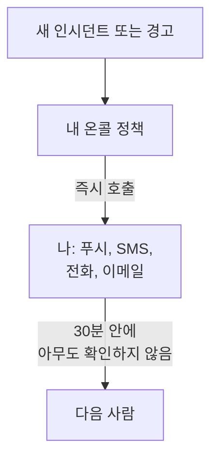

# 전화, SMS, 푸시로 호출 받기

이 가이드를 마치면 프로젝트에 새 인시던트나 경고가 생길 때마다 푸시 알림, SMS, 전화로 휴대폰에서 호출을 받고, 30분 안에 아무도 확인하지 않으면 다음 사람이 호출됩니다. 그리고 여러분이 확인한 테스트 호출로 모든 것이 동작함을 검증합니다. 안내형 설정 **문제가 생기면 적절한 담당자 호출하기**를 따라 진행하며, 약 10분 걸립니다.

## 필요한 것

- 여러분이 소유한 프로젝트: SMS와 전화를 켜려면 프로젝트 소유자여야 하고, 온콜 정책을 만들려면 소유자나 관리자여야 합니다.
- 여러분의 휴대폰.
- 호출하려는 팀원이 프로젝트의 멤버여야 합니다: 방법은 [사람 초대](/docs/permissions/inviting-people) 페이지를 참고하세요.

:::tabs
@tab OneUptime Cloud
푸시 알림은 모든 요금제에서 무료입니다. SMS와 전화는 프로젝트 잔액에서 지불되며, 잔액은 0.00 USD에서 시작합니다. 전화번호를 추가하면 SMS가 발송되므로, 먼저 잔액이 1.00 USD보다 많아야 합니다. 잔액을 추가하면 프로젝트의 카드로 결제됩니다. Free 요금제에는 한 사람과 에스컬레이션 규칙 하나만 둘 수 있습니다. 그래서 여러분만 호출되며, 호출은 다른 사람에게 넘어가지 않고 반복됩니다.
@tab 자체 호스팅
서버가 이메일, SMS, 전화를 보낼 수 있어야 합니다. 서버의 마스터 관리자가 `/admin/setup`에서 각각 테스트하며 설정합니다. 방법은 [자체 호스팅 가이드](/docs/installation/self-hosting-guide) 페이지에 나와 있습니다. 푸시 알림은 OneUptime의 푸시 릴레이를 거쳐 앱에 도달하므로 따로 설정할 것이 없습니다.
:::

## 단계

:::steps
### 안내형 설정 열기

프로젝트의 **홈**에서 **OneUptime에 오신 것을 환영합니다 👋** 체크리스트의 **온콜 정책 설정하기**를 클릭합니다. 새 프로젝트의 홈은 먼저 **무엇부터 하시겠어요?** 하고 묻습니다. **문제가 생기면 적절한 담당자 호출하기**에 체크하고 **계속**을 클릭합니다. 이 항목이 없거나 이미 완료되었다면 `Ctrl+K`(Mac에서는 `Cmd+K`)를 누르고 `get paged`를 입력한 뒤 **문제가 생기면 적절한 담당자 호출하기**를 고릅니다.

### 휴대폰에 앱 설치

App Store나 Google Play에서 OneUptime On-Call을 설치하고 로그인합니다. 그러면 휴대폰이 푸시 알림을 받도록 등록됩니다. 설정으로 돌아와 **다시 확인**을 클릭하면, **어떻게 연락할까요?** 아래의 **모바일 앱 또는 브라우저**에 휴대폰이 표시됩니다.

### SMS와 전화 켜기

새 프로젝트에서는 SMS와 전화가 꺼져 있습니다. 프로젝트 소유자라면 **SMS 및 전화 켜기**를 클릭합니다. 그 밖의 사람에게는 누가 켤 수 있는지 표시됩니다. OneUptime Cloud에서 잔액이 1.00 USD 이하라면 **잔액 추가**를 클릭하고, **금액 (USD)** 에 20~1,000 USD를 입력한 뒤 **충전**을 클릭합니다.

### 전화번호 추가

**내 전화번호**에 `+15551234567`처럼 국가 코드를 포함한 휴대폰 번호를 입력하고 **SMS로 코드 받기**를 클릭합니다. SMS로 받은 코드를 입력하고 **인증**을 클릭합니다. 호출 전화도 같은 번호로 걸려 옵니다. **계속**을 클릭합니다. 앱과 이메일로만 호출을 받으려면 번호를 비워 두고 바로 **계속**을 클릭합니다.

### 함께 호출할 사람 선택

**다른 온콜 담당자는 누구인가요?** 에서 여러분은 이미 **먼저 호출**에 들어 있습니다. 다른 사람도 함께 호출하려면 **팀 멤버 추가**를 클릭한 뒤 **저장하고 계속**을 클릭합니다. 아직 온콜 정책이 없는 프로젝트에서는 이렇게 하면 `Default on-call policy`가 만들어지고, 새 인시던트와 경고마다 이 사람들을 호출합니다. 이미 정책이 있는 프로젝트에서는 **온콜 정책**에서 그 정책을 고르고, 대신 **첫 번째 에스컬레이션 규칙에 추가**에서 사람을 추가합니다. 아직 호출이 닿지 않는 사람이 있으면 이 단계는 **호출이 닿을까요?** 에서 멈춰 있습니다. 그 사람에 대해 **설정 알림 보내기**를 클릭한 다음 **계속**을 클릭합니다.

### 아무도 응답하지 않을 때 할 일 정하기

**아무도 응답하지 않으면?** 에서 **다른 사람 호출**을 그대로 두고, **다음에 호출**에서 호출할 사람을 고른 뒤, **대기 시간(분)** 은 `30`으로 두거나 바꿉니다. **저장하고 계속**을 클릭합니다. Free 요금제에서는 대신 **같은 사람을 다시 호출**이 표시되며, **다시 호출할 횟수**는 `2`로 되어 있습니다.

### 테스트 호출 보내기

**테스트 호출 보내기** 아래에서 **이 정책 테스트**를 클릭합니다. **심각도**를 고르고 **테스트 호출 보내기**를 클릭합니다. 정책의 첫 번째 에스컬레이션 규칙이 실제 인시던트와 똑같이 호출되며, 모든 메시지에 TEST라고 표시됩니다. 인시던트는 만들어지지 않고, 상태 페이지나 구독자에게도 알리지 않습니다.

### 테스트 호출 확인

SMS나 이메일의 링크를 열어 그곳에서 호출을 확인하거나, 전화 통화 중에 1을 누릅니다. 앱에는 호출이 도착했다고 표시되지만, 앱에서는 테스트를 확인할 수 없습니다. 그런 다음 대화 상자에서 **완료**를 클릭하고 **계속**을 클릭합니다.
:::

## 제대로 되었는지 확인하기

- 테스트 단계에 누가, 어떤 방법으로, 얼마나 빨리 호출을 확인했는지 표시됩니다.
- 설정은 **호출이 설정되었습니다** 화면으로 끝나며, 기록에서 읽어 온 **호출 대상**, **아무도 응답하지 않으면**, **테스트 완료**를 보여 줍니다. 연락할 수 없는 사람이 있는 경우처럼 정책 자체에 문제가 있으면 **확인 필요** 아래에 나열됩니다.
- **홈**에서는 체크리스트의 **온콜 정책 설정하기**가 완료로 표시됩니다. 그것이 마지막 단계였다면 체크리스트는 사라집니다.

정책이 다음에 다른 사람을 호출하도록 되어 있다면 에스컬레이션도 직접 볼 수 있습니다. 요약에서 **온콜 정책 열기**를 클릭한 다음 **이 정책 테스트**를 클릭합니다. **모든 에스컬레이션 단계 거치기**를 켜고 보낸 뒤 첫 번째 호출을 확인하지 않으면, 최대 2분 후에 다음 사람이 호출됩니다.

## 문제 해결

:::details "SMS로 코드 받기" 버튼이 없음
SMS가 꺼져 있거나 보낼 수 없는 상태이며, 단계에 그 이유가 표시됩니다. **SMS 및 전화 켜기**는 프로젝트 소유자나 결제를 관리하는 사람에게만 보입니다. OneUptime Cloud에서는 잔액이 1.00 USD 이하이면 전화번호 입력란이 숨겨집니다. SMS를 보낼 수 없는 자체 호스팅 서버에서는 마스터 관리자에게 **SMS 및 전화 설정**이 보이며, 이를 클릭하면 Admin Dashboard가 열려 Twilio를 추가할 수 있습니다. 방법은 [Twilio 통합](/docs/self-hosted/twilio-integration) 페이지에 나와 있습니다.
:::

:::details 잔액 추가 시 결제 수단을 찾을 수 없다고 표시됨
잔액을 추가하면 프로젝트의 카드로 결제됩니다. **프로젝트 설정 → 결제 및 청구서 → 결제**에서 **결제 수단 추가**로 카드를 추가한 뒤 잔액을 다시 추가합니다. 그때까지도 앱과 이메일로는 호출을 받습니다.
:::

:::details 자체 호스팅: Twilio 계정이 설정되지 않아 번호가 거부됨
서버가 SMS를 보낼 수 없다는 경고를 미리 받는 사람은 마스터 관리자뿐입니다. 마스터 관리자에게 `/admin/setup`에서 SMS와 전화를 설정해 달라고 요청하세요. 그동안에는 **계속**을 클릭합니다. 앱과 이메일로는 계속 호출을 받습니다.
:::

:::details 코드나 테스트 호출이 오지 않음
먼저 번호의 국가 코드를 확인하세요. 테스트 호출 후라면 **완료**로 대화 상자를 닫고 **받지 못했습니다**를 클릭합니다. 확인할 사항이 표시되며, **내 알림 방법 열기**에서 여러분에게 연락할 수 있는 모든 방법을 볼 수 있습니다. 자체 호스팅 서버에서는 `/admin/setup`에서 테스트 SMS를 보내고, 서버에서 `npm run doctor`를 실행하세요.
:::

## 다음 단계

:::cards
- [온콜 스케줄](/docs/on-call/schedules): 돌아가며 맡아서, 각 호출이 그때 온콜인 사람에게 가도록 합니다. Cloud에서는 Growth 요금제부터.
- [에스컬레이션 규칙](/docs/on-call/escalation-rules): 정책에 단계, 팀, 스케줄을 추가합니다.
- [나에게 연락하는 방법](/docs/notifications/on-call-rules): 어떤 방법으로 먼저, 언제 연락받을지 고릅니다.
- [상태 페이지 게시하기](/docs/guides/status-page): 무슨 일이 일어나고 있는지 여러분의 도메인에서 고객에게 알립니다.
:::
