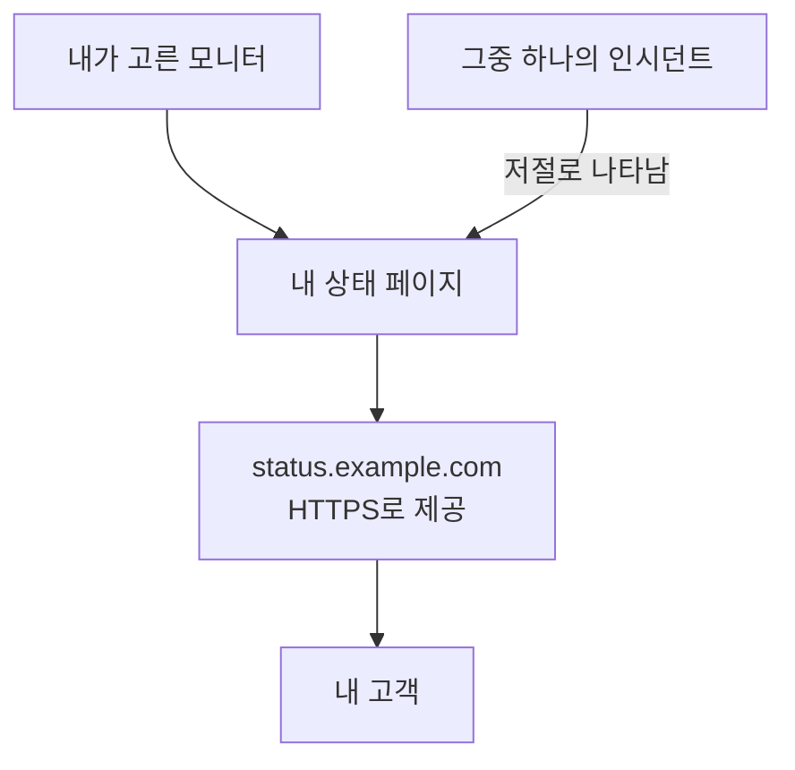

# 상태 페이지 게시하기

이 가이드를 마치면 고객이 `status.example.com` 같은 여러분만의 주소에서 HTTPS로 상태 페이지를 엽니다. 페이지는 여러분이 고른 모니터의 상태와 가동률을 보여 주고, 그중 하나에 인시던트가 생기면 저절로 페이지에 나타납니다. 이 가이드는 안내형 설정 **상태 페이지 게시하기**를 따라간 다음, 페이지의 **사용자 정의 도메인**에서 도메인을 추가합니다. 소요 시간은 약 15분이며, 여기에 DNS 공급자가 처리하는 시간이 더해집니다.

## 필요한 것

- 모니터 하나 이상: 상태 페이지는 모니터를 보여 줍니다. 아직 없다면 안내형 설정이 먼저 **모니터 설정**을 제안합니다.
- 프로젝트 소유자 또는 관리자 역할: 페이지를 만들려면 상태 페이지 생성 권한이, 도메인을 추가하려면 프로젝트의 도메인을 추가하고 인증하는 권한이 필요합니다.
- 여러분이 관리하는 도메인과, DNS 공급자에서 그 도메인의 DNS 레코드에 접근할 수 있는 권한.

:::tabs
@tab OneUptime Cloud
사용자 정의 도메인과 무료 SSL 인증서는 모든 요금제에 포함됩니다. Free 요금제에서는 프로젝트당 상태 페이지가 하나입니다. 이미 하나 있다면 그 페이지의 **사용자 정의 도메인**을 열고 도메인을 추가하는 단계부터 시작하세요. 새 상태 페이지는 공개 상태이며, 비공개로 하려면 Growth 요금제가 필요합니다.
@tab 자체 호스팅
서버에는 서버를 가리키는 A 레코드가 있고 포트 80과 443에서 응답하는 전용 호스트 이름이 필요합니다. 예: `oneuptime.example.com`. 이 이름을 `config.env`의 `STATUS_PAGE_CNAME_RECORD`(Helm 차트에서는 `statusPage.cnameRecord`)에 예시 값 대신 설정합니다. 무료 인증서에는 `LETS_ENCRYPT_ACCOUNT_KEY`(`letsEncrypt.accountKey`)도 필요합니다. openssl로 만들고 base64로 인코딩한 개인 키입니다. 값을 바꾼 뒤에는 OneUptime을 다시 시작합니다. **사용자 정의 도메인 추가**는 먼저 서버를 확인하고, 아직 빠진 것을 나열합니다.
:::

## 단계

:::steps
### 안내형 설정 열기

프로젝트의 **홈**에서 **OneUptime에 오신 것을 환영합니다 👋** 체크리스트의 **상태 페이지 게시하기**를 클릭합니다. 새 프로젝트의 홈은 먼저 **무엇부터 하시겠어요?** 하고 묻습니다. **상태 페이지로 고객에게 알리기**에 체크하고 **계속**을 클릭합니다. 이 항목이 없거나 이미 완료되었다면 `Ctrl+K`(Mac에서는 `Cmd+K`)를 누르고 `status page`를 입력한 뒤 **상태 페이지 게시하기**를 고릅니다.

### 이름 짓고 표시할 항목 고르기

**이름을 짓고 표시할 항목을 선택하세요**에서 제안된 **상태 페이지 이름**을 그대로 두거나 직접 입력합니다. **표시할 항목**에서 고객이 볼 모니터에 체크하거나 **모두 선택**을 클릭합니다. **상태 페이지 만들기**를 클릭합니다. 이 순간부터 페이지는 해당 링크에서 공개되며, 체크한 모니터만 보여 줍니다.

### 고객에게 보이는 모습 확인

**고객에게 보이는 모습입니다** 아래에서 **공개 링크**의 주소를 엽니다. 모니터가 상태와 함께 나열됩니다. 설정으로 돌아와 **좋습니다**를 클릭합니다.

### 사용자 정의 도메인 열기

설정은 요약 화면으로 끝납니다. **나만의 스타일로 설정(선택 사항)** 아래에서 **나만의 도메인**을 클릭합니다. 상태 페이지의 **사용자 정의 도메인**이 열립니다.

### 도메인 추가

**사용자 정의 도메인 추가**를 클릭합니다. **도메인**에 `status.example.com`처럼 고객이 열 주소를 입력하고 **계속**을 클릭합니다. 추가할 레코드와 함께 **DNS 설정**이 열립니다.

### DNS 레코드 추가

DNS 공급자에서 **DNS 설정**에 나열된 각 레코드를 **유형**, **이름**, **값** 그대로 추가합니다. 주소를 OneUptime으로 향하게 하는 CNAME 레코드와, 프로젝트가 이 도메인을 처음 사용할 때는 프로젝트가 도메인을 소유하고 있음을 보여 주는 TXT 레코드입니다. 공급자가 각 이름 뒤에 도메인을 자동으로 붙인다면 `status`처럼 그 앞부분만 입력하고, 도메인 자체에는 `@`를 입력합니다.

### 레코드 확인

**DNS 설정**을 열어 둔 채 **지금 확인**을 클릭합니다. 각 레코드 아래에 무엇을 조회했고 무엇이 돌아왔는지 나옵니다. TXT 레코드가 먼저입니다. 이 레코드를 찾기 전까지는 도메인이 추가되지 않으므로, 찾을 때까지 **지금 확인**을 다시 클릭합니다. CNAME 레코드를 찾으면 대화 상자에 **CNAME 레코드가 인증되었습니다.** 라고 표시되고, 무료 SSL 인증서가 보통 15분 이내에 발급됩니다.
:::

## 제대로 되었는지 확인하기

- `https://status.example.com`을 여러분의 주소로 바꿔서 엽니다. 상태 페이지가 인증서 경고 없이 열립니다.
- **사용자 정의 도메인**에서 도메인의 **상태**에 **인증서가 발급되었으며 자동으로 갱신됩니다.** 라고 표시됩니다. 페이지가 이미 열린 뒤에도 한동안 **무료 인증서를 발급하는 중입니다. 보통 15분 이내에 완료됩니다.** 라고 표시될 수 있습니다.
- **홈**에서는 체크리스트의 **상태 페이지 게시하기**가 완료로 표시됩니다. 상태 페이지가 모니터를 보여 주면 완료됩니다. 그것이 마지막 단계였다면 체크리스트는 사라집니다.

더 할 일은 없습니다. 인증서는 OneUptime이 알아서 갱신합니다. 도메인이 목록에 오르면, **DNS 설정**을 닫더라도 OneUptime이 15분마다 CNAME 레코드를 확인하고 레코드가 적용되는 대로 인증합니다.

## 문제 해결

:::details DNS 설정을 닫은 뒤 도메인이 목록에 없음
TXT 레코드를 찾기 전에 **DNS 설정**을 닫아서 도메인이 추가되지 않았습니다. **사용자 정의 도메인 추가**를 클릭하고 같은 주소를 입력한 뒤 **계속**을 클릭하고, 대화 상자가 두 레코드를 모두 찾을 때까지 **지금 확인**을 클릭합니다.
:::

:::details 도메인이 "DNS 대기 중"에 머묾
도메인 행에서 **DNS 설정**을 열고 **지금 확인**을 클릭합니다. 무엇을 찾았는지 알려 줍니다. 레코드의 이름이 `status.example.com` 같은 전체 주소인지, 값이 **DNS 설정**에 나온 값과 같은지 확인하세요. 이름이 주소로 응답한다면 그 이름에 A 레코드가 있거나 DNS 공급자가 프록시하고 있는 것입니다. A 레코드를 교체하거나 이름을 "DNS 전용"으로 설정하세요. `example.com` 같은 루트 도메인에서는 공급자의 ALIAS, ANAME 또는 평탄화된 CNAME 레코드를 사용하세요.
:::

:::details 상태에 무료 인증서를 발급하지 못했다고 표시됨
도메인에 `letsencrypt.org`를 빠뜨린 CAA 레코드가 있으면 인증서가 막힙니다. 자체 호스팅 서버에서는 Let's Encrypt가 포트 80으로 서버에 도달할 수 있어야 합니다. 원인을 고치세요. OneUptime은 알아서 계속 시도하며, **DNS 설정**의 **지금 확인**으로 다시 주문할 수도 있습니다. 주문은 도메인당 15분에 한 번까지입니다.
:::

:::details 자체 호스팅: 서버가 사용자 정의 도메인을 사용할 준비가 되지 않음
**사용자 정의 도메인 추가**에 **이 서버는 아직 사용자 정의 도메인을 사용할 준비가 되지 않았습니다**라는 메시지와 함께, 아직 빠진 항목과 바꿀 내용이 한 줄씩 표시됩니다. 대상은 [필요한 것](#필요한-것) 섹션의 설정입니다. `LETS_ENCRYPT_ACCOUNT_KEY`가 없으면 인증된 도메인에 **확인되었습니다. 자체 프록시의 HTTPS를 사용 중입니다.** 라고 표시됩니다. 이때는 자체 프록시에서 HTTPS를 제공하세요. 자세한 내용은 [상태 페이지 브랜딩 및 도메인](/docs/status-pages/branding-and-domains#시작하기-전에) 페이지에 있습니다.
:::

## 다음 단계

:::cards
- [상태 페이지 브랜딩 및 도메인](/docs/status-pages/branding-and-domains): 로고, 색상, 헤더 링크, 푸터.
- [구독자 및 공지](/docs/status-pages/subscribers): 고객이 구독하게 하고, 공지를 게시합니다.
- [예정된 유지 관리](/docs/scheduled-maintenance/index): 계획된 작업을 시작 전에 고객에게 알립니다.
- [전화, SMS, 푸시로 호출 받기](/docs/guides/paging): 그 모니터 중 하나가 다운되면 호출을 받습니다.
:::
