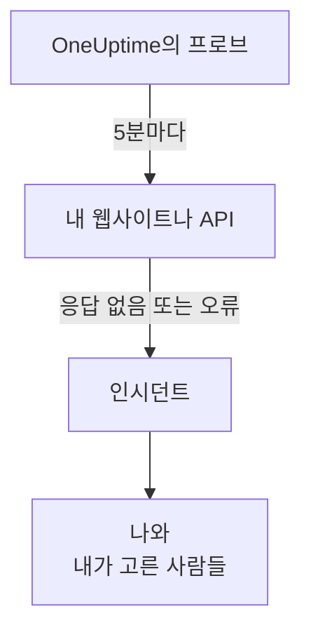

# 웹사이트나 API가 다운되면 알기

이 가이드를 마치면 OneUptime이 5분마다 웹사이트나 API를 확인하고, 응답하지 않거나 오류로 응답하면 인시던트를 생성해 여러분에게 알립니다. 그리고 여러분이 확인한 테스트 호출로 메시지가 제대로 도달함을 검증합니다. 안내형 설정 **웹사이트나 API가 다운되면 알기**를 따라 진행하며, 약 5분 걸립니다.

## 필요한 것

- 모니터를 만들 수 있는 OneUptime 프로젝트: 소유자, 관리자, 멤버라면 만들 수 있습니다. 계정과 프로젝트를 만들려면 [빠른 시작](/docs/introduction/quickstart#프로젝트-만들기) 페이지의 첫 부분을 따라 하세요.
- 확인할 주소(예: `https://example.com`). API라면 상태 확인용 엔드포인트처럼, 키 없는 단순한 `GET` 요청에 응답하는 엔드포인트를 고르세요. `401` 같은 응답은 다운으로 간주됩니다.

:::tabs
@tab OneUptime Cloud
여러 리전의 프로브가 주소를 확인하므로, 주소는 인터넷에서 접근할 수 있어야 합니다. Free 요금제에서는 활성 모니터를 10개까지 둘 수 있습니다.
@tab 자체 호스팅
주소는 서버 자체의 프로브에서 확인하므로, 그곳에서 접근할 수 있어야 합니다. 이메일을 받으려면 서버가 이메일을 보낼 수 있어야 합니다. 서버의 마스터 관리자가 `/admin/setup`에서 설정하며, 방법은 [자체 호스팅 가이드](/docs/installation/self-hosting-guide) 페이지에 나와 있습니다. 마스터 관리자는 자신이 만든 것의 소유자가 되지 않으므로, 이메일을 받으려면 모니터의 **소유자** 페이지에서 자신을 추가합니다.
:::

## 단계

:::steps
### 안내형 설정 열기

새 프로젝트의 **홈**은 먼저 **무엇부터 하시겠어요?** 하고 묻습니다. **웹사이트나 API가 다운되면 알기**에 체크하고 **계속**을 클릭합니다. 그런 다음 **OneUptime에 오신 것을 환영합니다 👋** 체크리스트에서 **첫 번째 모니터 만들기**를 클릭합니다. 체크리스트에 이 항목이 보이지 않으면 `Ctrl+K`(Mac에서는 `Cmd+K`)를 누르고 `website down`을 입력한 뒤 **웹사이트나 API가 다운되면 알기**를 고릅니다.

### 주소 입력

**무엇을 확인할까요?** 에서 **웹사이트 또는 API 주소**에 주소를 입력합니다. API 엔드포인트라면 **API 엔드포인트입니다**에 체크합니다. **확인 시작**을 클릭하면 프로브가 즉시 확인하고, 그 결과를 한 문장으로 알려 줍니다. **계속**을 클릭합니다.

### 알릴 사람 선택

**누구에게 알릴까요?** 에서 보이는 내용은 프로젝트에 따라 다릅니다.

- 아직 온콜 정책이나 온콜 규칙이 없다면 여러분은 이미 **호출 대상**에 들어 있습니다. 이미 프로젝트에 속한 사람을 추가하려면 **팀 멤버 추가**를 클릭한 뒤 **저장하고 계속**을 클릭합니다. 이렇게 하면 `Default on-call policy`가 만들어지고, 프로젝트의 새 인시던트와 경고마다 이 사람들을 호출합니다.
- 온콜 정책이나 규칙이 이미 있다면 누구를 호출할지는 프로젝트 자체의 규칙이 정합니다. **계속**을 클릭합니다.
- 호출을 설정할 수 없는 멤버라면 모니터 소유자로서 이메일을 받는다는 안내가 표시됩니다. **계속**을 클릭합니다.

### 나에게 테스트 보내기

**테스트 보내기** 아래에서 **나에게 테스트 호출 보내기**를 클릭합니다. **심각도**를 고르고 **테스트 호출 보내기**를 클릭합니다. 테스트는 실제 호출과 똑같은 방식으로 여러분에게 도착하며, 모든 메시지에 TEST라고 표시됩니다. 인시던트는 만들어지지 않습니다.

### 테스트 호출 확인

이메일의 링크를 열어 그곳에서 호출을 확인합니다. 프로젝트에서 SMS와 전화가 켜져 있다면 인증된 전화번호로도 확인할 수 있습니다. SMS의 링크를 열거나, 통화 중에 1을 누릅니다. 그런 다음 대화 상자에서 **완료**를 클릭하고 **계속**을 클릭합니다.
:::

## 제대로 되었는지 확인하기

- 설정은 요약 화면으로 끝나며, 기록에서 읽어 온 **확인 시각**, **다운되면**, **알림 대상**, **테스트 완료**를 보여 줍니다.
- **모니터 열기**를 클릭한 다음, 모니터의 **다운되면** 카드에서 **알림 흐름 보기**를 클릭합니다. 모니터에서 알림이 닿는 사람까지의 흐름이 표시되며, 흐름을 막는 것이 없으면 **알림 흐름을 막는 것은 없습니다.** 라고 표시됩니다.
- **홈**에서는 첫 확인 결과가 들어오면 체크리스트의 **첫 번째 모니터 만들기**가 완료로 표시됩니다. 그것이 마지막 단계였다면 체크리스트는 사라집니다.

나중에 다른 주소를 설정하려면 설정을 다시 열고 **다른 주소 확인**을 클릭합니다.

## 문제 해결

:::details 첫 확인 결과가 돌아오지 않음
어떤 위치에서도 주소를 확인하지 않는다는 문장이 나오면 모니터에 프로브가 없는 것이고, 계속 확인 중이라고만 나오면 프로브가 연결되지 않은 것입니다. 각 프로브의 상태를 보려면 **모니터 → 설정 → 프로브**를 엽니다. 자체 호스팅 서버에서는 마스터 관리자가 `/admin/setup`에서 서버의 프로브를 확인합니다. 그런 다음 모니터를 열어 연결된 프로브를 추가하고, 설정을 다시 엽니다.
:::

:::details 사이트는 정상인데 모니터는 다운이라고 표시함
모니터는 응답이 없거나 응답이 200~399 범위를 벗어나면 다운으로 봅니다. 방화벽이 프로브를 차단하면 응답이 없는 것처럼 보입니다. OneUptime Cloud에서는 [IP 주소](/docs/configuration/ip-addresses) 페이지의 주소를 허용하고, 자체 호스팅 서버에서는 프로브가 실행되는 머신을 허용합니다. 이 규칙을 바꾸려면 [웹사이트 모니터](/docs/monitor/website-monitor) 또는 [API 모니터](/docs/monitor/api-monitor) 페이지를 참고하세요.
:::

:::details 테스트 호출을 확인할 수 없음
확인할 수 있는 메시지가 하나도 오지 않았습니다. 자체 호스팅 서버에서는 대개 아직 이메일을 보낼 수 없다는 뜻입니다. 이 경우 단계에 그렇게 표시되고, 마스터 관리자에게는 **이메일 설정**이 보입니다. 이메일을 설정한 다음 **테스트 다시 보내기**를 클릭하거나, **테스트 건너뛰기**를 클릭하고 나중에 다시 오세요. 테스트 후라면 **완료**로 대화 상자를 닫고 **받지 못했습니다**를 클릭합니다. 확인할 사항이 표시됩니다.
:::

## 다음 단계

:::cards
- [전화, SMS, 푸시로 호출 받기](/docs/guides/paging): 휴대폰으로 호출을 받고, 아무도 응답하지 않으면 다음 사람을 호출합니다.
- [상태 페이지 게시하기](/docs/guides/status-page): 여러분의 도메인에서 고객에게 모니터를 보여 줍니다.
- [기준 및 상태](/docs/monitor/criteria-and-statuses): 모니터가 언제 다운으로 간주될지 정확히 정합니다.
:::
