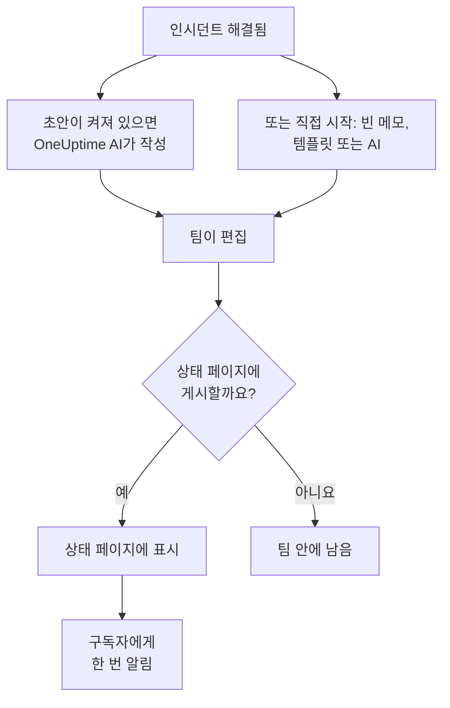

# 포스트모템

포스트모템은 인시던트 이후에 쓰는 정리입니다. 무슨 일이 있었는지, 왜 일어났는지, 사용자에게 어떤 영향을 주었는지, 그리고 이제 무엇을 바꾸는지를 담습니다. OneUptime에서는 인시던트 자체에 포스트모템을 씁니다. 직접 만든 템플릿이나 OneUptime AI의 초안에서 시작할 수 있으며, 인시던트의 마무리 업데이트로 상태 페이지에 게시할 수 있습니다.

:::cards
- [포스트모템 작성](#포스트모템-작성): 인시던트의 포스트모템 페이지에서 다섯 단계로.
- [템플릿이나 AI 초안에서 시작](#템플릿이나-ai-초안에서-시작): 직접 만든 개요, 또는 OneUptime AI가 채우는 개요.
- [상태 페이지에 게시](#상태-페이지에-게시): 고객에게 보여 주고, 구독자에게 한 번 알립니다.
- [에피소드의 포스트모템](#에피소드의-포스트모템): 인시던트 묶음에 대한 하나의 정리.
:::

## 포스트모템의 구성

포스트모템에는 세 부분이 있으며 모두 인시던트에 있습니다. Markdown으로 쓰는 메모, 스크린샷이나 보고서 같은 첨부 파일, 그리고 상태 페이지에 표시할지 여부입니다. 이 세 가지는 인시던트 사이드 메뉴의 **조사** 아래에 있는 **포스트모템** 페이지에 있습니다.

## 포스트모템 작성

:::steps
### 포스트모템 열기

인시던트를 열고 사이드 메뉴의 **조사** 아래에서 **포스트모템**을 클릭합니다. **사후 분석 메모** 카드에 메모, 첨부 파일, 그리고 포스트모템이 상태 페이지에 표시되는지가 나타납니다.

### 사후 분석 노트 편집 클릭

**사후 분석 노트 편집** 대화 상자가 첫 번째 단계인 **포스트모템**에서 열립니다.

### 메모 작성과 파일 첨부

**사후 분석 메모**를 Markdown으로 작성합니다. 무슨 일이 있었는지, 영향, 해결 방법, 후속 조치입니다. 스크린샷, 보고서, 타임라인은 **사후 분석 첨부 파일**에 추가합니다.

### 게시 여부 선택

**다음**을 클릭합니다. **상태 페이지** 단계에서 **상태 페이지에 게시**는 처음에 꺼져 있으므로 포스트모템은 팀 안에 남습니다. 고객에게 보여 주려면 [상태 페이지에 게시](#상태-페이지에-게시)를 참고하세요.

### 포스트모템 저장

**변경 사항 저장**을 클릭합니다. 카드에 메모와 첨부 파일이 표시됩니다.
:::

메모의 모든 변경은 인시던트 피드에 기록되며, 인시던트에 Slack 또는 Microsoft Teams 채널이 있으면 그 채널에도 게시됩니다. 포스트모템이 게시되지 않은 동안에는 상태 페이지 구독자가 그에 대해 듣지 못합니다.

포스트모템을 작성하려면 Project Owner, Project Admin, Project Member, Incident Admin 또는 Incident Member 역할이나, Edit Incident 권한이 있는 사용자 지정 역할이 필요합니다. 인시던트를 읽을 수 있는 사람은 누구나 그 포스트모템을 읽을 수 있습니다.

## 템플릿이나 AI 초안에서 시작

카드의 두 버튼이 메모를 대신 채워 줍니다. **Generate with AI**, 그리고 프로젝트에 포스트모템 템플릿이 생기면 나타나는 **템플릿 적용**입니다. 둘 다 **사후 분석 노트 편집**과 같은 편집기를 메모가 채워진 상태로 열며, 포스트모템의 나머지는 그대로입니다. **변경 사항 저장**을 클릭하기 전에는 아무것도 저장되지 않으므로 먼저 메모를 읽고 고치세요.

### 템플릿 적용

**템플릿 적용**은 프로젝트에 포스트모템 템플릿이 생기면 나타납니다. 템플릿은 **인시던트 → 설정 → 포스트모템 템플릿**에서 만듭니다. [포스트모템 템플릿](/docs/incidents/settings#포스트모템-템플릿)을 참고하세요. OneUptime Cloud에서는 템플릿에 Growth 요금제가 필요합니다.

**템플릿 적용**을 클릭하고 **사후 분석 템플릿 적용** 대화 상자의 **템플릿 선택**에서 템플릿을 고른 다음 **템플릿 적용**을 클릭합니다. 템플릿이 하나뿐인 프로젝트에서는 이미 선택되어 있습니다.

### AI로 생성

**Generate with AI**를 클릭합니다. **Generate Postmortem with AI** 대화 상자의 **템플릿 선택**에는 개요로 **Standard Postmortem**, **Detailed Technical Postmortem**, **Brief Postmortem**이 있고, 그 뒤에 직접 만든 포스트모템 템플릿이 나옵니다. **Template Preview**에 개요가 표시되며, 생성하기 전에 바꿀 수 있습니다.

대화 상자 아래쪽의 **Generate with AI**를 클릭합니다. OneUptime AI가 인시던트(설명, 근본 원인과 해결 조치, 상태 타임라인, 공개 메모와 비공개 메모, Slack 또는 Microsoft Teams 채널의 메시지)를 읽고 개요에 맞춰 포스트모템을 씁니다. 그런 다음 그 결과로 편집기가 열립니다.

생성하려면 **프로젝트 설정 → AI → AI Features**에서 프로젝트의 AI가 켜져 있어야 하고 LLM 공급자가 있어야 합니다. [LLM 공급자](/docs/ai/llm-provider)를 참고하세요. 또한 Project Owner 또는 Project Admin 역할이나, Edit Incident 권한이 있는 사용자 지정 역할이 필요합니다. 다른 역할은 포스트모템을 쓸 수는 있지만 생성할 수는 없습니다.

### 인시던트가 해결되면 OneUptime AI가 초안 작성

**인시던트가 해결되면 포스트모템 초안 작성**이 켜져 있으면 인시던트가 해결될 때마다 OneUptime AI가 포스트모템 초안을 작성해 메모로 저장하고, 팀이 검토할 수 있도록 인시던트 피드에 게시합니다. 이 스위치는 **인시던트 → AI → 설정**에 있으며, 새 프로젝트에서는 켜져 있습니다.

- 이미 작성된 메모를 바꾸지 않습니다.
- 이미 게시된 포스트모템에는 쓰지 않습니다. 그렇게 하면 초안이 검토 없이 상태 페이지에 올라가기 때문입니다.
- 프로젝트의 AI가 켜져 있어야 하며, 프로젝트가 일일 AI 한도에 도달하면 그날은 멈춥니다. [자동 포스트모템](/docs/ai/ai-sre#자동-포스트모템)을 참고하세요.

## 상태 페이지에 게시

게시된 포스트모템은 고객을 위한 인시던트의 마무리 업데이트입니다. 상태 페이지는 인시던트 타임라인에서 메모를 강조해 보여 주며, 첨부 파일을 내려받을 수 있습니다.

:::steps
### 상태 페이지 단계 열기

**사후 분석 노트 편집**을 클릭한 다음 **다음**을 클릭해 **상태 페이지** 단계로 갑니다.

### 상태 페이지에 게시 켜기

**상태 페이지에 게시**를 켭니다. 필드 두 개가 더 나타납니다. 켜져 있는 **구독자에게 알림**과, 지금 시각이 들어 있는 **사후 분석 게시 시각**입니다.

### 누구에게 알릴지, 언제로 표시할지 결정

구독자에게 알리지 않고 게시하려면 **구독자에게 알림**을 끕니다. 포스트모템 옆에 다른 시각을 표시하려면 **사후 분석 게시 시각**을 바꿉니다.

### 게시

**변경 사항 저장**을 클릭합니다. 이제 카드에 **사후 분석을 상태 페이지에 표시하시겠습니까?**, **구독자에게 알림**, **구독자 알림 상태**, **사후 분석 게시 시각**이 표시됩니다.
:::

고객이 포스트모템을 보는지, 소식을 듣는지는 다음에 달려 있습니다.

- **인시던트가 상태 페이지에 표시되어야 합니다.** 상태 페이지는 자신이 보여 주는 인시던트에서만 포스트모템을 보여 줍니다. **상태 페이지에 표시**가 켜져 있고 인시던트가 비공개가 아니어야 합니다.
- **메모에 내용이 있어야 합니다.** 빈 메모로 게시된 포스트모템은 표시되지 않으며, 아무에게도 알리지 않습니다.
- **구독자에게는 한 번만 알립니다.** 상태 페이지가 포스트모템을 처음 보여 줄 때입니다. 다시 저장하거나 게시된 상태에서 편집하면 페이지는 업데이트되지만 아무에게도 알리지 않습니다. 게시를 내렸다가 다시 게시하면 다시 알립니다. 인시던트가 숨겨진 동안 게시된 포스트모템은 인시던트가 표시될 때 보내집니다.
- **구독자에게 알림 설정은 알림을 보낼 때 읽힙니다.** 포스트모템이 게시된 뒤에 켜면 아무것도 보내지 않습니다.

**구독자 알림 상태**는 알림이 나갔는지 보여 주며, 실패하면 **다시 시도**를 제공합니다. 경우별 설명은 [포스트모템](/docs/status-pages/subscribers#포스트모템)을, 그리고 [다시 시도와 다시 보내기](/docs/status-pages/subscribers#다시-시도와-다시-보내기)를 참고하세요.

**사후 분석 게시 시각**은 **포스트모템까지 걸린 시간** 측정에서 포스트모템이 게시된 것으로 보는 시각이기도 합니다. [기성 측정](/docs/incidents/settings#기성-측정)을 참고하세요.

## 에피소드의 포스트모템

인시던트 에피소드에도 **조사** 아래에 **포스트모템** 페이지가 있습니다. 에피소드의 모든 인시던트에 대한 하나의 정리입니다. 작성하려면 **사후 분석 편집**을 클릭합니다. **템플릿 적용**과 **Generate with AI**는 인시던트에서와 똑같이 동작하며, AI는 에피소드와 그 구성 인시던트를 읽습니다.

에피소드의 포스트모템은 메모뿐입니다. 첨부 파일이 없고, 어떤 상태 페이지도 보여 주지 않습니다. 에피소드가 해결되어도 OneUptime AI가 스스로 초안을 쓰지 않습니다. 생성하려면 Project Owner 또는 Project Admin 역할이나, Edit Incident Episode 권한이 있는 사용자 지정 역할이 필요합니다.

알림과 예정된 유지 관리 이벤트에는 포스트모템이 없습니다.

## API로

포스트모템은 인시던트의 필드 묶음이며, 인시던트의 나머지와 마찬가지로 `/api/incident`를 통해 읽고 씁니다.

| 필드 | 의미 |
| --- | --- |
| `postmortemNote` | Markdown으로 작성한 메모. |
| `showPostmortemOnStatusPage` | 포스트모템이 상태 페이지에 게시되었는지 여부. 처음에는 `false`. |
| `notifySubscribersOnPostmortemPublished` | 게시될 때 구독자에게 알리는지 여부. 처음에는 `true`. |
| `postmortemPostedAt` | 상태 페이지가 포스트모템 옆에 표시하는 시각. |

작성된 `postmortemNote`가 있을 때 `showPostmortemOnStatusPage`를 `true`로 쓰면, 대화 상자와 마찬가지로 포스트모템이 게시됩니다.

## 문제 해결

:::details 카드에 템플릿 적용이 없음
프로젝트에 아직 포스트모템 템플릿이 없거나, 역할이 템플릿을 읽을 수 없습니다. **인시던트 → 설정 → 포스트모템 템플릿**에서 만드세요. OneUptime Cloud에서는 템플릿에 Growth 요금제가 필요합니다.
:::

:::details Generate with AI가 AI가 꺼져 있다거나 권한이 없다고 표시함
**프로젝트 설정 → AI → AI Features**에서 AI를 켜세요. 생성하려면 포스트모템을 편집할 수 있는 사람이라도 Project Owner 또는 Project Admin 역할이나, Edit Incident 권한이 있는 사용자 지정 역할이 필요합니다.
:::

:::details 포스트모템이 상태 페이지에 없음
세 가지를 확인하세요. **상태 페이지에 게시**가 켜져 있는지, 메모가 비어 있지 않은지, 인시던트가 상태 페이지에 표시되는지(**상태 페이지에 표시**가 켜져 있고 비공개가 아닌지)입니다.
:::

:::details 구독자가 포스트모템 소식을 받지 못함
게시할 때 **구독자에게 알림**이 꺼져 있었거나, 인시던트가 숨겨져 있습니다. 숨겨진 경우에는 인시던트가 표시되는 즉시 보내집니다. 카드의 **구독자 알림 상태**에서 어느 쪽인지 알 수 있습니다.
:::

:::details 인시던트가 해결됐는데 AI 초안이 나타나지 않음
인시던트에 이미 메모가 있었거나, 포스트모템이 이미 게시되었거나, **인시던트가 해결되면 포스트모템 초안 작성**이 꺼져 있습니다. 프로젝트의 AI가 켜져 있어야 하고, 프로젝트가 일일 AI 한도에 도달하지 않았어야 합니다.
:::

## 다음 단계

:::cards
- [인시던트 개요](/docs/incidents/index): 선언부터 해결까지 인시던트의 다른 페이지.
- [인시던트 설정 및 자동화](/docs/incidents/settings): 포스트모템 템플릿과 포스트모템까지 걸린 시간 측정.
- [구독자 및 공지](/docs/status-pages/subscribers): 상태 페이지가 구독자에게 알리는 모든 것.
- [AI SRE](/docs/ai/ai-sre): 인시던트 이후 OneUptime AI가 스스로 하는 일.
:::
