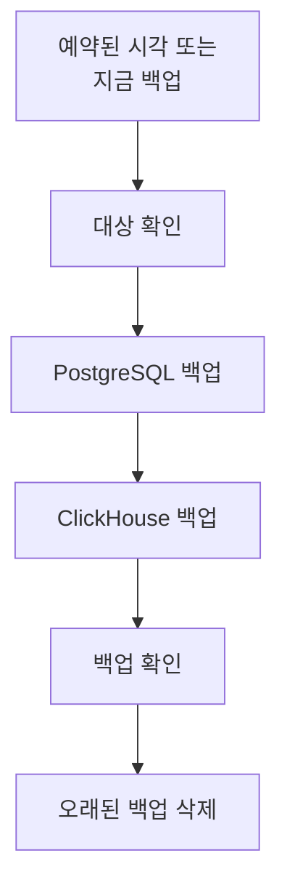

# 백업

자체 호스팅한 OneUptime을 일정에 따라 직접 소유한 스토리지에 백업하고, Admin Dashboard에서 복원합니다. 백업에는 프로젝트, 모니터, 인시던트, 상태 페이지, 사용자를 담은 PostgreSQL과 로그, 트레이스, 메트릭을 담은 ClickHouse가 들어 있습니다. 백업은 선택한 일수만큼 보관되고, 오래된 백업은 자동으로 삭제되며, 어떤 백업이든 그 자리에서 복원할 수 있습니다. 백업은 엔터프라이즈 에디션의 기능입니다.

:::cards
- [백업 설정](#백업-설정): 대상을 선택하고 테스트한 다음 일정을 정합니다.
- [대상](#대상): 각 권장 대상에 필요한 항목.
- [백업 복원](#백업-복원): 무엇이 대체되고 현재 데이터를 어떻게 안전하게 지키는지.
- [새 서버로 이전](#새-서버로-이전): 한 설치의 백업을 다른 설치에서 복원합니다.
:::

## 백업 작동 방식



- **일관성.** PostgreSQL은 하나의 트랜잭션으로 덤프되므로, OneUptime이 계속 실행되는 동안 덤프는 한 시점의 데이터베이스 그대로입니다. ClickHouse는 각 테이블을 그 파트를 읽은 시점의 상태로 백업합니다.
- **대상으로 바로.** `pg_dump`의 출력은 쓰이는 대로 스토리지로 스트리밍되고, ClickHouse는 자체 백업을 스토리지에 직접 씁니다. 데이터 크기와 관계없이 서버 디스크에는 아무것도 쓰지 않습니다.
- **확인 완료.** 백업으로 인정되기 전에 `pg_restore`가 대상에서 덤프를 다시 읽고, ClickHouse가 자신의 백업에 대해 남기는 기록도 대상에서 확인됩니다. 덤프의 SHA-256은 백업과 함께 저장되며, 복원은 무엇이든 바꾸기 전에 이를 확인합니다. 실패하거나 취소된 백업은 쓴 내용을 삭제하므로 대상에는 완전한 백업만 남습니다.
- **암호화.** 백업은 HTTPS로 스토리지에 전송됩니다(`http://` 엔드포인트를 입력한 경우는 제외). Amazon S3, Google Cloud Storage, Azure Blob Storage, Cloudflare R2는 저장하는 모든 것을 암호화합니다. 다른 스토리지에서는 버킷의 저장 데이터 암호화를 켜세요. 대상의 자격 증명은 암호화되어 저장되며 다시 표시되지 않습니다.
- **한 번에 하나씩.** 설치 전체에서 한 번에 하나의 백업이나 복원만 실행됩니다. 나머지는 차례를 기다립니다.

각 백업은 대상 폴더(다른 폴더를 선택하지 않으면 `oneuptime/backups/`) 안의 별도 폴더이며, 시작한 시각(UTC)으로 이름이 붙습니다.

```text
oneuptime/backups/20261024T020000Z-3f2a9c1b/manifest.json
oneuptime/backups/20261024T020000Z-3f2a9c1b/postgres.dump
oneuptime/backups/20261024T020000Z-3f2a9c1b/clickhouse/
```

`manifest.json`은 마지막에 쓰이며, 백업에 무엇이 들어 있는지와 어떤 버전의 OneUptime이 만들었는지를 알려 줍니다.

## 시작하기 전에

- **엔터프라이즈 에디션**과 백업이 포함된 라이선스. 평가판 기간과 유예 기간에는 백업이 실행됩니다. 라이선스가 없으면 새 백업이 만들어지지 않지만, 백업 복원과 삭제는 계속 사용할 수 있습니다. [엔터프라이즈 에디션](/docs/self-hosted/enterprise)을 참고하세요.
- **마스터 관리자.** 백업은 Admin Dashboard에서 설정합니다.
- **백업 전용 버킷 또는 컨테이너**와, 그 안에서 읽기, 쓰기, 나열, 삭제를 할 수 있는 자격 증명.
- **ClickHouse도 접근할 수 있는 대상.** ClickHouse는 백업을 직접 스토리지에 쓰므로, OneUptime의 네트워크와 마찬가지로 ClickHouse의 네트워크도 스토리지에 접근할 수 있어야 합니다.
- **PostgreSQL을 복원하려면 데이터베이스를 만들 수 있는 데이터베이스 사용자.** 복원은 운영 중인 데이터베이스 옆에 새 데이터베이스를 만들어 씁니다. OneUptime과 함께 제공되는 PostgreSQL은 슈퍼유저로 연결하므로 가능합니다.

## 백업 설정

:::steps
### 백업 페이지 열기

Admin Dashboard에서 **설정 → 백업**(으)로 이동한 다음 **백업 설정하기**를 클릭합니다.

### 백업 저장 위치 선택

권장 대상 중 하나를 선택합니다. 각 대상에 필요한 항목은 [대상](#대상)에 있습니다.

### 연결 정보 입력

대상이 요구하는 내용을 입력합니다. 폴더, 지역, 대부분 그대로 두는 설정은 **추가 필드**에 있으며, **설정 가이드**는 이 페이지에서 해당 대상의 섹션을 엽니다.

### 대상 테스트

**대상 테스트**를 클릭합니다. OneUptime은 작은 테스트 파일을 쓰고, 읽고, 나열하고, 삭제하며, `pg_dump`가 PostgreSQL을 백업할 수 있는지 확인하고, ClickHouse에 테이블 정의의 테스트 백업을 쓰도록 요청합니다. 아무것도 저장되지 않으며, 실패한 확인 항목은 무엇을 바꿔야 하는지 알려 줍니다.

### 백업 실행 시점 선택

**빈도**와 **시각(UTC)** 값으로 시각을 선택하고, 매주 백업이라면 **요일**도 선택합니다. **백업 보관 기간(일)** 값은 변경하지 않으면 30입니다. PostgreSQL만 백업하려면 **ClickHouse도 백업**를 끕니다.

### 백업 시작

**백업 시작**를 클릭합니다. 첫 백업은 다음 예약 시각에 실행되며, **지금 백업**로 바로 시작할 수도 있습니다.
:::

그다음 페이지에는 마지막 백업이 언제 실행되었는지, 크기와 소요 시간, 다음 백업이 언제 실행되는지가 표시됩니다. 진행 중인 백업은 현재 단계를 보여 주며, **단계 보기**로 각 단계를 실행되는 대로 확인할 수 있습니다.

## 대상

| 대상 | 스토리지 | 인증 방식 |
| --- | --- | --- |
| [Amazon S3](#amazon-s3) | Amazon S3 | 액세스 키 |
| [Cloudflare R2](#cloudflare-r2) | S3 호환 스토리지 | R2 API 토큰 |
| [Backblaze B2](#backblaze-b2) | S3 호환 스토리지 | 애플리케이션 키 |
| [Wasabi](#wasabi) | S3 호환 스토리지 | 액세스 키 |
| [MinIO](#minio) | S3 호환 스토리지 | 액세스 키 |
| [Google Cloud Storage](#google-cloud-storage) | Google Cloud Storage | HMAC 키 |
| [Azure Blob Storage](#azure-blob-storage) | Azure Blob Storage | SAS 토큰 또는 액세스 키 |
| [기타 S3 호환 스토리지](#기타-s3-호환-스토리지) | S3 호환 스토리지 | 액세스 키 |

Amazon S3 또는 기타 S3 호환 스토리지의 키에는 폴더에 대한 `s3:PutObject`, `s3:GetObject`, `s3:ListBucket`, `s3:DeleteObject`, `s3:AbortMultipartUpload` 권한이 필요하며, 그 밖의 권한은 필요하지 않습니다.

```json
{
  "Version": "2012-10-17",
  "Statement": [
    {
      "Effect": "Allow",
      "Action": "s3:ListBucket",
      "Resource": "arn:aws:s3:::my-backups"
    },
    {
      "Effect": "Allow",
      "Action": [
        "s3:PutObject",
        "s3:GetObject",
        "s3:DeleteObject",
        "s3:AbortMultipartUpload"
      ],
      "Resource": "arn:aws:s3:::my-backups/oneuptime/backups/*"
    }
  ]
}
```

### Amazon S3

| 필드 | 입력할 내용 |
| --- | --- |
| **Bucket** | 백업을 기록할 버킷입니다. 백업 전용으로 사용하세요. |
| **지역** | 버킷의 지역입니다. 처음에는 `us-east-1`입니다. |
| **액세스 키 ID** | 위의 권한이 있는 액세스 키입니다. |
| **비밀 액세스 키** | 키의 시크릿입니다. |
| **폴더** | **추가 필드**에 있습니다. 비워 두면 백업은 `oneuptime/backups/`에 저장됩니다. |

Amazon S3는 저장하는 모든 파일을 암호화하며, OneUptime은 쓰는 모든 파일에 대해 이를(SSE-S3) 요청합니다.

### Cloudflare R2

**엔드포인트**에 R2의 버킷 설정에 있는 계정의 S3 API 주소 `https://<account-id>.r2.cloudflarestorage.com`을 입력합니다. 그런 다음 **Bucket**과, 그 안의 객체를 읽고 쓸 수 있는 R2 API 토큰의 **액세스 키 ID**와 **비밀 액세스 키**를 입력합니다. R2에서 백업을 다시 읽는 데는 요금이 들지 않습니다.

### Backblaze B2

**엔드포인트**에 Backblaze의 버킷 Buckets 페이지에 표시되는 S3 엔드포인트(예: `https://s3.us-west-004.backblazeb2.com`)를 입력합니다. 그런 다음 **Bucket**을 입력하고, 애플리케이션 키의 키 ID와 키를 **액세스 키 ID**와 **비밀 액세스 키**에 입력합니다. 지역은 엔드포인트에서 읽습니다.

### Wasabi

**엔드포인트**에 버킷 지역의 서비스 URL(예: `https://s3.us-east-1.wasabisys.com`)을 입력한 다음 **Bucket**과 액세스 키를 입력합니다. 지역은 엔드포인트에서 읽습니다.

### MinIO

**엔드포인트**에 MinIO 서버의 S3 API 주소(예: `https://minio.example.com:9000`)를 입력한 다음 **Bucket**과, 그 안에서 읽기, 쓰기, 나열, 삭제를 할 수 있는 정책이 있는 액세스 키를 입력합니다. OneUptime과 ClickHouse 모두 이 주소에 접근할 수 있어야 합니다.

### Google Cloud Storage

**Bucket**과, 버킷에 대한 Storage Object Admin 역할이 있는 서비스 계정의 **HMAC 액세스 키**와 **HMAC 시크릿**을 입력합니다. 키는 Cloud Storage 설정의 상호 운용성 탭에서 만듭니다. OneUptime과 ClickHouse는 Cloud Storage의 S3 호환 API를 통해 버킷에 접근합니다.

### Azure Blob Storage

**스토리지 계정**와 **컨테이너**를 입력하고, **로그인 방법**에서 인증 방식을 선택합니다. 컨테이너에 대한 읽기, 추가, 만들기, 쓰기, 삭제, 나열 권한이 있는 **SAS 토큰**이나 스토리지 계정의 **액세스 키**입니다. SAS 토큰은 컨테이너로 제한할 수 있으므로 더 안전한 선택입니다. **클라우드**와 **폴더**는 **추가 필드**에 있습니다.

### 기타 S3 호환 스토리지

Ceph, DigitalOcean Spaces, Hetzner Object Storage 등 S3 API가 있는 스토리지라면, 그 S3 주소를 **엔드포인트**에 입력한 다음 **Bucket**과 액세스 키를 입력합니다. **추가 필드**에 있는 **지역**은 스토리지가 요구할 때만 필요합니다. 비워 두면 엔드포인트에서 읽고, 읽을 수 없으면 `us-east-1`을 사용합니다.

## 일정과 보관

| 설정 | 하는 일 |
| --- | --- |
| **빈도** | **매시간**, **6시간마다**, **12시간마다**, **매일**, **매주** 중 하나입니다. 대부분의 설치에는 매일이면 충분합니다. |
| **시각(UTC)** | 백업을 시작하는 시각(UTC)이며, 옆에 현지 시각이 표시됩니다. 6시간 또는 12시간 간격은 이 시각부터 계산합니다. `02:00`이라면 6시간마다 백업은 02:00, 08:00, 14:00, 20:00에 실행됩니다. 매시간 백업은 정각에 실행됩니다. |
| **요일** | 매주 백업이 실행되는 요일입니다. |
| **백업 보관 기간(일)** | 1일부터 3650일까지입니다. 변경하지 않으면 30일입니다. |
| **ClickHouse도 백업** | 끄지 않으면 켜져 있습니다. PostgreSQL은 항상 백업됩니다. |

각 백업이 끝나면 **백업 보관 기간(일)** 값보다 오래전에 시작된 백업이 대상과 목록에서 삭제됩니다. 단, 성공한 최신 백업은 아무리 오래되어도 남습니다. 따라서 백업을 끄거나 라이선스가 만료되어도 복원할 백업이 없어지는 일은 없습니다.

상태 카드 메뉴의 **예약된 백업 끄기**는 일정을 멈춥니다. **지금 백업**는 계속 사용할 수 있으며 백업은 삭제되지 않습니다. **켜기**으로 일정을 다시 시작합니다.

## 백업 복원

:::warning 복원이 대체하는 것
복원하면 현재 데이터가 백업의 데이터로 대체됩니다. 먼저 현재 데이터를 백업하지 않으면, 백업을 만든 이후 변경된 내용은 모두 사라집니다.
:::

:::steps
### 백업 선택

**백업** 테이블에서 되돌아갈 백업의 **복원**를 클릭합니다. OneUptime은 먼저 백업을 확인합니다. 파일이 대상에 그대로 있는지, 어떤 버전의 OneUptime이 만들었는지, 이 서버에서 복원할 수 있는지를 확인합니다.

### 복원할 항목 선택

**PostgreSQL: 프로젝트, 모니터, 인시던트, 사용자**, **ClickHouse: 로그, 트레이스, 메트릭** 또는 둘 다를 선택합니다. 대화 상자에는 백업에 들어 있는 프로젝트, 사용자, 모니터 수와 현재 수가 표시됩니다.

### 현재 데이터 보호

**먼저 현재 데이터 백업**가 선택되어 있습니다. 복원은 대체할 데이터의 백업으로 시작하므로 다시 되돌아갈 수 있습니다. 다른 사본이 있을 때만 선택을 해제하세요. 해제하면 복원을 되돌릴 수 없습니다.

### 확인

`restore`를 입력하고 **복원**를 클릭합니다.
:::

복원은 단계별로 실행되며, 페이지에 각 단계가 표시됩니다.

| 단계 | 일어나는 일 |
| --- | --- |
| **백업 확인** | 백업의 파일이 모두 있고, 이 설치에서 복원할 수 있습니다. |
| **현재 데이터 백업** | 선택을 해제하지 않았다면 현재 데이터를 백업합니다. |
| **PostgreSQL 복원** | 운영 중인 데이터베이스 옆의 새 데이터베이스에 백업을 복원하고 확인합니다. |
| **ClickHouse 복원** | 운영 중인 텔레메트리를 따로 옮겨 두고, 그 자리에 백업의 텔레메트리를 복원합니다. |
| **복원된 데이터로 전환** | 복원된 데이터베이스가 잠깐 사이에 운영 중인 데이터베이스의 이름을 넘겨받습니다. |
| **복원된 데이터를 최신 상태로 업데이트** | 이 버전의 데이터베이스 마이그레이션이 복원된 데이터에서 실행됩니다. |
| **정리** | 따로 옮겨 둔 것을 삭제합니다. |

전환될 때까지 OneUptime은 현재 데이터로 계속 실행되며, 그전에는 OneUptime이 사용하는 것이 아무것도 바뀌지 않습니다. 전환 전에 실패하거나 취소된 복원은 모든 것을 그대로 두고, 전환 중에 실패한 복원은 따로 옮겨 둔 것을 되돌려 놓습니다. ClickHouse를 복원하는 동안 들어온 텔레메트리는 저장되지 않습니다. PostgreSQL을 복원한 후에는 로그아웃될 수 있습니다. 백업에 있는 계정으로 로그인하세요.

:::details 다른 ENCRYPTION_SECRET으로 만든 백업이라고 표시됩니다
OneUptime이 저장하는 자격 증명(예: 대상의 키)은 `ENCRYPTION_SECRET`으로 암호화됩니다. 복원하기 전에 백업을 만들 때 사용한 `ENCRYPTION_SECRET`을 설정하세요. 그렇지 않으면 복원 후 해당 자격 증명을 읽을 수 없습니다.
:::

## 새 서버로 이전

:::steps
### 새 서버에 OneUptime 설치

백업을 만든 버전이나 그보다 새 버전의 엔터프라이즈 에디션을 설치합니다.

### 같은 대상 설정

**설정 → 백업**에서 백업이 있는 대상을 설정합니다. 페이지는 이미 그곳에 있는 백업을 찾아 목록에 표시하므로 바로 복원할 수 있습니다. 상태 카드 메뉴의 **백업 찾기**로 다시 찾을 수 있습니다.

### 최신 백업 복원

위와 같이 복원합니다. 이전 버전의 OneUptime이 만든 백업은 이 버전으로 업데이트됩니다. 최신 버전이 만든 백업은 OneUptime을 업데이트한 후 복원할 수 있습니다.
:::

## 백업이 실패하면

상태 카드에 오류와 함께 **마지막 백업이 실패했습니다**가 표시되며, **단계 보기**에서 멈춘 단계와 이유를 확인할 수 있습니다. 또한 모든 마스터 관리자에게 이메일이 전송되며, 백업이 계속 실패하는 동안에는 12시간에 한 번까지만 전송됩니다. 복원이 실패하면 항상 이메일로 알립니다.

## 문제 해결

:::details ClickHouse가 대상에 접근할 수 없습니다
ClickHouse는 스토리지에 직접 연결합니다. OneUptime의 네트워크처럼 ClickHouse의 네트워크도 대상 주소에 접근할 수 있게 한 다음, 대상을 다시 테스트하세요.
:::

:::details pg_dump가 없거나 너무 오래되었습니다
엔터프라이즈 이미지에는 `pg_dump`와 `pg_restore` 16, 17, 18이 들어 있어 PostgreSQL 18과 그 이전의 모든 버전을 백업합니다. 다른 이미지에서는 PostgreSQL 클라이언트 도구를 설치하거나, 도구가 있는 디렉터리를 `BACKUP_POSTGRES_BIN_DIR`에 설정하세요. `pg_dump`는 PostgreSQL 서버와 같거나 그보다 새 버전이어야 합니다.
:::

:::details PostgreSQL을 복원하려면 한 가지를 변경해야 합니다
복원은 데이터베이스를 만들므로 OneUptime의 데이터베이스 사용자에게 그 권한이 있어야 합니다. 슈퍼유저로 PostgreSQL에서 다음을 실행하고(`oneuptime`은 자신의 `DATABASE_USERNAME`으로 바꿉니다), 다시 복원하세요.

```sql
ALTER USER oneuptime CREATEDB;
```
:::

:::details 백업이 이전 대상에 있습니다
대상을 바꾼 후에도 이전 대상에서 만든 백업은 **이전 대상에 있음**로 표시되어 목록에 남습니다. 복원하려면 그 대상을 다시 설정하거나, 목록에서 삭제하세요. 파일은 원래 위치에 그대로 남습니다.
:::

## 다음 단계

:::cards
- [엔터프라이즈 에디션](/docs/self-hosted/enterprise): 라이선스와 엔터프라이즈 에디션이 추가하는 기능.
- [업그레이드](/docs/installation/upgrading): 업그레이드할 때마다 먼저 백업하세요.
- [Docker Compose](/docs/installation/docker-compose): 한 대의 서버에서 OneUptime을 운영합니다.
:::
