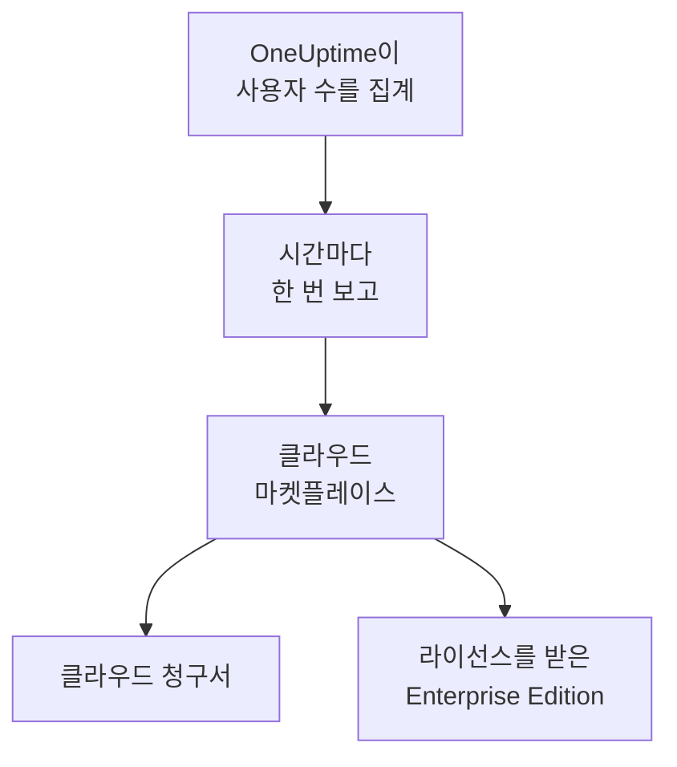

# 클라우드 마켓플레이스

AWS Marketplace, Microsoft Marketplace 또는 Google Cloud Marketplace에서 구매한 OneUptime Enterprise를 직접 운영하는 Kubernetes 클러스터에서 실행합니다. 마켓플레이스는 설치의 모든 사용자에 대한 요금을 시간 단위로 클라우드 청구서에 청구하며, 구독이 곧 Enterprise Edition의 라이선스가 되므로 활성화할 라이선스 키가 없습니다.

:::cards
- [OneUptime 설치](#oneuptime-설치): Amazon EKS, Azure Kubernetes Service 또는 Google Kubernetes Engine에 설치합니다.
- [요금이 청구되는 방식](#요금이-청구되는-방식): 사용자 1명당 시간당 USD 0.10이며, 매시간 보고됩니다.
- [업그레이드](#업그레이드): 새 릴리스가 클러스터에 반영되는 방식.
- [문제 해결](#문제-해결): 에디션 라벨이 마켓플레이스에 대해 경고할 때.
:::

## 작동 방식

OneUptime은 15분마다 사용자 수를 세고, 구매한 마켓플레이스에 매시간 한 번, 그 시간 동안 확인한 최대 사용자 수를 보고합니다. 마켓플레이스는 그 시간만큼의 요금을 클라우드 청구서에 추가합니다. 마켓플레이스가 보고를 받아들일 때마다 구독이 활성 상태라는 사실도 OneUptime에 전달되며, 그 덕분에 Enterprise Edition의 라이선스가 유지됩니다.



| | AWS | Microsoft | Google Cloud |
| --- | --- | --- | --- |
| 리스팅 | 아직 공개되지 않음 ([문의하기](https://oneuptime.com/enterprise/demo)) | [OneUptime Enterprise](https://marketplace.microsoft.com/en-us/product/oneupitme.oneuptime-enterprise) | 아직 공개되지 않음 ([문의하기](https://oneuptime.com/enterprise/demo)) |
| 실행 환경 | Amazon EKS | Azure Kubernetes Service (AKS) | Google Kubernetes Engine (GKE) |
| 설치 방법 | 리스팅의 레지스트리에서 Helm으로 | Azure portal | Google Cloud 콘솔 |
| OneUptime이 보고에 쓰는 것 | Kubernetes 서비스 계정의 IAM 역할 | Azure가 설치에 부여하는 관리 ID | Google Cloud Marketplace가 배포용으로 만드는 보고용 시크릿 |
| 새 릴리스 | Helm으로 직접 업그레이드 | 마이너 릴리스는 자동으로 설치됨 | 수동으로 업그레이드 |

## 시작하기 전에

- 마켓플레이스의 클라우드에 있는 **Kubernetes 클러스터**. 4 vCPU와 16 GiB 메모리를 갖춘 노드가 3개 이상 있고, 기본 StorageClass가 있으며, `LoadBalancer` 서비스를 지원해야 합니다. OneUptime은 자체 PostgreSQL, ClickHouse, Valkey를 클러스터 안에서 실행합니다. 그 크기는 [사이징 및 용량 계획](/docs/installation/sizing)을 참고해 정하세요.
- 클러스터의 로드 밸런서를 가리키게 할 수 있는 OneUptime용 **도메인 이름**(예: `oneuptime.example.com`).
- 클러스터에서 마켓플레이스로 **나가는 HTTPS**. OneUptime이 사용자 수를 보고하려면 필요합니다. 대상은 AWS에서는 `metering.marketplace.<region>.amazonaws.com`과 `sts.<region>.amazonaws.com`, Azure에서는 `marketplaceapi.microsoft.com`, Google Cloud에서는 `servicecontrol.googleapis.com`과 `oauth2.googleapis.com`입니다.

## OneUptime 설치

### AWS Marketplace

AWS에서 OneUptime은 EKS가 Kubernetes 서비스 계정에 부여하는 IAM 역할(서비스 계정에 대한 IAM 역할)로 사용자 수를 보고합니다. AWS Marketplace는 이렇게 서명된 경우에만 EKS의 사용량을 받아들입니다.

:::steps
1. AWS Marketplace에서 OneUptime Enterprise를 구독한 다음, **Continue to Configuration**을 선택하고 버전을 고른 뒤 **Continue to Launch**를 선택합니다.
2. 클러스터에 아직 IAM OIDC 공급자가 없다면 연결하고, 아래 명령으로 `AWSMarketplaceMeteringFullAccess` 정책이 있는 IAM 역할과 함께 `oneuptime` 서비스 계정을 만듭니다. 이 명령들은 시작 페이지의 **General launch instructions** 1단계에 있는 `eksctl` 명령 대신 실행합니다. 그 명령은 먼저 직접 만들어 두어야 하는 역할을 연결합니다.
3. **General launch instructions** 2단계의 명령으로 Helm을 리스팅의 레지스트리에 로그인시키고 차트를 설치합니다. `helm install` 명령에서 `serviceAccount.name`은 `oneuptime`으로, `host`는 도메인 이름으로, OneUptime 앞에 인증서가 있다면 `httpProtocol`은 `https`로 설정합니다.
4. [OneUptime을 엽니다](#oneuptime-열기).
:::

```bash
eksctl utils associate-iam-oidc-provider --cluster <cluster> --approve
eksctl create iamserviceaccount --name oneuptime --namespace oneuptime --cluster <cluster> \
  --attach-policy-arn arn:aws:iam::aws:policy/AWSMarketplaceMeteringFullAccess \
  --approve --override-existing-serviceaccounts
```

3단계의 값은 파일에 보관해 두고, `helm upgrade`를 실행할 때마다 전달합니다.

```yaml title="values.yaml"
host: oneuptime.example.com
httpProtocol: https
serviceAccount:
  name: oneuptime
```

### Microsoft Marketplace

Azure에서 OneUptime은 Kubernetes 애플리케이션입니다. AKS가 이를 클러스터 확장으로 설치하고, 사용자 수를 보고하는 데 쓰는 관리 ID를 부여합니다.

:::steps
1. Azure portal에서 Microsoft Marketplace의 OneUptime Enterprise를 열거나, AKS 클러스터를 열고 **Extensions + applications** > **Add**를 선택합니다. 그런 다음 플랜을 고르고 **Create**를 선택합니다.
2. 구독과 리소스 그룹을 선택하고, 기존 AKS 클러스터에 설치할지 새 클러스터를 만들지 선택합니다.
3. **OneUptime** 단계에서 설치 이름, 도메인 이름과 그 프로토콜을 입력합니다.
4. **Review + create**를 선택한 다음 **Create**를 선택합니다. 설치에는 몇 분이 걸리며, **Extensions + applications**에 프로비저닝 상태가 **Succeeded**로 표시되면 완료된 것입니다.
5. [OneUptime을 엽니다](#oneuptime-열기).
:::

사용자 지정 미터는 AKS 클러스터에서는 동작하지만 Azure Arc 지원 Kubernetes에서는 동작하지 않으므로, Microsoft Marketplace의 OneUptime Enterprise는 AKS에만 설치할 수 있습니다.

### Google Cloud Marketplace

Google Cloud에서는 Marketplace가 배포 도구를 실행합니다. 배포 도구는 선택한 네임스페이스에 OneUptime을 설치하고, OneUptime이 사용자 수를 보고할 때 쓰는 보고용 시크릿도 함께 만듭니다.

:::steps
1. Google Cloud 콘솔에서 Google Cloud Marketplace의 OneUptime Enterprise를 열고 **Configure**를 선택합니다.
2. GKE 클러스터와 네임스페이스를 선택하고, 설치 이름, 도메인 이름과 그 프로토콜을 입력합니다.
3. **Deploy**를 선택합니다. 배포에는 몇 분이 걸리며, **Kubernetes Engine** > **Applications**에서 애플리케이션이 준비됨으로 표시되면 완료된 것입니다.
4. [OneUptime을 엽니다](#oneuptime-열기).
:::

## OneUptime 열기

OneUptime은 시작하면서 먼저 데이터베이스를 마이그레이션하며, 새 설치에서는 몇 분이 걸립니다. 그런 다음 도메인 이름이 OneUptime의 로드 밸런서를 가리키게 합니다.

```bash
kubectl get service --namespace <namespace>
```

이름이 `-nginx`로 끝나는 서비스에 `EXTERNAL-IP`가 있습니다. 도메인 이름에 대해 이 주소를 가리키는 DNS 레코드를 만드세요. 도메인 이름을 열고 가입합니다. 새 설치의 첫 계정은 마스터 관리자가 되며, `/admin`에서 관리자 대시보드를 열 수 있습니다.

1시간 안에 에디션 라벨에 마켓플레이스를 통해 라이선스를 받은 Enterprise Edition이 표시됩니다. 마스터 관리자는 관리자 대시보드 헤더와 Dashboard 바닥글에서 에디션 라벨을 봅니다.

## 요금이 청구되는 방식

| 항목 | 방식 |
| --- | --- |
| 가격 | 사용자 1명당 시간당 USD 0.10, 한 달 기준으로는 사용자 1명당 약 USD 73입니다. |
| 집계 대상 | 설치에서 OneUptime에 로그인할 수 있는 모든 사람. 상태 페이지 구독자와 비공개 상태 페이지에 로그인하는 사람은 집계하지 않습니다. |
| 시점 | OneUptime은 15분마다 사용자 수를 세고, 매시간 한 번, 그 시간 동안 확인한 최대 사용자 수를 보고합니다. OneUptime이 실행되지 않은 시간에는 요금이 청구되지 않습니다. |
| 청구되는 곳 | 마켓플레이스를 통해 AWS, Azure 또는 Google Cloud 청구서에 청구됩니다. |
| 포함되지 않는 것 | 클러스터 자체. 노드, 디스크, 로드 밸런서는 평소처럼 클라우드에서 청구됩니다. |

설치마다 따로 요금이 청구되므로 스테이징 설치에도 요금이 청구됩니다. 연간 요금, 볼륨 할인 또는 비프로덕션 설치용 가격이 필요하면 [sales@oneuptime.com](mailto:sales@oneuptime.com)에 프라이빗 오퍼를 요청하세요. 프라이빗 오퍼는 마켓플레이스에서 수락합니다.

네트워크 문제나 마켓플레이스 장애로 보고를 보내지 못하면 OneUptime이 다음 실행 때 다시 보냅니다. 모든 보고에는 해당 시간을 나타내는 키가 붙어 있으므로, 같은 시간에 요금이 두 번 청구되는 일은 없습니다.

## 라이선스가 동작하는 방식

마켓플레이스 구독이 곧 라이선스입니다. 마켓플레이스가 보고를 하나 받아들일 때마다, 이후 72시간 동안 모든 사용자에게 모든 엔터프라이즈 기능의 라이선스가 부여됩니다. OneUptime에서 받은 라이선스 키도 같은 설치에서 동작하며, 이 경우 설치는 둘 중 더 유리한 쪽으로 실행됩니다.

| 일어나는 일 | 에디션 라벨에 표시되는 것 |
| --- | --- |
| 마켓플레이스가 매시간의 보고를 받아들임 | 마켓플레이스를 통해 라이선스를 받은 Enterprise Edition. |
| 72시간 동안 받아들여진 보고가 없음 | **Enterprise Edition (Marketplace Reports Failing)**: 30일 유예 기간 동안 모든 엔터프라이즈 기능이 계속 동작합니다. |
| 마켓플레이스가 이 설치는 구독되어 있지 않다고 응답하거나, 유예 기간이 끝남 | **Enterprise Edition (Marketplace Subscription Ended)**: [라이선스가 만료될](/docs/self-hosted/enterprise#라이선스가-만료되었거나-없을-때) 때와 마찬가지로 엔터프라이즈 기능이 멈춥니다. |

마켓플레이스가 거부하는 것은 해지되거나 일시 중지된 구독, 또는 구매한 설치가 아닌 설치입니다. 어떤 경우에도 모니터링, 알림, 인시던트, 온콜, 상태 페이지는 계속 동작하며, 아무것도 삭제되지 않습니다. 다시 구독하면 다음 보고가 받아들여지는 즉시 Enterprise Edition의 라이선스가 다시 부여되며, 다시 시작할 필요는 없습니다.

## 업그레이드

| 마켓플레이스 | 새 릴리스가 클러스터에 반영되는 방식 |
| --- | --- |
| AWS Marketplace | 각 릴리스는 리스팅의 새 버전입니다. 리스팅의 레지스트리에 있는 차트, 새 버전, 값 파일을 지정해 `helm upgrade`를 실행하세요. |
| Microsoft Marketplace | 새 마이너 릴리스와 패치 릴리스는 AKS가 자동으로 설치합니다. 새 메이저 릴리스는 수락할 때까지 기다립니다. 자동 업그레이드는 **Extensions + applications**에 있는 설치 페이지에서 끌 수 있습니다. |
| Google Cloud Marketplace | Google Cloud Marketplace는 배포를 설치한 버전 그대로 두며, 업데이트하지 않습니다. 배포를 새 버전으로 옮기기 전에 [지원팀](https://oneuptime.com/support)에 문의하세요. |

OneUptime은 새 릴리스가 시작될 때 데이터베이스를 마이그레이션합니다. 새 메이저 릴리스로 옮기기 전에 [업그레이드 노트](/docs/installation/upgrading)를 읽으세요.

업그레이드는 마켓플레이스를 통해 하세요. 마켓플레이스 설치는 GitHub의 OneUptime 릴리스와 자신을 비교하지 않습니다. 마켓플레이스가 제공하는 버전이 업그레이드할 버전입니다.

## 설정과 확장

규모를 키워도 청구 금액은 바뀌지 않습니다. OneUptime은 사용자 단위로 요금이 청구되기 때문입니다. 복제본을 늘리거나 노드를 키우면 클라우드가 클러스터에 대해 청구하는 금액만 달라집니다.

| 마켓플레이스 | 설정이 있는 곳 |
| --- | --- |
| AWS Marketplace | 값 파일. 함께 제공되는 오퍼레이터를 제외하고 [Helm 차트](https://artifacthub.io/packages/helm/oneuptime/oneuptime)의 모든 설정이 동작합니다. |
| Microsoft Marketplace | 설치의 구성 설정. **Extensions + applications**에 있는 설치 페이지에서, 또는 `az k8s-extension update --configuration-settings`로 바꿉니다. 각 설정은 `autoscaling.enabled=true` 같은 차트 값입니다. |
| Google Cloud Marketplace | 배포 양식의 필드. 그 밖의 것은 배포 자체의 리소스에서 `kubectl`로 바꿉니다. |

- **OneUptime을 확장하려면** 차트의 복제본 및 자동 확장 설정(`deployment.replicaCount`, `autoscaling.enabled`, 각 서비스 자체의 재정의)을 사용하고, 노드는 클러스터의 자동 확장기로 확장하세요.
- **마켓플레이스 설정은 리스팅이 정한 그대로 두세요**: `enterpriseMarketplace`와, AWS에서는 `serviceAccount`입니다. 이 설정이 없으면 OneUptime이 보고할 수 없고, Enterprise Edition의 라이선스도 부여되지 않습니다.
- **KEDA, CloudNativePG, Altinity ClickHouse 오퍼레이터는 포함되지 않습니다**. 마켓플레이스는 리스팅에 있는 이미지만 제공하기 때문입니다. 고가용성 데이터 저장소가 필요하면 `externalPostgres`, `externalRedis`, `externalClickhouse`로 OneUptime이 관리형 서비스를 가리키게 하세요.

청구는 실행 중인 복제본 수와 관계없습니다. 한 번에 하나의 실행만 보고하며, 각 시간의 보고는 하나뿐이기 때문입니다.

## 문제 해결

:::details 에디션 라벨에 Enterprise Edition (Marketplace Reports Failing)이 표시됩니다
OneUptime이 마켓플레이스에 보고하지 못하고 있습니다. 이에 관해 OneUptime이 남기는 로그 줄은 모두 `OneUptime Enterprise marketplace billing`으로 시작하며, 사용량을 "cannot be reported"라고 하는 줄에 무엇이 빠졌는지가 나옵니다. 흔한 원인은 다음과 같습니다.

- **AWS:** `oneuptime` 서비스 계정에 IAM 역할이 없거나, 역할에 `AWSMarketplaceMeteringFullAccess` 정책이 없습니다(`AWSMarketplaceMeteringRegisterUsage`만으로는 부족합니다). 역할에 정책을 연결하거나, [AWS Marketplace](#aws-marketplace)의 `eksctl` 명령으로 역할을 만든 뒤 `kubectl rollout restart deployment --namespace oneuptime`으로 OneUptime의 파드를 다시 시작하세요.
- **Azure:** 설치가 Microsoft Marketplace 애플리케이션이 아니어서(예를 들어 Helm으로 설치한 경우) 보고에 쓸 ID도 플랜도 없습니다. Azure portal에서 설치하세요.
- **Google Cloud:** 배포의 보고용 시크릿이 삭제되었거나 교체되었습니다.
- **모든 마켓플레이스:** 방화벽이나 프록시가 나가는 HTTPS([시작하기 전에](#시작하기-전에) 참고)를 차단하고 있습니다.

문제를 고치는 동안 사용량은 보관되며, OneUptime이 다시 보고할 수 있게 되면 청구됩니다. 30일보다 오래된 사용량은 청구되지 않습니다.
:::

:::details 에디션 라벨에 Enterprise Edition (Marketplace Subscription Ended)가 표시됩니다
마켓플레이스가 설치를 거부했습니다. 구독이 해지되었거나 일시 중지되었거나, 설치가 마켓플레이스에서 구매한 설치가 아닙니다. 마켓플레이스에서 구독을 확인하고 다시 구독하세요. 다음으로 받아들여진 보고가 Enterprise Edition의 라이선스를 다시 부여합니다. 유예 기간 내내 보고가 계속 실패했을 때도 같은 라벨이 표시됩니다.
:::

:::details 설치 후 파드가 Pending 상태로 남아 있습니다
OneUptime의 데이터베이스에는 영구 볼륨이 필요합니다. 클러스터에 기본 StorageClass를 두세요. Amazon EKS에서는 Amazon EBS CSI 드라이버 추가 기능을 설치합니다.
:::

## 다음 단계

:::cards
- [엔터프라이즈 에디션](/docs/self-hosted/enterprise): Enterprise Edition이 더하는 것과 라이선스가 만료되면 멈추는 것.
- [업그레이드](/docs/installation/upgrading): 각 릴리스의 업그레이드 노트.
- [사이징 및 용량 계획](/docs/installation/sizing): 텔레메트리에 맞춰 데이터 저장소를 사이징합니다.
- [아키텍처](/docs/self-hosted/architecture): 클러스터에서 실행되는 것.
- [Kubernetes 에이전트](/docs/telemetry/kubernetes-agent#amazon-eks-추가-기능으로-설치): OneUptime으로 데이터를 보내는 클러스터를 위해 AWS Marketplace에서도 Amazon EKS 추가 기능으로 무료로 제공됩니다.
:::
